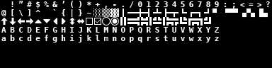

# Part 0: Introduction and Setup

## What You Will Build

By the end of this part, you will have a Python project with `uv`, `tcod`, and `numpy` installed, a small script that proves tcod works, and the font image the game will use. The game window opens in Part 1, and every later chapter builds on this project.

## Learning goals

In this part we will:

- See what makes a game a roguelike, and which kind of roguelike we are going to build
- Create a Python project and install tcod and numpy
- Run a short script that shows tcod works
- Download the font that the game will use

---

## Background

This section is for reading; there is nothing to type yet. If you want to start building right away, skip to [Setup](#setup). You can come back here at any time, even after you finish the tutorial, when you know the game from the inside and some of these ideas will mean more.

### What is a roguelike?

The genre is named after *Rogue* (1980), a dungeon game that made several ideas popular:

- **Procedural generation**: the dungeon is different every run
- **Permadeath**: when your character dies, the run ends and you start a new game
- **Turn-based**: time only passes when you act
- **Tile-based**: the world is a grid
- **Resource management**: health, items, and position all matter

Games like *NetHack*, *Dungeon Crawl Stone Soup*, *Brogue*, and *Caves of Qud* all follow this tradition. Over the years, the word "roguelike" has also come to describe very different games. *Spelunky* and *The Binding of Isaac* are often called roguelikes, but many players and developers call them *roguelites*. In this tutorial we build a traditional roguelike: grid-based, turn-based, with permadeath and procedural dungeons.

!!! info "The Berlin Interpretation"
    In 2008, at a roguelike development conference in Berlin, a group of developers wrote down the traits they considered typical of a "true" roguelike. Their list of high-value traits includes procedural environments, permadeath, turn-based play, grid-based movement, and resource management. We will build all five.

!!! info "Roguelike vs. roguelite"
    A **roguelite** keeps some roguelike traits (procedural levels, permadeath, short runs). Its main addition is **meta-progression**: currency, unlocks, or permanent upgrades that stay after you die, so you get stronger over many runs. Most roguelites also use **real-time action** instead of turn-based tactics. *Hades*, *Dead Cells*, and *The Binding of Isaac* are popular examples.

    They are great games, but they follow different design goals than the game we build here. If you ever want "permanent upgrades between runs", you are designing a roguelite, not a roguelike. Both are valid; just know which one you want.

### Why Python and tcod?

**Python** is easy to read and write, so we can focus on how the game is built instead of on the language.

**tcod** (also called *python-tcod*) is a library made for roguelikes. It provides:

- A console renderer (draws characters and colors to the screen)
- A tileset system (maps font images to Unicode characters)
- FOV (field of view) computation
- Pathfinding
- Input handling

tcod is the Python version of libtcod, a C library for roguelikes. The classic RogueBasin tutorials that inspired this one also used libtcod, through its older Python bindings (`libtcodpy`).

### How the project will be organized

As the tutorial progresses, we add files step by step. To give you a map, here is the shape of the project at the end of Part 5. Later parts add more files and move some of these into subfolders:

```text
roguelike-tutorial/
  main.py                ← entry point: creates the window and starts the game
  res/
    dejavu12x12_gs_tc.png
  game/
    __init__.py          ← marks `game/` as a Python package
    engine.py            ← the central game object (handles events, render loop)
    entity.py            ← generic game object (player, enemies, items)
    entity_factories.py  ← ready-made entities (player, orc, troll)
    input_handlers.py    ← translates key presses into actions
    actions.py           ← things the player (or AI) can do
    map/                 ← map storage, tile definitions, and generation
      __init__.py
      game_map.py        ← the tile grid
      tile_types.py      ← tile definitions (floor, wall, ...)
      map_generator.py   ← dungeon generator
    data/                ← game data (sprites, colors, key bindings)
      __init__.py
      sprites.py         ← single-character glyphs (PLAYER, ORC, TROLL, ...)
      colors.py          ← RGB colors (PLAYER, ORC, TROLL, ...)
      keys.py            ← key bindings (movement, wait, quit)
    components/          ← reusable pieces of behavior
      __init__.py
      ai.py              ← enemy behavior
  pyproject.toml
```

Each part of this layout has a reason:

- `main.py` stays at the root and stays small; it only starts the game.
- `game/` is a Python package that holds all the game modules.
- `res/` keeps static assets (fonts, images) apart from the code.
- `game/map/` groups all the map code.
- `game/data/` keeps game data (sprites, colors, key bindings, and later configuration) in one place, so changing a color or a key is a one-line edit.

We build all of this gradually; each part adds or changes a few files.

---

## Setup

### Prerequisites

This tutorial assumes you know:

- Python basics: variables, functions, `if`/`for`, classes with `__init__`
- How to run a Python script from the terminal

You do **not** need to know anything about game development, graphics, or numpy. We explain each topic when it first appears.

### Install uv

We use [uv](https://docs.astral.sh/uv/), a fast Python package manager. It installs the libraries and creates the project's virtual environment for you. A virtual environment is a folder that holds the packages for one project, separate from the rest of your system.

Follow the [uv installation instructions](https://docs.astral.sh/uv/getting-started/installation/) for your operating system. On most systems:

```bash
# macOS and Linux
curl -LsSf https://astral.sh/uv/install.sh | sh

# Windows (PowerShell)
powershell -ExecutionPolicy ByPass -c "irm https://astral.sh/uv/install.ps1 | iex"
```

### Create the project

```bash
mkdir roguelike-tutorial
cd roguelike-tutorial
uv init --no-readme .
```

This creates:

```text
roguelike-tutorial/
  .git/               ← a new Git repository (only if you are not already inside one)
  .gitignore          ← files that Git should ignore
  .python-version     ← pins the Python version
  pyproject.toml      ← project metadata and dependencies
  main.py             ← placeholder that uv created
```

### Add the libraries

```bash
uv add "tcod>=21.2,<22" "numpy>=2.4,<3"
```

This command installs both libraries. It also creates the virtual environment in a `.venv/` folder and writes a `uv.lock` file with the exact versions it installed. Your `pyproject.toml` will now look something like this:

```toml
[project]
name = "roguelike-tutorial"
version = "0.1.0"
description = "Add your description here"
requires-python = ">=3.12"
dependencies = [
    "numpy>=2.4,<3",
    "tcod>=21.2,<22",
]
```

The `requires-python` line shows the Python version that uv found on your system. Any version from 3.12 up works.

!!! tip "Why pin version ranges?"
    We write `>=21.2,<22` instead of just `tcod` because the tcod API changes between major versions. The upper bound stops a future major release from breaking your code.

    You will also see this written as `tcod~=21.2`, the "compatible release" operator. It means exactly the same as `>=21.2,<22`.

    Many projects list only a lower bound (`tcod>=21.2`). The upper bound here is our choice, to keep the tutorial stable; tcod does not require it.

!!! info "Dependency cooldowns"
    In a supply-chain attack, someone publishes a malicious version of a popular package. These versions are usually found and removed within days. If you install a new version on the day it appears, that delay does not protect you. `uv` lets you set a cooldown, so it ignores any release younger than a chosen age:

    ```toml
    [tool.uv]
    exclude-newer = "7 days"
    ```

    Add this to `pyproject.toml`. From then on, when uv resolves the project's dependencies (`uv add`, `uv lock`, `uv sync`), it only considers package versions that are at least 7 days old. See the [uv documentation on `exclude-newer`](https://docs.astral.sh/uv/reference/settings/#exclude-newer) for the full syntax (fixed dates also work) and for `exclude-newer-package`, which sets the rule per package.

!!! info "Other ways to install"
    uv is not the only way to set up the project. The Python code you write is the same whichever way you choose. These are two common alternatives.

    **pip with a virtual environment.** You need Python 3.12 or newer already installed. Create a `requirements.txt` with:

    ```text
    tcod>=21.2,<22
    numpy>=2.4,<3
    ```

    Then create the virtual environment, activate it, and install:

    ```bash
    python -m venv .venv
    source .venv/bin/activate     # Linux / macOS
    .venv\Scripts\activate        # Windows PowerShell
    python -m pip install -r requirements.txt
    ```

    Activate the environment again each time you open a new terminal. The same activation commands also work with the `.venv/` folder that uv creates.

    **pip without an environment.** Many people install the libraries directly into their main Python:

    ```bash
    python -m pip install "tcod>=21.2,<22" "numpy>=2.4,<3"
    ```

    This works well on Windows. On many Linux distributions (Debian, Ubuntu, Arch) and with the Homebrew Python on macOS, pip refuses with an `externally-managed-environment` error, because the system protects its own Python installation. In that case, use uv or a virtual environment.

    With either alternative (or with the uv environment activated), run your program with `python main.py`.

### Running your program

uv runs your program inside the project's environment, with no extra step:

```bash
uv run main.py
```

From now on, the tutorial shows the command in both forms: `uv run main.py` (or `python main.py`). Use `uv run main.py` if you followed the steps above, and `python main.py` if you installed the libraries another way (see the box above).

### Verifying the installation

Replace the contents of `main.py` with:

```python
from __future__ import annotations

import tcod


def main() -> None:
    print(f"Hello World! (tcod {tcod.__version__})")


if __name__ == "__main__":
    main()
```

Run it:

```bash
uv run main.py        # or: python main.py
```

You should see something like `Hello World! (tcod 21.2.1)` in the terminal. This confirms two things: Python runs your code, and tcod is installed. If you get a `ModuleNotFoundError` or an `ImportError`, first check that you ran the script with `uv run` (or, if you used pip with a virtual environment, that you activated it). If the error stays, see the [tcod installation guide](https://python-tcod.readthedocs.io/en/latest/installation.html).

!!! question "What is `from __future__ import annotations`?"
    This line tells Python to store type annotations as text and not evaluate them when the file loads. With it, a type hint can name a class that is defined later in the file.

    Python 3.14 delays annotations by default, so there this line is mostly not needed. On Python 3.12 and 3.13, a type hint that names a class defined later fails without it.

    We include it in every file as a simple rule, so the code stays consistent as it grows and forward references never cause an error.

!!! question "What is `if __name__ == '__main__'`?"
    This guard means: only run `main()` when this file is executed directly, not when another file imports it. As our project grows into multiple modules, this stops code from running by accident on import.

### The font file

tcod draws each character from a small picture in a font image. We use **dejavu12x12_gs_tc.png**: 256 tiles in a grid of 32 columns and 8 rows, in the order of the TCOD character map:



[Download dejavu12x12_gs_tc.png](images/dejavu12x12_gs_tc.png){ download }

Create a `res/` folder next to `main.py`, and save the file there as `dejavu12x12_gs_tc.png`. We will load it from that path in Part 1.

---

## Where to ask for help

Even with the clearest tutorial, you will get stuck. These are good places to ask:

- **r/roguelikedev**: every summer, this subreddit hosts the *RoguelikeDev Does The Complete Roguelike Tutorial* event, where many people work through this kind of tutorial together.
- **The Roguelikes Discord**: the server has a `#roguelikedev-help` channel for quick questions. You can find the invite link in the r/roguelikedev sidebar.
- **python-tcod on GitHub**: <https://github.com/libtcod/python-tcod> for bugs and questions about the library.

When you ask for help, paste the exact error message and the smallest piece of code that shows the problem. People are much more likely to answer a focused question than "it doesn't work".

---

## Summary

- A roguelike is defined by procedural generation, permadeath, turn-based play, a grid-based world, and resource management.
- We use Python 3.12+ with tcod 21.2+ and numpy 2.4+, managed by uv.
- The project lives in a single folder; we add files step by step.
