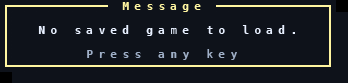
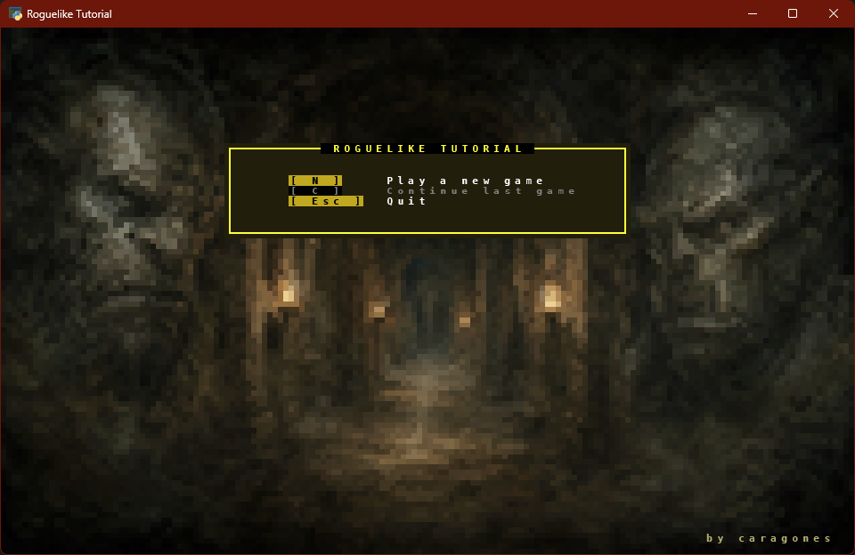
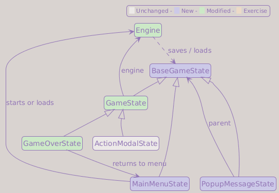
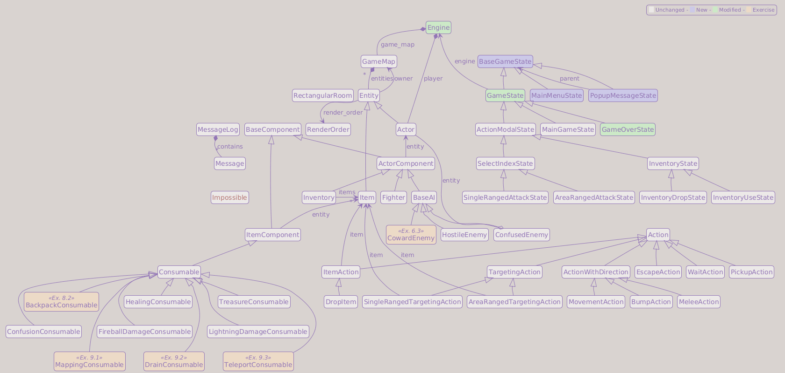
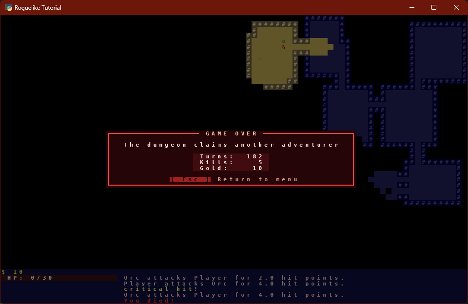

# Part 10: Save and Load

## What You Will Build

By the end of this part, your roguelike will have a main menu and a save system, allowing the player to quit the game and continue later from the saved state.

## Learning goals

In this part we will:

- Save the whole game state to disk with `pickle` and `lzma`, and load it back
- Move tunable numbers into a new `game/data/config.py`
- Add a main menu with New Game and Continue options, and a popup for short messages
- Change game states so they return the next state instead of setting it on the engine
- Delete the save file when the player dies
- Check that save, quit, and reload restore the map, entities, inventory, and message history

---

## Background

This section is for reading; there is nothing to type yet. If you want to start building right away, skip to [`game/data/config.py`](#gamedataconfigpy). You can come back here at any time, even after you finish the tutorial, when you know the game from the inside and some of these ideas will mean more.

### What a save file has to hold

Saving a game means converting the entire live object graph (engine, game map, entities, components, AI instances) into bytes that can be written to disk and reconstructed later.

```text
Engine
  ├── player (Actor)
  │     ├── fighter (Fighter)   ← component back-reference to player
  │     └── inventory (Inventory)
  ├── game_map (GameMap)
  │     └── entities: set[Entity]
  │           └── orc (Actor)
  │                 └── ai (HostileEnemy)  ← back-reference to the orc
Static state
  └── MessageLog.messages
```

The challenge: `Fighter.entity` points back to the `Actor` that owns it, `HostileEnemy.entity` points to the orc, and in Part 9 `ConfusedEnemy.previous_ai` holds another AI. These references form cycles: follow them and you come back to where you started. The message log is a separate static list, so we save it next to the engine.

### JSON or pickle

**JSON** cannot store cycles without custom encoding: every class needs a `to_dict()` / `from_dict()` pair. That is a lot of repeated code.

**`pickle`** handles cycles on its own. Python's `pickle` module serializes the whole object graph: it follows every reference and stores each shared object only once. It is the right tool for internal game state that you fully control.

!!! danger "pickle is not safe with untrusted data"
    Never load a pickle file from an unknown source: pickle can run arbitrary code while it loads. For a single-player game that loads only its own saves, this is fine.

!!! warning "Save files are not stable between code changes"
    Understanding what pickle does and does not serialize prevents hours of debugging.

    **What gets serialized:** every object reachable from the saved state, recursively. That means `Engine`, `GameMap`, every `Entity`, every `Fighter`, every `AI` instance, and anything those objects reference. For the plain Python classes in this project, pickle stores each object's `__dict__` (its instance attributes) together with the fully qualified class name (`module.ClassName`) needed to reconstruct it.

    **What does NOT get serialized:** method bodies, property functions, class-level constants (`UPPERCASE` values), and anything not stored as instance data.

    **Changes that break existing saves:**

    - Renaming an instance attribute (`self._hp` to `self._health`): an old save still contains `_hp`, but the new code reads `_health`, so it raises `AttributeError`.
    - Renaming or moving a class (`game.fighter.Fighter` to `game.components.Fighter`): pickle cannot find the class and raises `ModuleNotFoundError` or `AttributeError`.
    - Adding a new instance attribute that old saves do not have, unless you provide a migration or fallback.

    **Changes that do not usually break saves by themselves:**

    - Adding or renaming methods, as long as they can still work with old instance data.
    - Adding properties or class constants, as long as they do not read missing instance attributes.
    - Changing default parameter values in `__init__` (only affects newly created instances; loading with pickle does not call `__init__`).

    **The fix without deleting the save:** two tools, two use cases.

    - `__getattr__(self, name)`: Python calls this when normal attribute lookup fails. Use it when you *added* a new attribute that old saves simply don't have. It is useful for providing a simple default or lazily creating the missing field.

    - `__setstate__(self, state)`: pickle calls this once when loading, passing the saved `__dict__`. Use it when you *renamed* an attribute: rewrite the old key to the new name before updating `__dict__`; after that, every access works normally.

    Exercise 3 at the end of this part tries both, one after the other.

### Who owns the current state

Until now, the current screen lived in `engine.game_state`. States switched screens by writing to that attribute: `GameState.handle_events()` changed the engine as a side effect. The engine was both the game model and a shared pointer to the current screen.

The main menu breaks this design. It appears before any game exists, so there is no `Engine` to hold it. A popup over the menu has the same problem.

The fix is to turn the switch into a return value. Every state's `handle_events()` returns the next state: itself if nothing changes, another state otherwise. The main loop keeps the current state in a local variable and replaces it with whatever comes back. No object has to store the current screen for everyone else, and the engine goes back to holding only the game.

This is a common shape for state machines in games: each state knows its own transitions, and one loop owns the current state.

---

## game/data/config.py

The `game/data/` package already holds `colors.py`, `sprites.py`, and `keys.py`. This is a good moment to add a fourth member: a home for numeric and text constants that are currently scattered across `main.py` and component defaults (plus a couple staged here for later chapters).

Create `game/data/config.py`:

```python
from __future__ import annotations

from pathlib import Path

# Paths
_ROOT     = Path(__file__).parent.parent.parent
RES_DIR   = _ROOT / "res"
SAVE_DIR  = _ROOT / "savegames"
SAVE_PATH = SAVE_DIR / "savegame.sav"

# Screen / window
SCREEN_WIDTH  = 80
SCREEN_HEIGHT = 50
TITLE         = "Roguelike Tutorial"
VERSION       = "0.1.0"
APP_ID        = "com.tutorial.roguelike"

# HUD layout
BAR_WIDTH      = 24
XP_LEVEL_WIDTH = 4

# Map generation
MAP_WIDTH             = 80
MAP_HEIGHT            = 44
MAX_ROOMS             = 30
ROOM_MIN_SIZE         = 7
ROOM_MAX_SIZE         = 12
MIN_MONSTERS_PER_ROOM = 0
MAX_MONSTERS_PER_ROOM = 2
MIN_ITEMS_PER_ROOM    = 0
MAX_ITEMS_PER_ROOM    = 2

# Field of view
FOV_RADIUS = 8

# Part-4. Exercise 4: Fading memory
FADING_MEMORY   = True
MEMORY_DURATION = 10

# Combat
DEFAULT_CRITICAL_CHANCE     = 0.1
DEFAULT_CRITICAL_MULTIPLIER = 2.0
```

`_ROOT` is a private helper: the underscore signals it is not meant to be imported. It walks three `parent` steps from `game/data/config.py` to reach the project root, where `res/` and `savegames/` live.

`RES_DIR` lives here rather than in `setup_game.py` because two unrelated modules need it: `main.py` for the tileset and `MainMenuState` for the background image. With a single definition, the two can never point to different folders.

`FOV_RADIUS` replaces the hardcoded `8` in `Engine.__init__`. `FADING_MEMORY` and `MEMORY_DURATION` hold the Part 4 fading memory settings that `main.py` used to pass to `Engine` as literals. `BAR_WIDTH` (widened from the old `20` to `24`) and `XP_LEVEL_WIDTH` are staged here for the Part 11 HUD rework; nothing in Part 10 reads them yet. `DEFAULT_CRITICAL_CHANCE` and `DEFAULT_CRITICAL_MULTIPLIER` name the `0.1` and `2.0` values that the Part 6 critical-hit exercise added to `Fighter.__init__`.

!!! note "Exercise-derived constants in `config.py`"
    Some of these only matter if you did the matching exercise.

    `DEFAULT_CRITICAL_CHANCE` / `DEFAULT_CRITICAL_MULTIPLIER` belong to the Part 6 critical-hit exercise; if you skipped it your `Fighter` has no `critical_chance` / `critical_multiplier`, so leave these defined (they are harmless) and ignore the `fighter.py` change below.

    `MIN_MONSTERS_PER_ROOM` reflects the Part 5 Exercise 1 minimum; if you skipped that exercise, your `generate_dungeon` has no `min_monsters_per_room` parameter, so drop that argument from the `new_game()` call below.

    `FADING_MEMORY` and `MEMORY_DURATION` belong to Part 4 Exercise 4. If you skipped it, leave them defined and drop the two matching arguments from the `new_game()` call below.

    If you did Part 4 Exercise 1 (Variable torch radius), your `main.py` passed `fov_radius = 10` to `Engine`. That value now lives in `config.py`: set `FOV_RADIUS = 10` to keep the same torch.

!!! note "Why `config.py`?"
    Name a module for the kind of data it holds. `config.py` says exactly that: configuration values. Avoid a name that repeats the package (`game.data.data`) or one that says nothing (`misc.py`); if a module name only repeats where the file lives, it tells the reader nothing new.

Every caller imports the module the same way:

```python
from game.data import config
```

Then uses qualified names at every site: `config.MAP_WIDTH`, `config.FOV_RADIUS`, `config.SAVE_PATH`. The qualifier makes the origin explicit without a long destructured import list.

The files that gain an import and lose or avoid local definitions:

- `game/engine.py`: `fov_radius: int = 8` becomes `fov_radius: int = config.FOV_RADIUS`.
- `game/entities/components/fighter.py` (Part 6 critical-hit exercise only): if your `Fighter` has them, `critical_chance: float = 0.1` becomes `critical_chance: float = config.DEFAULT_CRITICAL_CHANCE`, and similarly for `critical_multiplier`. Skip this line if you did not do that exercise.

---

## BaseGameState and PopupMessageState

Before adding the main menu, we need one more abstraction: a state that does *not* delegate to `Engine`. The main menu runs before any engine exists, so it cannot inherit from the current `GameState`.

We split the hierarchy:

```text
BaseGameState
  ├── GameState (has engine, handles actions)
  │     ├── MainGameState
  │     ├── GameOverState
  │     └── ActionModalState
  │           ├── InventoryState
  │           │     ├── InventoryUseState
  │           │     └── InventoryDropState
  │           └── SelectIndexState
  │                 ├── SingleRangedAttackState
  │                 └── AreaRangedAttackState
  ├── MainMenuState  (no engine yet)
  └── PopupMessageState (renders a message overlay over the parent state)
```

`PopupMessageState` wraps long lines with `textwrap`, so add the import at the top of `game/game_states.py`:

```diff
 import math
+import textwrap
 from collections.abc import Callable
```

It also needs its own small palette. Add to `game/data/colors.py`:

```python
# Popup colors
POPUP_FRAME = Color(255, 245, 160)
POPUP_BG    = Color( 14,  18,  26)
POPUP_TITLE = Color(255, 245, 160)
POPUP_TEXT  = Color(232, 240, 255)
POPUP_DIM   = Color(160, 176, 200)
```

`POPUP_FRAME` and `POPUP_TITLE` hold the same value on purpose: the frame and the title share a color for now, but stay separate constants so they can diverge later.

Add to `game/game_states.py`, immediately before `GameState`:

```python
class BaseGameState:

    def handle_events(self, event: tcod.event.Event) -> BaseGameState:
        state = self.dispatch(event)
        if isinstance(state, BaseGameState):
            return state

        return self

    def dispatch(self, event: tcod.event.Event) -> Action | BaseGameState | None:
        match event:
            case tcod.event.Quit():
                raise SystemExit()

            case tcod.event.KeyDown():
                return self.event_keydown(event)

            case tcod.event.MouseButtonDown():
                return self.event_mousebuttondown(event)

        return None

    def event_keydown(self, _event: tcod.event.KeyDown) -> Action | BaseGameState | None:
        return None

    def event_mousebuttondown(self, _event: tcod.event.MouseButtonDown) -> Action | None:
        return None

    def on_render(self, console: tcod.console.Console) -> None:
        raise NotImplementedError()


class PopupMessageState(BaseGameState):
    """Display a message rendered over the parent state with a darkened overlay."""

    def __init__(self, parent_state: BaseGameState, text: str) -> None:
        self.parent = parent_state
        self.text   = text

    def on_render(self, console: tcod.console.Console) -> None:
        self.parent.on_render(console)

        # Dim the screen behind the popup
        console.fg[:] = console.fg // 2
        console.bg[:] = console.bg // 2

        title = " Message "
        hint = "Press any key"
        max_lines = max(1, console.height - 8)
        max_width = console.width - 10
        lines: list[str] = []
        for raw_line in self.text.split("\n"):
            # Wrap long lines instead of cutting them, like the message log
            lines.extend(textwrap.wrap(raw_line, max_width) or [""])
        lines = lines[:max_lines]
        width = min(
            console.width - 4,
            max(len(title), len(hint), *(len(line) for line in lines)) + 6,
        )
        height = len(lines) + 5
        x      = (console.width  - width)  // 2
        y      = (console.height - height) // 2

        # Draw the popup box
        _draw_panel(console, x, y, width, height, colors.POPUP_FRAME, colors.POPUP_BG)

        # Draw the popup title over the frame
        console.print(
            x    = x + (width - len(title)) // 2,
            y    = y,
            text = title,
            fg   = colors.POPUP_TITLE,
            bg   = colors.POPUP_BG,
        )

        for i, line in enumerate(lines):
            # Draw each message line centered inside the popup
            console.print(
                console.width // 2,
                y + 2 + i,
                line,
                fg        = colors.POPUP_TEXT,
                bg        = colors.POPUP_BG,
                alignment = tcod.constants.CENTER,
            )

        # Draw the close hint at the bottom of the popup
        console.print(
            x         = console.width // 2,
            y         = y + height - 2,
            text      = hint,
            fg        = colors.POPUP_DIM,
            bg        = colors.POPUP_BG,
            alignment = tcod.constants.CENTER,
        )

    def event_keydown(self, _event: tcod.event.KeyDown) -> Action | BaseGameState | None:
        return self.parent
```

`PopupMessageState` renders its parent state first, then dims the whole console by halving every color channel (the `// 2` trick from Part 7) and draws the box with `_draw_panel()`.

The body makes sure the text always fits on screen:

- Long lines are wrapped with `textwrap.wrap` (the same module the message log uses).
- `max_lines` limits how many wrapped lines are shown.
- `width` is clamped to `console.width - 4`.
- The `or [""]` keeps blank lines that are there on purpose: `textwrap.wrap("")` returns an empty list, so without it they would disappear.

The box shows a `" Message "` title on the top frame row and a dim "Press any key" hint above the bottom border. Any key closes it and returns to the parent state.



---

## Engine.save_as()

A save file is the current state turned into bytes with `pickle` (see [JSON or pickle](#json-or-pickle)) and compressed with `lzma`. A save from a fresh game is about 125 KB as raw pickle data, mostly the map arrays, which repeat the same few values many times. `lzma` shrinks it to 2 or 3 KB.

Add to `game/engine.py`:

```python
import lzma
import pickle
from pathlib import Path
from typing import TYPE_CHECKING

from game.message_log import MessageLog

if TYPE_CHECKING:
    from game.game_states import BaseGameState


class Engine:
    ...

    def save_as(self, filename: str | Path, active_state: BaseGameState) -> None:
        save_data = lzma.compress(
            pickle.dumps(
                {
                    "state": active_state,
                    "message_log": MessageLog.messages,
                }
            )
        )

        path = Path(filename)
        path.parent.mkdir(parents=True, exist_ok=True)
        tmp_path = path.with_suffix(".tmp")
        tmp_path.write_bytes(save_data)
        tmp_path.replace(path)
```

`pickle.dumps(...)` serializes `active_state` (which transitively includes the engine and everything it references) plus the static message log. `lzma.compress` shrinks it. `path.parent.mkdir(parents=True, exist_ok=True)` creates the `savegames/` directory if it does not exist yet.

The write uses a temporary file first: `savegame.tmp` is written completely, then `tmp_path.replace(path)` replaces `savegame.sav`. This is much safer than writing directly to the final file. If the process dies halfway through `write_bytes`, the old save is still intact. The replacement step is atomic on most filesystems when both files are in the same directory.

!!! tip "`Path.with_suffix()` and `Path.replace()`"
    `path.with_suffix(".tmp")` returns a new `Path` with the extension swapped: `savegames/savegame.sav` becomes `savegames/savegame.tmp`. The original path is unchanged.

    `tmp_path.replace(path)` renames `tmp_path` to `path`, overwriting the destination if it already exists. On Linux and macOS (POSIX systems) this rename is atomic: any reader of `path` sees either the old file or the new one, never a half-written mix. Windows does not make that formal promise, but the rename is still much safer than writing over the save in place. Both methods are part of the standard library `pathlib.Path` and work on every operating system.

Loading is the inverse:

```python
    @staticmethod
    def load(filename: str | Path) -> BaseGameState:
        save_data = Path(filename).read_bytes()
        data = pickle.loads(lzma.decompress(save_data))
        MessageLog.messages = data["message_log"]

        return data["state"]
```

`MessageLog.messages` is stored explicitly because it is class-level state, not an instance attribute of `Engine`. Without this extra field, loading would restore the map and entities but lose the visible message history.

The active state is now the root of the saved object graph. Any state that inherits from `GameState` stores the engine on `self.engine`, so code that needs the engine can access it through the current state after checking that the state is engine-backed.

`engine.py` imports `BaseGameState` only inside `if TYPE_CHECKING:`, the same trick `game_states.py` already uses for `Engine`. The type checker sees the name, but at run time `engine.py` does not import `game_states.py`. The refactor below depends on that: it removes the last run-time import from `engine.py` to `game_states.py`.

---

## setup_game.py

We need a function that creates a fresh game (used by "New Game") and one that loads an existing save (used by "Continue"). Extract them into a dedicated module so `main.py` and the main menu state stay clean.

Create `game/setup_game.py`:

```python
from __future__ import annotations

import copy
import os
import random
from pathlib import Path
from typing import TYPE_CHECKING

from game.data import colors, config
from game.engine import Engine
from game.entities import factories
from game.map.map_generator import generate_dungeon
from game.message_log import MessageLog

if TYPE_CHECKING:
    from game.game_states import BaseGameState


def new_game() -> Engine:
    """Return a fresh engine for a brand-new game."""
    MessageLog.clear()

    # Part-3. Exercise 1: Reproducible dungeons
    seed = int(os.environ.get("GAME_SEED", random.getrandbits(64)))
    print(f"Game seed: {seed}")

    player = copy.deepcopy(factories.player)

    game_map = generate_dungeon(
        max_rooms             = config.MAX_ROOMS,
        room_min_size         = config.ROOM_MIN_SIZE,
        room_max_size         = config.ROOM_MAX_SIZE,
        map_width             = config.MAP_WIDTH,
        map_height            = config.MAP_HEIGHT,
        min_monsters_per_room = config.MIN_MONSTERS_PER_ROOM,  # Part-5. Exercise 1: Minimum monsters per room
        max_monsters_per_room = config.MAX_MONSTERS_PER_ROOM,
        min_items_per_room    = config.MIN_ITEMS_PER_ROOM,
        max_items_per_room    = config.MAX_ITEMS_PER_ROOM,
        player                = player,
        seed                  = seed,    # Part-3. Exercise 1: Reproducible dungeons
    )

    engine = Engine(
        game_map        = game_map,
        player          = player,

        # Part-4. Exercise 4: Fading memory
        fading_memory   = config.FADING_MEMORY,
        memory_duration = config.MEMORY_DURATION,
    )

    MessageLog.add_message(
        "Hello and welcome, adventurer, to yet another dungeon!",
        colors.WELCOME_TEXT,
    )

    return engine


def load_game(filename: str | Path) -> BaseGameState:
    """Load a save file and return the saved game state."""
    path = Path(filename)
    if not path.exists():
        raise FileNotFoundError(f"No save file found at {filename!r}")

    try:
        return Engine.load(path)

    except Exception as ex:  # pylint: disable=broad-exception-caught
        backup_path = path.with_suffix(path.suffix + ".bak")
        path.replace(backup_path)
        raise RuntimeError(f"Save file could not be loaded and was moved to {backup_path}.") from ex
```

The map dimensions and spawn counts are now read from `config` rather than defined here. The seed line (`# Part-3. Exercise 1: Reproducible dungeons`) and the `seed = seed` argument are the Part 3 Exercise 1 carry-over: if you skipped that exercise your `generate_dungeon` has no `seed` parameter, so drop the seed computation and the `seed = seed` line.

The `Engine(...)` arguments marked `# Part-4. Exercise 4` used to be literals in `main.py`; they move here with the rest of the game setup and now read their values from `config.py`. `fov_radius` is no longer passed: its default is `config.FOV_RADIUS` (see Step 1 of the refactor). If you skipped Exercise 4, create the engine with `Engine(game_map=game_map, player=player)`.

`load_game` needs `Path` for its type annotation and for the backup path. Like `engine.py`, it imports `BaseGameState` only for the type checker.

`load_game()` handles one practical edge case: the save file might exist but fail to load because it is corrupt or incompatible with the current code. Instead of leaving the player stuck with a broken Continue option, the failed save is moved aside to `savegame.sav.bak` and the menu can show a clear message.

---

## MainMenuState

Save this image as `res/menu_background.png`. It is shown here so the asset used by the menu is visible in the tutorial:


[Download menu_background.png](images/menu_background.png){ download }

The main menu needs two new key constants. Add them to `game/data/keys.py`:

```python
KEY_NEW_GAME     = tcod.event.KeySym.N
KEY_CONTINUE     = tcod.event.KeySym.C
```

`KEY_QUIT_GAME` (already defined as `ESCAPE`) covers the quit option. With these three constants in place, the menu handler is fully decoupled from raw `KeySym` values.

The menu renders each option's key as a badge with `key_label`, a small helper that turns a `KeySym` into a label such as `[ N ]` or `[ Esc ]`, so the menu and any in-game hints style keys the same way. Add it to `game/data/keys.py`, right after the `tcod.event` import:

```python
_SPECIAL_KEY_NAMES = {
    tcod.event.KeySym.ESCAPE: "Esc",
}

def key_label(sym: tcod.event.KeySym) -> str:
    v    = int(sym)
    name = _SPECIAL_KEY_NAMES.get(sym) or (chr(v).upper() if 32 <= v <= 126 else sym.name)
    return f"[ {name} ]"
```

`key_label` picks a name with three rules, in order: an entry in `_SPECIAL_KEY_NAMES` wins first (`ESCAPE` becomes `Esc`); otherwise, a printable ASCII code (32 to 126) becomes `chr(v).upper()`, so the period key reads `.` instead of the verbose `"PERIOD"`; everything else falls back to `sym.name` (`"F1"`, `"KP_8"`, `"UP"`).

!!! note "If you completed Part 8 Exercise 4"
    You already wrote `key_label` there; skip the listing above. This is the canonical version, same story as `WaitAction`: what an earlier exercise introduced, the main path now adopts.

The menu also needs the image loader, the config constants, `key_label`, and the two functions from `setup_game.py`. Add these near the top of `game/game_states.py`:

```diff
 import tcod
+from tcod.image import Image

-from game.data import colors, keys
+from game.data import colors, config, keys
 from game.data.colors import Color
+from game.data.keys import key_label
 from game.exceptions import Impossible
 from game.message_log import MessageLog
+from game.setup_game import load_game, new_game
```

!!! warning "This import creates a cycle until Step 1 of the refactor"
    `setup_game.py` imports `engine.py`, and `engine.py` still imports `game_states.py` at the top. Until Step 1 of the refactor removes that import, the chain `game_states → setup_game → engine → game_states` is a cycle, and Python stops with an `ImportError` when the game starts. Nothing in this part runs before the refactor is complete anyway, so keep going.

`MainMenuState` is the first state the game enters. Unlike every other state, it holds no engine reference: the engine does not exist until the player makes a choice.

`on_render` draws the background image with `draw_semigraphics`, then overlays a framed menu panel (via `_draw_panel`, without shadow so it blends with the artwork) in the upper third of the screen. Each option shows its key as a badge over `MENU_ACCENT`, the same style the inventory rows use. It also prints `self.author` in a dim olive color in the lower-right corner, with one row and one column of margin; the default text is `"by caragones"` (me). Change it to your own name.

The Continue option is dimmed when no save file exists, but pressing `C` still shows a popup. If the game ignored the key, the player might think it had stopped responding.

!!! info "`draw_semigraphics` and half-block rendering"
    A tcod console is a grid of character cells. `draw_semigraphics` maps each 2×2 block of pixels in the source image onto one console cell. It picks a block character that splits the cell into quarters (such as `▀`, `▌`, or `▚`) and sets the foreground and background colors to match the pixels. That is why `menu_background.png` is 160×100 pixels: twice the size of the 80×50 console in each direction.

    The result has twice the resolution of plain text in both directions. The cost is color accuracy: one cell has only two colors, a foreground and a background, for its four pixels.

    The image is loaded once in `__init__`, so the file is not read again on every frame.

`event_keydown` handles three transitions:

- `keys.KEY_NEW_GAME` (`N`): calls `new_game()`, wraps the fresh engine in a `MainGameState`, and returns it.
- `keys.KEY_CONTINUE` (`C`): calls `load_game()` when a save exists. If no save file exists it falls back to a `PopupMessageState`; if the file is corrupt or incompatible, `load_game()` moves it to `.bak` and the menu shows the exception message.
- `keys.KEY_QUIT_GAME` (`Esc`): raises `SystemExit`.

The menu needs its own palette. Add to `game/data/colors.py`:

```python
MENU_TITLE             = Color(255, 255, 63)
MENU_TEXT              = WHITE
MENU_TEXT_DISABLED     = Color(128, 128, 128)
MENU_BG                = Color(  0,   0,   0)
MENU_ACCENT            = Color(192, 168,  32)
MENU_ROW_BG            = Color( 34,  30,  12)
MENU_DIM               = Color(184, 176, 112)
```

Add to `game/game_states.py` after `PopupMessageState`:

```python
class MainMenuState(BaseGameState):
    """Renders the main menu and handles New / Continue / Quit."""

    def __init__(self, author: str = "by caragones") -> None:
        self.author = author
        self._bg = Image.from_file(config.RES_DIR / "menu_background.png")

    def on_render(self, console: tcod.console.Console) -> None:
        # Draw the main menu background image
        console.draw_semigraphics(self._bg, 0, 0)

        title_text = "ROGUELIKE TUTORIAL"
        width      = max(len(title_text) + 4, console.width // 2 - 2)
        height     = 9
        x          = (console.width  - width)  // 2
        y          = console.height // 3 - 5

        # Draw the main box containing the title and options
        _draw_panel(
            console,
            x,
            y,
            width,
            height,
            colors.MENU_TITLE,
            colors.MENU_ROW_BG,
            shadow = False,
        )

        title = f" {title_text} "
        # Draw the centered title over the top frame
        console.print(
            x    = x + (width - len(title)) // 2,
            y    = y,
            text = title,
            fg   = colors.MENU_TITLE,
            bg   = colors.MENU_BG,
        )

        menu_options = [
            (keys.KEY_NEW_GAME,  "Play a new game",    True),
            (keys.KEY_CONTINUE,  "Continue last game", config.SAVE_PATH.exists()),
            (keys.KEY_QUIT_GAME, "Quit",               True),
        ]
        key_labels = [key_label(sym) for sym, _, _ in menu_options]
        key_width  = max(len(label) for label in key_labels) + 2
        row_x      = x + 4

        for i, (label, (_, desc, enabled)) in enumerate(zip(key_labels, menu_options)):
            row = y + 3 + i
            fg = colors.MENU_TEXT if enabled else colors.MENU_TEXT_DISABLED
            # Draw the key bound to this option
            console.print(
                row_x + 2,
                row,
                label,
                fg = colors.BLACK if enabled else colors.MENU_TEXT_DISABLED,
                bg = colors.MENU_ACCENT if enabled else colors.MENU_BG,
            )

            # Draw the option description
            console.print(
                row_x + key_width + 2,
                row,
                desc,
                fg = fg,
            )

        # Draw the author credit in the bottom-right corner
        console.print(
            console.width - 2,
            console.height - 2,
            self.author,
            fg        = colors.MENU_DIM,
            alignment = tcod.constants.RIGHT,
        )

    def event_keydown(self, event: tcod.event.KeyDown) -> Action | BaseGameState | None:
        match event.sym:
            case keys.KEY_NEW_GAME:
                engine = new_game()
                return MainGameState(engine)

            case keys.KEY_QUIT_GAME:
                raise SystemExit()

            case keys.KEY_CONTINUE:
                if not config.SAVE_PATH.exists():
                    return PopupMessageState(self, "No saved game to load.")

                try:
                    return load_game(config.SAVE_PATH)

                except FileNotFoundError:
                    return PopupMessageState(self, "No saved game to load.")

                except (RuntimeError, OSError) as ex:
                    return PopupMessageState(self, f"Failed to load save:\n{ex}")

        return None
```

*The finished main menu screen*:



!!! tip "Nested tuple unpacking with `zip`"
    ```python
    for i, (label, (_, desc, enabled)) in enumerate(zip(key_labels, menu_options)):
    ```

    - `i` comes from `enumerate`.
    - `label` comes from `key_labels`.
    - `(_, desc, enabled)` comes from `menu_options`, where each element is `(sym, desc, enabled)`.
    - `zip` pairs them: `(label, (sym, desc, enabled))`, and Python unpacks both levels in one step.

    `sym` is discarded with `_` because it was already used to build `key_labels`. `_` is a valid variable name; by convention it signals "intentionally unused".

The menu reads `config.SAVE_PATH` on every frame to decide whether Continue is enabled. `config.py` imports nothing from the game, so importing it can never create a cycle.

The first `except FileNotFoundError` is a TOCTOU guard (Time-Of-Check/Time-Of-Use): the file could be deleted between the `config.SAVE_PATH.exists()` check above and the actual `load_game()` call, so we handle that race rather than letting it crash.

The second `except` covers every other load failure, and a corrupt or incompatible save file shows a popup instead of crashing the program. It does not need to catch `Exception`: `load_game()` already turns any error from `Engine.load()` into a `RuntimeError`, and the only other error it can raise is an `OSError` if moving the file to `.bak` fails. `FileNotFoundError` is also an `OSError`, which is why it must come first: Python uses the first `except` that matches.

---

## Refactor: states return states

Now we make the change described in [Who owns the current state](#who-owns-the-current-state): `GameState.handle_events()` stops writing to `engine.game_state` and returns the next state instead. The caller, `run()` in `main.py`, keeps that state in a local variable.

!!! warning "Finish the refactor and `main.py` before running anything"
    Until Step 2 is done, `GameState` does not inherit from `BaseGameState`, so mypy reports an error wherever the menu returns a `MainGameState` as a `BaseGameState`. Step 1 deletes `Engine.run()`, which the old `main.py` still calls. Complete Steps 1, 2, and 3 **and** the new `main.py` before you run the game or a type check.

### Step 1: remove `game_state` from `Engine`

`engine.game_state` was only needed so states could mutate the active state from inside the engine. With state transitions now expressed as return values, that attribute is no longer needed.

In `game/engine.py`, remove the event-loop and game-state imports (now unused), drop `self.game_state` from `__init__`, and delete `handle_events` and `run` entirely (the main loop moves to `main.py`). The `lzma`, `pickle`, `Path`, `TYPE_CHECKING`, and `MessageLog` imports were already added in the `Engine.save_as()` section above.

```diff
-from collections.abc import Iterable
 import tcod.constants
-import tcod.event
 import tcod.map
 from tcod.console import Console
-from tcod.context import Context

 from game import hud
+from game.data import config
 from game.entities.entity import Actor
-from game.game_states import GameState, MainGameState
 from game.map.game_map import GameMap
 from game.message_log import MessageLog

 if TYPE_CHECKING:
     from game.game_states import BaseGameState

 class Engine:

     def __init__(
         self,
         game_map: GameMap,
         player: Actor,
         # Part-4. Exercise 1: Variable torch radius
-        fov_radius: int = 8,
+        fov_radius: int = config.FOV_RADIUS,
         # Part-4. Exercise 4: Fading memory
         fading_memory: bool  = False,
         memory_duration: int = 10,
     ) -> None:
         ...
-        self.game_state: GameState = MainGameState(self)
         self.update_fov()

-    def handle_events(self, events: Iterable[tcod.event.Event]) -> None:
-        for event in events:
-            self.game_state.handle_events(event)
-
-    def run(self, context: Context, console: Console) -> None:
-        while True:
-            console.clear()
-            self.game_state.on_render(console=console)
-            context.present(console)
-            for event in tcod.event.wait():
-                event = context.convert_event(event)
-                self.handle_events([event])
```

Removing `from game.game_states import GameState, MainGameState` means that, at run time, the engine no longer knows about screens: it holds the game model (map, player, field of view), and the states decide what to show and what happens next. The `BaseGameState` import under `if TYPE_CHECKING:` stays; only the type checker reads it.

This removal also breaks the import cycle from the MainMenuState section. `game_states.py` imports `setup_game.py`, which imports `engine.py`; now that `engine.py` no longer imports `game_states.py` at run time, the chain stops there.

!!! note "Constructor parameters shown as context"
    `fov_radius`, `fading_memory`, and `memory_duration` are Part 4 exercise carry-overs (Variable torch radius and Fading memory), shown here as unchanged context. The one edit inside the signature is the `fov_radius` default: the literal `8` becomes `config.FOV_RADIUS`. If you skipped those exercises and your `Engine` has no `fov_radius` parameter, swap the hardcoded `8` for `config.FOV_RADIUS` wherever your FOV radius lives instead.

### Step 2: replace `GameState` with the new version

**Delete the entire existing `GameState` class** and replace it with:

```python
class GameState(BaseGameState):

    def __init__(self, engine: Engine) -> None:
        self.engine = engine

    def handle_events(self, event: tcod.event.Event) -> BaseGameState:
        action: Action | BaseGameState | None = None
        match event:
            case tcod.event.Quit():
                action = EscapeAction()

            case tcod.event.MouseMotion():
                self.engine.mouse_location = event.integer_position
                return self

            case tcod.event.MouseButtonDown():
                action = self.event_mousebuttondown(event)  # pylint: disable=assignment-from-none

            case tcod.event.KeyDown():
                # Part-7. Exercise 2: Scroll the message panel (for all GameStates)
                if event.sym == keys.LOG_SCROLL_UP:
                    MessageLog.scroll_up()
                    return self

                if event.sym == keys.LOG_SCROLL_DOWN:
                    MessageLog.scroll_down()
                    return self

                action = self.event_keydown(event)  # pylint: disable=assignment-from-none

        if isinstance(action, BaseGameState):
            return action

        if action is not None:
            try:
                action.perform(self.engine, self.engine.player)

            except Impossible as ex:
                MessageLog.add_message(str(ex), colors.INVALID)
                return self

            if isinstance(action, TargetingAction):
                MessageLog.add_message(action.prompt, colors.NEEDS_TARGET)
                if isinstance(action, SingleRangedTargetingAction):
                    return SingleRangedAttackState(self.engine, callback=action.callback)

                if isinstance(action, AreaRangedTargetingAction):
                    return AreaRangedAttackState(
                        self.engine,
                        radius   = action.radius,
                        color    = action.color,
                        callback = action.callback,
                    )

            # Part-1. Exercise 3: Add a wait action
            self.engine.turn_count += 1

            if self.engine.player.is_alive:
                self.engine.handle_enemy_turns()

            if not self.engine.player.is_alive:
                new_state = GameOverState(self.engine)
                new_state.on_enter()
                return new_state

            # Part-4. Exercise 4: Fading memory
            if self.engine.fading_memory:
                self.engine.update_memory()

            self.engine.update_fov()

            if isinstance(self, ActionModalState):
                return MainGameState(self.engine)

        return self

    def event_keydown(self, _event: tcod.event.KeyDown) -> Action | BaseGameState | None:
        return None

    def event_mousebuttondown(self, _event: tcod.event.MouseButtonDown) -> Action | None:
        return None

    def on_render(self, console: tcod.console.Console) -> None:
        self.engine.render(console)
```

The lines marked `# Part-1. Exercise 3`, `# Part-4. Exercise 4`, and `# Part-7. Exercise 2` are the exercise code that Part 8b moved into this method. They stay in the same places; only the early exits change from `return` to `return self`, because the method now returns the next state. If you skipped one of those exercises, omit its lines.

`handle_events` calls `new_state.on_enter()` when the player dies. That method will be filled in the "Delete save on death" section; for now, add a stub to `GameOverState` so the code compiles:

```diff
 class GameOverState(GameState):
+    def on_enter(self) -> None:
+        pass
```

`handle_events` now checks `isinstance(action, BaseGameState)` before treating it as an `Action`. If a subclass's `event_keydown` returns a state (for example `InventoryUseState`), the method returns it immediately without running any game logic. The base `event_keydown` declaration uses `Action | BaseGameState | None` so subclasses can return either without a type mismatch.

### Step 3: replace `engine.game_state` mutations with return values

Three methods in `game_states.py` still assign to `self.engine.game_state`. Replace each assignment with a return value.

**`SelectIndexState.event_keydown`**:

```diff
-    def event_keydown(self, event: tcod.event.KeyDown) -> Action | None:
+    def event_keydown(self, event: tcod.event.KeyDown) -> Action | BaseGameState | None:
         key = event.sym
@@
         if key == keys.KEY_EXIT:
-            self.engine.game_state = MainGameState(self.engine)
-            return None
+            return MainGameState(self.engine)
```

**`MainGameState.event_keydown`** now saves the game when the player presses Escape. If saving fails, the error is logged, so first add `logging` and a logger for the module at the top of `game/game_states.py`:

```diff
+import logging
 import math
 import textwrap
@@
 if TYPE_CHECKING:
     from game.engine import Engine
     from game.entities.entity import Item
 
+logger = logging.getLogger(__name__)
+
 
 def _draw_panel(
```

`logging.getLogger(__name__)` returns a logger named after the module (`game.game_states`), so each message says which module wrote it. We do not configure `logging` anywhere: by default, Python prints warnings and errors to the terminal, and that is all we need.

Then change the method:

```diff
-    def event_keydown(self, event: tcod.event.KeyDown) -> Action | None:
+    def event_keydown(self, event: tcod.event.KeyDown) -> Action | BaseGameState | None:
         key = event.sym
@@
         if key == keys.KEY_QUIT_GAME:
-            return EscapeAction()
+            try:
+                self.engine.save_as(config.SAVE_PATH, self)
+                print(f"Game saved at {config.SAVE_PATH}.")
+
+            except Exception:  # pylint: disable=broad-exception-caught
+                logger.exception("Could not save the game.")
+
+            return MainMenuState()
@@
         if key == keys.KEY_INVENTORY:
-            self.engine.game_state = InventoryUseState(self.engine)
+            return InventoryUseState(self.engine)

         if key == keys.KEY_DROP:
-            self.engine.game_state = InventoryDropState(self.engine)
+            return InventoryDropState(self.engine)
```

Pressing `KEY_QUIT_GAME` (Escape) during gameplay now saves the current state and returns to the main menu. From the menu the player can press `N` for a new game or `C` to resume. `MainGameState` no longer returns `EscapeAction` (which raised `SystemExit`). Escape now quits the program only from the game-over screen and from the menu.

Here the `except` catches any `Exception` on purpose. Saving can fail in many ways (a full disk, a folder without write permission, an object that `pickle` cannot store), and none of them should crash the game and lose the session. Catching everything is safe only because nothing is lost: `logger.exception()` prints the message and the full traceback to the terminal, so you can still see what went wrong and where. A broad `except` that only prints `str(ex)`, or does nothing, would hide the bug.

!!! info "`except Exception` is not \"catch everything\""
    Python has a wider base class, `BaseException`, and a bare `except:` catches it too. It includes `KeyboardInterrupt` (Ctrl+C) and `SystemExit` (`sys.exit()`, which our own quit uses). Those are not errors: they are requests to stop the program. `except Exception` lets them through, which is what we want.

    If you come from C++, `except Exception` is close to `catch (const std::exception&)`, and `except BaseException` is close to `catch (...)`. Unlike C++, Python has no reason to use the second one for safety: an exception that nobody catches prints its traceback and ends the program in a clean way.

**`InventoryState.event_keydown`**:

```diff
-    def event_keydown(self, event: tcod.event.KeyDown) -> Action | None:
+    def event_keydown(self, event: tcod.event.KeyDown) -> Action | BaseGameState | None:
         key = event.sym
@@
         if key == keys.KEY_EXIT:
-            self.engine.game_state = MainGameState(self.engine)
-            return None
+            return MainGameState(self.engine)
```

After these three changes, `self.engine.game_state` no longer appears anywhere in `game_states.py`.

Part 9 already wired this correctly: `ConfusionConsumable` and `FireballDamageConsumable` return `TargetingAction` data classes from `get_action()`, and `handle_events()` dispatches on them. The only migration here is changing the mutation (`engine.game_state = ...`) to a return value, which the updated `handle_events()` above already reflects. No changes to `consumable.py` are needed.

---

## main.py: save on quit, main menu start

`Engine.run()` no longer fits the whole application: the main menu starts before any
`Engine` exists. We therefore move the loop back to a free `run()` function in
`main.py`, similar to `game_loop()` from Part 1. This time the loop owns the current
state and replaces it whenever `handle_events()` returns another one.

Replace `main.py` with:

```python
from __future__ import annotations

import logging
from collections.abc import Callable

import tcod

from game.data import config
from game.game_states import (
    BaseGameState,
    GameOverState,
    GameState,
    MainMenuState,
)

logger = logging.getLogger(__name__)


def run(
    state: BaseGameState,
    context: tcod.context.Context,
    console: tcod.console.Console,
    on_exit: Callable[[BaseGameState], None] | None = None,
) -> None:
    """Drive the game state machine until SystemExit. Calls on_exit(state) before re-raising."""
    try:
        while True:
            console.clear()
            state.on_render(console = console)
            context.present(console)

            for event in tcod.event.wait():
                event = context.convert_event(event)
                state = state.handle_events(event)

    except SystemExit:
        if on_exit is not None:
            on_exit(state)
        raise


def save_game(state: BaseGameState) -> None:
    if isinstance(state, GameState) and not isinstance(state, GameOverState):
        try:
            state.engine.save_as(config.SAVE_PATH, state)
            print(f"Game saved at {config.SAVE_PATH}.")

        except Exception:  # pylint: disable=broad-exception-caught
            logger.exception("Could not save the game.")


def main() -> None:
    state: BaseGameState = MainMenuState()

    tileset = tcod.tileset.load_tilesheet(
        config.RES_DIR / "dejavu12x12_gs_tc.png",
        32,
        8,
        tcod.tileset.CHARMAP_TCOD,
    )

    tcod.lib.SDL_SetAppMetadata(
        config.TITLE.encode("utf-8"),
        config.VERSION.encode("utf-8"),
        config.APP_ID.encode("utf-8"),
    )
    tcod.lib.SDL_SetHint(
        b"SDL_RENDER_SCALE_QUALITY",
        b"0",   # Nearest pixel sampling
    )

    with tcod.context.new(
        columns          = config.SCREEN_WIDTH,
        rows             = config.SCREEN_HEIGHT,
        tileset          = tileset,
        title            = config.TITLE,
        vsync            = True,
        sdl_window_flags = tcod.context.SDL_WINDOW_ALLOW_HIGHDPI | tcod.context.SDL_WINDOW_RESIZABLE,
    ) as context:
        console = tcod.console.Console(config.SCREEN_WIDTH, config.SCREEN_HEIGHT, order="F")
        run(state, context, console, on_exit=save_game)


if __name__ == "__main__":
    main()
```

`main.py` no longer generates a seed or adds the welcome message. Both belong in `new_game()`: the seed decides the map layout, and the welcome message is part of the initial game state, not app setup.

The local variables `screen_width`, `screen_height`, `title`, `version`, and `app_id` that were defined inline inside `main()` are gone. They now live in `config.py` as `SCREEN_WIDTH`, `SCREEN_HEIGHT`, `TITLE`, `VERSION`, and `APP_ID`, and `main.py` reads them through `config`.

`RES_DIR`, `SAVE_DIR`, and `SAVE_PATH` are built once in `config.py` from `Path(__file__).parent.parent.parent`. Because they are absolute `Path` values, every module that imports `config` uses the same files regardless of the working directory: `main.py` and `MainMenuState` agree on resource locations, while `save_game`, `on_enter`, and `load_game` agree on the save file without any path-joining at call sites.

`save_game()` is the fallback for closing the window with the X button. It does not run after a crash: `run()` only catches `SystemExit`, so any other exception skips it. The normal in-game quit path (Escape) already saves explicitly before transitioning to `MainMenuState`, so `save_game` mainly catches the case where the player is mid-game and closes the window without pressing Escape. If they are at the main menu or game-over screen there is nothing to save.

The `try/except` guards against one edge case: if the player closes the window while a targeting cursor is active (`SingleRangedAttackState`, `AreaRangedAttackState`), the state holds a `callback` lambda. `pickle` cannot serialize lambdas or closures, only named top-level functions and ordinary data. The save is skipped with a warning rather than crashing. This is a general rule worth remembering: `pickle` works well with plain classes and top-level functions; lambdas, open file handles, and GUI contexts will fail.

The `on_exit` callback receives the *current* state (after any state-machine transitions during `handle_events`), not the initial one.

The `try/except SystemExit` inside `run()` catches the quit signal raised by any state, runs `save_game`, then re-raises so Python exits normally.

!!! tip "Run it now"
    If you run `uv run main.py` now, you can check the whole save cycle before we handle death. The main menu appears, with Continue dimmed. Press `N`, walk a few steps, and press `Esc`: the terminal prints where the game was saved, and you are back at the menu with Continue enabled. Press `C` and you are back in the same spot, with the same message log.

    Repeat the round trip two or three times, and once close the window instead of pressing `Esc`. It is a good habit to test the save path now, while it is the only new thing that can break. Dying still leaves the last save on disk; the next section fixes that.

---

## Delete save on death

If the player dies, the save file is stale (it would reload a dead character). Delete it in `GameOverState`.

`config.SAVE_PATH` is available at the top of `game_states.py` via the `config` import added earlier. Replace the stub `on_enter()` added in Step 2 with the real implementation:

```diff
 class GameOverState(GameState):

-    def on_enter(self) -> None:
-        pass
+    def on_enter(self) -> None:
+        if config.SAVE_PATH.exists():
+            config.SAVE_PATH.unlink()
```

`GameOverState` keeps its own `event_keydown` so Escape still quits from the game-over screen. The save file is deleted when the state is entered, before the player has a chance to quit.

`new_state.on_enter()` is already called from `GameState.handle_events()` (added in Step 2):

```python
            if not self.engine.player.is_alive:
                new_state = GameOverState(self.engine)
                new_state.on_enter()
                return new_state
```

---

## Complete file listing for Part 10

After this part, the major files look like this:

**`game/engine.py`**: additions (`save_as`, `load`) and one removal:

```python
import lzma
import pickle
from pathlib import Path
from typing import TYPE_CHECKING

from game.message_log import MessageLog

if TYPE_CHECKING:
    from game.game_states import BaseGameState


class Engine:

    def save_as(self, filename: str | Path, active_state: BaseGameState) -> None:
        save_data = lzma.compress(
            pickle.dumps(
                {
                    "state": active_state,
                    "message_log": MessageLog.messages,
                }
            )
        )

        path = Path(filename)
        path.parent.mkdir(parents=True, exist_ok=True)
        tmp_path = path.with_suffix(".tmp")
        tmp_path.write_bytes(save_data)
        tmp_path.replace(path)

    @staticmethod
    def load(filename: str | Path) -> BaseGameState:
        save_data = Path(filename).read_bytes()
        data = pickle.loads(lzma.decompress(save_data))
        MessageLog.messages = data["message_log"]

        return data["state"]
```

The removals (`self.game_state`, `handle_events`, `run`) are covered in the Refactor section above.

`handle_events` and `run` both referenced `self.game_state`; without it they would crash if called. The free `run()` in `main.py` replaces them entirely.

This also breaks the import cycle created when `game_states.py` imports from `setup_game.py`: once `engine.py` no longer imports from `game_states.py` at run time, the chain `game_states → setup_game → engine` is not circular.

**`game/data/config.py`**: new file, defines paths, screen dimensions, HUD layout, map parameters, FOV radius, and combat defaults

**`game/setup_game.py`**: new file (full content above), imports from `config` and provides `new_game()` / `load_game()`

**`game/game_states.py`**: additions: `BaseGameState`, `PopupMessageState`, `MainMenuState`, updated `GameState`

**`main.py`**: starts with `MainMenuState`, saves on `SystemExit`

---

## Testing your work

Run the game with `uv run main.py` (or `python main.py`):

- [ ] The main menu appears with the background image, three framed options, and the author text in the lower-right corner
- [ ] `Continue last game` is dimmed when no save file exists
- [ ] Pressing `C` with no save shows `"No saved game to load."`
- [ ] `N` starts a new game
- [ ] Play for a few turns (pick up items, fight enemies)
- [ ] Press `Esc` or close the window, the terminal prints where the game was saved
- [ ] Run the game again, `C` loads the game with the same map, entities, and message log
- [ ] Die in combat, the game-over screen appears
- [ ] Press `Esc` to quit, no new save is written
- [ ] Run the game again, `C` shows `"No saved game to load."` because death deleted it

---

## Summary

Save and load is complete. The verification milestone is met:

> **save, quit, reload → map, entities, inventory, and message history restored**

Key additions:

- **`pickle` + `lzma`**: serialize/deserialize the active state plus static message log state
- **Atomic save writes**: write to a temporary file before replacing the final save
- **Corrupt save recovery**: move broken saves to `.bak` instead of trapping the player on a bad Continue option
- **`game/data/config.py`**: single source of truth for paths, screen size, map parameters, and tuning defaults
- **`game/setup_game.py`**: `new_game()` and `load_game()` functions; reads all dimensions from `config`
- **`BaseGameState`**: state base that works without an engine (main menu, popups)
- **`PopupMessageState`**: dismissable framed overlay with darkened background
- **`MainMenuState`**: background image plus framed New / Continue / Quit menu at startup
- **States return states**: clean state machine transitions
- **Save on quit, delete on death**: the normal quit and death paths keep the save file consistent; dead runs are never preserved

**Current architecture**:

- `main.py`: owns the outer app loop and active `BaseGameState`
- `setup_game.py`: creates new games and loads saved ones
- `BaseGameState`: common interface for menu, popup, and engine-backed states
- `MainMenuState`: starts before an `Engine` exists
- `Engine.save_as(filename, state)` / `Engine.load()`: serialize and restore the active state (engine included transitively) plus `MessageLog.messages`

**Local Class Diagram**:



**Full Class Diagram**:



**File structure**:

```text
main.py                         ← modified
res/
├── dejavu12x12_gs_tc.png
└── menu_background.png          ← new
game/
├── __init__.py
├── actions.py
├── engine.py                   ← modified
├── exceptions.py
├── hud.py
├── game_states.py              ← modified
├── message_log.py
├── setup_game.py               ← new
├── data/
│   ├── __init__.py
│   ├── colors.py               ← modified
│   ├── config.py               ← new
│   ├── keys.py                 ← modified
│   └── sprites.py
├── entities/
│   ├── __init__.py
│   ├── entity.py
│   ├── factories.py
│   ├── render_order.py
│   └── components/
│       ├── __init__.py
│       ├── ai.py
│       ├── base_component.py
│       ├── consumable.py
│       ├── fighter.py
│       └── inventory.py
└── map/
    ├── __init__.py
    ├── game_map.py
    ├── tile_types.py
    └── map_generator.py
```

---

## Exercises

The next parts assume you did these exercises. Try each one on your own first. If one is too hard for now, do not let it stop you: where a reference solution is given, read it and type it in, and when a later part builds on an exercise, it points out the code that comes from it.

1. **Return to main menu on death**:

    On death the game currently quits on `Escape`. Make it return to the main menu instead, so the player can start a fresh run without relaunching the program, and update the on-screen hint so it tells the truth about what `Escape` now does. Draw the hint as a key **badge** (dark text on an accent background, the same style as the Part 8 inventory rows) followed by its description, which means building it from two pieces so the badge and the text can be styled and positioned independently.

    ??? note "Reference implementation"
        The handler change is in `GameOverState.event_keydown` (`game/game_states.py`): return `MainMenuState()` where it used to quit.

        Add the accent color in `game/data/colors.py`:

        ```python
        GAME_OVER_ACCENT = Color(160,  32,  32)
        ```

        Build the hint from two pieces in `GameOverState.on_render` (`game/game_states.py`); the combined string is still handy for the width calculation:

        ```python
        hint_key  = key_label(keys.KEY_QUIT_GAME)
        hint_text = "Return to menu"
        hint      = f"{hint_key} {hint_text}"
        ```

        ...then draw the badge and its description separately:

        ```python
        # Draw the hint for returning to the main menu
        hint_x = (console.width - len(hint)) // 2
        hint_y = y + height - 2
        # Draw the key that returns to the main menu
        console.print(
            x    = hint_x,
            y    = hint_y,
            text = hint_key,
            fg   = colors.BLACK,
            bg   = colors.GAME_OVER_ACCENT,
        )

        # Draw the description for the return-to-menu action
        console.print(
            x    = hint_x + len(hint_key) + 1,
            y    = hint_y,
            text = hint_text,
            fg   = colors.GAME_OVER_DIM,
        )
        ```

2. **Record a graveyard file**:

    Add a small run history, written when the player dies. Two counters feed it: `turn_count` on `Engine` and `kill_count` on `Fighter`. The thinking is in *when* each one increments:

    - `turn_count` only after an action that actually consumes a turn: opening the inventory, cancelling targeting, scrolling the message log, and impossible actions do not count. This has been true since Part 8b.
    - `kill_count` on the actor that *caused* a death, threaded through the damage code so melee attacks and damaging scrolls both attribute correctly. Self-inflicted deaths (caught in your own fireball) must not count.

    If you carried the Part 1 turn counter forward, `turn_count` already exists and already counts correctly. Retire the debug `Turn:` print from `Engine.render()`, if you still have it, now that the graveyard shows the tally on the game-over screen. The counter born in Part 1 to prove that time only passes when you act ends its journey here, feeding your run history.

    Show the tally on the game-over screen, then on death append one record to a `graveyard.json`. Use JSON, not pickle: it is a small, stable record that should stay readable even if the game's classes change later.

    ??? note "Reference implementation"
        Add `kill_count` as `int = 0` to `Fighter.__init__` (`game/entities/components/fighter.py`). `turn_count` already exists on `Engine` since Part 1.

        Attribute the kill in `Fighter.take_damage` (`game/entities/components/fighter.py`); the `attacker` is threaded in from `melee_attack` and the damaging consumables:

        ```diff
        -def take_damage(self, amount: float) -> None:
        +def take_damage(self, amount: float, attacker: Actor) -> None:
             self.hp -= amount
        +    if self.hp <= 0 and attacker is not self.entity:
        +        # Part-10. Exercise 2: Record a graveyard file
        +        # Self-inflicted deaths do not count as kills
        +        attacker.fighter.kill_count += 1
        ```

        This changes `take_damage`'s signature, so every call site must pass `attacker`: `melee_attack` in `fighter.py`, plus the lightning, fireball, and drain consumables in `consumable.py`. That threading is exactly the change Part 11 makes in its "Award XP on kill" section, which then notes it is already in place if you did this exercise.

        Show the tally. Add the row color in `game/data/colors.py`:

        ```python
        GAME_OVER_ROW_BG = Color( 64,  12,  16)
        ```

        Then in `GameOverState.on_render` (`game/game_states.py`), grow the panel (`height = 10`) and build a centered stats box between the message and the hint, one row per stat over its own `GAME_OVER_ROW_BG` background (the same row pattern as the inventory overlay), including the stat lines in the panel `width` so values never overflow:

        ```python
        stats = [
            ("Turns:", str(self.engine.turn_count)),
            ("Kills:", str(self.engine.player.fighter.kill_count)),
            ("Gold:",  str(self.engine.player.inventory.gold)),
        ]
        stat_label_width = max(len(label) for label, _ in stats)
        stat_value_width = max(len(value) for _, value in stats) + 2
        stat_lines = [
            f"{label:<{stat_label_width}}{value:>{stat_value_width}}"
            for label, value in stats
        ]
        ```

        

        Write the record on death in `GameOverState.on_enter` (`game/game_states.py`); this needs `import json` and `from datetime import datetime`:

        ```python
        # Part-10. Exercise 2: Record a graveyard file
        graveyard_path = config.SAVE_DIR / "graveyard.json"
        if graveyard_path.exists():
            graveyard = json.loads(graveyard_path.read_text(encoding="utf-8"))
        else:
            graveyard = []

        graveyard.append(
            {
                "date": datetime.now().isoformat(timespec="seconds"),
                "turns": self.engine.turn_count,
                "kills": self.engine.player.fighter.kill_count,
                "gold": self.engine.player.inventory.gold,
            }
        )
        graveyard = graveyard[-10:]   # keep only the latest 10 runs

        config.SAVE_DIR.mkdir(parents=True, exist_ok=True)
        graveyard_path.write_text(json.dumps(graveyard, indent=2), encoding="utf-8")
        ```

        JSON, not pickle: a graveyard entry is a small, stable record that should stay readable even if the game's classes change.

3. **Break and fix an old save file**:

    Saves are pickled, so they break when `Fighter`'s shape changes underneath them. This exercise reproduces that on purpose and shows the two tools that fix it: `__getattr__` for a **new** field, `__setstate__` for a **renamed** one. Each part starts from the normal Part 10 code, and the order matters: first create the save, then change the code, so you reproduce the real problem of a player carrying a save across versions.

    **Part A: a new field (`__getattr__`)**

    Run the game, play a turn or two, and press `Escape` to save. That save's `Fighter` objects have no `_armor`. Now pretend the next version adds armor. Add an `_armor` attribute to `Fighter.__init__`:

    ```python
    self._armor: float = 0.0
    ```

    Add a property that reads it:

    ```python
    @property
    def armor(self) -> float:
        return self._armor
    ```

    Then make damage use it (the important part is that combat reads `target.fighter.armor`):

    ```diff
    -base_damage = (self.attack * self.attack) / (self.attack + target.fighter.defense)
    +base_damage = (self.attack * self.attack) / (self.attack + target.fighter.defense + target.fighter.armor)
    ```

    Load the old save (`C`): the load succeeds, but the first time damage reads armor the game crashes with `AttributeError: 'Fighter' object has no attribute '_armor'`, because the pickled object predates the field. Try to make old saves repair themselves before you peek.

    ??? note "The fix: `__getattr__`"
        `__getattr__` runs only when normal attribute lookup fails, so fresh objects (which already have `_armor`) never reach it; old ones get the field created on first access, and the next save stores it normally. Add `from typing import Any` near the imports, then add this to `Fighter`:

        ```python
        def __getattr__(self, name: str) -> Any:
            if name == "_armor":
                self._armor = 0.0
                return self._armor

            raise AttributeError(name)
        ```

    Revert the exercise changes when done if you want to continue from the exact reference code.

    ---

    **Part B: a renamed field (`__setstate__`)**

    Return to the normal Part 10 code, delete the Part A save, and save again. This save contains `Fighter._hp`. Now pretend the next version renames the stored field: rename `_hp` to `_health` throughout `game/entities/components/fighter.py` (the `__init__` assignment, the `hp` getter and setter, and `heal()`). The public `hp` property keeps its name; only the stored attribute changes.

    Load the old save: the same kind of crash, `AttributeError: 'Fighter' object has no attribute '_health'`. `__getattr__` could hide it, but a rename is better fixed once, at load time. Try it before you peek.

    ??? note "The fix: `__setstate__`"
        Pickle calls `__setstate__` once on load with the saved `__dict__`; rewrite the old key to the new one before updating the object, so afterwards `_health` is present as normal and later saves store it correctly:

        ```python
        def __setstate__(self, state: dict) -> None:
            if "_hp" in state and "_health" not in state:
                state["_health"] = state.pop("_hp")

            self.__dict__.update(state)
        ```

    Revert the exercise changes when done if you want to continue from the exact reference code.

    ---

    !!! warning "Delete your save before starting Part 11"
        These exercises intentionally create incompatible save files. Delete `savegames/savegame.sav` before continuing. Part 11 adds a `Level` component to every actor; a save written now has no `level` attribute, so any leftover save will fail after you load it.
