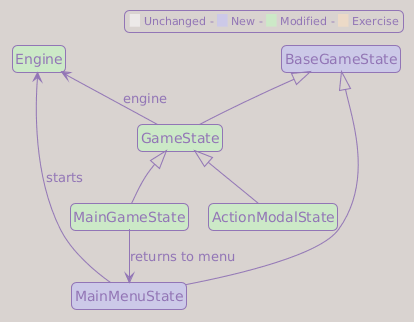

# Part 10a: The Main Menu

**Part 10** gives the game a main menu and a save system. Before the game can save anything, it needs a place to start that is not a game: a menu that runs before any dungeon exists. That changes who owns the current screen, so this part is also a refactor of the game states.

**Part 10a** builds the main menu and the state machine behind it. Nothing is saved yet.

**Part 10b** saves the game to disk, adds Continue to the menu, and deletes the save when the player dies.

---

## What You Will Build

By the end of Part 10a, the game starts at a main menu with background art. `N` starts a new game, `Esc` during play returns to the menu, and `Esc` in the menu quits. Under the hood, every game state now returns the next state, and the main loop lives in `main.py` again.

## Learning goals

In this part we will:

- Move tunable numbers into a new `game/data/config.py`
- Change game states so they return the next state instead of setting it on the engine
- Move the main loop back to `main.py`, where it owns the current state
- Add a main menu with a background image

---

## Background

This section is for reading; there is nothing to type yet. If you want to start building right away, skip to [`game/data/config.py`](#gamedataconfigpy). You can come back here at any time, even after you finish the tutorial, when you know the game from the inside and some of these ideas will mean more.

### Who owns the current state

Until now, the current screen lived in `engine.game_state`. States switched screens by writing to that attribute: `GameState.handle_events()` changed the engine as a side effect. The engine was both the game model and a shared pointer to the current screen.

The main menu breaks this design. It appears before any game exists, so there is no `Engine` to hold it. A popup over the menu, which Part 10b adds, has the same problem.

The fix is to turn the switch into a return value. Every state's `handle_events()` returns the next state: itself if nothing changes, another state otherwise. The main loop keeps the current state in a local variable and replaces it with whatever comes back. No object has to store the current screen for everyone else, and the engine goes back to holding only the game.

This is a common shape for state machines in games: each state knows its own transitions, and one loop owns the current state.

---

## game/data/config.py

The `game/data/` package already holds `colors.py`, `sprites.py`, and `keys.py`. This is a good moment to add a fourth member: a home for numeric and text constants that are currently scattered across `main.py` and component defaults (plus a few staged here for later chapters).

Create `game/data/config.py`:

```python
from __future__ import annotations

from pathlib import Path

# Paths
_ROOT     = Path(__file__).parent.parent.parent
RES_DIR   = _ROOT / "res"
SAVE_DIR  = _ROOT / "savegames"
SAVE_PATH = SAVE_DIR / "savegame.sav"

# Screen / window
SCREEN_WIDTH  = 80
SCREEN_HEIGHT = 50
TITLE         = "Roguelike Tutorial"
VERSION       = "0.1.0"
APP_ID        = "com.tutorial.roguelike"

# HUD layout
BAR_WIDTH      = 24
XP_LEVEL_WIDTH = 4

# Map generation
MAP_WIDTH             = 80
MAP_HEIGHT            = 44
MAX_ROOMS             = 30
ROOM_MIN_SIZE         = 7
ROOM_MAX_SIZE         = 12
MIN_MONSTERS_PER_ROOM = 0
MAX_MONSTERS_PER_ROOM = 2
MIN_ITEMS_PER_ROOM    = 0
MAX_ITEMS_PER_ROOM    = 2

# Field of view
FOV_RADIUS = 8

# Part-4. Exercise 4: Fading memory
FADING_MEMORY   = True
MEMORY_DURATION = 10

# Combat
DEFAULT_CRITICAL_CHANCE     = 0.1
DEFAULT_CRITICAL_MULTIPLIER = 2.0
```

`_ROOT` is a private helper: the underscore signals it is not meant to be imported. It walks three `parent` steps from `game/data/config.py` to reach the project root, where `res/` and `savegames/` live.

`RES_DIR` lives here rather than in `setup_game.py` because two unrelated modules need it: `main.py` for the tileset and `MainMenuState` for the background image. With a single definition, the two can never point to different folders. `SAVE_DIR` and `SAVE_PATH` are staged here for Part 10b, where the game starts saving; nothing in this part reads them yet.

`FOV_RADIUS` replaces the hardcoded `8` in `Engine.__init__`. `FADING_MEMORY` and `MEMORY_DURATION` hold the Part 4 fading memory settings that `main.py` used to pass to `Engine` as literals. `BAR_WIDTH` (widened from the old `20` to `24`) and `XP_LEVEL_WIDTH` are staged here for the Part 11 HUD rework; nothing in Part 10 reads them yet. `DEFAULT_CRITICAL_CHANCE` and `DEFAULT_CRITICAL_MULTIPLIER` name the `0.1` and `2.0` values that the Part 6 critical-hit exercise added to `Fighter.__init__`.

!!! note "Exercise-derived constants in `config.py`"
    Some of these only matter if you did the matching exercise.

    `DEFAULT_CRITICAL_CHANCE` / `DEFAULT_CRITICAL_MULTIPLIER` belong to the Part 6 critical-hit exercise; if you skipped it your `Fighter` has no `critical_chance` / `critical_multiplier`, so leave these defined (they are harmless) and ignore the `fighter.py` change below.

    `MIN_MONSTERS_PER_ROOM` reflects the Part 5 Exercise 1 minimum; if you skipped that exercise, your `generate_dungeon` has no `min_monsters_per_room` parameter, so drop that argument from the `new_game()` call below.

    `FADING_MEMORY` and `MEMORY_DURATION` belong to Part 4 Exercise 4. If you skipped it, leave them defined and drop the two matching arguments from the `new_game()` call below.

    If you did Part 4 Exercise 1 (Variable torch radius), your `main.py` passed `fov_radius = 10` to `Engine`. That value now lives in `config.py`: set `FOV_RADIUS = 10` to keep the same torch.

!!! note "Why `config.py`?"
    Name a module for the kind of data it holds. `config.py` says exactly that: configuration values. Avoid a name that repeats the package (`game.data.data`) or one that says nothing (`misc.py`); if a module name only repeats where the file lives, it tells the reader nothing new.

Every caller imports the module the same way:

```python
from game.data import config
```

Then uses qualified names at every site: `config.MAP_WIDTH`, `config.FOV_RADIUS`, `config.RES_DIR`. The qualifier makes the origin explicit without a long destructured import list.

The files that gain an import and lose or avoid local definitions:

- `game/engine.py`: `fov_radius: int = 8` becomes `fov_radius: int = config.FOV_RADIUS`. This change is part of Step 1 of the refactor below.
- `game/entities/components/fighter.py` (Part 6 critical-hit exercise only): if your `Fighter` has them, `critical_chance: float = 0.1` becomes `critical_chance: float = config.DEFAULT_CRITICAL_CHANCE`, and similarly for `critical_multiplier`. Skip this line if you did not do that exercise.

---

## BaseGameState

Before adding the main menu, we need one more abstraction: a state that does *not* delegate to `Engine`. The main menu runs before any engine exists, so it cannot inherit from the current `GameState`.

We split the hierarchy:

```text
BaseGameState
  ├── GameState (has engine, handles actions)
  │     ├── MainGameState
  │     ├── GameOverState
  │     └── ActionModalState
  │           ├── InventoryState
  │           │     ├── InventoryUseState
  │           │     └── InventoryDropState
  │           └── SelectIndexState
  │                 ├── SingleRangedAttackState
  │                 └── AreaRangedAttackState
  └── MainMenuState  (no engine yet)
```

Add to `game/game_states.py`, immediately before `GameState`:

```python
class BaseGameState:

    def handle_events(self, event: tcod.event.Event) -> BaseGameState:
        state = self.dispatch(event)
        if isinstance(state, BaseGameState):
            return state

        return self

    def dispatch(self, event: tcod.event.Event) -> Action | BaseGameState | None:
        match event:
            case tcod.event.Quit():
                raise SystemExit()

            case tcod.event.KeyDown():
                return self.event_keydown(event)

            case tcod.event.MouseButtonDown():
                return self.event_mousebuttondown(event)

        return None

    def event_keydown(self, _event: tcod.event.KeyDown) -> Action | BaseGameState | None:
        return None

    def event_mousebuttondown(self, _event: tcod.event.MouseButtonDown) -> Action | None:
        return None

    def on_render(self, console: tcod.console.Console) -> None:
        raise NotImplementedError()
```

`handle_events()` already has the new shape: it returns the next state, or `self` when nothing changes. States without an engine, like the menu, use it as it is. `GameState` overrides it in Step 2 of the refactor, because it also has to perform actions.

---

## Refactor: states return states

Now we make the change described in [Who owns the current state](#who-owns-the-current-state): `GameState.handle_events()` stops writing to `engine.game_state` and returns the next state instead. The caller, `run()` in `main.py`, keeps that state in a local variable.

!!! warning "Do not run the game until the new `main.py`"
    Step 1 deletes `Engine.run()`, which the current `main.py` still calls. Complete Steps 1, 2, and 3, `setup_game.py`, **and** the new `main.py` before you run the game or a type check. The first "Run it now" box comes right after `main.py`.

### Step 1: remove `game_state` from `Engine`

`engine.game_state` was only needed so states could mutate the active state from inside the engine. With state transitions now expressed as return values, that attribute is no longer needed.

In `game/engine.py`, remove the event-loop and game-state imports (now unused), import `config`, drop `self.game_state` from `__init__`, and delete `handle_events` and `run` entirely (the main loop moves to `main.py`):

```diff
-from collections.abc import Iterable
-
 import tcod.constants
-import tcod.event
 import tcod.map
 from tcod.console import Console
-from tcod.context import Context
 
 from game import hud
+from game.data import config
 from game.entities.entity import Actor
-from game.game_states import GameState, MainGameState
 from game.map.game_map import GameMap
 from game.message_log import MessageLog
 
 class Engine:
 
     def __init__(
         self,
         game_map: GameMap,
         player: Actor,
 
         # Part-4. Exercise 1: Variable torch radius
-        fov_radius: int = 8,
+        fov_radius: int = config.FOV_RADIUS,
 
         # Part-4. Exercise 4: Fading memory
         fading_memory: bool  = False,
         memory_duration: int = 10,
     ) -> None:
         ...
-        self.game_state: GameState = MainGameState(self)
         self.update_fov()
 
-    def handle_events(self, events: Iterable[tcod.event.Event]) -> None:
-        for event in events:
-            self.game_state.handle_events(event)
-
-    def run(self, context: Context, console: Console) -> None:
-        while True:
-            console.clear()
-            self.game_state.on_render(console=console)
-            context.present(console)
-            for event in tcod.event.wait():
-                event = context.convert_event(event)
-                self.handle_events([event])
```

Removing `from game.game_states import GameState, MainGameState` means that the engine no longer knows about screens: it holds the game model (map, player, field of view), and the states decide what to show and what happens next.

It also matters for the main menu. Later in this part, `game_states.py` imports `setup_game.py`, which imports `engine.py`. If `engine.py` still imported `game_states.py`, that chain would be an import cycle, and Python would stop with an `ImportError` when the game starts.

!!! note "Constructor parameters shown as context"
    `fov_radius`, `fading_memory`, and `memory_duration` are Part 4 exercise carry-overs (Variable torch radius and Fading memory), shown here as unchanged context. The one edit inside the signature is the `fov_radius` default: the literal `8` becomes `config.FOV_RADIUS`. If you skipped those exercises and your `Engine` has no `fov_radius` parameter, swap the hardcoded `8` for `config.FOV_RADIUS` wherever your FOV radius lives instead.

### Step 2: replace `GameState` with the new version

**Delete the entire existing `GameState` class** and replace it with:

```python
class GameState(BaseGameState):

    def __init__(self, engine: Engine) -> None:
        self.engine = engine

    def handle_events(self, event: tcod.event.Event) -> BaseGameState:
        action: Action | BaseGameState | None = None
        match event:
            case tcod.event.Quit():
                action = EscapeAction()

            case tcod.event.MouseMotion():
                self.engine.mouse_location = event.integer_position
                return self

            case tcod.event.MouseButtonDown():
                action = self.event_mousebuttondown(event)  # pylint: disable=assignment-from-none

            case tcod.event.KeyDown():
                # Part-7. Exercise 2: Scroll the message panel (for all GameStates)
                if event.sym == keys.LOG_SCROLL_UP:
                    MessageLog.scroll_up()
                    return self

                if event.sym == keys.LOG_SCROLL_DOWN:
                    MessageLog.scroll_down()
                    return self

                action = self.event_keydown(event)  # pylint: disable=assignment-from-none

        if isinstance(action, BaseGameState):
            return action

        if action is not None:
            try:
                action.perform(self.engine, self.engine.player)

            except Impossible as ex:
                MessageLog.add_message(str(ex), colors.INVALID)
                return self

            if isinstance(action, TargetingAction):
                MessageLog.add_message(action.prompt, colors.NEEDS_TARGET)
                if isinstance(action, SingleRangedTargetingAction):
                    return SingleRangedAttackState(self.engine, callback=action.callback)

                if isinstance(action, AreaRangedTargetingAction):
                    return AreaRangedAttackState(
                        self.engine,
                        radius   = action.radius,
                        color    = action.color,
                        callback = action.callback,
                    )

            # Part-1. Exercise 3: Add a wait action
            self.engine.turn_count += 1

            if self.engine.player.is_alive:
                self.engine.handle_enemy_turns()

            if not self.engine.player.is_alive:
                return GameOverState(self.engine)

            # Part-4. Exercise 4: Fading memory
            if self.engine.fading_memory:
                self.engine.update_memory()

            self.engine.update_fov()

            if isinstance(self, ActionModalState):
                return MainGameState(self.engine)

        return self

    def event_keydown(self, _event: tcod.event.KeyDown) -> Action | BaseGameState | None:
        return None

    def event_mousebuttondown(self, _event: tcod.event.MouseButtonDown) -> Action | None:
        return None

    def on_render(self, console: tcod.console.Console) -> None:
        self.engine.render(console)
```

The lines marked `# Part-1. Exercise 3`, `# Part-4. Exercise 4`, and `# Part-7. Exercise 2` are the exercise code that Part 8b moved into this method. They stay in the same places; only the early exits change from `return` to `return self`, because the method now returns the next state. If you skipped one of those exercises, omit its lines.

`handle_events` now checks `isinstance(action, BaseGameState)` before treating it as an `Action`. If a subclass's `event_keydown` returns a state (for example `InventoryUseState`), the method returns it immediately without running any game logic. The base `event_keydown` declaration uses `Action | BaseGameState | None` so subclasses can return either without a type mismatch.

### Step 3: replace `engine.game_state` mutations with return values

Three methods in `game_states.py` still assign to `self.engine.game_state`. Replace each assignment with a return value.

**`SelectIndexState.event_keydown`**:

```diff
-    def event_keydown(self, event: tcod.event.KeyDown) -> Action | None:
+    def event_keydown(self, event: tcod.event.KeyDown) -> Action | BaseGameState | None:
         key = event.sym
@@
         if key == keys.KEY_EXIT:
-            self.engine.game_state = MainGameState(self.engine)
-            return None
+            return MainGameState(self.engine)
```

**`MainGameState.event_keydown`**:

```diff
-    def event_keydown(self, event: tcod.event.KeyDown) -> Action | None:
+    def event_keydown(self, event: tcod.event.KeyDown) -> Action | BaseGameState | None:
         key = event.sym
@@
         if key == keys.KEY_INVENTORY:
-            self.engine.game_state = InventoryUseState(self.engine)
+            return InventoryUseState(self.engine)
 
         if key == keys.KEY_DROP:
-            self.engine.game_state = InventoryDropState(self.engine)
+            return InventoryDropState(self.engine)
```

**`InventoryState.event_keydown`**:

```diff
-    def event_keydown(self, event: tcod.event.KeyDown) -> Action | None:
+    def event_keydown(self, event: tcod.event.KeyDown) -> Action | BaseGameState | None:
         key = event.sym
@@
         if key == keys.KEY_EXIT:
-            self.engine.game_state = MainGameState(self.engine)
-            return None
+            return MainGameState(self.engine)
```

After these three changes, `self.engine.game_state` no longer appears anywhere in `game_states.py`.

Part 9 already wired this correctly: `ConfusionConsumable` and `FireballDamageConsumable` return `TargetingAction` data classes from `get_action()`, and `handle_events()` dispatches on them. The only migration here is changing the mutation (`engine.game_state = ...`) to a return value, which the updated `handle_events()` above already reflects. No changes to `consumable.py` are needed.

---

## setup_game.py

`main.py` used to build the player, the map, and the engine inline. The main menu needs to do the same thing when the player presses `N`, so we move that code into a function that both can call. Part 10b adds a second function to this module, one that loads a save.

Create `game/setup_game.py`:

```python
from __future__ import annotations

import copy
import os
import random

from game.data import colors, config
from game.engine import Engine
from game.entities import factories
from game.map.map_generator import generate_dungeon
from game.message_log import MessageLog


def new_game() -> Engine:
    """Return a fresh engine for a brand-new game."""
    MessageLog.clear()

    # Part-3. Exercise 1: Reproducible dungeons
    seed = int(os.environ.get("GAME_SEED", random.getrandbits(64)))
    print(f"Game seed: {seed}")

    player = copy.deepcopy(factories.player)

    game_map = generate_dungeon(
        max_rooms             = config.MAX_ROOMS,
        room_min_size         = config.ROOM_MIN_SIZE,
        room_max_size         = config.ROOM_MAX_SIZE,
        map_width             = config.MAP_WIDTH,
        map_height            = config.MAP_HEIGHT,
        min_monsters_per_room = config.MIN_MONSTERS_PER_ROOM,  # Part-5. Exercise 1: Minimum monsters per room
        max_monsters_per_room = config.MAX_MONSTERS_PER_ROOM,
        min_items_per_room    = config.MIN_ITEMS_PER_ROOM,
        max_items_per_room    = config.MAX_ITEMS_PER_ROOM,
        player                = player,
        seed                  = seed,    # Part-3. Exercise 1: Reproducible dungeons
    )

    engine = Engine(
        game_map        = game_map,
        player          = player,

        # Part-4. Exercise 4: Fading memory
        fading_memory   = config.FADING_MEMORY,
        memory_duration = config.MEMORY_DURATION,
    )

    MessageLog.add_message(
        "Hello and welcome, adventurer, to yet another dungeon!",
        colors.WELCOME_TEXT,
    )

    return engine
```

The map dimensions and spawn counts are now read from `config` rather than defined here. The seed line (`# Part-3. Exercise 1: Reproducible dungeons`) and the `seed = seed` argument are the Part 3 Exercise 1 carry-over: if you skipped that exercise your `generate_dungeon` has no `seed` parameter, so drop the seed computation and the `seed = seed` line.

The `Engine(...)` arguments marked `# Part-4. Exercise 4` used to be literals in `main.py`; they move here with the rest of the game setup and now read their values from `config.py`. `fov_radius` is no longer passed: its default is `config.FOV_RADIUS` (see Step 1 above). If you skipped Exercise 4, create the engine with `Engine(game_map=game_map, player=player)`.

`MessageLog.clear()` comes first because the message log is class-level state: without it, a second game started from the menu would still show the messages of the first one.

---

## main.py: the loop owns the current state

`Engine.run()` is gone, so we move the loop back to a free `run()` function in `main.py`, similar to `game_loop()` from Part 1. This time the loop owns the current state and replaces it whenever `handle_events()` returns another one. For now the game starts directly in `MainGameState`, as before; the menu comes in the next section.

Replace `main.py` with:

```python
from __future__ import annotations

import tcod

from game.data import config
from game.game_states import (
    BaseGameState,
    MainGameState,
)
from game.setup_game import new_game


def run(
    state: BaseGameState,
    context: tcod.context.Context,
    console: tcod.console.Console,
) -> None:
    """Drive the game state machine until the program exits."""
    while True:
        console.clear()
        state.on_render(console = console)
        context.present(console)

        for event in tcod.event.wait():
            event = context.convert_event(event)
            state = state.handle_events(event)


def main() -> None:
    state: BaseGameState = MainGameState(new_game())

    tileset = tcod.tileset.load_tilesheet(
        config.RES_DIR / "dejavu12x12_gs_tc.png",
        32,
        8,
        tcod.tileset.CHARMAP_TCOD,
    )

    tcod.lib.SDL_SetAppMetadata(
        config.TITLE.encode("utf-8"),
        config.VERSION.encode("utf-8"),
        config.APP_ID.encode("utf-8"),
    )
    tcod.lib.SDL_SetHint(
        b"SDL_RENDER_SCALE_QUALITY",
        b"0",   # Nearest pixel sampling
    )

    with tcod.context.new(
        columns          = config.SCREEN_WIDTH,
        rows             = config.SCREEN_HEIGHT,
        tileset          = tileset,
        title            = config.TITLE,
        vsync            = True,
        sdl_window_flags = tcod.context.SDL_WINDOW_ALLOW_HIGHDPI | tcod.context.SDL_WINDOW_RESIZABLE,
    ) as context:
        console = tcod.console.Console(config.SCREEN_WIDTH, config.SCREEN_HEIGHT, order="F")
        run(state, context, console)


if __name__ == "__main__":
    main()
```

`main.py` no longer generates a seed or adds the welcome message. Both belong in `new_game()`: the seed decides the map layout, and the welcome message is part of the initial game state, not app setup.

The local variables `screen_width`, `screen_height`, `title`, `version`, and `app_id` that were defined inline inside `main()` are gone. They now live in `config.py` as `SCREEN_WIDTH`, `SCREEN_HEIGHT`, `TITLE`, `VERSION`, and `APP_ID`, and `main.py` reads them through `config`.

`RES_DIR` is built once in `config.py` from `Path(__file__).parent.parent.parent`. Because it is an absolute `Path`, every module that imports `config` finds the same files regardless of the working directory.

The loop never ends on its own. Quitting still works as before: `EscapeAction` and closing the window raise `SystemExit`, which leaves `run()` and ends the program.

!!! tip "Run it now"
    If you run `uv run main.py` now, the game should play exactly as at the end of Part 9: the same dungeon generation, the same keys, the inventory and the targeting cursors, and `Esc` still quits. Nothing visible changed, and that is the point.

    It is a good habit to check a refactor on its own, before you build anything on top of it. If something broke, the cause is in the last few steps, not hidden under a new feature.

---

## MainMenuState

Save this image as `res/menu_background.png`. It is shown here so the asset used by the menu is visible in the tutorial:


[Download menu_background.png](images/menu_background.png){ download }

The main menu needs one new key constant. Add it to `game/data/keys.py`:

```python
KEY_NEW_GAME     = tcod.event.KeySym.N
```

`KEY_QUIT_GAME` (already defined as `ESCAPE`) covers the quit option. With these constants in place, the menu handler is fully decoupled from raw `KeySym` values.

The menu renders each option's key as a badge with `key_label`, a small helper that turns a `KeySym` into a label such as `[ N ]` or `[ Esc ]`, so the menu and any in-game hints style keys the same way. Add it to `game/data/keys.py`, right after the `tcod.event` import:

```python
_SPECIAL_KEY_NAMES = {
    tcod.event.KeySym.ESCAPE: "Esc",
}

def key_label(sym: tcod.event.KeySym) -> str:
    v    = int(sym)
    name = _SPECIAL_KEY_NAMES.get(sym) or (chr(v).upper() if 32 <= v <= 126 else sym.name)
    return f"[ {name} ]"
```

`key_label` picks a name with three rules, in order: an entry in `_SPECIAL_KEY_NAMES` wins first (`ESCAPE` becomes `Esc`); otherwise, a printable ASCII code (32 to 126) becomes `chr(v).upper()`, so the period key reads `.` instead of the verbose `"PERIOD"`; everything else falls back to `sym.name` (`"F1"`, `"KP_8"`, `"UP"`).

!!! note "If you completed Part 8 Exercise 4"
    You already wrote `key_label` there; skip the listing above. This is the canonical version, same story as `WaitAction`: what an earlier exercise introduced, the main path now adopts.

The menu also needs the image loader, the config constants, `key_label`, and `new_game()`. Add these near the top of `game/game_states.py`:

```diff
 import tcod
+from tcod.image import Image
 
 from game.actions import (
@@
-from game.data import colors, keys
+from game.data import colors, config, keys
 from game.data.colors import Color
+from game.data.keys import key_label
 from game.exceptions import Impossible
 from game.message_log import MessageLog
+from game.setup_game import new_game
```

The `setup_game` import is safe because of Step 1: `game_states.py` imports `setup_game.py`, which imports `engine.py`, and `engine.py` no longer imports `game_states.py`. `config.py` imports nothing from the game, so importing it can never create a cycle.

`MainMenuState` is the first state the game enters. Unlike every other state, it holds no engine reference: the engine does not exist until the player makes a choice.

`on_render` draws the background image with `draw_semigraphics`, then overlays a framed menu panel (via `_draw_panel`, without shadow so it blends with the artwork) in the upper third of the screen. Each option shows its key as a badge over `MENU_ACCENT`, the same style the inventory rows use. It also prints `self.author` in a dim olive color in the lower-right corner, with one row and one column of margin; the default text is `"by caragones"` (me). Change it to your own name.

!!! info "`draw_semigraphics` and half-block rendering"
    A tcod console is a grid of character cells. `draw_semigraphics` maps each 2×2 block of pixels in the source image onto one console cell. It picks a block character that splits the cell into quarters (such as `▀`, `▌`, or `▚`) and sets the foreground and background colors to match the pixels. That is why `menu_background.png` is 160×100 pixels: twice the size of the 80×50 console in each direction.

    The result has twice the resolution of plain text in both directions. The cost is color accuracy: one cell has only two colors, a foreground and a background, for its four pixels.

    The image is loaded once in `__init__`, so the file is not read again on every frame.

`event_keydown` handles two transitions:

- `keys.KEY_NEW_GAME` (`N`): calls `new_game()`, wraps the fresh engine in a `MainGameState`, and returns it.
- `keys.KEY_QUIT_GAME` (`Esc`): raises `SystemExit`.

The menu needs its own palette. Add to `game/data/colors.py`:

```python
MENU_TITLE             = Color(255, 255, 63)
MENU_TEXT              = WHITE
MENU_TEXT_DISABLED     = Color(128, 128, 128)
MENU_BG                = Color(  0,   0,   0)
MENU_ACCENT            = Color(192, 168,  32)
MENU_ROW_BG            = Color( 34,  30,  12)
MENU_DIM               = Color(184, 176, 112)
```

Add to `game/game_states.py` after `BaseGameState`:

```python
class MainMenuState(BaseGameState):
    """Renders the main menu and handles its options."""

    def __init__(self, author: str = "by caragones") -> None:
        self.author = author
        self._bg = Image.from_file(config.RES_DIR / "menu_background.png")

    def on_render(self, console: tcod.console.Console) -> None:
        # Draw the main menu background image
        console.draw_semigraphics(self._bg, 0, 0)

        menu_options = [
            (keys.KEY_NEW_GAME,  "Play a new game", True),
            (keys.KEY_QUIT_GAME, "Quit",            True),
        ]

        title_text = "ROGUELIKE TUTORIAL"
        width      = max(len(title_text) + 4, console.width // 2 - 2)
        height     = len(menu_options) + 6
        x          = (console.width  - width)  // 2
        y          = console.height // 3 - 5

        # Draw the main box containing the title and options
        _draw_panel(
            console,
            x,
            y,
            width,
            height,
            colors.MENU_TITLE,
            colors.MENU_ROW_BG,
            shadow = False,
        )

        title = f" {title_text} "
        # Draw the centered title over the top frame
        console.print(
            x    = x + (width - len(title)) // 2,
            y    = y,
            text = title,
            fg   = colors.MENU_TITLE,
            bg   = colors.MENU_BG,
        )

        key_labels = [key_label(sym) for sym, _, _ in menu_options]
        key_width  = max(len(label) for label in key_labels) + 2
        row_x      = x + 4

        for i, (label, (_, desc, enabled)) in enumerate(zip(key_labels, menu_options)):
            row = y + 3 + i
            fg = colors.MENU_TEXT if enabled else colors.MENU_TEXT_DISABLED
            # Draw the key bound to this option
            console.print(
                row_x + 2,
                row,
                label,
                fg = colors.BLACK if enabled else colors.MENU_TEXT_DISABLED,
                bg = colors.MENU_ACCENT if enabled else colors.MENU_BG,
            )

            # Draw the option description
            console.print(
                row_x + key_width + 2,
                row,
                desc,
                fg = fg,
            )

        # Draw the author credit in the bottom-right corner
        console.print(
            console.width - 2,
            console.height - 2,
            self.author,
            fg        = colors.MENU_DIM,
            alignment = tcod.constants.RIGHT,
        )

    def event_keydown(self, event: tcod.event.KeyDown) -> Action | BaseGameState | None:
        match event.sym:
            case keys.KEY_NEW_GAME:
                engine = new_game()
                return MainGameState(engine)

            case keys.KEY_QUIT_GAME:
                raise SystemExit()

        return None
```

Each menu option is a tuple `(key, description, enabled)`. Both options are always enabled for now; Part 10b adds Continue, which is enabled only when a save file exists. A disabled option is drawn in gray, without the accent badge. The panel height comes from the number of options, so adding one later needs no other change.

!!! tip "Nested tuple unpacking with `zip`"
    ```python
    for i, (label, (_, desc, enabled)) in enumerate(zip(key_labels, menu_options)):
    ```

    - `i` comes from `enumerate`.
    - `label` comes from `key_labels`.
    - `(_, desc, enabled)` comes from `menu_options`, where each element is `(sym, desc, enabled)`.
    - `zip` pairs them: `(label, (sym, desc, enabled))`, and Python unpacks both levels in one step.

    `sym` is discarded with `_` because it was already used to build `key_labels`. `_` is a valid variable name; by convention it signals "intentionally unused".

### Start at the menu

Two small changes connect the menu to the game. First, `main.py` starts with the menu instead of a new game:

```diff
 from game.game_states import (
     BaseGameState,
-    MainGameState,
+    MainMenuState,
 )
-from game.setup_game import new_game
@@
 def main() -> None:
-    state: BaseGameState = MainGameState(new_game())
+    state: BaseGameState = MainMenuState()
```

Second, `Esc` during play returns to the menu instead of quitting. In `MainGameState.event_keydown`:

```diff
         if key == keys.KEY_QUIT_GAME:
-            return EscapeAction()
+            return MainMenuState()
```

`MainGameState` no longer returns `EscapeAction` (which raised `SystemExit`). `Esc` now quits the program only from the game-over screen and from the menu. Closing the window still quits from anywhere.

!!! tip "Run it now"
    If you run `uv run main.py` now, the game opens on the main menu. Press `N` to start a game and play a few turns. Press `Esc` and you are back at the menu; press `N` again and you get a new dungeon with a fresh message log. The previous game is lost: saving comes in Part 10b. `Esc` in the menu quits.

    It is a good habit to walk through every transition once (menu to game, game to menu, menu to quit), because each one is now a return value that you wrote by hand.

---

## Testing Part 10a

Run the game with `uv run main.py` (or `python main.py`):

- [ ] The main menu appears with the background image, two framed options, and the author text in the lower-right corner
- [ ] `N` starts a new game
- [ ] Moving, fighting, the inventory, the targeting cursors, and the log scroll work as in Part 9
- [ ] `Esc` during play returns to the menu
- [ ] `N` again starts a different dungeon, and the message log shows only the welcome message
- [ ] `Esc` in the menu quits, and closing the window quits from any screen
- [ ] Die in combat, the game-over screen appears, and `Esc` quits

If every transition works, Part 10a is complete.

---

## Summary

- **`game/data/config.py`**: one place for paths, screen size, map parameters, and tuning defaults.
- **`game/setup_game.py`**: `new_game()` builds a fresh engine; it reads all dimensions from `config`.
- **`BaseGameState`**: the base of every state, including the ones that work without an engine.
- **States return states**: `handle_events()` returns the next state; `engine.game_state` is gone.
- **The main loop is back in `main.py`**: `run()` owns the current state and replaces it with whatever comes back.
- **`MainMenuState`**: background image plus a framed New Game / Quit menu at startup.

**Local Class Diagram**:



**File structure**:

```text
main.py                         ← modified
res/
├── dejavu12x12_gs_tc.png
└── menu_background.png          ← new
game/
├── __init__.py
├── actions.py
├── engine.py                   ← modified
├── exceptions.py
├── hud.py
├── game_states.py              ← modified
├── message_log.py
├── setup_game.py               ← new
├── data/
│   ├── __init__.py
│   ├── colors.py               ← modified
│   ├── config.py               ← new
│   ├── keys.py                 ← modified
│   └── sprites.py
├── entities/
│   ├── __init__.py
│   ├── entity.py
│   ├── factories.py
│   ├── render_order.py
│   └── components/
│       ├── __init__.py
│       ├── ai.py
│       ├── base_component.py
│       ├── consumable.py
│       ├── fighter.py
│       └── inventory.py
└── map/
    ├── __init__.py
    ├── game_map.py
    ├── tile_types.py
    └── map_generator.py
```

Continue to [Part 10b: Save and Load](part-10b.md) to save the game, continue it from the menu, and delete the save when the player dies.
