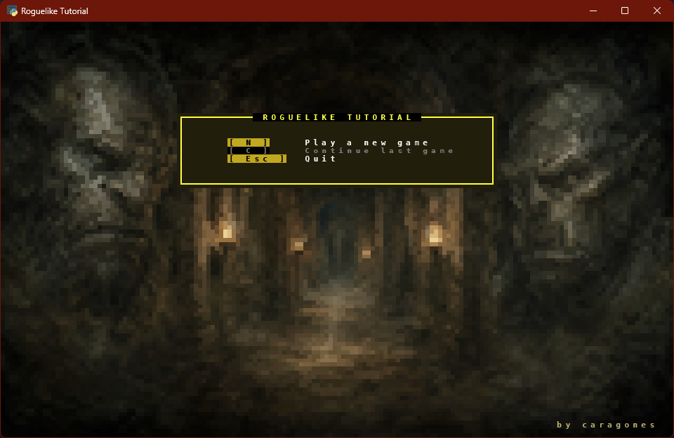
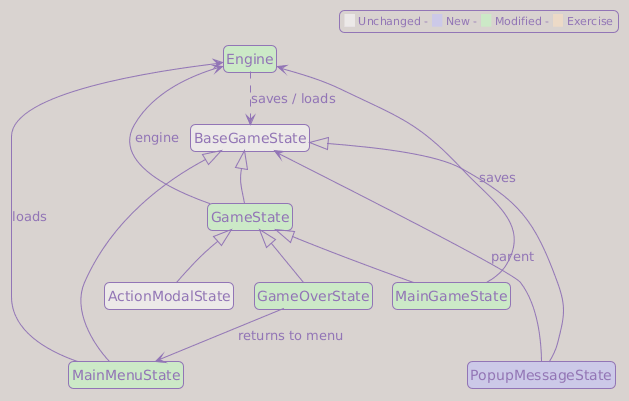
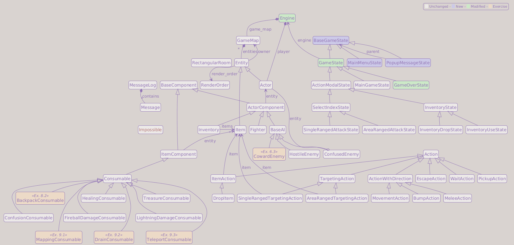
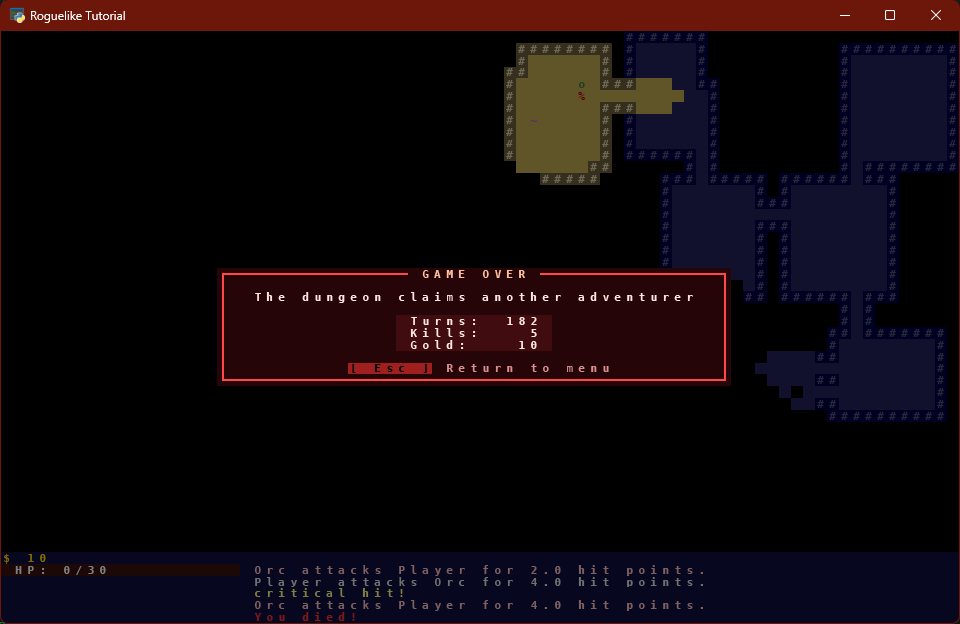

# Part 10b: Save and Load

In **Part 10a** we built the main menu and moved the current state into the main loop. This part saves that state to disk, so the player can quit and continue later.

## What You Will Build

By the end of Part 10b, the player can quit at any moment, with `Esc` or by closing the window, and continue later from the main menu: same spot, same map, same inventory, same message log. Continue is dimmed when there is nothing to load, and a broken save shows a message instead of crashing the game. Dying deletes the save.

## Learning goals

In this part we will:

- Save the whole game state to disk with `pickle` and `lzma`, and load it back
- Write the save file safely, and recover from a broken one
- Add a popup for short messages
- Add Continue to the main menu, and save when the player quits
- Delete the save file when the player dies
- Check that save, quit, and reload restore the map, entities, inventory, and message history

---

## Background

This section is for reading; there is nothing to type yet. If you want to start building right away, skip to [Engine.save_as()](#enginesave_as). You can come back here at any time, even after you finish the tutorial, when you know the game from the inside and some of these ideas will mean more.

### What a save file has to hold

Saving a game means converting the entire live object graph (engine, game map, entities, components, AI instances) into bytes that can be written to disk and reconstructed later.

```text
Engine
  ├── player (Actor)
  │     ├── fighter (Fighter)   ← component back-reference to player
  │     └── inventory (Inventory)
  ├── game_map (GameMap)
  │     └── entities: set[Entity]
  │           └── orc (Actor)
  │                 └── ai (HostileEnemy)  ← back-reference to the orc
Static state
  └── MessageLog.messages
```

The challenge: `Fighter.entity` points back to the `Actor` that owns it, `HostileEnemy.entity` points to the orc, and in Part 9 `ConfusedEnemy.previous_ai` holds another AI. These references form cycles: follow them and you come back to where you started. The message log is a separate static list, so we save it next to the engine.

### JSON or pickle

**JSON** cannot store cycles without custom encoding: every class needs a `to_dict()` / `from_dict()` pair. That is a lot of repeated code.

**`pickle`** handles cycles on its own. Python's `pickle` module serializes the whole object graph: it follows every reference and stores each shared object only once. It is the right tool for internal game state that you fully control.

!!! danger "pickle is not safe with untrusted data"
    Never load a pickle file from an unknown source: pickle can run arbitrary code while it loads. For a single-player game that loads only its own saves, this is fine.

!!! warning "Save files are not stable between code changes"
    Understanding what pickle does and does not serialize prevents hours of debugging.

    **What gets serialized:** every object reachable from the saved state, recursively. That means `Engine`, `GameMap`, every `Entity`, every `Fighter`, every `AI` instance, and anything those objects reference. For the plain Python classes in this project, pickle stores each object's `__dict__` (its instance attributes) together with the fully qualified class name (`module.ClassName`) needed to reconstruct it.

    **What does NOT get serialized:** method bodies, property functions, class-level constants (`UPPERCASE` values), and anything not stored as instance data.

    **Changes that break existing saves:**

    - Renaming an instance attribute (`self._hp` to `self._health`): an old save still contains `_hp`, but the new code reads `_health`, so it raises `AttributeError`.
    - Renaming or moving a class (`game.fighter.Fighter` to `game.components.Fighter`): pickle cannot find the class and raises `ModuleNotFoundError` or `AttributeError`.
    - Adding a new instance attribute that old saves do not have, unless you provide a migration or fallback.

    **Changes that do not usually break saves by themselves:**

    - Adding or renaming methods, as long as they can still work with old instance data.
    - Adding properties or class constants, as long as they do not read missing instance attributes.
    - Changing default parameter values in `__init__` (only affects newly created instances; loading with pickle does not call `__init__`).

    **The fix without deleting the save:** two tools, two use cases.

    - `__getattr__(self, name)`: Python calls this when normal attribute lookup fails. Use it when you *added* a new attribute that old saves simply don't have. It is useful for providing a simple default or lazily creating the missing field.

    - `__setstate__(self, state)`: pickle calls this once when loading, passing the saved `__dict__`. Use it when you *renamed* an attribute: rewrite the old key to the new name before updating `__dict__`; after that, every access works normally.

    Exercise 3 at the end of this part tries both, one after the other.

---

## Engine.save_as()

A save file is the current state turned into bytes with `pickle` (see [JSON or pickle](#json-or-pickle)) and compressed with `lzma`. A save from a fresh game is about 125 KB as raw pickle data, mostly the map arrays, which repeat the same few values many times. `lzma` shrinks it to 2 or 3 KB.

Add to `game/engine.py`:

```python
import lzma
import pickle
from pathlib import Path
from typing import TYPE_CHECKING

from game.message_log import MessageLog

if TYPE_CHECKING:
    from game.game_states import BaseGameState


class Engine:
    ...

    def save_as(self, filename: str | Path, active_state: BaseGameState) -> None:
        save_data = lzma.compress(
            pickle.dumps(
                {
                    "state": active_state,
                    "message_log": MessageLog.messages,
                }
            )
        )

        path = Path(filename)
        path.parent.mkdir(parents=True, exist_ok=True)
        tmp_path = path.with_suffix(".tmp")
        tmp_path.write_bytes(save_data)
        tmp_path.replace(path)
```

`pickle.dumps(...)` serializes `active_state` (which transitively includes the engine and everything it references) plus the static message log. `lzma.compress` shrinks it. `path.parent.mkdir(parents=True, exist_ok=True)` creates the `savegames/` directory if it does not exist yet.

The write uses a temporary file first: `savegame.tmp` is written completely, then `tmp_path.replace(path)` replaces `savegame.sav`. This is much safer than writing directly to the final file. If the process dies halfway through `write_bytes`, the old save is still intact. The replacement step is atomic on most filesystems when both files are in the same directory.

!!! tip "`Path.with_suffix()` and `Path.replace()`"
    `path.with_suffix(".tmp")` returns a new `Path` with the extension swapped: `savegames/savegame.sav` becomes `savegames/savegame.tmp`. The original path is unchanged.

    `tmp_path.replace(path)` renames `tmp_path` to `path`, overwriting the destination if it already exists. On Linux and macOS (POSIX systems) this rename is atomic: any reader of `path` sees either the old file or the new one, never a half-written mix. Windows does not make that formal promise, but the rename is still much safer than writing over the save in place. Both methods are part of the standard library `pathlib.Path` and work on every operating system.

Loading is the inverse:

```python
    @staticmethod
    def load(filename: str | Path) -> BaseGameState:
        save_data = Path(filename).read_bytes()
        data = pickle.loads(lzma.decompress(save_data))
        MessageLog.messages = data["message_log"]

        return data["state"]
```

`MessageLog.messages` is stored explicitly because it is class-level state, not an instance attribute of `Engine`. Without this extra field, loading would restore the map and entities but lose the visible message history.

The active state is now the root of the saved object graph. Any state that inherits from `GameState` stores the engine on `self.engine`, so code that needs the engine can access it through the current state after checking that the state is engine-backed.

`engine.py` imports `BaseGameState` only inside `if TYPE_CHECKING:`, the same trick `game_states.py` already uses for `Engine`. The type checker sees the name, but at run time `engine.py` still does not import `game_states.py`, so the import cycle that Part 10a removed does not come back.

---

## load_game()

`setup_game.py` gets the second function promised in Part 10a: one that loads a save and returns the saved state. First the new imports:

```diff
 import copy
 import os
 import random
+from pathlib import Path
+from typing import TYPE_CHECKING
 
 from game.data import colors, config
 from game.engine import Engine
 from game.entities import factories
 from game.map.map_generator import generate_dungeon
 from game.message_log import MessageLog
+
+if TYPE_CHECKING:
+    from game.game_states import BaseGameState
```

Then add at the end of `game/setup_game.py`:

```python
def load_game(filename: str | Path) -> BaseGameState:
    """Load a save file and return the saved game state."""
    path = Path(filename)
    if not path.exists():
        raise FileNotFoundError(f"No save file found at {filename!r}")

    try:
        return Engine.load(path)

    except Exception as ex:  # pylint: disable=broad-exception-caught
        backup_path = path.with_suffix(path.suffix + ".bak")
        path.replace(backup_path)
        raise RuntimeError(f"Save file could not be loaded and was moved to {backup_path}.") from ex
```

`load_game` needs `Path` for its type annotation and for the backup path. Like `engine.py`, it imports `BaseGameState` only for the type checker.

`load_game()` handles one practical edge case: the save file might exist but fail to load because it is corrupt or incompatible with the current code. Instead of leaving the player stuck with a broken Continue option, the failed save is moved aside to `savegame.sav.bak` and the menu can show a clear message.

The `except Exception` here does not hide anything: it moves the file and raises a new `RuntimeError`, and `from ex` keeps the original error attached to it. Whoever calls `load_game()` only has to handle `RuntimeError`.

---

## PopupMessageState

The menu needs a way to tell the player that there is nothing to load, or that the save was broken. `PopupMessageState` draws a short message over another state, and any key closes it. Like the menu, it needs no engine, so it inherits from `BaseGameState`:

```text
BaseGameState
  ├── GameState (has engine, handles actions)
  │     └── ...
  ├── MainMenuState  (no engine yet)
  └── PopupMessageState (renders a message overlay over the parent state)
```

`PopupMessageState` wraps long lines with `textwrap`, so add the import at the top of `game/game_states.py`:

```diff
 import math
+import textwrap
 from collections.abc import Callable
```

It also needs its own small palette. Add to `game/data/colors.py`:

```python
# Popup colors
POPUP_FRAME = Color(255, 245, 160)
POPUP_BG    = Color( 14,  18,  26)
POPUP_TITLE = Color(255, 245, 160)
POPUP_TEXT  = Color(232, 240, 255)
POPUP_DIM   = Color(160, 176, 200)
```

`POPUP_FRAME` and `POPUP_TITLE` hold the same value on purpose: the frame and the title share a color for now, but stay separate constants so they can diverge later.

Add to `game/game_states.py`, between `BaseGameState` and `MainMenuState`:

```python
class PopupMessageState(BaseGameState):
    """Display a message rendered over the parent state with a darkened overlay."""

    def __init__(self, parent_state: BaseGameState, text: str) -> None:
        self.parent = parent_state
        self.text   = text

    def on_render(self, console: tcod.console.Console) -> None:
        self.parent.on_render(console)

        # Dim the screen behind the popup
        console.fg[:] = console.fg // 2
        console.bg[:] = console.bg // 2

        title = " Message "
        hint = "Press any key"
        max_lines = max(1, console.height - 8)
        max_width = console.width - 10
        lines: list[str] = []
        for raw_line in self.text.split("\n"):
            # Wrap long lines instead of cutting them, like the message log
            lines.extend(textwrap.wrap(raw_line, max_width) or [""])
        lines = lines[:max_lines]
        width = min(
            console.width - 4,
            max(len(title), len(hint), *(len(line) for line in lines)) + 6,
        )
        height = len(lines) + 5
        x      = (console.width  - width)  // 2
        y      = (console.height - height) // 2

        # Draw the popup box
        _draw_panel(console, x, y, width, height, colors.POPUP_FRAME, colors.POPUP_BG)

        # Draw the popup title over the frame
        console.print(
            x    = x + (width - len(title)) // 2,
            y    = y,
            text = title,
            fg   = colors.POPUP_TITLE,
            bg   = colors.POPUP_BG,
        )

        for i, line in enumerate(lines):
            # Draw each message line centered inside the popup
            console.print(
                console.width // 2,
                y + 2 + i,
                line,
                fg        = colors.POPUP_TEXT,
                bg        = colors.POPUP_BG,
                alignment = tcod.constants.CENTER,
            )

        # Draw the close hint at the bottom of the popup
        console.print(
            x         = console.width // 2,
            y         = y + height - 2,
            text      = hint,
            fg        = colors.POPUP_DIM,
            bg        = colors.POPUP_BG,
            alignment = tcod.constants.CENTER,
        )

    def event_keydown(self, _event: tcod.event.KeyDown) -> Action | BaseGameState | None:
        return self.parent
```

`PopupMessageState` renders its parent state first, then dims the whole console by halving every color channel (the `// 2` trick from Part 7) and draws the box with `_draw_panel()`.

The body makes sure the text always fits on screen:

- Long lines are wrapped with `textwrap.wrap` (the same module the message log uses).
- `max_lines` limits how many wrapped lines are shown.
- `width` is clamped to `console.width - 4`.
- The `or [""]` keeps blank lines that are there on purpose: `textwrap.wrap("")` returns an empty list, so without it they would disappear.

The box shows a `" Message "` title on the top frame row and a dim "Press any key" hint above the bottom border. Any key closes it and returns to the parent state.


---

## Continue in the main menu

Add the key next to `KEY_NEW_GAME` in `game/data/keys.py`:

```python
KEY_CONTINUE     = tcod.event.KeySym.C
```

The menu now calls `load_game()` too. In `game/game_states.py`, extend the import:

```diff
-from game.setup_game import new_game
+from game.setup_game import load_game, new_game
```

Add the Continue option to `MainMenuState.on_render`. It is enabled only when a save file exists:

```diff
         menu_options = [
-            (keys.KEY_NEW_GAME,  "Play a new game", True),
-            (keys.KEY_QUIT_GAME, "Quit",            True),
+            (keys.KEY_NEW_GAME,  "Play a new game",    True),
+            (keys.KEY_CONTINUE,  "Continue last game", config.SAVE_PATH.exists()),
+            (keys.KEY_QUIT_GAME, "Quit",               True),
         ]
```

And handle the key in `MainMenuState.event_keydown`:

```diff
             case keys.KEY_QUIT_GAME:
                 raise SystemExit()
+
+            case keys.KEY_CONTINUE:
+                if not config.SAVE_PATH.exists():
+                    return PopupMessageState(self, "No saved game to load.")
+
+                try:
+                    return load_game(config.SAVE_PATH)
+
+                except FileNotFoundError:
+                    return PopupMessageState(self, "No saved game to load.")
+
+                except (RuntimeError, OSError) as ex:
+                    return PopupMessageState(self, f"Failed to load save:\n{ex}")
 
         return None
```

*The finished main menu screen*:



The menu reads `config.SAVE_PATH` on every frame to decide whether Continue is enabled. The Continue option is dimmed when no save file exists, but pressing `C` still shows a popup. If the game ignored the key, the player might think it had stopped responding.

When a save exists, `load_game()` returns the saved state, usually a `MainGameState`, and the menu returns it like any other transition.

The first `except FileNotFoundError` is a TOCTOU guard (Time-Of-Check/Time-Of-Use): the file could be deleted between the `config.SAVE_PATH.exists()` check above and the actual `load_game()` call, so we handle that race rather than letting it crash.

The second `except` covers every other load failure, and a corrupt or incompatible save file shows a popup instead of crashing the program. It does not need to catch `Exception`: `load_game()` already turns any error from `Engine.load()` into a `RuntimeError`, and the only other error it can raise is an `OSError` if moving the file to `.bak` fails. `FileNotFoundError` is also an `OSError`, which is why it must come first: Python uses the first `except` that matches.

---

## Save on Escape

In Part 10a, `Esc` during play returns to the menu and the game is lost. Now it saves first. If saving fails, the error is logged, so add `logging` and a logger for the module at the top of `game/game_states.py`:

```diff
+import logging
 import math
 import textwrap
@@
 if TYPE_CHECKING:
     from game.engine import Engine
     from game.entities.entity import Item
 
+logger = logging.getLogger(__name__)
+
 
 def _draw_panel(
```

`logging.getLogger(__name__)` returns a logger named after the module (`game.game_states`), so each message says which module wrote it. We do not configure `logging` anywhere: by default, Python prints warnings and errors to the terminal, and that is all we need.

Then change `MainGameState.event_keydown`:

```diff
         if key == keys.KEY_QUIT_GAME:
-            return MainMenuState()
+            try:
+                self.engine.save_as(config.SAVE_PATH, self)
+                print(f"Game saved at {config.SAVE_PATH}.")
+
+            except Exception:  # pylint: disable=broad-exception-caught
+                logger.exception("Could not save the game.")
+
+            return MainMenuState()
```

The state passed to `save_as()` is `self`, the `MainGameState`. Continue gets it back from `load_game()` and returns it, so the player is in the same state they left.

Here the `except` catches any `Exception` on purpose. Saving can fail in many ways (a full disk, a folder without write permission, an object that `pickle` cannot store), and none of them should crash the game and lose the session. Catching everything is safe only because nothing is lost: `logger.exception()` prints the message and the full traceback to the terminal, so you can still see what went wrong and where. A broad `except` that only prints `str(ex)`, or does nothing, would hide the bug.

!!! info "`except Exception` is not \"catch everything\""
    Python has a wider base class, `BaseException`, and a bare `except:` catches it too. It includes `KeyboardInterrupt` (Ctrl+C) and `SystemExit` (`sys.exit()`, which our own quit uses). Those are not errors: they are requests to stop the program. `except Exception` lets them through, which is what we want.

    If you come from C++, `except Exception` is close to `catch (const std::exception&)`, and `except BaseException` is close to `catch (...)`. Unlike C++, Python has no reason to use the second one for safety: an exception that nobody catches prints its traceback and ends the program in a clean way.

---

## main.py: save when the window closes

`Esc` is not the only way to leave a game: the player can also close the window. That raises `SystemExit` from inside `run()`, so `main.py` is the place to save in that case.

Update the imports at the top of `main.py`, and add a logger:

```diff
 from __future__ import annotations
 
+import logging
+from collections.abc import Callable
+
 import tcod
 
 from game.data import config
 from game.game_states import (
     BaseGameState,
+    GameOverState,
+    GameState,
     MainMenuState,
 )
+
+logger = logging.getLogger(__name__)
```

Replace `run()` with this version, and add `save_game()` below it:

```python
def run(
    state: BaseGameState,
    context: tcod.context.Context,
    console: tcod.console.Console,
    on_exit: Callable[[BaseGameState], None] | None = None,
) -> None:
    """Drive the game state machine until SystemExit. Calls on_exit(state) before re-raising."""
    try:
        while True:
            console.clear()
            state.on_render(console = console)
            context.present(console)

            for event in tcod.event.wait():
                event = context.convert_event(event)
                state = state.handle_events(event)

    except SystemExit:
        if on_exit is not None:
            on_exit(state)
        raise


def save_game(state: BaseGameState) -> None:
    if isinstance(state, GameState) and not isinstance(state, GameOverState):
        try:
            state.engine.save_as(config.SAVE_PATH, state)
            print(f"Game saved at {config.SAVE_PATH}.")

        except Exception:  # pylint: disable=broad-exception-caught
            logger.exception("Could not save the game.")
```

Finally, pass `save_game` to `run()` at the end of `main()`:

```diff
         console = tcod.console.Console(config.SCREEN_WIDTH, config.SCREEN_HEIGHT, order="F")
-        run(state, context, console)
+        run(state, context, console, on_exit=save_game)
```

The `try/except SystemExit` inside `run()` catches the quit signal raised by any state, runs `save_game`, then re-raises so Python exits normally. The `on_exit` callback receives the *current* state (after any state-machine transitions during `handle_events`), not the initial one.

`save_game()` is the fallback for closing the window with the X button. It does not run after a crash: `run()` only catches `SystemExit`, so any other exception skips it. The normal in-game quit path (Escape) already saves explicitly before transitioning to `MainMenuState`, so `save_game` mainly catches the case where the player is mid-game and closes the window without pressing Escape. If they are at the main menu or game-over screen there is nothing to save.

The `try/except` guards against one edge case: if the player closes the window while a targeting cursor is active (`SingleRangedAttackState`, `AreaRangedAttackState`), the state holds a `callback` lambda. `pickle` cannot serialize lambdas or closures, only named top-level functions and ordinary data. The save is skipped and the error is logged, instead of crashing. This is a general rule worth remembering: `pickle` works well with plain classes and top-level functions; lambdas, open file handles, and GUI contexts will fail.

`SAVE_DIR` and `SAVE_PATH`, staged in `config.py` in Part 10a, are absolute `Path` values like `RES_DIR`. `save_game`, `MainGameState`, the menu, and `load_game` agree on the save file without any path-joining at call sites.

!!! tip "Run it now"
    If you run `uv run main.py` now, you can check the whole save cycle before we handle death. The main menu appears, with Continue dimmed. Press `N`, walk a few steps, and press `Esc`: the terminal prints where the game was saved, and you are back at the menu with Continue enabled. Press `C` and you are back in the same spot, with the same message log.

    Repeat the round trip two or three times, and once close the window instead of pressing `Esc`. It is a good habit to test the save path now, while it is the only new thing that can break. Dying still leaves the last save on disk; the next section fixes that.

---

## Delete save on death

If the player dies, the save file is stale (it would reload a dead character). Delete it when the game enters `GameOverState`.

Add an `on_enter()` method to `GameOverState`:

```diff
 class GameOverState(GameState):
     TITLE    = "GAME OVER"
     FG_COLOR = colors.GAME_OVER_FRAME
     BG_COLOR = colors.GAME_OVER_PANEL_BG
 
+    def on_enter(self) -> None:
+        if config.SAVE_PATH.exists():
+            config.SAVE_PATH.unlink()
+
     def on_render(self, console: tcod.console.Console) -> None:
```

Then call it from `GameState.handle_events()`, where the player's death is detected:

```diff
             if not self.engine.player.is_alive:
-                return GameOverState(self.engine)
+                new_state = GameOverState(self.engine)
+                new_state.on_enter()
+                return new_state
```

`GameOverState` keeps its own `event_keydown` so Escape still quits from the game-over screen. The save file is deleted when the state is entered, before the player has a chance to quit.

---

## Complete file listing for Part 10b

After this part, the save and load code in `game/engine.py` looks like this:

```python
import lzma
import pickle
from pathlib import Path
from typing import TYPE_CHECKING

from game.message_log import MessageLog

if TYPE_CHECKING:
    from game.game_states import BaseGameState


class Engine:

    def save_as(self, filename: str | Path, active_state: BaseGameState) -> None:
        save_data = lzma.compress(
            pickle.dumps(
                {
                    "state": active_state,
                    "message_log": MessageLog.messages,
                }
            )
        )

        path = Path(filename)
        path.parent.mkdir(parents=True, exist_ok=True)
        tmp_path = path.with_suffix(".tmp")
        tmp_path.write_bytes(save_data)
        tmp_path.replace(path)

    @staticmethod
    def load(filename: str | Path) -> BaseGameState:
        save_data = Path(filename).read_bytes()
        data = pickle.loads(lzma.decompress(save_data))
        MessageLog.messages = data["message_log"]

        return data["state"]
```

The other changes:

**`game/setup_game.py`**: gains `load_game()`, which moves a broken save to `.bak`

**`game/game_states.py`**: additions: `PopupMessageState`, Continue in `MainMenuState`, save on Escape in `MainGameState`, `GameOverState.on_enter()`

**`main.py`**: saves on `SystemExit` through `on_exit=save_game`

---

## Testing Part 10b

Run the game with `uv run main.py` (or `python main.py`):

- [ ] The main menu appears with the background image, three framed options, and the author text in the lower-right corner
- [ ] `Continue last game` is dimmed when no save file exists
- [ ] Pressing `C` with no save shows `"No saved game to load."`
- [ ] `N` starts a new game
- [ ] Play for a few turns (pick up items, fight enemies)
- [ ] Press `Esc` or close the window, the terminal prints where the game was saved
- [ ] Run the game again, `C` loads the game with the same map, entities, and message log
- [ ] Die in combat, the game-over screen appears
- [ ] Press `Esc` to quit, no new save is written
- [ ] Run the game again, `C` shows `"No saved game to load."` because death deleted it

---

## Summary

Save and load is complete. The verification milestone is met:

> **save, quit, reload → map, entities, inventory, and message history restored**

Key additions:

- **`pickle` + `lzma`**: serialize/deserialize the active state plus static message log state
- **Atomic save writes**: write to a temporary file before replacing the final save
- **Corrupt save recovery**: move broken saves to `.bak` instead of trapping the player on a bad Continue option
- **`load_game()`**: the second half of `setup_game.py`, next to `new_game()`
- **`PopupMessageState`**: dismissable framed overlay with darkened background
- **Continue in the main menu**: enabled only when a save exists, with a popup for every failure
- **Save on quit, delete on death**: the normal quit and death paths keep the save file consistent; dead runs are never preserved

**Current architecture**:

- `main.py`: owns the outer app loop and active `BaseGameState`, and saves on `SystemExit`
- `setup_game.py`: creates new games and loads saved ones
- `BaseGameState`: common interface for menu, popup, and engine-backed states
- `MainMenuState`: starts before an `Engine` exists
- `Engine.save_as(filename, state)` / `Engine.load()`: serialize and restore the active state (engine included transitively) plus `MessageLog.messages`

**Local Class Diagram**:



**Full Class Diagram**:



**File structure**:

```text
main.py                         ← modified
res/
├── dejavu12x12_gs_tc.png
└── menu_background.png
game/
├── __init__.py
├── actions.py
├── engine.py                   ← modified
├── exceptions.py
├── hud.py
├── game_states.py              ← modified
├── message_log.py
├── setup_game.py               ← modified
├── data/
│   ├── __init__.py
│   ├── colors.py               ← modified
│   ├── config.py
│   ├── keys.py                 ← modified
│   └── sprites.py
├── entities/
│   ├── __init__.py
│   ├── entity.py
│   ├── factories.py
│   ├── render_order.py
│   └── components/
│       ├── __init__.py
│       ├── ai.py
│       ├── base_component.py
│       ├── consumable.py
│       ├── fighter.py
│       └── inventory.py
└── map/
    ├── __init__.py
    ├── game_map.py
    ├── tile_types.py
    └── map_generator.py
```

---

## Exercises

The next parts assume you did these exercises. Try each one on your own first. If one is too hard for now, do not let it stop you: where a reference solution is given, read it and type it in, and when a later part builds on an exercise, it points out the code that comes from it.

1. **Return to main menu on death**:

    On death the game currently quits on `Escape`. Make it return to the main menu instead, so the player can start a fresh run without relaunching the program, and update the on-screen hint so it tells the truth about what `Escape` now does. Draw the hint as a key **badge** (dark text on an accent background, the same style as the Part 8 inventory rows) followed by its description, which means building it from two pieces so the badge and the text can be styled and positioned independently.

    ??? note "Reference implementation"
        The handler change is in `GameOverState.event_keydown` (`game/game_states.py`): return `MainMenuState()` where it used to quit. The method now returns a state, so widen its return type the same way Step 3 of Part 10a did for the other states:

        ```diff
        -    def event_keydown(self, event: tcod.event.KeyDown) -> Action | None:
        +    def event_keydown(self, event: tcod.event.KeyDown) -> Action | BaseGameState | None:
                 if event.sym == keys.KEY_QUIT_GAME:
        -            return EscapeAction()
        +            return MainMenuState()
        ```

        Add the accent color in `game/data/colors.py`:

        ```python
        GAME_OVER_ACCENT = Color(160,  32,  32)
        ```

        Build the hint from two pieces in `GameOverState.on_render` (`game/game_states.py`); the combined string is still handy for the width calculation:

        ```python
        hint_key  = key_label(keys.KEY_QUIT_GAME)
        hint_text = "Return to menu"
        hint      = f"{hint_key} {hint_text}"
        ```

        ...then draw the badge and its description separately:

        ```python
        # Draw the hint for returning to the main menu
        hint_x = (console.width - len(hint)) // 2
        hint_y = y + height - 2
        # Draw the key that returns to the main menu
        console.print(
            x    = hint_x,
            y    = hint_y,
            text = hint_key,
            fg   = colors.BLACK,
            bg   = colors.GAME_OVER_ACCENT,
        )

        # Draw the description for the return-to-menu action
        console.print(
            x    = hint_x + len(hint_key) + 1,
            y    = hint_y,
            text = hint_text,
            fg   = colors.GAME_OVER_DIM,
        )
        ```

2. **Record a graveyard file**:

    Add a small run history, written when the player dies. Two counters feed it: `turn_count` on `Engine` and `kill_count` on `Fighter`. The thinking is in *when* each one increments:

    - `turn_count` only after an action that actually consumes a turn: opening the inventory, cancelling targeting, scrolling the message log, and impossible actions do not count. This has been true since Part 8b.
    - `kill_count` on the actor that *caused* a death, threaded through the damage code so melee attacks and damaging scrolls both attribute correctly. Self-inflicted deaths (caught in your own fireball) must not count.

    If you carried the Part 1 turn counter forward, `turn_count` already exists and already counts correctly. Retire the debug `Turn:` print from `Engine.render()`, if you still have it, now that the graveyard shows the tally on the game-over screen. The counter born in Part 1 to prove that time only passes when you act ends its journey here, feeding your run history.

    Show the tally on the game-over screen, then on death append one record to a `graveyard.json`. Use JSON, not pickle: it is a small, stable record that should stay readable even if the game's classes change later.

    ??? note "Reference implementation"
        Add `kill_count` as `int = 0` to `Fighter.__init__` (`game/entities/components/fighter.py`). `turn_count` already exists on `Engine` since Part 1.

        Attribute the kill in `Fighter.take_damage` (`game/entities/components/fighter.py`); the `attacker` is threaded in from `melee_attack` and the damaging consumables:

        ```diff
        -def take_damage(self, amount: float) -> None:
        +def take_damage(self, amount: float, attacker: Actor) -> None:
             self.hp -= amount
        +    if self.hp <= 0 and attacker is not self.entity:
        +        # Part-10. Exercise 2: Record a graveyard file
        +        # Self-inflicted deaths do not count as kills
        +        attacker.fighter.kill_count += 1
        ```

        This changes `take_damage`'s signature, so every call site must pass `attacker`: `melee_attack` in `fighter.py`, plus the lightning, fireball, and drain consumables in `consumable.py`. That threading is exactly the change Part 11b makes in its "Award XP on kill" section, which then notes it is already in place if you did this exercise.

        Show the tally. Add the row color in `game/data/colors.py`:

        ```python
        GAME_OVER_ROW_BG = Color( 64,  12,  16)
        ```

        Then in `GameOverState.on_render` (`game/game_states.py`), grow the panel (`height = 10`) and build a centered stats box between the message and the hint, one row per stat over its own `GAME_OVER_ROW_BG` background (the same row pattern as the inventory overlay), including the stat lines in the panel `width` so values never overflow:

        ```python
        stats = [
            ("Turns:", str(self.engine.turn_count)),
            ("Kills:", str(self.engine.player.fighter.kill_count)),
            ("Gold:",  str(self.engine.player.inventory.gold)),
        ]
        stat_label_width = max(len(label) for label, _ in stats)
        stat_value_width = max(len(value) for _, value in stats) + 2
        stat_lines = [
            f"{label:<{stat_label_width}}{value:>{stat_value_width}}"
            for label, value in stats
        ]
        ```

        

        Write the record on death in `GameOverState.on_enter` (`game/game_states.py`); this needs `import json` and `from datetime import datetime`:

        ```python
        # Part-10. Exercise 2: Record a graveyard file
        graveyard_path = config.SAVE_DIR / "graveyard.json"
        if graveyard_path.exists():
            graveyard = json.loads(graveyard_path.read_text(encoding="utf-8"))
        else:
            graveyard = []

        graveyard.append(
            {
                "date": datetime.now().isoformat(timespec="seconds"),
                "turns": self.engine.turn_count,
                "kills": self.engine.player.fighter.kill_count,
                "gold": self.engine.player.inventory.gold,
            }
        )
        graveyard = graveyard[-10:]   # keep only the latest 10 runs

        config.SAVE_DIR.mkdir(parents=True, exist_ok=True)
        graveyard_path.write_text(json.dumps(graveyard, indent=2), encoding="utf-8")
        ```

        JSON, not pickle: a graveyard entry is a small, stable record that should stay readable even if the game's classes change.

3. **Break and fix an old save file**:

    Saves are pickled, so they break when `Fighter`'s shape changes underneath them. This exercise reproduces that on purpose and shows the two tools that fix it: `__getattr__` for a **new** field, `__setstate__` for a **renamed** one. Each part starts from the normal Part 10 code, and the order matters: first create the save, then change the code, so you reproduce the real problem of a player carrying a save across versions.

    **Part A: a new field (`__getattr__`)**

    Run the game, play a turn or two, and press `Escape` to save. That save's `Fighter` objects have no `_armor`. Now pretend the next version adds armor. Add an `_armor` attribute to `Fighter.__init__`:

    ```python
    self._armor: float = 0.0
    ```

    Add a property that reads it:

    ```python
    @property
    def armor(self) -> float:
        return self._armor
    ```

    Then make damage use it (the important part is that combat reads `target.fighter.armor`):

    ```diff
    -base_damage = (self.attack * self.attack) / (self.attack + target.fighter.defense)
    +base_damage = (self.attack * self.attack) / (self.attack + target.fighter.defense + target.fighter.armor)
    ```

    Load the old save (`C`): the load succeeds, but the first time damage reads armor the game crashes with `AttributeError: 'Fighter' object has no attribute '_armor'`, because the pickled object predates the field. Try to make old saves repair themselves before you peek.

    ??? note "The fix: `__getattr__`"
        `__getattr__` runs only when normal attribute lookup fails, so fresh objects (which already have `_armor`) never reach it; old ones get the field created on first access, and the next save stores it normally. Add `from typing import Any` near the imports, then add this to `Fighter`:

        ```python
        def __getattr__(self, name: str) -> Any:
            if name == "_armor":
                self._armor = 0.0
                return self._armor

            raise AttributeError(name)
        ```

    Revert the exercise changes when done if you want to continue from the exact reference code.

    ---

    **Part B: a renamed field (`__setstate__`)**

    Return to the normal Part 10 code, delete the Part A save, and save again. This save contains `Fighter._hp`. Now pretend the next version renames the stored field: rename `_hp` to `_health` throughout `game/entities/components/fighter.py` (the `__init__` assignment, the `hp` getter and setter, and `heal()`). The public `hp` property keeps its name; only the stored attribute changes.

    Load the old save: the same kind of crash, `AttributeError: 'Fighter' object has no attribute '_health'`. `__getattr__` could hide it, but a rename is better fixed once, at load time. Try it before you peek.

    ??? note "The fix: `__setstate__`"
        Pickle calls `__setstate__` once on load with the saved `__dict__`; rewrite the old key to the new one before updating the object, so afterwards `_health` is present as normal and later saves store it correctly:

        ```python
        def __setstate__(self, state: dict) -> None:
            if "_hp" in state and "_health" not in state:
                state["_health"] = state.pop("_hp")

            self.__dict__.update(state)
        ```

    Revert the exercise changes when done if you want to continue from the exact reference code.

    ---

    !!! warning "Delete your save before starting Part 11"
        These exercises intentionally create incompatible save files. Delete `savegames/savegame.sav` before continuing. Part 11a adds a `game_world` to the engine and Part 11b a `Level` component to every actor; a save written now has neither, so any leftover save will fail after you load it.
