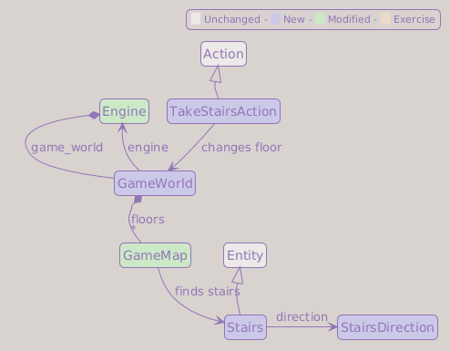

# Part 11a: Dungeon Levels

**Part 11** gives the dungeon depth and the player a way to grow stronger. The two systems are almost independent, so the chapter comes in two parts.

**Part 11a** adds more floors: stairs down to new floors and back up to the ones already visited.

**Part 11b** adds experience: enemies give XP when they die, and the player levels up and chooses a bonus.

---

## What You Will Build

By the end of Part 11a, the dungeon has more than one floor. The player finds the `>` in the last room of a floor, presses Enter, and arrives on a new, deeper floor. The `<` leads back up to the floor above, exactly as the player left it. The HUD shows the current floor and a wider HP bar.

## Learning goals

In this part we will:

- Introduce `GameWorld` to separate "how to generate maps" from the current map
- Add stairs that go down to a new floor and back up to the previous one
- Keep every visited floor, so going back up returns to the same map
- Show the floor number in the HUD, and widen the HP bar for the XP bar of Part 11b

---

## Background

This section is for reading; there is nothing to type yet. If you want to start building right away, skip to [GameWorld: map settings apart from the current map](#gameworld-map-settings-apart-from-the-current-map). You can come back here at any time, even after you finish the tutorial, when you know the game from the inside and some of these ideas will mean more.

### Floors that stay

Every roguelike with stairs must decide what happens to a floor when the player leaves it. Rogue, and Angband by default, create a new level every time you take the stairs: if you go back up, you find a different floor. NetHack keeps every level you visit, with the items you dropped and the corpses you left.

We keep the floors. A new class, `GameWorld`, holds the settings used to generate a map and a list of every floor generated so far. Going down to a new depth generates a floor and adds it to the list; going back up only switches to a floor that already exists. Each floor gets its own seed (the run's seed plus the floor number), so the same run always produces the same dungeon.

---

## GameWorld: map settings apart from the current map

`Engine` currently holds `game_map` directly. When the player goes down the stairs, we need to generate a new map with the same parameters but a higher floor number. We move those parameters into a `GameWorld` class.

Create `game/game_world.py`:

```python
from __future__ import annotations

from typing import TYPE_CHECKING

from game.map.map_generator import generate_dungeon

if TYPE_CHECKING:
    from game.engine import Engine
    from game.map.game_map import GameMap


class GameWorld:
    """Holds the settings for map generation and tracks the current floor."""

    def __init__(
        self,
        *,
        engine: Engine,
        map_width: int,
        map_height: int,
        max_rooms: int,
        room_min_size: int,
        room_max_size: int,
        min_monsters_per_room: int,
        max_monsters_per_room: int,
        min_items_per_room: int,
        max_items_per_room: int,
        seed: int,
        current_floor: int = 0,
    ) -> None:
        self.engine                = engine
        self.map_width             = map_width
        self.map_height            = map_height
        self.max_rooms             = max_rooms
        self.room_min_size         = room_min_size
        self.room_max_size         = room_max_size
        self.min_monsters_per_room = min_monsters_per_room
        self.max_monsters_per_room = max_monsters_per_room
        self.min_items_per_room    = min_items_per_room
        self.max_items_per_room    = max_items_per_room
        self.seed                  = seed
        self.current_floor         = current_floor
        self.floors: list[GameMap] = []

    def generate_floor(self) -> None:
        self.current_floor += 1
        self.engine.game_map = generate_dungeon(
            max_rooms             = self.max_rooms,
            room_min_size         = self.room_min_size,
            room_max_size         = self.room_max_size,
            map_width             = self.map_width,
            map_height            = self.map_height,
            min_monsters_per_room = self.min_monsters_per_room,
            max_monsters_per_room = self.max_monsters_per_room,
            min_items_per_room    = self.min_items_per_room,
            max_items_per_room    = self.max_items_per_room,
            player                = self.engine.player,
            seed                  = self.seed + self.current_floor,
        )
```

`GameWorld` keeps a reference to the engine because `generate_floor` needs two things from it: the player, to place on the new map, and the `game_map` attribute, which it replaces with that map.

`seed + self.current_floor` keeps the run reproducible while still giving each dungeon floor a different layout. Using the exact same seed for every floor would generate the same dungeon again.

The seed comes from Part 3 Exercise 1 (reproducible dungeons). If you skipped that exercise, your `generate_dungeon` has no `seed` parameter: omit the `seed` parameter and attribute from `GameWorld`, the `seed = ...` argument in `generate_floor`, and the `seed = seed` argument in `new_game` below. Each floor is then fully random.

!!! info "Keyword-only arguments"
    In `def __init__(self, *, engine, ...)`, the bare `*` forces every argument after it to be passed by name: `GameWorld(engine=engine, map_width=80, ...)`. A positional call like `GameWorld(engine, 80, 48, ...)` raises a `TypeError` at once.

    This protects constructors with many parameters of the same type. If you swap two `int` arguments in a positional call, nothing warns you and the bug stays hidden. With keyword arguments, the call site shows which value goes where.

Update `Engine` in `game/engine.py`. The engine will no longer receive `game_map` through its constructor: the map is created later by `GameWorld.generate_floor()`, which assigns it directly to `engine.game_map`. Add class-level annotations so the type checker knows both attributes will exist even though neither is set in `__init__`, and remove `self.update_fov()` from the constructor (it will be called from `new_game()` after the first floor is generated):

```diff
+from game.game_world import GameWorld

 class Engine:
+    game_map: GameMap
+    game_world: GameWorld

-    def __init__(self, game_map: GameMap, player: Actor, ...) -> None:
-        self.game_map = game_map
+    def __init__(self, player: Actor, ...) -> None:
         self.mouse_location: tuple[int, int] = (0, 0)
         self.player = player
         ...
-        self.update_fov()
```

If you completed exercises from previous parts, keep `fov_radius`, `fading_memory`, and `memory_duration` as optional parameters in `__init__`, and keep the `turn_count` attribute. They stay on the engine and this change does not affect them.

Update `game/setup_game.py` to replace the direct `generate_dungeon` call with `GameWorld`:

```diff
 from game.entities import factories
-from game.map.map_generator import generate_dungeon
+from game.game_world import GameWorld

 def new_game() -> Engine:
     ...
-    game_map = generate_dungeon(
+    engine = Engine(
+        player          = player,
+
+        # Part-4. Exercise 4: Fading memory
+        fading_memory   = config.FADING_MEMORY,
+        memory_duration = config.MEMORY_DURATION,
+    )
+    engine.game_world = GameWorld(
+        engine                = engine,
         max_rooms             = config.MAX_ROOMS,
         room_min_size         = config.ROOM_MIN_SIZE,
         room_max_size         = config.ROOM_MAX_SIZE,
         map_width             = config.MAP_WIDTH,
         map_height            = config.MAP_HEIGHT,
         min_monsters_per_room = config.MIN_MONSTERS_PER_ROOM,  # Part-5. Exercise 1: Minimum monsters per room
         max_monsters_per_room = config.MAX_MONSTERS_PER_ROOM,
         min_items_per_room    = config.MIN_ITEMS_PER_ROOM,
         max_items_per_room    = config.MAX_ITEMS_PER_ROOM,
-        player                = player,
         seed                  = seed,    # Part-3. Exercise 1: Reproducible dungeons
     )
-
-    engine = Engine(
-        game_map        = game_map,
-        player          = player,
-
-        # Part-4. Exercise 4: Fading memory
-        fading_memory   = config.FADING_MEMORY,
-        memory_duration = config.MEMORY_DURATION,
-    )
+    engine.game_world.generate_floor()
+    engine.update_fov()
```

The engine is now created first, because `GameWorld` needs it, and `GameWorld` gets the player from the engine instead of a `player` argument. If you skipped Part 4 Exercise 4, create the engine with `Engine(player=player)`.

!!! warning "Save file compatibility"
    Adding `game_world` to `Engine` changes the structure of the pickled objects. A save file from Part 10 still loads, but the saved engine has no `game_world`, so the game crashes as soon as it needs one: when you take the stairs and, once the HUD shows the floor number at the end of this part, as soon as it draws the screen.

    Delete `savegames/savegame.sav` before testing this part.

!!! tip "Run it now"
    If you run the game now with `uv run main.py` (or `python main.py`), you can check that nothing broke: start a new game and it plays exactly as in Part 10. The map now comes from `GameWorld`, but there is only one floor and nothing on screen has changed.

    Running the game after a refactor like this one is a good habit: if something broke, you know it was one of the last few changes.

---

## Stairs in the map generator

### The Stairs entity

Each floor has stairs going down and, from floor 2 on, stairs going up. A plain `Entity` could draw them, but then the code would have to compare tile positions to know which stairs the player is standing on. A dedicated `Stairs` class stores its direction, so the stairs themselves carry that information.

In `game/entities/entity.py`, add the import at the top of the file:

```python
from enum import Enum, auto
```

Then add the two new classes at the end of the file:

```python
class StairsDirection(Enum):
    UP   = auto()
    DOWN = auto()


class Stairs(Entity):
    def __init__(
        self,
        *,
        direction: StairsDirection,
        x: int       = 0,
        y: int       = 0,
        char: str    = sprites.UNKNOWN,
        color: Color = colors.DEFAULT_FG,
        name: str    = "Stairs",
    ) -> None:
        super().__init__(
            x               = x,
            y               = y,
            char            = char,
            color           = color,
            name            = name,
            blocks_movement = False,
            render_order    = RenderOrder.ITEM,
        )
        self.direction = direction
```

!!! tip "Keep the stairs on the map (optional)"
    If you completed Part 4's Exercise 3, stairs are an ideal use of `stays_visible`: pass `stays_visible=True` to the `super().__init__()` call in `Stairs`, and the stairs stay drawn once discovered, even outside your FOV. It is a small change, but it makes the stairs much easier to find again. If you skipped that exercise, this is a good reason to go back and add the flag.

Add to `game/data/sprites.py`:

```python
DOWN_STAIRS = ">"
UP_STAIRS   = "<"
```

Add to `game/data/colors.py`:

```python
DOWN_STAIRS = Color(255, 255, 100)
UP_STAIRS   = Color(200, 200, 255)
```

In `game/entities/factories.py`, import the two new names and add the templates for both kinds of stairs at the end of the file:

```diff
-from game.entities.entity import Actor, Item
+from game.entities.entity import (
+    Actor,
+    Item,
+    Stairs,
+    StairsDirection,
+)
```

```python
down_stairs = Stairs(
    char      = sprites.DOWN_STAIRS,
    color     = colors.DOWN_STAIRS,
    direction = StairsDirection.DOWN,
)

up_stairs = Stairs(
    char      = sprites.UP_STAIRS,
    color     = colors.UP_STAIRS,
    direction = StairsDirection.UP,
)
```

### Updating GameMap

In `game/map/game_map.py`, import `Stairs`:

```diff
-from game.entities.entity import Actor, Item
+from game.entities.entity import (
+    Actor,
+    Item,
+    Stairs,
+)
```

Then add both stair locations as class-level attributes, and a helper that finds a `Stairs` entity at a given position:

```python
class GameMap:
    downstairs_location: tuple[int, int] = (0, 0)
    upstairs_location:   tuple[int, int] = (0, 0)

    ...

    def get_stairs_at_location(self, x: int, y: int) -> Stairs | None:
        for entity in self.entities:
            if isinstance(entity, Stairs) and entity.x == x and entity.y == y:
                return entity
        return None
```

### Placing stairs in map_generator.py

`generate_dungeon` now receives the current floor number so it can decide whether to place up-stairs:

```diff
 def generate_dungeon(
     ...,
     player: Entity,
     seed: int,
+    current_floor: int,
 ) -> GameMap:
```

In the first-room block, place up-stairs on floors 2 and deeper (floor 1 has no previous floor to return to):

```diff
         if not rooms:
             # First room: place the player here
             player.place(*new_room.center, dungeon)
+            if current_floor > 1:
+                dungeon.upstairs_location = new_room.center
+                factories.up_stairs.spawn(dungeon, *new_room.center)
```

After all rooms are generated, place down-stairs in the last room. Pick a free cell so the stairs do not overwrite an item or monster:

```diff
+    last_room = rooms[-1]
+    free = [
+        (x, y)
+        for x in range(last_room.x1 + 1, last_room.x2)
+        for y in range(last_room.y1 + 1, last_room.y2)
+        if not any(e.x == x and e.y == y for e in dungeon.entities)
+    ]
+
+    stair_pos = rng.choice(free) if free else last_room.center
+    dungeon.downstairs_location = stair_pos
+    factories.down_stairs.spawn(dungeon, *stair_pos)
+
     return dungeon
```

`free` is a list comprehension with an `if` clause: it keeps only the room cells where no entity already exists. `rng.choice(free) if free else last_room.center` chooses a random free cell when possible, and falls back to the room center if the room somehow has no free cells. Because the list is built by walking the room in a fixed order and `rng` is the same seeded instance the rest of the generator uses, the same seed can reproduce the same stair placement.

### Passing current_floor from GameWorld

Update `GameWorld.generate_floor` to pass the new parameter:

```diff
     def generate_floor(self) -> None:
         self.current_floor += 1
         self.engine.game_map = generate_dungeon(
             ...,
             seed                  = self.seed + self.current_floor,
+            current_floor         = self.current_floor,
         )
+        self.floors.append(self.engine.game_map)
```

`generate_floor` appends each new map to `self.floors` so it can be retrieved when the player ascends.

---

## Taking the stairs

### descend_floor and ascend_floor in GameWorld

The `self.floors: list[GameMap] = []` line in `GameWorld.__init__` now has a purpose. Add two navigation methods to `GameWorld`:

```python
    def descend_floor(self) -> None:
        next_floor_index = self.current_floor
        if next_floor_index < len(self.floors):
            self.current_floor += 1
            next_floor = self.floors[next_floor_index]
            self.engine.player.place(*next_floor.upstairs_location, next_floor)
            self.engine.game_map = next_floor
            return
        self.generate_floor()

    def ascend_floor(self) -> None:
        previous_floor_index = self.current_floor - 2
        self.current_floor -= 1
        previous_floor = self.floors[previous_floor_index]
        self.engine.player.place(*previous_floor.downstairs_location, previous_floor)
        self.engine.game_map = previous_floor
```

`descend_floor` checks whether the next floor already exists in `self.floors`. If it does (the player has been there before), it restores that map. Otherwise it generates a new one. `ascend_floor` always restores an existing map, so it must never run on floor 1; the action below checks that before calling it.

### TakeStairsAction

Add two colors to `game/data/colors.py`:

```python
DESCEND = Color(0x9F, 0x3F, 0xFF)
ASCEND  = Color(0x9F, 0x9F, 0xFF)
```

In `game/actions.py`, import `StairsDirection`:

```diff
-from game.entities.entity import Actor, Item
+from game.entities.entity import Actor, Item, StairsDirection
```

Then add `TakeStairsAction`. It asks the map for the `Stairs` entity at the player's position instead of comparing coordinates, so a single action handles both directions:

```python
class TakeStairsAction(Action):

    def perform(self, engine: Engine, entity: Entity) -> None:
        assert isinstance(entity, Actor)
        stairs = engine.game_map.get_stairs_at_location(entity.x, entity.y)
        if stairs is None:
            raise Impossible("There are no stairs here.")

        if stairs.direction == StairsDirection.DOWN:
            engine.game_world.descend_floor()
            MessageLog.add_message("You descend the staircase.", colors.DESCEND)
            return

        if stairs.direction == StairsDirection.UP and engine.game_world.current_floor > 1:
            engine.game_world.ascend_floor()
            MessageLog.add_message("You ascend the staircase.", colors.ASCEND)
            return

        raise Impossible("There are no stairs here.")
```

The check `current_floor > 1` is what keeps the player from going above floor 1.

Add `KEY_STAIRS` to `game/data/keys.py`. Enter (or numpad Enter) takes both up and down stairs, because the action decides from the stairs under the player:

```python
KEY_STAIRS = {tcod.event.KeySym.RETURN, tcod.event.KeySym.KP_ENTER}
```

Add `TakeStairsAction` to the imports in `game/game_states.py` and wire it up in `MainGameState`:

```python
        if key in keys.KEY_STAIRS:
            return TakeStairsAction()
```

!!! tip "Run it now"
    If you run the game now, you can try the stairs. Explore until you find the `>`: the generator puts it in the last room it dug, which can be anywhere on the map. Stand on it and press Enter: a new floor appears, and you start on its `<`. Press Enter again and you are back on floor 1, with the same layout and the same enemies you left. Go down and up a few times; each floor keeps its state. The HUD does not show the floor number yet; that comes at the end of this part.

---

## Show floor and gold in the UI

Redesign the top two rows of the HUD panel: the floor number on the left of the first row, the gold on its right, and the HP bar below, all 24 columns wide:

```text
Floor: 1             $ 0
[      HP: 30/30       ]
```

**Step 1.** Add the `config` and `Color` imports and a contrast-aware text helper to `game/hud.py`.

Part 10a already set `config.BAR_WIDTH` to 24 (wider than the old 20). The wider bar leaves room for the XP bar that Part 11b adds below the HP bar, with the level number inside it. `BAR_TEXT_DARK` (added in Step 2) is used when the bar's fill color is so light that white text would be hard to read.

`_print_bar_text` draws a string one character at a time. For each character it checks whether that column is inside the filled part of the bar, picks the matching fill or empty color, and then chooses a light or dark text color by contrast. The text stays readable wherever the edge of the bar is:

```diff
-from game.data import colors
+from game.data import colors, config
+from game.data.colors import Color
```

```python
def _contrast_text_color(background: Color, light: Color, dark: Color) -> Color:
    return dark if background.grey.r > 128 else light

def _bar_background_at(
    x: int, bar_x: int, bar_width: int,
    filled_color: Color, empty_color: Color,
) -> Color:
    return filled_color if x < bar_x + bar_width else empty_color

def _print_bar_text(
    console: Console,
    text: str, x: int, y: int,
    bar_width: int,
    filled_color: Color, empty_color: Color,
    light_text_color: Color, dark_text_color: Color,
    bar_x: int = 0,
) -> None:
    for offset, character in enumerate(text):
        text_x = x + offset
        bg = _bar_background_at(
            x            = text_x,
            bar_x        = bar_x,
            bar_width    = bar_width,
            filled_color = filled_color,
            empty_color  = empty_color,
        )
        console.print(
            x    = text_x,
            y    = y,
            text = character,
            fg   = _contrast_text_color(bg, light_text_color, dark_text_color),
            bg   = bg,
        )
```

Also give `render_bar` a default width:

```diff
 def render_bar(
     console: Console,
     current_value: float,
     maximum_value: float,
-    total_width: int,
-    y: int = 45,
+    total_width: int = config.BAR_WIDTH,
+    y: int           = 45,
 ) -> None:
```

**Step 2.** Update `render_bar` to use `_print_bar_text`. Also add `BAR_TEXT_DARK` to `colors.py`:

```python
BAR_TEXT_DARK = BLACK
```

Replace the final `console.print` in `render_bar`. The HP text is now centered in the bar instead of starting at `x=1`:

```diff
-    console.print(
-        x    = 1,
-        y    = y,
-        text = f"HP: {int(current_value)}/{int(maximum_value)}",
-        fg   = colors.BAR_TEXT,
-    )
+    hp_text = f"HP: {int(current_value)}/{int(maximum_value)}"
+    _print_bar_text(
+        console          = console,
+        text             = hp_text,
+        x                = (total_width - len(hp_text)) // 2,
+        y                = y,
+        bar_width        = bar_width,
+        filled_color     = bar_color_fg,
+        empty_color      = bar_color_bg,
+        light_text_color = colors.BAR_TEXT,
+        dark_text_color  = colors.BAR_TEXT_DARK,
+    )
```

`bar_color_fg` and `bar_color_bg` come from Part 7 Exercise 1 (colored HP bar). If you skipped that exercise, pass `filled_color = colors.HP_BAR_FILLED` and `empty_color = colors.HP_BAR_EMPTY` instead.

**Step 3.** Add `FLOOR` to `game/data/colors.py`:

```python
FLOOR = Color(0x00, 0xD7, 0xFF)
```

**Step 4.** Update `render_gold` to right-align gold within the bar width, and add `render_dungeon_level` to show the current floor on the left of the same row:

```python
def render_gold(
    console: Console,
    gold: int,
    total_width: int = config.BAR_WIDTH,
    y: int           = 44,
) -> None:
    text = f"$ {gold}"
    console.print(
        x    = total_width - len(text),
        y    = y,
        text = text,
        fg   = colors.GOLD,
    )


def render_dungeon_level(
    console: Console,
    dungeon_floor: int,
    y: int = 44,
) -> None:
    console.print(
        x    = 0,
        y    = y,
        text = f"Floor: {dungeon_floor}",
        fg   = colors.FLOOR,
    )
```

**Step 5.** Update `Engine.render()`: remove the `total_width` argument from the HP bar call (it now has a default), add the floor display, and move the message log and the names under the mouse to `x = config.BAR_WIDTH + 1`:

```diff
         MessageLog.render(
             console = console,
-            x       = 21,
+            x       = config.BAR_WIDTH + 1,
             ...
         )

         hud.render_bar(
             console       = console,
             current_value = self.player.fighter.hp,
             maximum_value = self.player.fighter.max_hp,
-            total_width   = 20,
         )

         hud.render_gold(
             console = console,
             gold    = self.player.inventory.gold,
         )

+        hud.render_dungeon_level(
+            console       = console,
+            dungeon_floor = self.game_world.current_floor,
+        )
+
         hud.render_names_at_mouse_location(
             console        = console,
-            x              = 21,
+            x              = config.BAR_WIDTH + 1,
             ...
         )
```

The HUD now shows:

```text
Floor: 1             $ 0
[      HP: 30/30       ]
```

Row `46`, under the HP bar, is still free. Part 11b puts the XP bar there.

---

## Testing Part 11a

Run the game with `uv run main.py` (or `python main.py`):

- [ ] A new game starts on floor 1, and the HUD shows `Floor: 1` on the left and the gold on the right
- [ ] The HP text is centered in the bar, and stays readable when the bar color changes
- [ ] Finding `>` stairs and pressing Enter generates a new floor, and the floor counter increases
- [ ] On floor 2 and deeper, the player starts on `<` stairs
- [ ] Pressing Enter on `<` stairs returns to the previous floor with its original layout, and the floor counter decreases
- [ ] Enemies and items are freshly generated on each new floor; revisited floors keep their state
- [ ] The player's HP and inventory persist across floor transitions
- [ ] Pressing Enter where there are no stairs shows "There are no stairs here." and costs no turn

If every floor transition works, Part 11a is complete.

---

## Summary

- **`GameWorld`**: owns the generation parameters, the ordered `floors` list, `current_floor`, and the navigation methods
- **`Stairs` entity**: typed stairs with a `StairsDirection`
- **`TakeStairsAction`**: looks up the `Stairs` entity under the player and calls `descend_floor` or `ascend_floor`
- **Persistent floors**: a floor is generated once; going back up switches to the stored map
- **HUD**: floor number and right-aligned gold on the top row, a wider HP bar with centered, readable text

**Local Class Diagram**:



**File structure**:

```text
main.py
game/
├── __init__.py
├── actions.py                  ← modified
├── engine.py                   ← modified
├── exceptions.py
├── game_world.py               ← new
├── hud.py                      ← modified
├── game_states.py              ← modified
├── message_log.py
├── setup_game.py               ← modified
├── data/
│   ├── __init__.py
│   ├── colors.py               ← modified
│   ├── config.py
│   ├── keys.py                 ← modified
│   └── sprites.py              ← modified
├── entities/
│   ├── __init__.py
│   ├── entity.py               ← modified
│   ├── factories.py            ← modified
│   ├── render_order.py
│   └── components/
│       ├── __init__.py
│       ├── ai.py
│       ├── base_component.py
│       ├── consumable.py
│       ├── fighter.py
│       └── inventory.py
└── map/
    ├── __init__.py
    ├── game_map.py             ← modified
    ├── tile_types.py
    └── map_generator.py        ← modified
```
