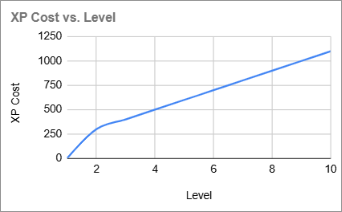
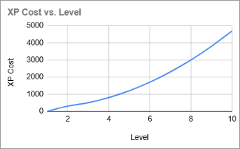
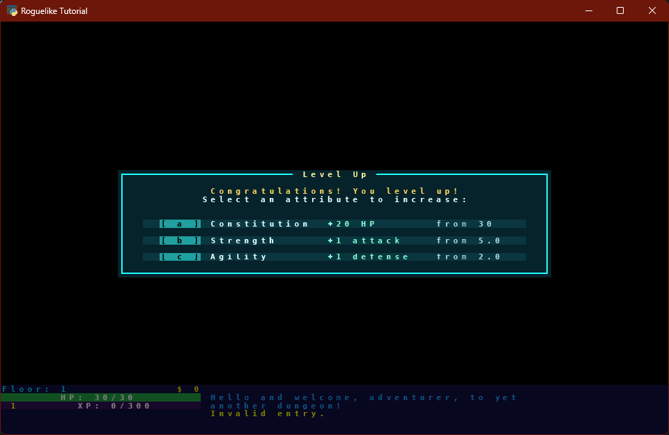
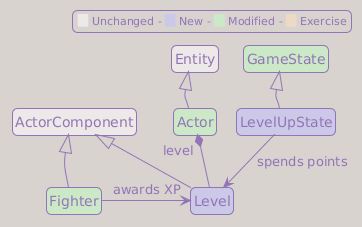
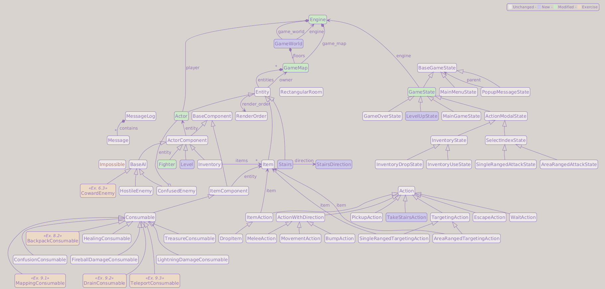

# Part 11b: Experience

In **Part 11a** the dungeon got deeper: stairs lead to new floors, and every floor stays as the player left it. This part makes the player grow stronger on the way down.

## What You Will Build

By the end of Part 11b, the player gains experience from defeating enemies. When the XP bar fills, a level-up screen appears and the player chooses a bonus: more HP, more attack, or more defense. Each level-up also heals the player to full HP.

## Learning goals

In this part we will:

- Rename the stored combat stats to `base_attack` and `base_defense`, keeping `attack` and `defense` as properties
- Track experience points and character level on a `Level` component
- Award XP to the killer when an enemy dies
- Show a level-up modal when the player gains enough XP
- Show an XP bar in the HUD

---

## Background

This section is for reading; there is nothing to type yet. If you want to start building right away, skip to [config.py additions](#configpy-additions). You can come back here at any time, even after you finish the tutorial, when you know the game from the inside and some of these ideas will mean more.

### Experience curves

Classic roguelikes use an XP curve where each level requires more XP than the last.
The two most common designs are a flat cost per level and an accelerating one.



A **flat (linear) cost** means the player always knows how many fights to expect before
leveling up. Progress feels steady and predictable, but a new level stops feeling
special.



An **accelerating cost** makes early levels fast, so the player gets the first rewards
quickly. Later levels take much more effort, which makes reaching them feel earned.
The risk is a curve so steep that high levels become practically unreachable.

We use a quadratic formula: each threshold grows by `level * factor`, so early levels
are fast and later ones demand progressively more effort.

| Level | XP cost | Increase |
| ---   | ---     | ---      |
| 2     | 300     | -        |
| 3     | 500     | +200     |
| 4     | 800     | +300     |
| 5     | 1200    | +400     |
| ...   | ...     | +100 * previous level |

The first level-up costs `level_up_base + current_level * level_up_factor` XP (300 at level 1). Each time you level up, the next cost increases by `new_level * level_up_factor`. Many games use an accelerating curve of this kind. In Diablo II, for example, each level also costs more than the one before, although its experience table does not follow a simple formula like ours.

### Who earns the XP, and when

When an enemy dies, someone has to receive its XP. One option is to give `die()` access to the `Engine` and always reward the player. We do something else: `take_damage()` receives the `attacker`, and `die()` gives the XP to that actor. `Fighter` does not need to know about `Engine`, and XP works for any actor that deals damage: melee attacks, spells, or summoned allies added later.

A level-up heals the player to full HP. In a difficult roguelike, this makes a level-up a real survival tool: a player with low health has a reason to fight one more enemy instead of retreating.

That raises a timing question. The game checks for a level-up after the enemies have taken their turns, not right after the killing blow. So if your attack crosses the XP threshold, you still have to survive the enemies' turns before the level-up screen appears. This is on purpose: the healing is a reward for choosing your fights well, not a last-second escape from death.

---

## config.py additions

This part introduces the Level/XP system. Append these groups to `game/data/config.py`:

```python
# Level / XP
DEFAULT_LEVEL_UP_BASE   = 200
DEFAULT_LEVEL_UP_FACTOR = 100

# Stat bonuses on level-up
LEVEL_STAT_HP      = 20.0
LEVEL_STAT_ATTACK  = 1.0
LEVEL_STAT_DEFENSE = 1.0
```

`DEFAULT_LEVEL_UP_BASE` and `DEFAULT_LEVEL_UP_FACTOR` name the numbers that drive the XP curve explained above. `LEVEL_STAT_*` name the bonus for each choice in the level-up modal. The `Level` methods use them as default amounts, and the modal reads them for its labels, so changing a value here changes both the bonus and the text the player sees.

The exploration-reward constants (`EXPLORATION_MILESTONES`, `EXPLORATION_XP_BASE`, etc.) belong to Exercise 2 and are listed there.

---

## The Level component

`Level` needs to increase the actor's stored attack and defense values. Before creating
the component, we rename those values to `base_attack` and `base_defense`, while
keeping `attack` and `defense` as properties. Level-ups can then modify the base values
directly, while the existing combat code continues to use the same public attributes.

!!! info "base_attack and base_defense"
    The new names also make room for equipment bonuses in Part 13. Both values are
    stored as `float` so equipment can apply multipliers (for example,
    `base_defense *= 1.1`) without losing precision. Keeping `attack` and `defense` as
    properties means later changes will not require edits at every combat call site.

In `Fighter.__init__` (`game/entities/components/fighter.py`), rename the two stored
values:

```diff
-        self.defense             = float(defense)
-        self.attack              = float(attack)
+        self.base_defense        = float(defense)
+        self.base_attack         = float(attack)
```

Then add the two properties to the `Fighter` class, next to the `hp` property:

```python
    @property
    def defense(self) -> float:
        return self.base_defense

    @property
    def attack(self) -> float:
        return self.base_attack
```

With those base stats ready, create `game/entities/components/level.py`, starting with the constructor:

```python
from __future__ import annotations

from game.data import config
from game.entities.components.base_component import ActorComponent


class Level(ActorComponent):

    def __init__(
        self,
        current_level: int   = 1,
        current_xp: int      = 0,
        level_up_base: int   = config.DEFAULT_LEVEL_UP_BASE,
        level_up_factor: int = config.DEFAULT_LEVEL_UP_FACTOR,
        xp_given: int        = 0,
    ) -> None:
        self.current_level    = current_level
        self.current_xp       = current_xp
        self.level_up_base    = level_up_base
        self.level_up_factor  = level_up_factor
        self.xp_given         = xp_given
        self.xp_to_next_level = level_up_base + current_level * level_up_factor
```

`xp_given` is how much XP an enemy awards on death. Enemies set this; the player leaves it at 0 (the player does not give XP to anything).

`xp_to_next_level` is the XP total that triggers the next level-up. With the default values, the player needs 300 XP to reach level 2 (`200 + 1 * 100`); the Background explains how the curve grows from there.

Next, add the methods that check and add XP to `Level`:

```python
    @property
    def requires_level_up(self) -> bool:
        return self.current_xp >= self.xp_to_next_level

    def add_xp(self, xp: int) -> bool:
        if xp == 0 or self.level_up_base == 0:
            return False

        was_ready = self.requires_level_up
        self.current_xp += xp
        return self.requires_level_up and not was_ready
```

`add_xp` returns `True` only when this specific gain crosses the level-up threshold: `was_ready` captures the state before the increment, and the method returns `True` only if the threshold is now met and was not met before. Without this check, a fireball that kills two enemies in one action could trigger the message twice if the first kill already pushed XP past the threshold.

The two early returns cover two different cases:

- `if xp == 0` handles enemies (or any entity) with `xp_given=0`: they give no XP when killed, so the call returns immediately.
- `if self.level_up_base == 0` is a safety check for an entity created with `level_up_base=0`. Nothing in the current code does that, but it lets you add an entity that never levels up later, without changing `add_xp`.

Finally, add the methods that apply a level-up. Each option in the level-up menu calls one of the three `increase_*` methods, which raises one stat and then calls `increase_level`:

```python
    def increase_level(self) -> None:
        self.current_level    += 1
        self.current_xp       -= self.xp_to_next_level
        self.xp_to_next_level += self.current_level * self.level_up_factor

        # On level up recover all hp points
        self.entity.fighter.heal(self.entity.fighter.max_hp)

    def increase_max_hp(self, amount: float = config.LEVEL_STAT_HP) -> None:
        self.entity.fighter.max_hp += amount
        self.increase_level()

    def increase_attack(self, amount: float = config.LEVEL_STAT_ATTACK) -> None:
        self.entity.fighter.base_attack += amount
        self.increase_level()

    def increase_defense(self, amount: float = config.LEVEL_STAT_DEFENSE) -> None:
        self.entity.fighter.base_defense += amount
        self.increase_level()
```

`increase_level` heals the player to full HP on every level-up (the Background explains why). Because `increase_level` already heals, `increase_max_hp` does not need to heal on its own.

---

## Wire up the Level component

Update `game/entities/factories.py` imports, then attach `Level` to every actor:

```diff
-from game.data import colors, keys, sprites
+from game.data import colors, config, keys, sprites
 ...
 from game.entities.components.inventory import Inventory
+from game.entities.components.level import Level
 from game.entities.entity import (
     ...

 player = Actor(
     ...
     inventory = Inventory(capacity=10, max_capacity=26),
+    level     = Level(level_up_base=config.DEFAULT_LEVEL_UP_BASE),
 )

 orc = Actor(
     ...
     inventory = Inventory(capacity=0, max_capacity=0),
+    level     = Level(xp_given=54),
 )

 troll = Actor(
     ...
     inventory = Inventory(capacity=0, max_capacity=0),
+    level     = Level(xp_given=36),
 )
```

The player passes `level_up_base=config.DEFAULT_LEVEL_UP_BASE` and leaves `xp_given` at 0 (the player does not award XP to anything). Enemies pass only `xp_given` and use the default thresholds (which never matter, because nothing calls `add_xp` on them). `Level.__init__` already defaults to `config.DEFAULT_LEVEL_UP_BASE`, so passing it for the player is redundant; we keep it so that each entity's settings are visible and easy to search for.

Update `Actor.__init__` in `game/entities/entity.py` to accept and wire up the `level` component. `Level` is only needed for the type annotation, so it goes in the `TYPE_CHECKING` block with the other components:

```diff
 if TYPE_CHECKING:
     ...
     from game.entities.components.inventory import Inventory
+    from game.entities.components.level import Level
     from game.map.game_map import GameMap

 ...

 class Actor(Entity):

     def __init__(
         self,
         *,
         ...
+        level: Level,
     ) -> None:
         ...
+        self.level = level
+        self.level.entity = self
```

!!! warning "Save file compatibility"
    Adding `level` to `Actor` changes the structure of the pickled objects. A save file from Part 11a still loads, but the saved actors have no `level`, so the game crashes as soon as it needs one: at the first kill and, once the HUD shows the XP bar at the end of this part, as soon as it draws the screen.

    Delete `savegames/savegame.sav` before testing this part.

---

## Award XP on kill

We add an `attacker` parameter to `take_damage()`, and `die()` gives the XP to that actor (the Background explains why).

We also clean up how `_hp` is accessed. The `hp` setter existed only to clamp the value and call `die()`. Now `take_damage` calls `die()`, so the setter has no job left. Without it, after `__init__` only two methods write `_hp`: `heal` and `take_damage`. A comment on each one says so, so future readers know exactly where to look.

All reads, including the ones inside `heal` and `take_damage`, go through the `self.hp` property. If you search the code for `_hp =`, you find every place that changes HP.

Update `game/entities/components/fighter.py`. Remove the `hp` setter entirely, then update `heal` and `take_damage`:

```python
    # only heal and take_damage can write to self._hp
    def heal(self, amount: float) -> float:
        if self.hp == self.max_hp:
            return 0.0

        new_hp_value = self.hp + amount
        new_hp_value = min(new_hp_value, self.max_hp)

        recovered    = new_hp_value - self.hp
        self._hp     = new_hp_value

        return recovered

    # only heal and take_damage can write to self._hp
    def take_damage(self, amount: float, attacker: Actor) -> None:
        self._hp = max(0.0, min(self.hp - amount, self.max_hp))

        if self.hp == 0:
            # Part-10. Exercise 2: Record a graveyard file
            # Self-inflicted deaths do not count as kills
            if attacker is not self.entity:
                attacker.fighter.kill_count += 1
            self.die(attacker)
```

Because `take_damage()` now requires an attacker, update every damage call site that can kill an enemy.

!!! note "Part 10 Exercise 2: graveyard file"
    If you completed that exercise, `take_damage` already has the `attacker` parameter and the call-site updates below are already in place. The only new changes for you are the body of `take_damage` shown above: the `_hp` cleanup and the `self.die(attacker)` call.

    **If you skipped that exercise**, your `Fighter` has no `kill_count` attribute, so omit the two `# Part-10. Exercise 2` lines above (`if attacker is not self.entity:` and `attacker.fighter.kill_count += 1`). The body then reads simply `if self.hp == 0: self.die(attacker)`. The `attacker` parameter and the call-site updates below are still required either way.

In `Fighter.melee_attack()`, pass the actor that is making the attack:

```diff
-        target.fighter.take_damage(damage)
+        target.fighter.take_damage(damage, attacker=self.entity)
```

Update the spell damage in `game/entities/components/consumable.py` too. The player is the `consumer`, so they are the attacker for lightning, fireball, and drain. `FireballDamageConsumable.activate` did not use its consumer until now, so its parameter was named `_consumer`; rename it to `consumer`:

```diff
 class LightningDamageConsumable(Consumable):
     ...
-            target.fighter.take_damage(self.damage)
+            target.fighter.take_damage(self.damage, attacker=consumer)

 class FireballDamageConsumable(Consumable):
     ...
-    def activate(self, action: ItemAction, engine: Engine, _consumer: Actor) -> None:
+    def activate(self, action: ItemAction, engine: Engine, consumer: Actor) -> None:
         ...
-                actor.fighter.take_damage(damage)
+                actor.fighter.take_damage(damage, attacker=consumer)

 class DrainConsumable(Consumable):
     ...
-        target.fighter.take_damage(amount_drained)
+        target.fighter.take_damage(amount_drained, attacker=consumer)
```

`DrainConsumable` comes from Part 9 Exercise 2; if you skipped that exercise, ignore its lines.

Add the color for the XP message to `game/data/colors.py`:

```python
LEVEL_UP = Color(0xFF, 0xFF, 0x00)
```

Then replace the existing `die()` method:

```python
    def die(self, attacker: Actor | None) -> None:
        leveled_up = False
        if self.entity.ai is None:
            death_message = "You died!"
            death_message_color = colors.PLAYER_DEATH
        else:
            death_message = f"The {self.entity.name} is dead!"
            death_message_color = colors.ENEMY_DEATH
            if attacker is not None:
                leveled_up = attacker.level.add_xp(self.entity.level.xp_given)

        MessageLog.add_message(death_message, death_message_color)
        if leveled_up:
            MessageLog.add_message("You feel your experience grow!", colors.LEVEL_UP)

        self.entity.char            = sprites.CORPSE
        self.entity.color           = colors.CORPSE
        self.entity.blocks_movement = False
        self.entity.ai              = None
        self.entity.name            = f"remains of {self.entity.name}"
        self.entity.render_order    = RenderOrder.CORPSE
```

Only enemies award XP: when the player dies, nobody gains anything. `leveled_up` remembers whether this kill crossed the threshold, so the XP message can come after the death message and the log reads in order: first the enemy dies, then you feel your experience grow.

`die()` only adds the XP. The level-up screen appears later, after the enemy turns; we add that check in the LevelUpState section.

!!! tip "Run it now"
    If you run the game now with `uv run main.py` (or `python main.py`), you can check that nothing broke: the game plays as in Part 11a. Kill a few enemies (six orcs are enough to pass 300 XP) and "You feel your experience grow!" appears in the message log, right after the death message. Nothing else happens yet: the level-up screen and the XP bar come later in this part.

    Running the game after changing a class that every actor uses is a good habit: if something broke, you know it was one of the last few changes.

---

## LevelUpState

### Colors

Add to `game/data/colors.py`:

```python
LEVEL_UP_MENU_FRAME    = Color( 32, 255, 255)
LEVEL_UP_MENU_BG       = Color(  6,  34,  42)
LEVEL_UP_MENU_ACCENT   = Color( 32, 160, 160)
LEVEL_UP_MENU_ROW_BG   = Color( 10,  54,  64)
LEVEL_UP_MENU_TITLE    = Color(255, 245, 160)
LEVEL_UP_MENU_CONGRATS = Color(255, 215,  96)
LEVEL_UP_MENU_TEXT     = Color(232, 255, 255)
LEVEL_UP_MENU_DIM      = Color(168, 216, 216)
LEVEL_UP_MENU_BONUS    = Color(128, 255, 208)
LEVEL_UP_MENU_KEY      = BLACK
```

### on_render

Add `LevelUpState` at the end of `game/game_states.py`. The modal dims the scene behind it, draws a drop shadow, and centers itself, all with the tools built in earlier parts (`// 2` dimming and `_draw_panel` from Part 7). Each stat option gets its own colored row with the key badge, stat name, bonus, and current value separated into columns. When finished, it looks like this:



Start with the class, the dimmed background, and the data for the three options. Each option is a tuple: the key that selects it, the stat name, the bonus text, and the current value:

```python
class LevelUpState(GameState):
    TITLE = "Level Up"

    def on_render(self, console: tcod.console.Console) -> None:
        super().on_render(console)

        # Dim the map background to highlight the level-up menu
        console.fg[:] = console.fg // 2
        console.bg[:] = console.bg // 2

        fighter       = self.engine.player.fighter
        hp_bonus      = f"+{config.LEVEL_STAT_HP:g} HP"
        attack_bonus  = f"+{config.LEVEL_STAT_ATTACK:g} attack"
        defense_bonus = f"+{config.LEVEL_STAT_DEFENSE:g} defense"
        options = [
            ("a", "Constitution", hp_bonus,      f"from {fighter.max_hp:g}"),
            ("b", "Strength",     attack_bonus,  f"from {fighter.base_attack:g}"),
            ("c", "Agility",      defense_bonus, f"from {fighter.base_defense:g}"),
        ]
```

Continue `on_render` with the panel. It is centered on the screen, with the title printed over its top frame:

```python
        width  = 52
        height = 13
        x = (console.width  - width)  // 2
        y = (console.height - height) // 2

        # Draw the level-up menu box
        _draw_panel(
            console,
            x,
            y,
            width,
            height,
            colors.LEVEL_UP_MENU_FRAME,
            colors.LEVEL_UP_MENU_BG,
        )

        title = f" {self.TITLE} "
        # Draw the title over the top frame
        console.print(
            x    = x + (width - len(title)) // 2,
            y    = y,
            text = title,
            fg   = colors.LEVEL_UP_MENU_TITLE,
            bg   = colors.LEVEL_UP_MENU_BG,
        )
```

Then print the two centered lines of text inside the panel:

```python
        # Draw the congratulations message
        console.print(
            x         = console.width // 2,
            y         = y + 2,
            text      = "Congratulations! You level up!",
            fg        = colors.LEVEL_UP_MENU_CONGRATS,
            alignment = tcod.constants.CENTER,
        )

        # Draw the instruction for choosing an attribute
        console.print(
            x         = console.width // 2,
            y         = y + 3,
            text      = "Select an attribute to increase:",
            fg        = colors.LEVEL_UP_MENU_TEXT,
            alignment = tcod.constants.CENTER,
        )
```

Last, draw one row per option. Every row uses the same four columns, at fixed offsets from the start of the row: the key at `+2`, the name at `+8`, the bonus at `+22`, and the current value at `+35`:

```python
        row_x = x + 3
        row_width = width - 6
        for index, (key, name, bonus, current) in enumerate(options):
            row_y = y + 6 + index * 2

            # Draw the background for one attribute option
            console.draw_rect(
                x      = row_x,
                y      = row_y,
                width  = row_width,
                height = 1,
                ch     = ord(" "),
                bg     = colors.LEVEL_UP_MENU_ROW_BG,
            )

            # Draw the key that selects this option
            console.print(
                row_x + 2,
                row_y,
                f"[ {key} ]",
                fg = colors.LEVEL_UP_MENU_KEY,
                bg = colors.LEVEL_UP_MENU_ACCENT,
            )

            # Draw the attribute name
            console.print(
                row_x + 8,
                row_y,
                f"{name:<12}",
                fg = colors.LEVEL_UP_MENU_TEXT,
                bg = colors.LEVEL_UP_MENU_ROW_BG,
            )

            # Draw the bonus that will be applied
            console.print(
                row_x + 22,
                row_y,
                f"{bonus:<11}",
                fg = colors.LEVEL_UP_MENU_BONUS,
                bg = colors.LEVEL_UP_MENU_ROW_BG,
            )

            # Draw the current attribute value
            console.print(
                row_x + 35,
                row_y,
                current,
                fg = colors.LEVEL_UP_MENU_DIM,
                bg = colors.LEVEL_UP_MENU_ROW_BG,
            )
```

The dimming and the drop shadow come straight from Part 7: `// 2` halves every color channel of the frame already rendered, and `_draw_panel` draws the shadow, fill, and frame in one call. The key badges (`[ a ]`, dark text over the accent color) match the style of the inventory rows from Part 8, so every selectable option in the game now looks the same.

### event_keydown

```python
    def event_keydown(self, event: tcod.event.KeyDown) -> BaseGameState | None:
        player = self.engine.player
        index  = event.sym - tcod.event.KeySym.A

        if index == 0:
            player.level.increase_max_hp()

        elif index == 1:
            player.level.increase_attack()

        elif index == 2:
            player.level.increase_defense()

        else:
            MessageLog.add_message("Invalid entry.", colors.INVALID)
            return None

        return MainGameState(self.engine)
```

### Triggering the modal

Trigger the modal from `GameState.handle_events()` after `update_fov()`:

```diff
             self.engine.update_fov()

+            if self.engine.player.level.requires_level_up:
+                return LevelUpState(self.engine)
+
             if isinstance(self, ActionModalState):
```

This point in `handle_events()` comes after `handle_enemy_turns()`, so the enemies act before the level-up screen opens. The Background section ("Who earns the XP, and when") explains why.

---

## Show XP in the HUD

Part 11a left row `46`, under the HP bar, free for this. Add `render_xp_bar` to `game/hud.py`, under `render_bar`. This basic version draws the bar background, fills it proportionally, and centers the XP text. Exercise 1 later replaces it with the full color gradient and the embedded level number:

```python
def render_xp_bar(
    console: Console,
    current_xp: int,
    xp_to_next_level: int,
    total_width: int      = config.BAR_WIDTH,
    y: int                = 46,
) -> None:
    xp_ratio  = min(1.0, float(current_xp) / xp_to_next_level)
    bar_width = int(xp_ratio * total_width)

    console.draw_rect(
        x      = 0,
        y      = y,
        width  = total_width,
        height = 1,
        ch     = ord(" "),
        bg     = colors.HP_BAR_EMPTY,
    )

    if bar_width > 0:
        console.draw_rect(
            x      = 0,
            y      = y,
            width  = bar_width,
            height = 1,
            ch     = ord(" "),
            bg     = colors.HP_BAR_FILLED,
        )

    xp_text = f"XP: {current_xp}/{xp_to_next_level}"
    console.print(
        x    = (total_width - len(xp_text)) // 2,
        y    = y,
        text = xp_text,
        fg   = colors.BAR_TEXT,
    )
```

Then call it from `Engine.render()`, right after the HP bar:

```diff
         hud.render_bar(
             console       = console,
             current_value = self.player.fighter.hp,
             maximum_value = self.player.fighter.max_hp,
         )

+        hud.render_xp_bar(
+            console          = console,
+            current_xp       = self.player.level.current_xp,
+            xp_to_next_level = self.player.level.xp_to_next_level,
+        )
+
         hud.render_gold(
```

The HUD now shows:

```text
Floor: 1             $ 0
[      HP: 30/30       ]
[      XP: 0/300       ]
```

---

## Testing Part 11b

Run the game with `uv run main.py` (or `python main.py`):

- [ ] Killing enemies with melee, lightning, fireball, or drain counts toward level-up XP
- [ ] The XP bar appears below the HP bar with the current XP and the next threshold
- [ ] When a kill crosses the threshold, "You feel your experience grow!" appears after the death message
- [ ] After the enemies' turn, a level-up screen appears with three stat choices
- [ ] Selecting an option increases the stat, heals the player to full HP, and closes the modal
- [ ] Any other key shows "Invalid entry." and keeps the modal open
- [ ] The player's level and XP persist across floor transitions

If you can level up and see the new values, Part 11b is complete.

---

## Summary

The player now grows stronger on the way down. Key additions:

- **`base_attack` / `base_defense`**: stored stats behind the `attack` and `defense` properties
- **`Level` component**: XP tracking, level-up threshold, stat-increase methods
- **XP on kill**: `take_damage()` receives the attacker, and `Fighter.die()` awards XP to it
- **`LevelUpState`**: centered modal with dimmed background and colored stat rows
- **XP bar**: a second bar in the HUD, under the HP bar

**Current architecture**:

- `GameWorld`: owns dungeon generation parameters, the ordered `floors` list, and `current_floor`
- `Engine`: owns the current `GameMap` plus a `GameWorld` for navigation
- `Level`: component that owns XP, level thresholds, and stat increases
- `TakeStairsAction`: looks up the `Stairs` entity under the player and calls the appropriate `GameWorld` method
- `LevelUpState`: modal state entered when the player must choose a stat

**Local Class Diagram**:



**Full Class Diagram**:



**File structure**:

```text
main.py
game/
├── __init__.py
├── actions.py
├── engine.py                   ← modified
├── exceptions.py
├── game_world.py
├── hud.py                      ← modified
├── game_states.py              ← modified
├── message_log.py
├── setup_game.py
├── data/
│   ├── __init__.py
│   ├── colors.py               ← modified
│   ├── config.py               ← modified
│   ├── keys.py
│   └── sprites.py
├── entities/
│   ├── __init__.py
│   ├── entity.py               ← modified
│   ├── factories.py            ← modified
│   ├── render_order.py
│   └── components/
│       ├── __init__.py
│       ├── ai.py
│       ├── base_component.py
│       ├── consumable.py       ← modified
│       ├── fighter.py          ← modified
│       ├── inventory.py
│       └── level.py            ← new
└── map/
    ├── __init__.py
    ├── game_map.py
    ├── tile_types.py
    └── map_generator.py
```

---

## Exercises

The next parts assume you did these exercises. Try each one on your own first. If one is too hard for now, do not let it stop you: where a reference solution is given, read it and type it in, and when a later part builds on an exercise, it points out the code that comes from it.

1. **XP display**:

    The HUD already renders an XP bar via `render_xp_bar` (added in the main tutorial). Extend it with the full color gradient and the level number embedded on the left.

    `XP_LEVEL_WIDTH = 4` is already defined in `game/data/config.py` (added in Part 10a). `hud.py` reads it as `config.XP_LEVEL_WIDTH`.

    Add `current_level` to the `render_xp_bar` parameters and pass `self.player.level.current_level` from `Engine.render()`.

    The bar is already 24 chars wide; both bars share `config.BAR_WIDTH`. At level 50 the XP text reaches `"XP: 122700/127700"` (17 chars). With 24 chars total and 4 reserved for the level prefix, 20 chars remain, enough for any realistic play-through.

    Print the level number, right-aligned in two characters, at `x=1` inside the XP bar in `colors.LEVEL_UP` (level-up yellow), then center the XP text in the remaining 20 characters:

    ```text
    [      HP: 30/30       ]   24 chars, HP bar unchanged
    [ 1      XP: 0/300     ]   level on the left, XP centered in the rest
    [10    XP: 4700/5700   ]   level 10
    [50  XP: 122700/127700 ]   level 50
    ```

    For the bar fill color, use a three-tier gradient that conveys *accumulating power* rather than the HP bar's danger ramp:

    | Fill ratio | Bar filled | Bar empty | Feel |
    |---|---|---|---|
    | 0-33% | `(0x70, 0x30, 0xC8)` violet | `(0x30, 0x10, 0x54)` | just started |
    | 33-66% | `(0x20, 0x60, 0xC0)` bright blue | `(0x0C, 0x28, 0x60)` | building up |
    | 66-100% | `colors.LEVEL_UP` yellow | `(0x58, 0x48, 0x08)` | almost there |

    The final tier reuses `LEVEL_UP`: the bar turns yellow before a level-up, making the reward feel imminent without any extra text.

    Watch out for that last tier: a yellow level number on a yellow bar cannot be seen. Make sure the level stays readable when the bar turns yellow.

    ??? note "Reference implementation"
        Colors at the end of `game/data/colors.py`. They must come after `LEVEL_UP`, because the last tier reuses it:

        ```python
        # Part-11. Exercise 1: XP display
        XP_BAR_LOW_FILLED  = Color(0x70, 0x30, 0xC8)
        XP_BAR_LOW_EMPTY   = Color(0x30, 0x10, 0x54)
        XP_BAR_MID_FILLED  = Color(0x20, 0x60, 0xC0)
        XP_BAR_MID_EMPTY   = Color(0x0C, 0x28, 0x60)
        XP_BAR_HIGH_FILLED = LEVEL_UP
        XP_BAR_HIGH_EMPTY  = Color(0x58, 0x48, 0x08)
        ```

        Replace `render_xp_bar` in `game/hud.py`. Both texts go through `_print_bar_text` from Part 11a, which switches to dark text over a light fill. Without it, the yellow level number would disappear once the bar itself turns yellow:

        ```python
        def render_xp_bar(
            console: Console,
            current_xp: int,
            xp_to_next_level: int,
            current_level: int,
            total_width: int      = config.BAR_WIDTH,
            y: int                = 46,
        ) -> None:
            # Part-11. Exercise 1: XP display
            xp_ratio  = min(1.0, float(current_xp) / xp_to_next_level)
            bar_width = int(xp_ratio * total_width)
            if xp_ratio < 0.33:
                bar_color_fg = colors.XP_BAR_LOW_FILLED
                bar_color_bg = colors.XP_BAR_LOW_EMPTY
            elif xp_ratio < 0.66:
                bar_color_fg = colors.XP_BAR_MID_FILLED
                bar_color_bg = colors.XP_BAR_MID_EMPTY
            else:
                bar_color_fg = colors.XP_BAR_HIGH_FILLED
                bar_color_bg = colors.XP_BAR_HIGH_EMPTY

            console.draw_rect(
                x      = 0,
                y      = y,
                width  = total_width,
                height = 1,
                ch     = ord(" "),
                bg     = bar_color_bg,
            )

            if bar_width > 0:
                console.draw_rect(
                    x      = 0,
                    y      = y,
                    width  = bar_width,
                    height = 1,
                    ch     = ord(" "),
                    bg     = bar_color_fg,
                )

            _print_bar_text(
                console          = console,
                text             = f"{current_level:>2}",
                x                = 1,
                y                = y,
                bar_width        = bar_width,
                filled_color     = bar_color_fg,
                empty_color      = bar_color_bg,
                light_text_color = colors.LEVEL_UP,
                dark_text_color  = colors.BAR_TEXT_DARK,
            )

            xp_text  = f"XP: {current_xp}/{xp_to_next_level}"
            xp_width = total_width - config.XP_LEVEL_WIDTH
            _print_bar_text(
                console          = console,
                text             = xp_text,
                x                = config.XP_LEVEL_WIDTH + (xp_width - len(xp_text)) // 2,
                y                = y,
                bar_width        = bar_width,
                filled_color     = bar_color_fg,
                empty_color      = bar_color_bg,
                light_text_color = colors.BAR_TEXT,
                dark_text_color  = colors.BAR_TEXT_DARK,
            )
        ```

        Then pass the level from `Engine.render()` (`game/engine.py`):

        ```diff
                 hud.render_xp_bar(
                     console          = console,
                     current_xp       = self.player.level.current_xp,
                     xp_to_next_level = self.player.level.xp_to_next_level,
        +            current_level    = self.player.level.current_level,
                 )
        ```

2. **XP from exploration**:

    Reward the player for exploring each floor, scaled by depth so the reward stays relevant at every level. There are two sources, and the design is in how they balance:

    - **Milestones** at 25%, 50%, 75% and 100% of a floor revealed. Make the payoff *escalate* (later milestones worth more) and *scale with the current floor*, so deep, thorough exploration pays best. Track which milestones a floor has already paid, and store that on the **map**, not the engine: floors now persist (Part 11a made them so), and a return visit must not award them again.
    - A **descent** reward when the player takes the down stairs, scaled by the floor being left. Guard it the same way, so walking up and down one staircase cannot farm XP.

    Aim for exploration being clearly worth more than rushing. With the numbers below, exploration alone gives double the descent reward at every depth, and fully exploring a floor before descending gives triple the XP of descending immediately.

    Be careful with what counts as explored. The map's `explored` array works only while `FADING_MEMORY` is `False`. With the fading memory from Part 4 Exercise 4 turned on, `explored` holds only the tiles the player still remembers, so the explored share goes down again as the memory fades, and the last milestones are almost never reached. Either set `FADING_MEMORY = False`, or keep a separate array of the tiles the player has really seen.

    ??? note "Reference implementation"
        Constants in `game/data/config.py`:

        ```python
        # Part-11. Exercise 2: XP from exploration
        EXPLORATION_MILESTONES = (0.25, 0.50, 0.75, 1.00)
        EXPLORATION_MESSAGES = (
            "You have explored 25% of this floor. You gain {xp} XP.",
            "You have explored half of this floor. You gain {xp} XP.",
            "You have explored 75% of this floor. You gain {xp} XP.",
            "You have fully explored this floor! You gain {xp} XP.",
        )
        EXPLORATION_XP_BASE  = 26
        EXPLORATION_XP_TIER  = 16
        DESCENT_XP_PER_FLOOR = 100
        ```

        Per-floor state at the end of `GameMap.__init__` (`game/map/game_map.py`). `seen` records every tile the player has had in view; unlike `explored`, it only grows, whatever the fading memory does. Tiles shown by the scroll of mapping (Part 9 Exercise 1) do not count: the reward is for going there, not for reading the map. The tile count is filled in later, once the map is dug:

        ```python
                # Part-11. Exercise 2: XP from exploration
                self.seen = np.full((width, height), fill_value=False, order="F")
                self.explorable_tiles: int = 0
                self.exploration_milestones = [False, False, False, False]
                self.descent_xp_awarded = False
        ```

        At the end of `generate_dungeon`, after all tiles are placed, right before `return dungeon`:

        ```python
            # Part-11. Exercise 2: XP from exploration
            dungeon.explorable_tiles = int(dungeon.tiles["walkable"].sum())
        ```

        Award the milestones in `Engine` (`game/engine.py`), called after each FOV update. The escalating, depth-scaled payoff is `(EXPLORATION_XP_BASE + index * EXPLORATION_XP_TIER) * current_floor`, and the per-floor `exploration_milestones` flags stop a milestone paying twice. The messages use `colors`, which `engine.py` does not import yet; add it to the `from game.data import config` line:

        ```python
            # Part-11. Exercise 2: XP from exploration
            def award_exploration_xp(self) -> None:
                game_map = self.game_map
                if game_map.explorable_tiles == 0:
                    return

                seen_tiles = int((game_map.seen & game_map.tiles["walkable"]).sum())
                ratio = seen_tiles / game_map.explorable_tiles

                for index, milestone in enumerate(config.EXPLORATION_MILESTONES):
                    if ratio < milestone or game_map.exploration_milestones[index]:
                        continue

                    xp_reward = (
                        config.EXPLORATION_XP_BASE
                        + index * config.EXPLORATION_XP_TIER
                    ) * self.game_world.current_floor
                    self.player.level.add_xp(xp_reward)
                    game_map.exploration_milestones[index] = True

                    message_color = colors.LEVEL_UP if milestone == 1.0 else colors.WHITE
                    MessageLog.add_message(
                        config.EXPLORATION_MESSAGES[index].format(xp=xp_reward),
                        message_color,
                    )
        ```

        `award_exploration_xp` does nothing until it is called. At the end of `Engine.update_fov()`, add the tiles in view to `seen` and check the milestones, so they are checked every time the player's view refreshes:

        ```python
                # Part-11. Exercise 2: XP from exploration
                self.game_map.seen |= self.game_map.visible
                self.award_exploration_xp()
        ```

        The descent reward goes in `TakeStairsAction` (`game/actions.py`), which needs `from game.data import config`. Add it to the "down" branch, guarded so it pays once per floor:

        ```diff
                 if stairs.direction == StairsDirection.DOWN:
        +            # Part-11. Exercise 2: XP from exploration
        +            if not engine.game_map.descent_xp_awarded:
        +                xp_reward = config.DESCENT_XP_PER_FLOOR * engine.game_world.current_floor
        +                entity.level.add_xp(xp_reward)
        +                engine.game_map.descent_xp_awarded = True
        +                MessageLog.add_message(
        +                    f"You descend deeper into the dungeon. You gain {xp_reward} XP.",
        +                    colors.DESCEND,
        +                )
        +
                     engine.game_world.descend_floor()
        ```

        The reward, in XP, escalating per milestone and scaling with depth:

        | Milestone | Floor 1 | Floor 5 | Floor 10 |
        |---|---|---|---|
        | 25% | 26 | 130 | 260 |
        | 50% | 42 | 210 | 420 |
        | 75% | 58 | 290 | 580 |
        | 100% | 74 | 370 | 740 |
        | **Total** | **200** | **1,000** | **2,000** |
