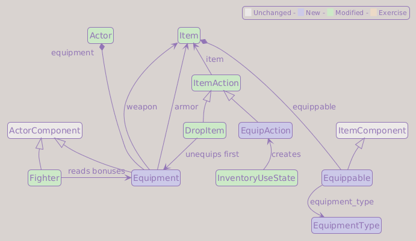

# Part 13a: Weapons and Armor

**Part 13** gives the player weapons and armor. It comes in two parts.

**Part 13a** builds the equipment system and the gear itself: two new components, an action to equip and remove gear, four pieces of equipment, and a guaranteed place in the dungeon for each piece.

**Part 13b** reworks the inventory screen so the player sees at a glance what they are wearing, and closes the main tutorial game.

---

## What You Will Build

By the end of Part 13a, the player can find, equip, and swap weapons and armor, and their combat stats will reflect what they are carrying. Equipment does not come from the random loot tables: each piece appears exactly once per run, starting with a dagger waiting in your first room.

## Learning goals

In this part we will:

- Add `Equippable` and `Equipment` components
- Define equipment slots (weapon, armor) as an enum
- Layer equipment bonuses on top of `Fighter` base stats through the existing properties
- Route inventory selection to an `EquipAction`
- Place guaranteed, once-per-run equipment by floor, in contrast with Part 12's weighted tables

!!! info "Where you stand"
    This part touches files that earlier exercises also modified. If you did Part 8 Exercise 3 (persistent item keys), the new equipment templates take fixed number keys instead of letters; the factories section shows them. If you did Part 9 Exercise 3 (teleport scroll), one extra guard applies to it; the section that adds it says where. If you did Part 11 Exercise 2 or Part 12 Exercise 1, the equipment placement goes in a slightly different spot; a note next to it says where. Readers without those exercises can ignore these notes.

---

## Background

This section is for reading; there is nothing to type yet. If you want to start building right away, skip to [EquipmentType enum](#equipmenttype-enum). You can come back here at any time, even after you finish the tutorial, when you know the game from the inside and some of these ideas will mean more.

### How equipment works

Equipment is a two-sided relationship:

- An **`Equippable`** component sits on an `Item` and says "I give +2 attack when equipped in the weapon slot"
- An **`Equipment`** component sits on an `Actor` and holds references to whatever is currently equipped

When combat damage is calculated, `Fighter.attack` and `Fighter.defense` include the bonuses from the `Equipment` component.

```text
Actor (player)
  ├── Fighter  (base_attack=5, base_defense=2)
  └── Equipment
        ├── weapon  → Item("Sword")
        │               └── Equippable(attack_bonus=4)
        └── armor   → Item("Chain Mail")
                        └── Equippable(defense_bonus=3)

Effective attack  = 5 + 4 = 9
Effective defense = 2 + 3 = 5
```

!!! info "Wield and wear"
    The two slots are as old as the genre. Rogue (1980) had separate commands to wield a weapon and wear armor, and NetHack still binds them to `w` and `W` today. Our version follows the modern convention instead: one inventory screen, one key, and the game decides which slot the item belongs to.

### Where equipment comes from

Part 12 made random loot scale with depth. Equipment gets the opposite treatment, for a simple reason: with only two slots and items that never break, a second dagger is useless. So equipment does not join the weighted item table. Each piece appears **exactly once per run**, on a floor chosen at random from a small range of floors (a band). The bands follow the difficulty curve, and the band of an upgrade always comes after the band of the piece it replaces.

!!! info "Guaranteed loot is a classic tool"
    Pure random tables can leave a run without the basics. A roguelike where you fight bare-handed for five floors because the dice said so is not difficult, just unfair.

    Brogue is well known for controlling the items its balance depends on. Potions of strength and life and scrolls of enchanting are "metered": their chance grows on every floor where none appears, and when a run falls too far behind, the game forces one to spawn. Most modern roguelikes mix the two systems: weighted tables for consumables, guarantees for the items the balance depends on. Now ours does too.

---

## EquipmentType enum

You will not see equipment in the game until near the end of this part, once `factories.py` builds the pieces and the generator places them. Until then we connect parts that you cannot see working yet. The reward is the dagger waiting in your first room.

Create `game/entities/equipment_type.py`:

```python
from __future__ import annotations

from enum import Enum, auto


class EquipmentType(Enum):
    WEAPON = auto()
    ARMOR  = auto()
```

A two-member enum may look like too much when a pair of strings would do, but it gives the same guarantees as `RenderOrder` did in Part 6: a typo becomes an immediate `AttributeError` instead of a silent bug, and your editor can autocomplete the slots.

---

## game/entities/components/equippable.py

Create `game/entities/components/equippable.py`:

```python
from __future__ import annotations

from game.entities.components.base_component import ItemComponent
from game.entities.equipment_type import EquipmentType


class Equippable(ItemComponent):

    def __init__(
        self,
        equipment_type: EquipmentType,
        attack_bonus: float  = 0.0,
        defense_bonus: float = 0.0,
    ) -> None:
        self.equipment_type = equipment_type
        self.attack_bonus   = attack_bonus
        self.defense_bonus  = defense_bonus
```

That is the whole file. An `Equippable` is pure data: which slot it occupies and what it adds. The concrete numbers (a dagger gives +2, chain mail gives +3) do not live here; they go in `factories.py` later in this chapter, next to the templates, exactly where `Fighter(hp=30.0, defense=2.0, attack=5.0)` and the Part 12 spawn tables already live. One file tells you everything about an item.

!!! info "Why not a subclass per item?"
    The older tutorials define `class Dagger(Equippable)` and similar classes, one subclass per item type. It works, but every new weapon then needs edits in two files, and none of those subclasses add behavior; they only store different parameters.

    We already have a place for parameters: the template in `factories.py`. Subclasses are worth it when items need different *code*, not different *numbers*.

---

## game/entities/components/equipment.py

Create `game/entities/components/equipment.py`. Start with the imports, the two slots, and the combat bonus they expose:

```python
from __future__ import annotations

from typing import TYPE_CHECKING

from game.entities.components.base_component import ActorComponent
from game.entities.equipment_type import EquipmentType
from game.message_log import MessageLog

if TYPE_CHECKING:
    from game.entities.entity import Item


class Equipment(ActorComponent):

    def __init__(
        self,
        weapon: Item | None = None,
        armor:  Item | None = None,
    ) -> None:
        self.weapon = weapon
        self.armor  = armor

    @property
    def attack_bonus(self) -> float:
        bonus = 0.0

        if self.weapon and self.weapon.equippable:
            bonus += self.weapon.equippable.attack_bonus

        if self.armor and self.armor.equippable:
            bonus += self.armor.equippable.attack_bonus

        return bonus

    @property
    def defense_bonus(self) -> float:
        bonus = 0.0

        if self.weapon and self.weapon.equippable:
            bonus += self.weapon.equippable.defense_bonus

        if self.armor and self.armor.equippable:
            bonus += self.armor.equippable.defense_bonus

        return bonus
```

Both bonus properties check both slots, even though today weapons only carry attack bonuses and armor only defense. The symmetry is on purpose: a *Sword of Deflection* with `defense_bonus=1` would work without touching this class.

Next, a way to ask what is equipped, and the single entry point for putting gear on or taking it off. Add these methods to the class:

```python
    def item_is_equipped(self, item: Item) -> bool:
        return self.weapon is item or self.armor is item

    def toggle_equip(self, equippable_item: Item) -> None:
        assert equippable_item.equippable is not None

        if equippable_item.equippable.equipment_type == EquipmentType.WEAPON:
            slot = "weapon"
        else:
            slot = "armor"

        if getattr(self, slot) is equippable_item:
            self.unequip_from_slot(slot)
        else:
            self.equip_to_slot(slot, equippable_item)
```

`toggle_equip` is the single entry point. Select an equipped item and it is removed; select an unequipped one and it is equipped, replacing whatever was in that slot. `equip_to_slot` unequips the previous item first, so swapping a dagger for a sword logs both messages. The `assert` at the top narrows `equippable` from `Equippable | None` to `Equippable` for the type checker, the same trick the actions have used with `isinstance` since Part 8.

Finally, the two methods that actually move an item into or out of a slot:

```python
    def equip_to_slot(self, slot: str, item: Item) -> None:
        current_item = getattr(self, slot)
        if current_item is not None:
            self.unequip_from_slot(slot)

        setattr(self, slot, item)
        MessageLog.add_message(f"You equip the {item.name}.")

    def unequip_from_slot(self, slot: str) -> None:
        current_item = getattr(self, slot)
        MessageLog.add_message(f"You remove the {current_item.name}.")
        setattr(self, slot, None)
```

!!! tip "`getattr` and `setattr` with a computed name"
    `getattr(self, "weapon")` is exactly `self.weapon`, except the attribute name is a runtime value. That lets `equip_to_slot` and `unequip_from_slot` serve both slots with one implementation.

    With direct attribute access we would need a near-identical `if`/`else` branch per slot, and one more copy for each new slot (rings, amulets). This pair is the standard tool when *which attribute to touch* is data rather than something you can hardcode.

!!! note "Expect red squiggles for now"
    Your editor will flag `item.equippable` as unknown here, because `Item` does not have that attribute yet. We add it a couple of sections down, in *entity.py: Item gets equippable, Actor gets equipment*. The references resolve there.

---

## Fighter: bonuses through the existing properties

Part 11 renamed the stored stats to `base_attack` and `base_defense` and kept `attack` and `defense` as properties precisely for this moment. Update the two properties in `game/entities/components/fighter.py`:

```diff
     @property
     def defense(self) -> float:
-        return self.base_defense
+        return self.base_defense + self.entity.equipment.defense_bonus

     @property
     def attack(self) -> float:
-        return self.base_attack
+        return self.base_attack + self.entity.equipment.attack_bonus
```

That is all combat needs. Every read of `fighter.attack` and `fighter.defense`, starting with `melee_attack`, now includes equipment bonuses with no changes at the call sites. This is why we went through properties: the stored data has changed twice (the rename in Part 11, the bonuses now), and the rest of the game did not have to change.

!!! note "Still red, still fine"
    Like `item.equippable` above, `self.entity.equipment` does not exist yet: `Actor` gains it in the next section. Both references go green once *entity.py* wires in the two new components.

---

## entity.py: Item gets equippable, Actor gets equipment

In `game/entities/entity.py`, add the two new components to the `TYPE_CHECKING` block:

```diff
     from game.entities.components.consumable import Consumable
+    from game.entities.components.equipment import Equipment
+    from game.entities.components.equippable import Equippable
     from game.entities.components.fighter import Fighter
```

So far `Item` required a consumable. Now an item can be a potion, a sword, or in principle both at once, so the two components become optional:

```diff
 class Item(Entity):

     def __init__(
         self,
         *,
         ...
         name: str    = "<unnamed>",
-        consumable: Consumable,
+        consumable: Consumable | None = None,
+        equippable: Equippable | None = None,
     ) -> None:
         super().__init__(
             ...
         )
-        self.consumable = consumable
-        self.consumable.entity = self
+        self.consumable = consumable
+        if self.consumable:
+            self.consumable.entity = self
+
+        self.equippable = equippable
+        if self.equippable:
+            self.equippable.entity = self
```

`Actor` gains a required `equipment` component, wired up like the other three:

```diff
         ai: BaseAI | None = None,
         fighter: Fighter,
         inventory: Inventory,
         level: Level,
+        equipment: Equipment,
     ) -> None:
```

```diff
         self.level = level
         self.level.entity = self

+        self.equipment = equipment
+        self.equipment.entity = self
```

Making `consumable` optional also changes the base `ItemAction`. Its default implementation is only valid for consumable items, so state that invariant explicitly before calling `activate`:

```diff
 class ItemAction(Action):
     ...

     def perform(self, engine: Engine, entity: Entity) -> None:
         assert isinstance(entity, Actor)
+        assert self.item.consumable is not None
         self.item.consumable.activate(self, engine, entity)
```

`DropItem` and the `EquipAction` added below override `perform`, so neither reaches this assertion. Besides preventing an invalid direct `ItemAction` from failing with a less useful `AttributeError`, the assertion narrows `Consumable | None` for the type checker.

!!! warning "Old saves break this time"
    Part 12 ended with good news: removing reads does not hurt old save files. This chapter is the other half of that rule: **adding required state breaks them**. A player loaded from an old save has no `equipment` attribute. The first code that reads it (the `Fighter` properties, on every attack) stops with `AttributeError`.

    Delete your old save files after this change, just as you did when `Level` arrived in Part 11. If you would rather migrate them, the `__getattr__` trick from Part 10b Exercise 3 can return a default `Equipment()` on first access; deleting the save is simpler.

---

## Walking over items: guard the contact hook

Since Part 8, `MovementAction` lets items react when an actor steps on them; that `on_contact` hook is how chests collect themselves. The loop assumes every item has a consumable, which just stopped being true: walk over a sword lying on the floor and the game would crash. Add a guard in `game/actions.py`:

```diff
         if isinstance(entity, Actor):
             for item in engine.game_map.get_items_at(entity.x, entity.y):
-                item.consumable.on_contact(engine=engine, consumer=entity)
+                if item.consumable is not None:
+                    item.consumable.on_contact(engine=engine, consumer=entity)
```

This is the usual cost of relaxing an invariant (a rule the code assumes is always true). Other code depended on "every item has a consumable", so changing `Consumable` to `Consumable | None` breaks every `.consumable.` access without a guard. The type checker is the fastest way to find them all: `mypy` flags each one as a possible `None` as soon as the annotation changes.

!!! info "Same guard in the teleport scroll"
    If you did Part 9 Exercise 3, `TeleportConsumable` runs the same auto-collect loop after teleporting. Give it the same `if item.consumable is not None:` guard.

---

## EquipAction and a safer DropItem

Equipping is an action like any other: it goes through `GameState.handle_events()` and consumes a turn. Add it to `game/actions.py`, next to its siblings:

```python
class EquipAction(ItemAction):

    def perform(self, engine: Engine, entity: Entity) -> None:
        assert isinstance(entity, Actor)
        entity.equipment.toggle_equip(self.item)
```

`ItemAction` already stores the item, and `DropItem` already subclasses it for exactly that reason, so `EquipAction` only has to override `perform`.

Dropping equipped gear should unequip it first; otherwise you would keep the bonus of a sword lying on the floor. Update `DropItem`:

```diff
 class DropItem(ItemAction):

     def perform(self, engine: Engine, entity: Entity) -> None:
         assert isinstance(entity, Actor)
+        if entity.equipment.item_is_equipped(self.item):
+            entity.equipment.toggle_equip(self.item)
+
         if not entity.inventory.drop_item(self.item, engine.game_map):
             raise Impossible("You don't have that.")

         MessageLog.add_message(f"You dropped the {self.item.name}.")
```

---

## Update InventoryUseState

When the selected item is equippable, return an `EquipAction` instead of asking the consumable. In `game/game_states.py`, first add `EquipAction` to the import list at the top:

```diff
 from game.actions import (
     Action,
     AreaRangedTargetingAction,
     BumpAction,
     DropItem,
+    EquipAction,
     EscapeAction,
     ...
 )
```

Then update `InventoryUseState.on_item_selected`:

```diff
     def on_item_selected(self, item: Item) -> Action | None:
-        return item.consumable.get_action(self.engine.player, self.engine)
+        if item.equippable:
+            return EquipAction(item=item)
+
+        if item.consumable:
+            return item.consumable.get_action(self.engine.player, self.engine)
+
+        return None
```

The final `return None` covers an item with neither component: no such item exists today, but if one ever does, selecting it does nothing instead of crashing.

!!! note "If you did the persistent-keys exercise (Part 8 Exercise 3)"
    That exercise also added a direct item-key shortcut to `MainGameState.event_keydown` in `game/game_states.py`. It still calls `item.consumable.get_action()` unconditionally, so update that method with the same component dispatch:

    ```diff
     class MainGameState(GameState):
         ...
         def event_keydown(self, event: tcod.event.KeyDown) -> Action | BaseGameState | None:
             ...
             for item in self.engine.player.inventory.items:
                 if item.key is not None and item.key == key:
-                    return item.consumable.get_action(self.engine.player, self.engine)
+                    if item.equippable:
+                        return EquipAction(item=item)
+
+                    if item.consumable:
+                        return item.consumable.get_action(self.engine.player, self.engine)
+
+                    return None
    ```

    This makes a persistent equipment key return `EquipAction`, while consumable keys keep their existing behavior.

---

## Sprites and colors

Each piece of equipment gets its own named sprite and color, even though daggers and swords share `/` and the two armors share `[`. Per the convention from Part 5, `colors.SWORD` reads better at a call site than a reused `colors.DAGGER` or a hardcoded tuple.

Add to `game/data/sprites.py`:

```diff
+# Equipment sprites
+DAGGER        = "/"
+SWORD         = "/"
+LEATHER_ARMOR = "["
+CHAIN_MAIL    = "["
```

Add to `game/data/colors.py`:

```diff
+# Equipment colors
+DAGGER        = Color(  0, 191, 255)
+SWORD         = Color(  0, 191, 255)
+LEATHER_ARMOR = Color(139,  69,  19)
+CHAIN_MAIL    = Color(139,  69,  19)
```

---

## factories.py: weapons and armor

Wire the new components into `game/entities/factories.py`. First the imports:

```diff
 from game.entities.components.ai import HostileEnemy
 from game.entities.components.consumable import (
     ...
 )
+from game.entities.components.equipment import Equipment
+from game.entities.components.equippable import Equippable
 from game.entities.components.fighter import Fighter
 from game.entities.components.inventory import Inventory
 from game.entities.components.level import Level
 from game.entities.entity import (
     Actor,
     Item,
     Stairs,
     StairsDirection,
 )
+from game.entities.equipment_type import EquipmentType
```

Every actor now needs an `Equipment` component. Add the empty default to every actor template (shown for the player; do the same for `orc`, `troll`, the Part 12 `ogre`, and any monster you added in the Part 12 exercises):

```diff
 player = Actor(
     ...
     level     = Level(level_up_base=config.DEFAULT_LEVEL_UP_BASE),
+    equipment = Equipment(),
 )
```

Monsters get one too, even though nothing equips them yet: the `Fighter` properties always read `entity.equipment`. As a bonus, an orc with a rusty sword now needs only one template edit.

Then the four item templates, at the end of the items section:

```python
# Weapons and armor
dagger = Item(
    char       = sprites.DAGGER,
    color      = colors.DAGGER,
    name       = "Dagger",
    equippable = Equippable(equipment_type=EquipmentType.WEAPON, attack_bonus=2.0),
)

sword = Item(
    char       = sprites.SWORD,
    color      = colors.SWORD,
    name       = "Sword",
    equippable = Equippable(equipment_type=EquipmentType.WEAPON, attack_bonus=4.0),
)

leather_armor = Item(
    char       = sprites.LEATHER_ARMOR,
    color      = colors.LEATHER_ARMOR,
    name       = "Leather Armor",
    equippable = Equippable(equipment_type=EquipmentType.ARMOR, defense_bonus=1.0),
)

chain_mail = Item(
    char       = sprites.CHAIN_MAIL,
    color      = colors.CHAIN_MAIL,
    name       = "Chain Mail",
    equippable = Equippable(equipment_type=EquipmentType.ARMOR, defense_bonus=3.0),
)
```

!!! note "If you did the persistent-keys exercise (Part 8 Exercise 3)"
    These templates take their keys by position. With persistent keys, give each piece a fixed **number** key, reserving **1-5 for weapons and 6-0 for armor** so the two ranges never collide. Numbers keep gear apart from the letters your consumables already use, and Part 13b builds the inventory sections on that split. If you did Exercise 4 too, the item keys live in `game/data/keys.py`; add these constants there. Otherwise write the raw `tcod.event.KeySym.N1` values directly in the templates, as you did for the consumables:

    ```python
    # Part-13: equipment keys are numbers; weapons 1-5, armor 6-0.
    DAGGER        = tcod.event.KeySym.N1
    SWORD         = tcod.event.KeySym.N2
    LEATHER_ARMOR = tcod.event.KeySym.N6
    CHAIN_MAIL    = tcod.event.KeySym.N7
    ```

    Then give each template its key, `key = keys.DAGGER`, `key = keys.SWORD`, `key = keys.LEATHER_ARMOR`, and `key = keys.CHAIN_MAIL`, and mark those lines `# Part-8. Exercise 3: Persistent item keys`, like the consumables. The gap between `2` and `6` leaves room to add more weapons or armor later without renumbering.

The whole definition of a dagger fits in one template: sprite, color, name, slot, numbers. Changing the sword's bonus is a one-line edit here, with no other file to update.

!!! tip "Run it now"
    If you run the game now, it should play as at the end of Part 12: the equipment exists, but nothing places it in the dungeon yet. Walk around, fight a monster or two, and take the stairs down. If the game starts and combat works, the new components are connected correctly. Do not load an old save; start a new game.

---

## Guaranteed equipment spawns

Equipment does not join `item_chances`: each piece appears **exactly once per run**, on a floor rolled from its band (see *Where equipment comes from* in the Background). Add the table to `factories.py`, right after `item_chances`, next to the other spawn data:

```python
# Guaranteed equipment: each template spawns once per run,
# on a floor rolled from its (first_floor, last_floor) band
equipment_spawns = {
    dagger:        (1, 1),
    leather_armor: (2, 3),
    sword:         (4, 5),
    chain_mail:    (6, 7),
}
```

The bands encode the difficulty curve. The dagger is always on floor 1; the sword arrives somewhere on floors 4 to 5; and because the bands of a piece and its upgrade never overlap, the upgrade cannot appear before the thing it replaces.

### GameWorld rolls the floors

`GameWorld` owns the run seed, so it decides which floor each piece lands on. Add the imports to `game/game_world.py`:

```diff
 from __future__ import annotations

+import random
 from typing import TYPE_CHECKING

+from game.entities import factories
 from game.map.map_generator import generate_dungeon

 if TYPE_CHECKING:
     from game.engine import Engine
+    from game.entities.entity import Item
     from game.map.game_map import GameMap
```

Then a helper method, above `generate_floor`:

```python
    def equipment_for_floor(self) -> list[Item]:
        """The guaranteed equipment whose floor roll matches the current floor."""
        rng = random.Random(self.seed)
        return [
            item
            for item, (first_floor, last_floor) in factories.equipment_spawns.items()
            if rng.randint(first_floor, last_floor) == self.current_floor
        ]
```

And pass the result to the generator:

```diff
             player        = self.engine.player,
             seed          = self.seed + self.current_floor,
             current_floor = self.current_floor,
+            equipment     = self.equipment_for_floor(),
         )
```

The method repeats every roll from the start on every call, with a new `random.Random(self.seed)`. That sounds wasteful, but it is the point: the same seed always produces the same rolls in the same order (dicts keep their insertion order), so when floor 4 asks "is the sword mine?" it gets the answer the run already decided on floor 1.

Each piece also spawns only once, with no extra tracking: floors are persistent since Part 11, so each floor is generated exactly once.

!!! info "Two random generators, two jobs"
    This `rng` is separate from the `rng` inside `generate_dungeon` on purpose. This one decides only *which* floor each piece belongs to, and its seed is the run seed (`self.seed`). The one in `generate_dungeon` decides *where* things go on a given floor, and its seed is the per-floor seed (`self.seed + self.current_floor`, from Part 11).

    So we have two local `random.Random` instances, each with one job, instead of one shared or global generator. The same run seed still reproduces the whole dungeon: the layout, the equipment, its floor, and its tile.

!!! warning "Why not just store the rolled floors?"
    The obvious alternative is a dict computed once in `__init__`, something like `self.equipment_floors = {factories.dagger: 1, ...}`. But `GameWorld` is pickled inside every save file, and pickle would store *copies* of those template items.

    After loading, `factories.dagger` and the key in your dict would be two different objects. Every identity-based lookup (the same identity hashing that makes the Part 12 tables work) would then fail without any error. Deriving the rolls from the seed keeps template references out of `GameWorld`, and out of your saves.

### map_generator places the items

The stairs placement at the end of `generate_dungeon` already solves "find a free tile in a room". Extract that search into a helper so the new code can reuse it. Add it above `generate_dungeon` in `game/map/map_generator.py`:

```python
def free_positions(room: RectangularRoom, dungeon: GameMap) -> list[tuple[int, int]]:
    """Every tile inside the room not occupied by an entity."""
    return [
        (x, y)
        for x in range(room.x1 + 1, room.x2)
        for y in range(room.y1 + 1, room.y2)
        if not any(entity.x == x and entity.y == y for entity in dungeon.entities)
    ]
```

And replace the inline search in the stairs block:

```diff
     last_room = rooms[-1]
-    free = [
-        (x, y)
-        for x in range(last_room.x1 + 1, last_room.x2)
-        for y in range(last_room.y1 + 1, last_room.y2)
-        if not any(e.x == x and e.y == y for e in dungeon.entities)
-    ]
+    free = free_positions(room=last_room, dungeon=dungeon)

     stair_pos = rng.choice(free) if free else last_room.center
```

`generate_dungeon` accepts the equipment list. Extend the entity import:

```diff
-from game.entities.entity import Entity
+from game.entities.entity import Entity, Item
```

```diff
     player: Entity,
     seed: int,
     current_floor: int,
+    equipment: list[Item],
 ) -> GameMap:
```

And place each piece after the stairs, just before the return:

```diff
     dungeon.downstairs_location = stair_pos
     factories.down_stairs.spawn(dungeon, *stair_pos)

+    # Guaranteed equipment: the starting room on floor 1, a random room deeper down
+    for item_template in equipment:
+        room = rooms[0] if current_floor == 1 else rng.choice(rooms)
+        free = free_positions(room, dungeon)
+        if free:
+            item_template.spawn(dungeon, *rng.choice(free))
+
     return dungeon
```

!!! note "If you did Part 11 Exercise 2 or Part 12 Exercise 1"
    Your `generate_dungeon` has more lines between the stairs and the `return`. Put the equipment loop after the stairs guardian call (Part 12 Exercise 1), so the guardian keeps its place next to the stairs, and before the `explorable_tiles` count (Part 11 Exercise 2).

    The guardian exercise also turned the entity import into a multi-line block with `Actor`. Add `Item` to that block instead of using the one-line diff above.

The floor 1 special case is deliberate level design. Your starting room spawns no monsters (it never has, since Part 5), so the dagger sits in a safe spot. There you can practice the whole sequence with no enemy nearby: walk over it, pick it up with `g`, open the inventory, and equip it. The game teaches its own mechanic before the first fight. On deeper floors the rule changes. The arrival room holds the up stairs, and gear there would be loot without exploration, so the piece goes to a random room. That random room can still be the arrival room; Exercise 3 of Part 13b closes that gap.

The `if free:` guard mirrors the stairs code above it: a room with no free tile is almost impossible, but the check makes sure generation never crashes on one.

!!! tip "Run it now"
    If you run the game now and start a new game, a light blue `/` lies in your starting room: the Dagger. Walk over it, press `g`, open the inventory with `i`, and press the Dagger's key to equip it: the letter next to it in the list, or `1` if you did Part 8 Exercise 3. Select it again to remove it, and equip it once more. Then go down the stairs and look for the Leather Armor (`[`), which waits on floor 2 or 3. Equipping and removing gear a few times is the quickest way to check the messages.

---

## Testing Part 13a

Run the game with `uv run main.py` (or `python main.py`):

- [ ] A Dagger lies somewhere in your starting room. Pick it up with `g` and equip it from the inventory: `"You equip the Dagger."`
- [ ] Selecting the equipped Dagger again unequips it: `"You remove the Dagger."`
- [ ] Walking over equipment on the floor does not crash the game (the contact guard at work)
- [ ] Leather Armor appears once on floor 2 or 3, the Sword once on floor 4 or 5, Chain Mail once on floor 6 or 7; never a duplicate, never an upgrade before the piece it replaces
- [ ] Equipping the Sword while the Dagger is equipped logs `"You remove the Dagger."` and then `"You equip the Sword."`
- [ ] With the Sword equipped, your attack is your base attack plus 4 (5 + 4 = 9 if you never raised attack at a level-up), and the damage numbers in the message log grow to match
- [ ] Dropping an equipped item unequips it first, and its bonus disappears
- [ ] Two runs with the same `GAME_SEED` environment variable (Part 3 Exercise 1) place every piece on the same floors and tiles

If all of this works, Part 13a is complete. One thing is still missing: the inventory list does not show which items you are wearing, so only the message log tells you. Part 13b fixes that.

---

## Summary

The player can now find, equip, and fight with weapons and armor. Key additions:

- **`Equippable` component**: pure data, slot plus stat bonuses, with the numbers defined inline in the templates
- **`Equipment` component**: tracks the weapon and armor slots and exposes the summed bonuses
- **`Fighter.attack`/`.defense`**: the Part 11 properties now add equipment bonuses transparently
- **`EquipAction`**: routes inventory selection into `equipment.toggle_equip()`
- **Guaranteed spawns**: `equipment_spawns` bands in `factories.py`, rolled per run by `GameWorld`, placed by the generator; the dagger waits in the safe starting room of floor 1

**Local Class Diagram**:



**File structure**:

```text
main.py
game/
├── __init__.py
├── actions.py                  ← modified
├── engine.py
├── exceptions.py
├── game_world.py               ← modified
├── hud.py
├── game_states.py              ← modified
├── message_log.py
├── setup_game.py
├── data/
│   ├── __init__.py
│   ├── colors.py               ← modified
│   ├── config.py
│   ├── keys.py
│   └── sprites.py              ← modified
├── entities/
│   ├── __init__.py
│   ├── entity.py               ← modified
│   ├── factories.py            ← modified
│   ├── render_order.py
│   ├── equipment_type.py       ← new
│   └── components/
│       ├── __init__.py
│       ├── ai.py
│       ├── base_component.py
│       ├── consumable.py
│       ├── equipment.py        ← new
│       ├── equippable.py       ← new
│       ├── fighter.py          ← modified
│       ├── inventory.py
│       └── level.py
└── map/
    ├── __init__.py
    ├── game_map.py
    ├── tile_types.py
    └── map_generator.py        ← modified
```
