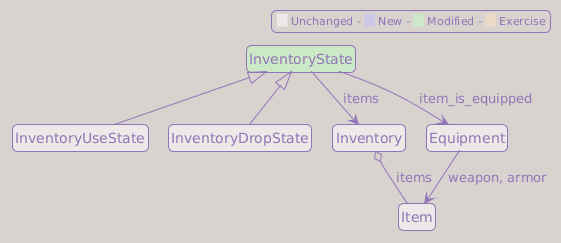
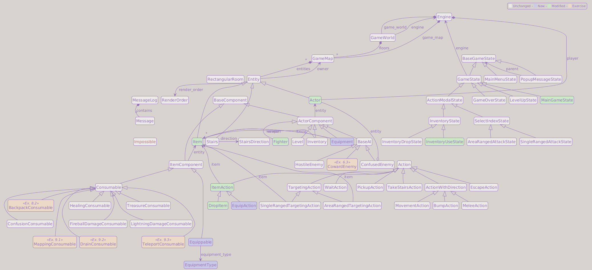

# Part 13b: The Inventory Screen

In **Part 13a** the player got weapons and armor: a dagger in the first room, and one more piece every couple of floors. This part makes the inventory show what the player is wearing, and closes the main tutorial game.

## What You Will Build

By the end of Part 13b, the inventory overlay groups items into three sections, *Equipped*, *Equippable*, and *Items*. Gear is selected with number keys, and everything else keeps its letter. With this in place, the main tutorial game is complete.

## Learning goals

In this part we will:

- Sort the inventory into *Equipped*, *Equippable*, and *Items* sections
- Build the overlay from a list of display rows: headers, blank lines, and items
- Select gear with number keys and everything else with letters

!!! info "Where you stand"
    If you did the Part 8 inventory exercises (item stacking and persistent keys), your overlay differs from the base code in this part. The inventory section says where your path splits and gives you a version to type. Readers without those exercises can ignore it.

---

## Background

This section is for reading; there is nothing to type yet. If you want to start building right away, skip to [Group the inventory: numbers for gear, letters for the rest](#group-the-inventory-numbers-for-gear-letters-for-the-rest). You can come back here at any time, even after you finish the tutorial, when you know the game from the inside and some of these ideas will mean more.

### Two kinds of keys

Right now the inventory is one flat list: every item, equipped or not, takes the next letter. That was fine when everything was a consumable, but equipment changes what the list is *for*. The player needs to see quickly what is worn and what is spare, and gear is selected far more often than a one-shot potion. So we split the overlay into three sections, *Equipped*, *Equippable*, and *Items*, and give equipment its own keys: **numbers** for weapons and armor, **letters** for everything else.

The split has two practical reasons:

- Selecting gear by number is a convention players already know from many games (hotbars, quick slots).
- Keeping consumables on letters means that pressing the health potion key out of habit never equips a weapon by mistake.

A separate *Equipped* header also makes a per-item marker like `(E)` unnecessary: the section a row is in already says it.

---

## Group the inventory: numbers for gear, letters for the rest

`InventoryState` in `game/game_states.py` draws both overlays, so all the changes in this part go there: a helper that sorts the items into groups, a second one that turns the groups into rows, a new drawing loop, and key handling for numbers and letters.

!!! warning "Two paths through this section"
    The code below builds the overlay on the **base** inventory: positional letters, one flat list. If you did the Part 8 inventory exercises (Exercise 1, item stacking, and Exercise 3, persistent keys), your inventory already stacks and selects by a fixed key, so this base code will not match yours. Read the base code to see how the overlay works, but do not type it. Then go to [If you did the Part 8 inventory exercises](#if-you-did-the-part-8-inventory-exercises) at the end of this section, expand the box there, type that version, and continue with [A file past 1,000 lines](#a-file-past-1000-lines) right after it. Everyone else, read on.

First, a helper that sorts the inventory into the three groups, in the order they appear on screen. Add it to `InventoryState` (`game\game_states.py`):

```python
    def _grouped_items(self) -> tuple[list[Item], list[Item], list[Item]]:
        """Equipped gear, carried equippables, and everything else."""
        equipment = self.engine.player.equipment

        equipped:   list[Item] = []
        equippable: list[Item] = []
        other:      list[Item] = []
        for item in self.engine.player.inventory.items:
            if equipment.item_is_equipped(item):
                equipped.append(item)

            elif item.equippable is not None:
                equippable.append(item)

            else:
                other.append(item)

        return equipped, equippable, other
```

A second helper turns those groups into the rows the overlay draws: a section header, a blank line between groups, and one row per item carrying the key that selects it. Equipment is numbered with a single sequence that runs across *both* gear sections, so an equipped dagger and a spare sword read as `1` and `2`, not `1` and `1`. Consumables keep letters.

```python
    def _inventory_rows(self) -> list[tuple[str, str, Item | None]]:
        """Display rows as (kind, label, item); kind is header, blank or item."""
        equipped, equippable, other = self._grouped_items()

        rows: list[tuple[str, str, Item | None]] = []

        number = 1
        for header, gear in (("Equipped", equipped), ("Equippable", equippable)):
            if not gear:
                continue

            if rows:
                rows.append(("blank", "", None))

            rows.append(("header", header, None))
            for item in gear:
                rows.append(("item", str(number), item))
                number += 1

        if other:
            if rows:
                rows.append(("blank", "", None))

            rows.append(("header", "Items", None))
            for offset, item in enumerate(other):
                rows.append(("item", chr(ord("a") + offset), item))

        return rows
```

Now `InventoryState.on_render` draws from that list instead of walking `inventory.items` directly. The height is driven by the number of rows, headers and blanks included, so change the count near the top of the method:

```diff
-        number_of_items_in_inventory = len(inventory.items)
+        rows           = self._inventory_rows()
+        number_of_rows = len(rows)

         slot_count   = f"({len(inventory.items)} / {inventory.capacity} slots)"
         max_height   = console.height - 4
-        height       = min(max(8, number_of_items_in_inventory + 7), max_height)
-        visible_rows = min(number_of_items_in_inventory, max(0, height - 7))
+        height       = min(max(8, number_of_rows + 7), max_height)
+        visible_rows = min(number_of_rows, max(0, height - 7))
```

Then replace the drawing loop itself. Keep the surrounding `if visible_rows > 0:` guard, its `else` branch that prints `EMPTY_TEXT`, and the `name_width` line just above the loop exactly as they are; only the loop body changes. The old loop walked items and built a letter from the index; the new one walks `rows` and branches on the row kind, printing a header, skipping a blank, or drawing an item with its precomputed label:

```python
            for i, (kind, label, item) in enumerate(rows[:visible_rows]):
                row_y = y + 4 + i

                # A blank row is a true gap: draw nothing, not even a background
                if kind == "blank":
                    continue

                # Draw the background for one row
                console.draw_rect(
                    x      = row_x,
                    y      = row_y,
                    width  = row_width,
                    height = 1,
                    ch     = ord(" "),
                    bg     = self.ROW_BG_COLOR,
                )

                if kind == "header":
                    console.print(
                        row_x,
                        row_y,
                        label,
                        fg = colors.INVENTORY_MENU_DIM,
                        bg = self.ROW_BG_COLOR,
                    )
                    continue

                assert item is not None

                # Draw the key that selects this item
                console.print(
                    row_x + 2,
                    row_y,
                    f"[ {label} ]",
                    fg = colors.INVENTORY_MENU_KEY,
                    bg = self.ACCENT_COLOR,
                )

                # Draw the item glyph using its own color
                console.print(
                    row_x + 8,
                    row_y,
                    item.char,
                    fg = item.color,
                    bg = self.ROW_BG_COLOR,
                )

                # Draw the item name, trimmed if it does not fit
                console.print(
                    row_x + 10,
                    row_y,
                    _trim_text(item.name, name_width),
                    fg = colors.INVENTORY_MENU_TEXT,
                    bg = self.ROW_BG_COLOR,
                )
```

Selection now has two namespaces, so `InventoryState.event_keydown` checks numbers and letters separately. Numbers index into the gear (the two equipment sections joined, in display order); letters index into everything else:

```python
    def event_keydown(self, event: tcod.event.KeyDown) -> Action | BaseGameState | None:
        key = event.sym
        equipped, equippable, other = self._grouped_items()

        # Numbers select equipment, one sequence across both gear sections
        if tcod.event.KeySym.N1 <= key <= tcod.event.KeySym.N9:
            gear  = equipped + equippable
            index = int(key) - int(tcod.event.KeySym.N1)
            if index < len(gear):
                return self.on_item_selected(gear[index])

            MessageLog.add_message("Invalid entry.", colors.INVALID)
            return None

        # Letters select consumables and anything else
        index = key - tcod.event.KeySym.A
        if 0 <= index <= 25:
            try:
                selected_item = other[index]
            except IndexError:
                MessageLog.add_message("Invalid entry.", colors.INVALID)
                return None

            return self.on_item_selected(selected_item)

        if key == keys.KEY_EXIT:
            return MainGameState(self.engine)

        return super().event_keydown(event)
```

The two key ranges never overlap, so a number always means "equip or unequip" and a letter always means "use". An equipped item still shows its number in the *Equipped* section, and pressing it again toggles the gear back off through the `on_item_selected` routing you added in Part 13a. The base class drives both the use and drop overlays, so the grouping and the new keys appear in both with no extra code.

### If you did the Part 8 inventory exercises

??? note "Adapted overlay: stacking and persistent keys"
    Your overlay already stacks identical items and selects them by a fixed `key` (Part 8 Exercises 1 and 3). The grouped overlay builds on that, and it ends up *simpler* than the positional code above: equipment carries number keys and consumables carry letter keys, so every label is just `chr(stack[0].key)` and the number/letter split disappears.

    `_grouped_items` classifies stacks instead of loose items:

    ```python
    def _grouped_items(self) -> tuple[list[list[Item]], list[list[Item]], list[list[Item]]]:
        """Equipped, carried equippable, and other, as stacks."""
        equipment = self.engine.player.equipment

        equipped:   list[list[Item]] = []
        equippable: list[list[Item]] = []
        other:      list[list[Item]] = []
        for stack in self.stack_items(self.engine.player.inventory.items):
            item = stack[0]
            if equipment.item_is_equipped(item):
                equipped.append(stack)
            elif item.equippable is not None:
                equippable.append(stack)
            else:
                other.append(stack)

        return equipped, equippable, other
    ```

    `_inventory_rows` carries each stack and labels it with its key, so all three groups share one loop:

    ```python
    def _inventory_rows(self) -> list[tuple[str, str, list[Item] | None]]:
        """Display rows as (kind, label, stack); kind is header, blank or item."""
        equipped, equippable, other = self._grouped_items()

        rows: list[tuple[str, str, list[Item] | None]] = []

        for header, group in (
            ("Equipped",   equipped),
            ("Equippable", equippable),
            ("Items",      other),
        ):
            if not group:
                continue

            if rows:
                rows.append(("blank", "", None))

            rows.append(("header", header, None))
            for stack in group:
                key   = stack[0].key
                label = chr(key) if key is not None else "-"
                rows.append(("item", label, stack))

        return rows
    ```

    `on_render` then follows the base code above, read for reference. Size the panel from the rows: replace your `number_of_items_in_inventory = len(item_stacks)` line with `rows = self._inventory_rows()` and `number_of_rows = len(rows)`, and use `number_of_rows` in the `height` and `visible_rows` lines, as in the base diff. Keep `item_stacks` for the `item_width` line.

    The drawing loop is the base loop above, with two changes. Unpack each row as `(kind, label, stack)`. In the item branch, after the header branch, write `assert stack is not None` and take `item = stack[0]` for the key badge and the glyph. Draw the name with `self.stack_name(stack)` instead of `item.name`, so a stacked row still reads `Health Potion (x3)`. Your old `item_key` line goes away: `label` already holds the key.

    `event_keydown` keeps your persistent loop (it already matches `stack[0].key`); the only change is widening the invalid-entry guard to reject stray digits too:

    ```diff
             if key == keys.KEY_EXIT:
                 return MainGameState(self.engine)

             # Part-8. Exercise 3: Persistent item keys
    -        if ord("a") <= int(key) <= ord("z"):
    +        # Part-13: equipment uses number keys, so reject stray digits too.
    +        if ord("a") <= int(key) <= ord("z") or ord("0") <= int(key) <= ord("9"):
                 MessageLog.add_message("Invalid entry.", colors.INVALID)
                 return None
    ```

    The equipment templates already carry their number keys from Part 13a, so nothing else changes.

### A file past 1,000 lines

With the grouped overlay and every exercise so far, `game_states.py` passes 1,000 lines, and pylint reports `C0302 too-many-lines`. The limit is a rule of thumb: a very long module is often doing too many jobs. If you skipped the exercises, your file is a little shorter and pylint may not complain yet.

Here the length has a reason. Every screen of the game lives in this file, and the states create each other: `MainGameState` opens the inventory, and the inventory returns to `MainGameState`. Keeping them together keeps those references simple. Splitting the file would mean resolving the references between modules, for example with imports inside functions, which this tutorial avoids.

So we accept the length, and say so in the file itself. Add this line at the very top of `game/game_states.py`:

```diff
+# pylint: disable=too-many-lines
 from __future__ import annotations
```

The comment tells pylint, and any reader of the file, that the length is a decision and not an accident. If your file is still under the limit, the line does no harm. In a larger game, the usual next step is a `game/states/` package with one module per group of screens.

---

## Testing Part 13b

Run the game with `uv run main.py` (or `python main.py`):

- [ ] With an empty pack, the inventory still shows the empty-pack message
- [ ] Pick up the Dagger and a potion: the overlay shows an *Equippable* section with the Dagger on `1`, and an *Items* section with the potion on a letter
- [ ] Equipping the Dagger moves it under an *Equipped* header; it keeps the number `1`, and pressing `1` again unequips it: `"You remove the Dagger."`
- [ ] With the Dagger equipped and the Leather Armor carried, the two read `1` and `2` (or `1` and `6` with persistent keys)
- [ ] A number with no gear behind it, such as `5`, shows "Invalid entry." and costs no turn
- [ ] Letters still use potions and scrolls, as before
- [ ] The drop overlay (`d`) shows the same sections and keys

If all of this works, Part 13b is complete, and so is the main tutorial game.

---

## Summary

Equipment is complete, and with it the main tutorial game. Key additions in this part:

- **`_grouped_items`**: sorts the inventory into equipped gear, carried gear, and everything else
- **`_inventory_rows`**: turns the groups into display rows (headers, blank lines, and items with their keys); `on_render` and its height both come from those rows
- **Two key ranges**: numbers select gear, in one sequence across both gear sections, and letters select everything else; the use and drop overlays share both through `InventoryState`

**Local Class Diagram**:



**Full Class Diagram**:



**File structure**:

```text
main.py
game/
├── __init__.py
├── actions.py
├── engine.py
├── exceptions.py
├── game_world.py
├── hud.py
├── game_states.py              ← modified
├── message_log.py
├── setup_game.py
├── data/
│   ├── __init__.py
│   ├── colors.py
│   ├── config.py
│   ├── keys.py
│   └── sprites.py
├── entities/
│   ├── __init__.py
│   ├── entity.py
│   ├── factories.py
│   ├── render_order.py
│   ├── equipment_type.py
│   └── components/
│       ├── __init__.py
│       ├── ai.py
│       ├── base_component.py
│       ├── consumable.py
│       ├── equipment.py
│       ├── equippable.py
│       ├── fighter.py
│       ├── inventory.py
│       └── level.py
└── map/
    ├── __init__.py
    ├── game_map.py
    ├── tile_types.py
    └── map_generator.py
```

---

## Exercises

Try each one on your own first. If one is too hard for now, do not let it stop you: where a reference solution is given, read it and type it in.

1. **Show equipment bonuses in the inventory**:

    The inventory lists `Sword` and `Chain Mail` with no hint of what they do, so the player has no reason to prefer one over another. Make each equippable row show its bonus, for example `Sword (+4 attack)` or `Chain Mail (+3 defense)`.

    The bonus lives on the item: `item.equippable` is `None` for consumables and an `Equippable` for gear, and it carries `attack_bonus`, `defense_bonus`, and `equipment_type` (which tells you whether to label the number "attack" or "defense"). The name is drawn in `InventoryState.on_render`, in the `_trim_text(item.name, name_width)` call. Build the suffix only when `item.equippable is not None`, append it to the name *before* trimming, and remember that the extra characters take space from `name_width` and change the panel width, which is computed from the names.

    ??? note "Reference implementation"
        A helper in `game/game_states.py`, next to `_trim_text`. The bonuses are floats, and the `:g` format prints `4.0` as `4`:

        ```python
        # Part-13. Exercise 1: Show equipment bonuses in the inventory
        def _item_display_name(item: Item) -> str:
            equippable = item.equippable
            if equippable is None:
                return item.name

            if equippable.equipment_type == EquipmentType.WEAPON:
                return f"{item.name} (+{equippable.attack_bonus:g} attack)"

            return f"{item.name} (+{equippable.defense_bonus:g} defense)"
        ```

        It needs `EquipmentType` at run time, so import it at the top of the file:

        ```diff
         from game.data.keys import key_label
        +from game.entities.equipment_type import EquipmentType
         from game.exceptions import Impossible
        ```

        In `InventoryState.on_render`, use the helper in the two places that read `item.name`: the panel width and the drawn name.

        ```diff
        -        item_width = max((len(item.name) for item in inventory.items), default=0) + 18
        +        # Part-13. Exercise 1: Show equipment bonuses in the inventory
        +        item_width = max((len(_item_display_name(item)) for item in inventory.items), default=0) + 18
        ```

        ```diff
                         # Draw the item name, trimmed if it does not fit
                         console.print(
                             row_x + 10,
                             row_y,
        -                    _trim_text(item.name, name_width),
        +                    _trim_text(_item_display_name(item), name_width),  # Part-13. Exercise 1
                             fg = colors.INVENTORY_MENU_TEXT,
                             bg = self.ROW_BG_COLOR,
                         )
        ```

        If you did the Part 8 stacking exercise, change `stack_name` instead: replace both `stack[0].name` reads with `_item_display_name(stack[0])`. The width line and the drawn name already go through `stack_name`.

2. **Equipment stats in the HUD**:

    The panel shows the HP and XP bars, the floor, and your gold, but never your actual combat numbers. Add one line below the XP bar, for example `Attack: 9  Defense: 5`.

    This is almost free, and that is the lesson: the `Fighter.attack` and `Fighter.defense` properties you edited in Part 13a already add the weapon and armor bonuses to the base stats, so you do **not** touch `Equipment` here at all. You only *read* `player.fighter.attack` and `player.fighter.defense` (they return floats, so wrap them in `int(...)`) and print them.

    Follow the pattern of the other panel pieces: add a small `render_combat_stats(console, attack, defense)` to `game/hud.py`, next to `render_dungeon_level`, have it `console.print` the line on a free panel row, and call it from `Engine.render()` right after `hud.render_xp_bar(...)`. The text itself is just `f"Attack: {int(attack)}  Defense: {int(defense)}"`.

    ??? note "Reference implementation"
        In `game/hud.py`, after `render_dungeon_level`. Row 47 is the first free row: the floor and gold use row 44, the HP bar 45, and the XP bar 46.

        ```python
        # Part-13. Exercise 2: Equipment stats in the HUD
        def render_combat_stats(
            console: Console,
            attack: float,
            defense: float,
            y: int = 47,
        ) -> None:
            console.print(
                x    = 0,
                y    = y,
                text = f"Attack: {int(attack)}  Defense: {int(defense)}",
            )
        ```

        In `Engine.render()` (`game/engine.py`), right after the `hud.render_xp_bar(...)` call:

        ```python
                # Part-13. Exercise 2: Equipment stats in the HUD
                hud.render_combat_stats(
                    console = console,
                    attack  = self.player.fighter.attack,
                    defense = self.player.fighter.defense,
                )
        ```

        Equip and remove the Dagger: the attack number changes at once, because the HUD is drawn again every frame.

3. **Place guaranteed equipment away from the arrival room**:

    On floors after the first, the guaranteed piece can currently land in `rooms[0]`, the room you arrive in, which also holds the up stairs, so the reward appears with no exploration. In the placement loop in `generate_dungeon` (`game/map/map_generator.py`), the deeper-floor branch is `rng.choice(rooms)`; restrict it to `rooms[1:]` so the arrival room is excluded.

    Fall back safely when the dungeon has only one room (so `rooms[1:]` is empty): `rooms[1:] or rooms` gives you the candidate list in a single expression. Leave the floor-1 special case (`rooms[0]`) untouched, since placing the dagger in the safe starting room is deliberate.

    ??? note "Reference implementation"
        One line changes in the placement loop at the end of `generate_dungeon`:

        ```diff
             for item_template in equipment:
        -        room = rooms[0] if current_floor == 1 else rng.choice(rooms)
        +        # Part-13. Exercise 3: Place guaranteed equipment away from the arrival room
        +        room = rooms[0] if current_floor == 1 else rng.choice(rooms[1:] or rooms)
                 free = free_positions(room, dungeon)
        ```

        `rooms[1:] or rooms` works because an empty list is false: when `rooms[1:]` is empty, `or` returns `rooms` instead.

4. **Challenge: equipment for monsters**:

    Every actor already carries an `Equipment` component, so the machinery for armed monsters is mostly in place. Give one monster template (say the orc) an equipped weapon in `factories.py` (`equipment = Equipment(weapon=...)`); because `Fighter.attack` reads `entity.equipment`, that orc immediately hits harder, with no other change. Each monster is deep-copied from its template on spawn (Part 5), so every orc gets its own weapon instance.

    Then make the kill rewarding: in the death logic in `Fighter` (the `die` handler that turns an actor into a corpse), check whether the dying actor has anything in a slot and, if so, drop it onto the corpse's tile (set the item's `x`/`y` and add it to the map's entities) so the player can pick it up and equip it. That turns equipment from a player-only system into a general actor feature.

---

## A toolkit, not a power ladder

Part 12 warned against making a dungeon harder with bigger numbers, and gave each monster a personality instead. Part 13 did the opposite with the player's gear. The dagger gives +2, the sword +4; leather armor +1, chain mail +3. That is a **power ladder**: each piece is the one before it with a larger number, and you swing the sword exactly the way you swung the dagger, only it hits harder. It is the orc with triple hit points, applied to your own inventory.

That is fine here, and deliberate. The goal of Part 13 was the *architecture*: two components, a pair of slots, bonuses that flow through the `Fighter` properties. A simple stat ladder is the right baseline for that system. It plays the same role as the orc: the plain fight that everything else is measured against. You need a simple reference before you can build variations on top of it.

But the interesting direction is the one the bestiary already took. A weapon, too, can ask a **different question** instead of offering a bigger number:

- an **axe** that hits every enemy around you asks, *are you in the open, or in a corridor?*
- a **war hammer** that stuns asks, *do you need to buy a turn to escape?*
- a **bow** that strikes at range asks, *can you fight before they reach you?*

None of those is a larger `attack_bonus`; each changes *how* you fight. That is a toolkit, not a ladder.

Armor is harder to vary this way, and the reason is the same idea as in Part 12: *personality lives in behavior, not in stats.* Attacking is an **action**, so you can attach behavior to it (a cleave, a stun, a knockback). Wearing armor is **passive**: it only changes a number, and a number has no behavior to vary.

Armor gets a personality only by becoming partly active (spikes that hurt attackers, slow regeneration, resistance to one kind of damage), and then it is using the weapon's trick. So let armor be the steady baseline, and let the weapons carry the variety.

!!! tip "Design takeaway"
    For the player's gear, as for the monsters, "stronger" is the boring direction. The question that creates depth is *what new decision does this item create?* Good stats are the minimum for good item design, not the goal.

The weapons with behavior above are not in Part 13, and the reason is the rule the `Equippable` design set at the start: a subclass is worth it when an item needs different *code*, not different *numbers*. A cleave needs targeting, a stun needs a status effect, a bow needs a ranged attack path; none of that fits in a template. A future appendix, *Weapons with behavior*, builds them.

---

## What's next

You have built a complete roguelike. Here are directions to take it further:

**Content**:

- More monster types in Part 12's weighted tables (troll variants, vampires, dragons)
- More spell scrolls: confusion variants, area heals, walls of fire
- Ranged weapons: a bow as an `Equippable` plus arrows as inventory items

**Depth**:

- A shop between floors: the gold from Part 8's chests needs something to buy
- Named artifacts: unique items with special effects, spawned through their own `equipment_spawns` bands
- Status effects: poison, blindness, haste, each as a component with a countdown

**Polish**:

- Graphical tiles: swap the tileset for a 16×16 pixel art set; tcod supports it with no code changes beyond the tileset loader
- Sound: `pygame.mixer` can play `.wav` files alongside tcod's rendering
- Fullscreen: extend the `sdl_window_flags` value passed to `tcod.context.new`, for example by adding `tcod.context.SDL_WINDOW_FULLSCREEN`

**Sharing it**:

- Push the game to a public repository with a README, a screenshot, and the run command; a project that starts with `uv run main.py` is easy for anyone to try

The architecture you built (entities and components, actions, game states as a state machine, pickle serialization, data-driven spawn tables) works for a much larger game.

[Yet Another Roguelike Tutorial](https://www.rogueliketutorials.com/), the tutorial this one comes from, is a good comparison: same genre, same library, but different decisions where this tutorial chose another way (game states instead of event handlers, a static message log, the data and factories packages, guaranteed equipment). Reading code that solves the same problems differently is one of the fastest ways to improve.

Good luck with the dungeon.
