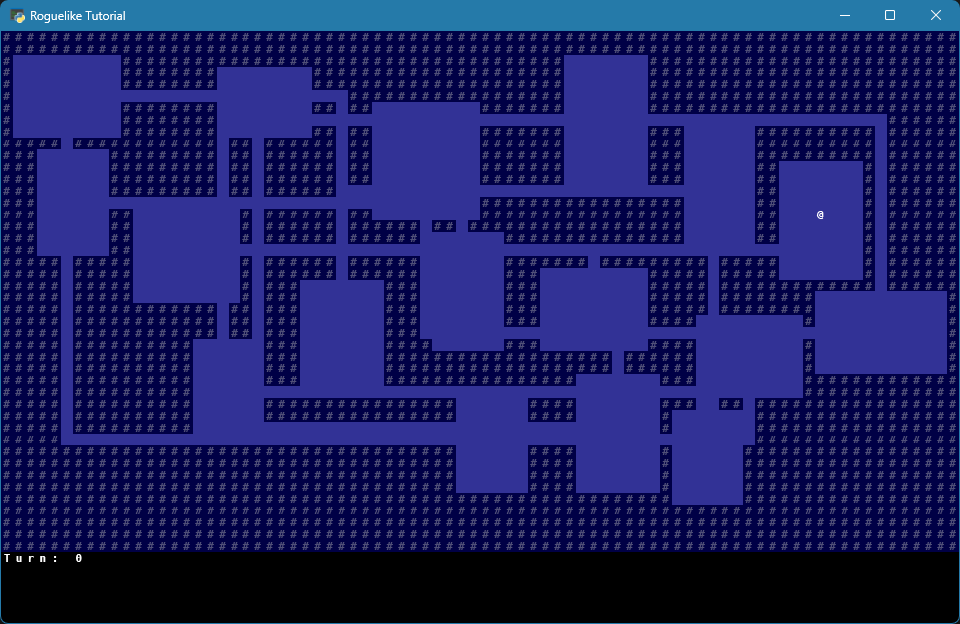
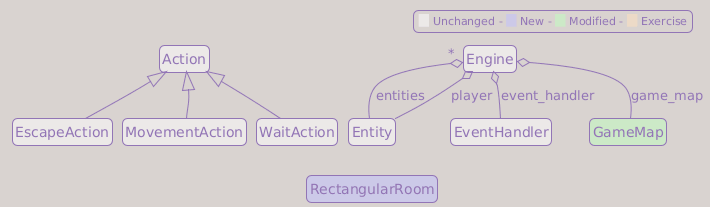

# Part 3: Generating a Dungeon

## What You Will Build

By the end of this part, your roguelike will generate a new dungeon layout made of rooms and tunnels each time it starts, instead of the single hand-written map from Part 2.

## Learning goals

In this part we will:

- See what procedural generation is and why roguelikes use it
- Implement the rooms-and-corridors dungeon algorithm
- Place the player in the first room
- Use Bresenham lines to dig L-shaped tunnels

---

## Background

This section is for reading; there is nothing to type yet. If you want to start building right away, skip to [The map package](#the-map-package). You can come back here at any time, even after you finish the tutorial, when you know the game from the inside and some of these ideas will mean more.

### Procedural generation

A dungeon designed by hand is fixed: every player sees the same map. A procedurally generated dungeon is built by code while the game runs, so it is different on every run. This is one of the roguelike traits from Part 0: players cannot learn the map by heart, so every run is a new exploration.

The classic roguelike dungeon uses the **rooms-and-corridors** approach:

1. Pick a random position and size for a room
2. Check if it overlaps with any existing room
3. If not, place it and dig a tunnel to the previous room
4. Keep trying until we have enough rooms, or until we run out of placement attempts.

This gives dungeons that feel hand-designed (recognizable rooms connected by corridors) while being different on every run.

!!! example "Other algorithms"
    Many alternatives exist:

    | Algorithm | Feel | Complexity |
    | --- | --- | --- |
    | Rooms-and-corridors | Classic dungeon | Low |
    | BSP (Binary Space Partitioning) | Structured, rooms spread evenly | Medium |
    | Cellular automata | Organic caves | Medium |
    | Wave Function Collapse | Highly varied, tile-pattern aware | High |

    We use rooms-and-corridors because it is the easiest to understand, and it produces dungeons that anyone recognizes as a roguelike at first sight.

    The structure we build here lets you replace it with another generator later, with no changes to the rest of the game.

### Keeping the generator apart from the map

The 2019 edition of Yet Another Roguelike Tutorial put dungeon generation inside the `GameMap` class (`GameMap.make_map`). That works for simple cases, but it ties the map *data structure* to one specific *algorithm*. If you later want a second generator (for example, a cave level that uses cellular automata), `GameMap` fills up with code that has nothing to do with storing the map.

We use a separate module instead: `game/map/map_generator.py` takes configuration parameters and returns a `GameMap`.

!!! info "Design decision: Separate map generator module"
    `GameMap` is responsible for *storing* and *rendering* the tile grid. `game/map/map_generator.py` is responsible for *filling* it. This is the Single Responsibility Principle: each module does one thing. Swapping algorithms later means changing only the call in `main.py`.

---

## The map package

Part 2 created `game/game_map.py` and `game/tile_types.py` directly inside `game/`. Now that we are adding dungeon generation, it is worth grouping the map-related files before the project grows further:

```text
game/
  map/
    __init__.py
    game_map.py
    tile_types.py
    map_generator.py
```

Create `game/map/__init__.py` as an empty file. Then move:

- `game/game_map.py` to `game/map/game_map.py`
- `game/tile_types.py` to `game/map/tile_types.py`

Update the import in `game/map/game_map.py`:

```diff
-from game import tile_types
+from game.map import tile_types
```

Update the `GameMap` import in `game/engine.py`. It moves below the other `game` imports to keep them alphabetical:

```diff
 from game.entity import Entity
-from game.game_map import GameMap
 from game.input_handlers import EventHandler
+from game.map.game_map import GameMap
```

`main.py` still imports the old path at this point, so do not run the game yet: it would fail with `ModuleNotFoundError: No module named 'game.game_map'`. That is expected; we replace `main.py` entirely near the end of this part.

---

## The RectangularRoom class

All the generation code goes in a new module, `game/map/map_generator.py`, outside `GameMap` (the Background explains why). Create it with our first class:

```python
from __future__ import annotations

import random
from collections.abc import Iterator
from typing import TYPE_CHECKING

import tcod

from game.map import tile_types
from game.map.game_map import GameMap

if TYPE_CHECKING:
    from game.entity import Entity


class RectangularRoom:

    def __init__(self, x: int, y: int, width: int, height: int) -> None:
        self.x1 = x
        self.y1 = y
        self.x2 = x + width
        self.y2 = y + height

    @property
    def center(self) -> tuple[int, int]:
        return (
            (self.x1 + self.x2) // 2,
            (self.y1 + self.y2) // 2,
        )

    @property
    def inner(self) -> tuple[slice, slice]:
        """The interior of the room as numpy slices."""
        return (
            slice(self.x1 + 1, self.x2),
            slice(self.y1 + 1, self.y2),
        )

    def intersects(self, other: RectangularRoom) -> bool:
        """True if this room overlaps another. Sharing just the outer wall does not count."""
        return (
            self.x1 < other.x2
            and self.x2 > other.x1
            and self.y1 < other.y2
            and self.y2 > other.y1
        )
```

!!! question "What does `@property` do?"
    `@property` lets us call a method like an attribute. Instead of writing `room.center()`, we write `room.center`. This is useful for values that are computed from the object's current state but feel like data: a room's center is derived from `x1`, `y1`, `x2`, and `y2`.

Two rectangles overlap if and only if their projections overlap on **both** the X and Y axes. The strict comparisons (`<`, `>`) deliberately leave one case out: two rooms whose outer walls only touch do not count as overlapping, they simply share that wall. The next section shows why that sharing is safe.

### Why `inner` adds 1

Consider room A with `x1 = 1`, `y1 = 1`, `x2 = 6`, `y2 = 6`, and room B right next to it, with `x1 = 6` and `x2 = 11`. `intersects` accepts B, because the two rooms only share column 6.

Without the `+1`, a room's interior would be `slice(x1, x2)`. A slice stops *before* its end value, so for room A this digs columns and rows 1 to 5:

- Column 6 and row 6 (the right and bottom walls) stay wall, because the slice ends there.
- Column 1 and row 1 (the left and top walls) are dug away.

Room B then digs from column 6, which is room A's right wall, and the two rooms merge into one (right drawing).

The `+1` fixes the other side. The end of the slice already keeps the right and bottom walls; starting the interior at `x1 + 1` and `y1 + 1` also keeps the left and top walls. Every room keeps one tile of wall all around it, and two rooms next to each other share a wall (left drawing):

```text
With +1 (what we do):           Without +1:

0 # # # # # # # # # # # # #     0 # # # # # # # # # # # # #
1 # + + + + + + + + + + + #     1 # . . . . . . . . . . + #
2 # + . . . . + . . . . + #     2 # . . . . . . . . . . + #
3 # + . . . . + . . . . + #     3 # . . . . . . . . . . + #
4 # + . . . . + . . . . + #     4 # . . . . . . . . . . + #
5 # + . . . . + . . . . + #     5 # . . . . . . . . . . + #
6 # + + + + + + + + + + + #     6 # + + + + + + + + + + + #
7 # # # # # # # # # # # # #     7 # # # # # # # # # # # # #
    ^         ^         ^           ^         ^         ^
    x=1       x=6       x=11        x=1       x=6       x=11

Room A: x1=1, x2=6    Room B: x1=6, x2=11
+ = wall on a room's border (a normal wall in the game)
```

Two rooms next to each other will always have a wall between them when they are dug. Only tunnels break through these walls, and that is deliberate: it is exactly how rooms get connected in the next section.

---

## L-shaped tunnels

Rooms need corridors between them. We connect room centers with an L-shaped tunnel: first move horizontally (or vertically), then turn.

Add this function to `game/map/map_generator.py`:

```python
def tunnel_between(
    start: tuple[int, int],
    end: tuple[int, int],
) -> Iterator[tuple[int, int]]:
    """Yield the (x, y) coordinates of an L-shaped tunnel."""
    x1, y1 = start
    x2, y2 = end

    if random.random() < 0.5:
        corner_x, corner_y = x2, y1  # Horizontal first, then vertical
    else:
        corner_x, corner_y = x1, y2  # Vertical first, then horizontal

    for x, y in tcod.los.bresenham((x1, y1), (corner_x, corner_y)).tolist():
        yield x, y

    for x, y in tcod.los.bresenham((corner_x, corner_y), (x2, y2)).tolist():
        yield x, y
```

The two options look like this:

```text
Option A (right then down):      Option B (down then right):

  ┌──────┐                    ┌──────┐
  │      │                    │      │
  │  ●───────────────┐        │  ●   │
  └──────┘           │        └──│───┘
                     │           │
                     │           │
                  ┌──│───┐       │            ┌──────┐
                  │  ●   │       └───────────────●   │
                  └──────┘                    └──────┘
```

The 50/50 random choice means the dungeon gets a mix of both shapes, which looks more natural than always turning the same way.

`tcod.los.bresenham` returns the coordinates of a straight line between two points, using [Bresenham's line algorithm](https://en.wikipedia.org/wiki/Bresenham%27s_line_algorithm). It lives in tcod's line-of-sight module (`los`), but the algorithm works for any straight line on a grid, which is exactly what a tunnel is.

The `yield` keyword makes `tunnel_between` a *generator function*: it produces coordinates one at a time instead of building a full list. The caller (`for x, y in tunnel_between(...)`) receives them as it loops. This "generator" is a Python term; it has nothing to do with our dungeon generator.

---

## The dungeon generator

Now add the main function:

```python
def generate_dungeon(
    max_rooms: int,
    room_min_size: int,
    room_max_size: int,
    map_width: int,
    map_height: int,
    player: Entity,
) -> GameMap:
    """Generate a new dungeon map and place the player."""
    dungeon = GameMap(map_width, map_height)

    rooms: list[RectangularRoom] = []

    max_room_attempts = max_rooms * 2
    for _ in range(max_room_attempts):
        room_width  = random.randint(room_min_size, room_max_size)
        room_height = random.randint(room_min_size, room_max_size)

        x = random.randint(0, dungeon.width  - room_width  - 1)
        y = random.randint(0, dungeon.height - room_height - 1)

        new_room = RectangularRoom(x, y, room_width, room_height)

        # Skip this room if it overlaps with any existing room
        if any(new_room.intersects(other) for other in rooms):
            continue

        # Dig out the interior
        dungeon.tiles[new_room.inner] = tile_types.floor

        if not rooms:
            # First room: place the player here
            player.set_position(*new_room.center)

        else:
            # All subsequent rooms: dig a tunnel to the previous room
            for x, y in tunnel_between(rooms[-1].center, new_room.center):
                dungeon.tiles[x, y] = tile_types.floor

        rooms.append(new_room)
        if len(rooms) >= max_rooms:
            break

    return dungeon
```

The algorithm in plain language:

1. Attempt to place rooms, giving the generator extra chances when a room overlaps
2. For each attempt, pick a random size and position
3. If it overlaps an existing room, skip it (try again next iteration)
4. Otherwise, dig it out and connect it to the last room with a tunnel
5. Put the player in the first room that was successfully placed

`max_rooms` is the maximum number of rooms we want to keep, not the number of placement attempts. Since many attempts are rejected because they overlap existing rooms, we give the generator extra chances with `max_room_attempts`. The loop stops early once enough rooms have been placed.

!!! tip "Tweaking the dungeon"
    The three parameters `max_rooms`, `room_min_size`, and `room_max_size` control how the dungeon looks. More rooms give a denser dungeon. Smaller rooms give more corridors and a more maze-like floor. Try different values once Part 3 works.

    With the values in `main.py`, the map fills up before `max_rooms` is reached: most dungeons end with 12 to 18 rooms. Try smaller rooms (4 to 6) and you will see `max_rooms` start to limit the count.

---

## The GameMap needs walls to start

The generator digs floors out of a solid wall map. Update `game/map/game_map.py` to start with walls:

```diff
-        # Fill the entire map with floor tiles for now
-        # Part 3 will change this to walls, which we dig out
-        self.tiles = np.full((width, height), fill_value=tile_types.floor, order="F")
-
-        half_width  = width  // 2
-        half_height = height // 2
-
-        # A small wall for testing: we will remove it in Part 3
-        self.tiles[half_width-10:half_width+10+1, half_height] = (
-            tile_types.wall
-        )
+        self.tiles = np.full((width, height), fill_value=tile_types.wall, order="F")
```

!!! note "If you completed Part 2's water-tile exercise"
    Delete the lines that paint the lake while you are here. A fixed obstacle can cut a corridor or block a room entrance in a generated dungeon, which makes it harder to tell whether a problem comes from the generator or from the old test feature. You can keep the `water` tile definition in `tile_types.py`; only remove the code that paints it into the map.

---

## Wiring it into main.py

Update `main.py` to call `generate_dungeon`:

```python
from __future__ import annotations

from pathlib import Path

import tcod

from game.engine import Engine
from game.entity import Entity
from game.input_handlers import EventHandler
from game.map.map_generator import generate_dungeon


def main() -> None:
    screen_width  = 80
    screen_height = 50

    map_width  = 80
    map_height = 44

    room_max_size = 12
    room_min_size = 7

    max_rooms = 30

    tileset = tcod.tileset.load_tilesheet(
        Path(__file__).parent / "res" / "dejavu12x12_gs_tc.png",
        32,
        8,
        tcod.tileset.CHARMAP_TCOD,
    )

    event_handler = EventHandler()

    player = Entity(
        x     = 0,
        y     = 0,
        char  = "@",
        color = (255, 255, 255),
        name  = "Player",          # Part-2. Exercise 1: Add names to entities
    )

    game_map = generate_dungeon(
        max_rooms     = max_rooms,
        room_min_size = room_min_size,
        room_max_size = room_max_size,
        map_width     = map_width,
        map_height    = map_height,
        player        = player,
    )

    engine = Engine(
        entities      = {player},
        event_handler = event_handler,
        game_map      = game_map,
        player        = player,
    )

    title   = "Roguelike Tutorial"
    version = "0.1.0"
    app_id  = "com.tutorial.roguelike"

    tcod.lib.SDL_SetAppMetadata(
        title.encode("utf-8"),
        version.encode("utf-8"),
        app_id.encode("utf-8"),
    )
    tcod.lib.SDL_SetHint(
        b"SDL_RENDER_SCALE_QUALITY",
        b"0",   # Nearest pixel sampling
    )

    with tcod.context.new(
        columns          = screen_width,
        rows             = screen_height,
        tileset          = tileset,
        title            = title,
        vsync            = True,
        sdl_window_flags = tcod.context.SDL_WINDOW_ALLOW_HIGHDPI | tcod.context.SDL_WINDOW_RESIZABLE,
    ) as context:
        console = tcod.console.Console(screen_width, screen_height, order="F")
        engine.run(context, console)


if __name__ == "__main__":
    main()
```

Notice that the player starts at `(0, 0)`, a wall. `generate_dungeon` will move the player to the center of the first room before the game begins. We also removed the `npc` entity since it was just for demonstration.

!!! note "The `name` argument comes from Part 2's first exercise"
    If you did that exercise, `Entity` already accepts `name` and you have nothing to add.

    If you skipped it, add it now: later parts show entity names in messages such as "Player attacks Orc!". In `game/entity.py`, add a `name: str` parameter to `Entity.__init__` and store it as `self.name`.



---

## Testing your work

Run the game a few times with `uv run main.py` (or `python main.py`):

- [ ] A different dungeon layout appears every run
- [ ] The player starts inside a room, not inside a wall
- [ ] All rooms are connected by corridors (you can reach every room)
- [ ] Walls block movement as expected
- [ ] The dungeon fits within the map bounds
- [ ] There is no exit yet; descending stairs come in Part 11a

!!! bug "What if some rooms are unreachable?"
    Our algorithm connects each room to the *previous* room in the list with a tunnel. Digging only turns wall into floor, so a later room can never block an earlier corridor. That is what makes every room reachable.

    The overlap check does not matter here: two overlapping rooms would just merge into one, which looks bad but is still reachable.

    If you see a room with no connection, the tunnel code did not run for it. Check the `else` branch, and check that `rooms.append(new_room)` runs for every room you dig: if it does not, `rooms` stays empty and every room takes the "first room" branch, with no tunnel.

---

## Summary

We built a rooms-and-corridors dungeon generator in a dedicated `game/map/map_generator.py` module. Key ideas:

- **Separation of concerns**: `GameMap` stores tiles, `map_generator` fills them
- **Wall-first approach**: start with all walls and dig out rooms
- **Intersection testing**: reject rooms that overlap, guaranteeing clean separation
- **L-shaped tunnels**: connecting room centers with a random horizontal-or-vertical-first choice
- **Player placement**: the first valid room becomes the player's starting position

**Current architecture**:

- `main.py`: chooses generation parameters and starts the engine
- `game/map/`: groups tile definitions, map storage, and map generation
- `game/map/map_generator.py`: builds a dungeon and places the player
- `GameMap`: stores the generated tile grid
- `RectangularRoom`: local helper for the rooms-and-corridors algorithm
- `Engine`: runs the already-generated map

**Class Diagram**:



**File structure**:

```text
main.py                     ← modified
game/
├── __init__.py
├── actions.py
├── engine.py               ← modified
├── entity.py
├── input_handlers.py
└── map/
    ├── __init__.py         ← new
    ├── game_map.py         ← moved (game/game_map.py), modified
    ├── tile_types.py       ← moved (game/tile_types.py)
    └── map_generator.py    ← new
```

---

## Exercises

The next parts assume you did these exercises. Try each one on your own first. If one is too hard for now, do not let it stop you: where a reference solution is given, read it and type it in, and when a later part builds on an exercise, it points out the code that comes from it.

1. **Reproducible dungeons**:

    Add a `seed` parameter to `generate_dungeon` and call `random.seed(seed)` at the top of the function. With a fixed seed, the dungeon is always the same. This is useful for debugging: if you find a problematic layout, record its seed to reproduce it.

    `random.seed(seed)` reseeds Python's shared, global random generator. It affects every other part of the program that calls `random` after this point, not just dungeon generation. Part 4 introduces a safer pattern: a `random.Random(seed)` instance owned by the generator itself, so seeding the dungeon does not also make unrelated systems repeat the same results.

2. **Connect to the *nearest* room instead of the *previous* one**:

    Our current algorithm connects each room to the one placed before it. This sometimes creates long tunnels that cross half the map. Instead, find the already-placed room that is closest to the new room and connect to that. The dungeon will look more compact.

    Add distance helpers to `RectangularRoom`:

    ```python
    def squared_center_distance(self, other_room: RectangularRoom) -> int:
        dx = self.center[0] - other_room.center[0]
        dy = self.center[1] - other_room.center[1]
        return dx * dx + dy * dy

    def squared_distance(self, other_room: RectangularRoom) -> int:
        dx = max(
            other_room.x1 - self.x2,
            self.x1 - other_room.x2,
            0,
        )
        dy = max(
            other_room.y1 - self.y2,
            self.y1 - other_room.y2,
            0,
        )
        return dx * dx + dy * dy
    ```

    `squared_center_distance` compares room centers. `squared_distance` compares the rectangles themselves: if two rooms overlap along one axis, that axis contributes `0`; otherwise it contributes the gap between their edges. Use `squared_distance` for this exercise, then try `squared_center_distance` too and compare the layouts: center distance sometimes picks a room whose nearest *edge* is actually far away, because it ignores each room's size.

    We compare squared distances instead of real distances because we only need to know which room is closest. Taking a square root would make every distance slower to compute, and it would not change the ordering: if one squared distance is smaller than another, its real distance is smaller too.

    A simple explicit loop is a good fit here: keep track of the closest room found so far and update it when you find a shorter distance. (`min()` with a `key` function is a fine alternative, but the loop reads better for a check this small.)

3. **Connect rooms using rough centers**:

    Add a `roughly_center` property to `RectangularRoom` that returns a random point inside the room instead of its exact center, keeping a small margin from the walls so the point never lands on one. Use `roughly_center` as the tunnel endpoint instead of `center`, so corridors do not always connect to the exact middle of each room. Keep using `center` to place the player in the first room.
