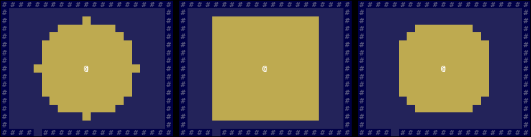
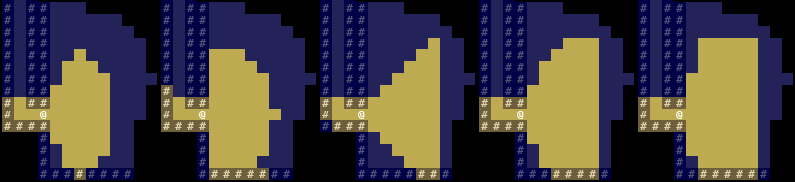
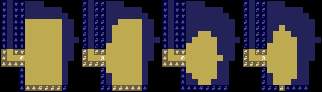
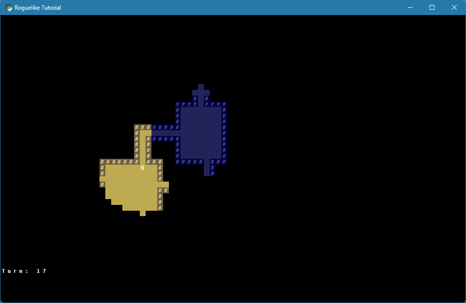
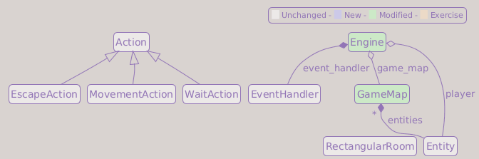

# Part 4: Field of View

## What You Will Build

By the end of this part, the player will only see the parts of the dungeon that are currently visible, while previously explored areas stay remembered on the map. Each dungeon will also come from a seed, so you can rebuild the same dungeon again.

## Learning goals

In this part we will:

- See what FOV (field of view) is and why roguelikes use it
- Track three tile visibility states: visible, explored, unseen
- Render tiles differently depending on visibility
- Move the entities from `Engine` into `GameMap`
- Recompute FOV after every player action
- Make dungeons reproducible with a seed

---

## Background

This section is for reading; there is nothing to type yet. If you want to start building right away, skip to [Adding light colors to tiles](#adding-light-colors-to-tiles). You can come back here at any time, even after you finish the tutorial, when you know the game from the inside and some of these ideas will mean more.

### What is FOV and why do roguelikes use it?

In a dungeon you cannot see around corners. FOV (Field of View) simulates this: the player only sees tiles that have an unobstructed line of sight from their position.

```text
Legend:
  @ player
  # wall
  . visible floor
  ? unseen floor

# # # # # # # # # # # # # # # # #
# ? ? . . . . . # ? ? ? ? ? ? ? #
# ? . . . . . . # ? ? ? ? ? ? ? #
# ? . . . . . . # ? ? ? ? ? ? ? #
# . . . . @ . . . . ? ? ? ? ? ? #
# ? . . . . . . # ? ? ? ? ? ? ? #
# ? . . . . . . # ? ? ? ? ? ? ? #
# ? ? . . . . . # ? ? ? ? ? ? ? #
# # # # # # # # # # # # # # # # #
```

The wall blocks line of sight. The player can see the floor tiles on the left, but the tiles behind the wall are unseen, even if they are physically part of the same map. The unseen corners of the left room have a different cause: the diagram uses a short sight radius of 4 tiles, so the player cannot see that far. Our code will use `radius=8`.

This creates tension (you never know what is around the next corner) and makes exploration meaningful.

Roguelikes also show tiles the player has *already seen* even when they are out of current view. They are drawn darker, to show that the player remembers them but cannot see them now. Tiles never seen at all are completely black.

This is often called **fog of war**: visible tiles are bright, remembered tiles are dim, and unseen tiles are black. Some roguelike codebases call never-seen tiles the *shroud*, but we use the plainer name `UNSEEN`.

### Choosing an FOV algorithm

tcod ships several FOV algorithms: `FOV_BASIC`, `FOV_DIAMOND`, `FOV_SHADOW`, `FOV_PERMISSIVE_*` (nine variants, levels 0-8), `FOV_RESTRICTIVE`, and `FOV_SYMMETRIC_SHADOWCAST`. They differ in how they handle corners, walls, and symmetry: whether the fact that A can see B implies B can see A.

| Algorithm | Notes |
| --- | --- |
| `FOV_BASIC` | Simple raycasting; fast, but may show artifacts on walls |
| `FOV_DIAMOND` | Diamond raycasting: another raycasting method that spreads out from the player one tile at a time |
| `FOV_SHADOW` | Recursive shadowcasting; good general-purpose choice |
| `FOV_RESTRICTIVE` | Restrictive Precise Angle Shadowcasting (MRPAS); the default when you do not pass `algorithm` |
| `FOV_PERMISSIVE_0` to `FOV_PERMISSIVE_8` | Permissive FOV (PFOV) family, levels `0`-`8`; `FOV_PERMISSIVE_8` is the most permissive |
| `FOV_SYMMETRIC_SHADOWCAST` | Guarantees symmetric results: if A sees B, B sees A |

Our game uses `FOV_SHADOW` (recursive shadowcasting) because it produces clean sight lines with few artifacts and is the traditional roguelike choice. It is not fully symmetric; `FOV_SYMMETRIC_SHADOWCAST` exists to fix that, for games where mutual sight matters. Once your game runs, change the `algorithm` argument in `update_fov()` and see how each one changes the look of corridors and walls.

RogueBasin's [Field of Vision](https://www.roguebasin.com/index.php/Field_of_Vision) article goes deeper into how each algorithm works internally.

---

**Example of FOV algorithms in an open space**:



1. BASIC, DIAMOND, RESTRICTIVE, SHADOW
2. PERMISSIVE_X
3. SYMMETRIC_SHADOWCAST

---

**Example of FOV algorithms entering a room**:



1. BASIC
2. DIAMOND
3. PERMISSIVE_0
4. PERMISSIVE_2
5. PERMISSIVE_4

---



1. PERMISSIVE_6, PERMISSIVE_8
2. RESTRICTIVE
3. SHADOW
4. SYMMETRIC_SHADOWCAST

---

## Adding light colors to tiles

Each tile on the map is in one of three states:

| State | Appearance |
| ----- | ---------- |
| Currently visible | Bright (light colors) |
| Explored but out of FOV | Dimmed (dark colors) |
| Never seen | Black (`UNSEEN`) |

Until now, tiles only had an `out_of_fov` appearance. We add an `in_fov` appearance for when a tile is inside the player's FOV.

Update `game/map/tile_types.py`:

```python
from __future__ import annotations

import numpy as np

# Describes how to draw one tile: character + foreground + background colors
graphic_dtype = np.dtype(
    [
        ("ch", np.int32),   # Unicode codepoint of the character
        ("fg", "3B"),       # foreground RGB (3 unsigned bytes)
        ("bg", "3B"),       # background RGB
    ]
)

# Describes one tile: its gameplay properties + its appearance
tile_dtype = np.dtype(
    [
        ("walkable",    np.bool_),      # True if entities can walk here
        ("transparent", np.bool_),      # True if this tile doesn't block FOV
        ("out_of_fov",  graphic_dtype), # appearance when explored but outside FOV
        ("in_fov",      graphic_dtype), # appearance when inside the player's FOV
    ]
)

# Used for tiles the player has never seen. Pure black
UNSEEN = np.array((ord(" "), (255, 255, 255), (0, 0, 0)), dtype=graphic_dtype)


def new_tile(
    *,
    walkable: bool,
    transparent: bool,
    out_of_fov: tuple[int, tuple[int, int, int], tuple[int, int, int]],
    in_fov: tuple[int, tuple[int, int, int], tuple[int, int, int]],
) -> np.ndarray:
    """Create a single tile definition."""
    return np.array((walkable, transparent, out_of_fov, in_fov), dtype=tile_dtype)


# Tile definitions
floor = new_tile(
    walkable    = True,
    transparent = True,
    out_of_fov  = (ord(" "), (255, 255, 255), (35, 35, 90)),
    in_fov      = (ord(" "), (255, 255, 255), (190, 170, 80)),
)

wall = new_tile(
    walkable    = False,
    transparent = False,
    out_of_fov  = (ord("#"), (80, 80, 120), (0, 0, 70)),
    in_fov      = (ord("#"), (220, 210, 170), (110, 95, 60)),
)

# Part-2. Exercise 3: Add a new tile type
water = new_tile(
    walkable    = False,
    transparent = True,
    out_of_fov  = (ord("~"), (64, 255, 255), (0, 0, 180)),
    in_fov      = (ord("~"), (180, 255, 255), (20, 90, 220)),
)
```

`UNSEEN` is a single graphic (not a full tile struct) that we use for unseen cells.

If you did not complete Part 2's Exercise 3, ignore the `water` tile definition; this chapter does not use it.

---

## Moving entities into GameMap

Right now, entities are stored in `Engine`. But entities live *in* the dungeon; it makes more sense for the map to own them. Moving them to `GameMap` also makes the rendering code simpler: the map knows both the tile grid and what is on it.

!!! info "Design decision: entities belong to the map"
    Storing entities in `Engine` worked while we had one player and no enemies. Once we add dozens of enemies per floor, pathfinding and collision queries become much easier if the map already knows where everything is. We make this change now, before Part 5 places enemies.

Update `game/map/game_map.py`:

```python
from __future__ import annotations

from collections.abc import Iterable
from typing import TYPE_CHECKING

import numpy as np
from tcod.console import Console

from game.map import tile_types

if TYPE_CHECKING:
    from game.entity import Entity


class GameMap:

    def __init__(
        self,
        width: int,
        height: int,
        entities: Iterable[Entity] = (),
    ) -> None:
        self.width = width
        self.height = height
        self.entities: set[Entity] = set(entities)
        self.tiles = np.full((width, height), fill_value=tile_types.wall, order="F")
        self.visible = np.full((width, height), fill_value=False, order="F")
        self.explored = np.full((width, height), fill_value=False, order="F")

    def in_bounds(self, x: int, y: int) -> bool:
        """True if (x, y) is inside the map."""
        return 0 <= x < self.width and 0 <= y < self.height

    def render(self, console: Console) -> None:
        console.rgb[0 : self.width, 0 : self.height] = np.select(
            condlist   = [self.visible, self.explored],
            choicelist = [self.tiles["in_fov"], self.tiles["out_of_fov"]],
            default    = tile_types.UNSEEN,
        )

        for entity in self.entities:
            if self.visible[entity.x, entity.y]:
                console.print(entity.x, entity.y, entity.char, fg=entity.color)
```

### np.select: choosing between three outcomes

`np.select` evaluates a list of conditions in order and picks the matching array:

```text
If visible[x, y]    → use tiles["in_fov"][x, y]
Elif explored[x, y] → use tiles["out_of_fov"][x, y]
Else                → use UNSEEN
```

This replaces the entire map in one vectorized call: no Python loop needed.

Entity rendering now only shows entities in the player's current FOV (`if self.visible[entity.x, entity.y]`). Enemies that have walked out of sight disappear from view until the player sees them again.

Update `game/map/map_generator.py` to add the player to the map's entity set. In `generate_dungeon`, change:

```diff
-    dungeon = GameMap(map_width, map_height)
+    dungeon = GameMap(map_width, map_height, entities=[player])
```

---

## Computing FOV in the Engine

`tcod.map.compute_fov` takes the map's transparency array and the player's position and returns a boolean array: `True` where the player can see.

Update `game/engine.py`:

```python
from __future__ import annotations

from collections.abc import Iterable
from typing import Any

import tcod.constants
import tcod.event
import tcod.map
from tcod.console import Console
from tcod.context import Context

from game.entity import Entity
from game.input_handlers import EventHandler
from game.map.game_map import GameMap


class Engine:

    def __init__(self, game_map: GameMap, player: Entity) -> None:
        self.game_map = game_map
        self.player = player
        self.event_handler = EventHandler()
        self.update_fov()  # compute FOV for the starting position

    def update_fov(self) -> None:
        self.game_map.visible[:] = tcod.map.compute_fov(
            self.game_map.tiles["transparent"],
            (self.player.x, self.player.y),
            radius    = 8,
            algorithm = tcod.constants.FOV_SHADOW,
        )
        # Any tile now visible is permanently remembered
        self.game_map.explored |= self.game_map.visible

    def handle_events(self, events: Iterable[Any]) -> None:
        for event in events:
            action = self.event_handler.dispatch(event)
            if action is None:
                continue
            action.perform(self, self.player)
            self.update_fov()  # recompute after every action

    def render(self, console: Console, context: Context) -> None:
        console.clear()
        self.game_map.render(console)
        context.present(console)

    def run(self, context: Context, console: Console) -> None:
        while True:
            self.render(console=console, context=context)
            self.handle_events(tcod.event.wait())
```

Key points:

- `update_fov()` is called once in `__init__` so the player's starting room is immediately visible
- It is called after every action in `handle_events` so moving updates the view
- `explored |= visible` is an element-wise OR: a tile becomes explored the first time it is visible, and it stays explored after that

!!! note "If you kept the Part 1 turn counter"
    This listing replaces the whole `engine.py`, so copy your three `# Part-1. Exercise 3` lines into it: `self.turn_count    = 0` at the end of `__init__`, `self.turn_count += 1` after the `if action is None:` block in `handle_events`, and the `console.print(x=0, y=44, text=f"Turns: {self.turn_count}")` in `render()`, before `context.present(console)`. Part 10 will build on this counter.

!!! note "What does `[:]` mean?"
    `visible[:] = ...` updates the contents of the existing array in-place. Without `[:]`, the assignment would replace the array with a new one, and any other code holding a reference to the original would still see the old data.

!!! info "The Engine constructor shrank"
    Compared to Part 2, `Engine.__init__` no longer receives `entities` (they live in `GameMap` now) or `event_handler` (we always create the `EventHandler` inside the engine, since for now there is only one). The signature keeps only what the caller must provide: the newly generated `game_map` and the `player`. Objects that only the engine uses are now created inside it.

!!! question "Why `radius=8`?"
    The radius controls how far the player can see. Eight tiles is a common default: large enough to see across a room, small enough that corridors stay mysterious. Try other values, or make it a character stat later.

!!! question "Why `FOV_SHADOW`?"
    Recursive shadowcasting gives clean sight lines with few artifacts. tcod has several other FOV algorithms; [Choosing an FOV algorithm](#choosing-an-fov-algorithm) in the Background section compares them.

---

## Simplifying main.py

With entities now living in `GameMap` and `Engine` having a simpler constructor, update `main.py`:

```python
from __future__ import annotations

from pathlib import Path

import tcod

from game.engine import Engine
from game.entity import Entity
from game.map.map_generator import generate_dungeon


def main() -> None:
    screen_width  = 80
    screen_height = 50

    map_width  = 80
    map_height = 44

    room_max_size = 12
    room_min_size = 7

    max_rooms = 30

    tileset = tcod.tileset.load_tilesheet(
        Path(__file__).parent / "res" / "dejavu12x12_gs_tc.png",
        32,
        8,
        tcod.tileset.CHARMAP_TCOD,
    )

    player = Entity(
        x     = 0,
        y     = 0,
        char  = "@",
        color = (255, 255, 255),
        name  = "Player",          # Part-2. Exercise 1: Add names to entities
    )

    game_map = generate_dungeon(
        max_rooms     = max_rooms,
        room_min_size = room_min_size,
        room_max_size = room_max_size,
        map_width     = map_width,
        map_height    = map_height,
        player        = player,
    )

    engine = Engine(game_map=game_map, player=player)

    title   = "Roguelike Tutorial"
    version = "0.1.0"
    app_id  = "com.tutorial.roguelike"

    tcod.lib.SDL_SetAppMetadata(
        title.encode("utf-8"),
        version.encode("utf-8"),
        app_id.encode("utf-8"),
    )
    tcod.lib.SDL_SetHint(
        b"SDL_RENDER_SCALE_QUALITY",
        b"0",   # Nearest pixel sampling
    )

    with tcod.context.new(
        columns          = screen_width,
        rows             = screen_height,
        tileset          = tileset,
        title            = title,
        vsync            = True,
        sdl_window_flags = tcod.context.SDL_WINDOW_ALLOW_HIGHDPI | tcod.context.SDL_WINDOW_RESIZABLE,
    ) as context:
        console = tcod.console.Console(screen_width, screen_height, order="F")
        engine.run(context, console)


if __name__ == "__main__":
    main()
```

If you did Part 3's Exercise 1, your `generate_dungeon` already requires a `seed`, so keep passing the seed you used there. The next section replaces that code.

!!! tip "Run it now"
    Run the game with `uv run main.py` (or `python main.py`). The starting room is bright, the tiles behind you turn dim as you move away, and anything you have not explored yet is solid black. Walk through a few rooms and corridors and watch the lit area follow you. Run it a few times: each run builds a different dungeon.

    

---

## Reproducible dungeons on the main path

Each run now builds a different dungeon. That is what we want when we play, but not when something goes wrong: if you find a broken layout, you cannot get it back. A **seed** solves this. The generator receives a number, and the same number always rebuilds the same dungeon. From here on, `main.py` always passes a seed, so `generate_dungeon` needs a `seed` parameter on the main path.

This was Part 3's first exercise, with one difference: instead of reseeding Python's shared `random` module, we create a `random.Random` instance that belongs to the generator. Reseeding the shared module would also repeat every other `random` call in the game (combat rolls, AI decisions, item drops), not just dungeon generation. A local instance limits the seed to the dungeon.

If you completed Part 3's exercise with `random.seed(seed)`, replace it now (from this point it is required, not optional):

```diff
 def generate_dungeon(
     max_rooms: int,
     room_min_size: int,
     room_max_size: int,
     map_width: int,
     map_height: int,
     player: Entity,
+    seed: int,
 ) -> GameMap:
     """Generate a new dungeon map and place the player."""
+    # Part-3. Exercise 1: Reproducible dungeons
+    rng = random.Random(seed)
+
     dungeon = GameMap(map_width, map_height, entities=[player])

     rooms: list[RectangularRoom] = []

     max_room_attempts = max_rooms * 2
     for _ in range(max_room_attempts):
-        room_width  = random.randint(room_min_size, room_max_size)
-        room_height = random.randint(room_min_size, room_max_size)
+        room_width  = rng.randint(room_min_size, room_max_size)
+        room_height = rng.randint(room_min_size, room_max_size)

-        x = random.randint(0, dungeon.width  - room_width  - 1)
-        y = random.randint(0, dungeon.height - room_height - 1)
+        x = rng.randint(0, dungeon.width  - room_width  - 1)
+        y = rng.randint(0, dungeon.height - room_height - 1)
```

Every other `random.*` call the generator makes needs the same change, including inside `tunnel_between`, so `rng` has to travel with it:

```diff
 def tunnel_between(
+    rng: random.Random,
     start: tuple[int, int],
     end: tuple[int, int],
 ) -> Iterator[tuple[int, int]]:
     """Yield the (x, y) coordinates of an L-shaped tunnel."""
     x1, y1 = start
     x2, y2 = end

-    if random.random() < 0.5:
+    if rng.random() < 0.5:
         corner_x, corner_y = x2, y1  # Horizontal first, then vertical
     else:
         corner_x, corner_y = x1, y2  # Vertical first, then horizontal
```

And its call site, inside `generate_dungeon`:

```diff
         else:
             # All subsequent rooms: dig a tunnel to the previous room
-            for x, y in tunnel_between(rooms[-1].center, new_room.center):
+            for x, y in tunnel_between(rng, rooms[-1].center, new_room.center):
                 dungeon.tiles[x, y] = tile_types.floor
```

`rng` now replaces every bare `random.*` call the generator makes. Nothing outside `generate_dungeon` and the functions it calls is affected: combat rolls, AI decisions, and anything else that calls `random` directly keeps using Python's ordinary, unseeded generator, exactly as before.

!!! note "If you did Part 3's rough-centers exercise"
    `roughly_center` also draws random numbers, so it needs the same conversion, or a fixed seed will not reproduce the same dungeon. A property cannot receive arguments, so it stops being a property and becomes a method that takes `rng`:

    ```diff
    -    @property
    -    def roughly_center(self) -> tuple[int, int]:
    -        # Part-3. Exercise 3: Connect rooms using rough centers
    -        return (
    -            random.randint(self.x1 + 2, self.x2 - 2),
    -            random.randint(self.y1 + 2, self.y2 - 2),
    -        )
    +    def roughly_center(self, rng: random.Random) -> tuple[int, int]:
    +        # Part-3. Exercise 3: Connect rooms using rough centers
    +        return (
    +            rng.randint(self.x1 + 2, self.x2 - 2),
    +            rng.randint(self.y1 + 2, self.y2 - 2),
    +        )
    ```

    Then pass `rng` at every call site. Your tunnel line differs from the main-path one shown above, so this replaces that change; combined with the nearest-room exercise, the loop becomes:

    ```diff
                 for x, y in tunnel_between(
    -                nearest_room.roughly_center,
    -                new_room.roughly_center,
    +                rng,
    +                nearest_room.roughly_center(rng),
    +                new_room.roughly_center(rng),
                 ):
    ```

    If you connect to the previous room instead, the same change applies on that single line: `tunnel_between(rng, rooms[-1].roughly_center(rng), new_room.roughly_center(rng))`.

Now `main.py` can choose the seed. Add the two imports at the top of the file, and pick the seed at the start of `main()`:

```diff
 from __future__ import annotations

+import os
+import random
 from pathlib import Path

 import tcod
```

```diff
 def main() -> None:
+    # Part-3. Exercise 1: Reproducible dungeons
+    seed = int(os.environ.get("GAME_SEED", random.getrandbits(64)))
+    print(f"Game seed: {seed}")
+
     screen_width  = 80
     screen_height = 50
```

Then pass it to the generator:

```diff
         map_height    = map_height,
         player        = player,
+        seed          = seed,
     )
```

`main.py` decides the seed before anything else:

- `random.getrandbits(64)` produces a new 64-bit number, so each run builds a different dungeon. It uses Python's shared random generator, which is seeded from operating system randomness when Python starts. That is enough here; we do not need the cryptographic randomness of the `secrets` module.
- `os.environ.get("GAME_SEED", ...)` lets you override that: set the `GAME_SEED` environment variable and the game uses it instead. The same seed always builds the same dungeon.
- `print(f"Game seed: {seed}")` reports the chosen seed, so when you find an interesting (or broken) layout you can reproduce it later.

How you set an environment variable depends on your shell. On Linux and macOS (bash, zsh):

```bash
GAME_SEED=12345 uv run main.py
```

On Windows, in the Command Prompt (cmd):

```bat
set GAME_SEED=12345
uv run main.py
```

On Windows, in PowerShell:

```powershell
$env:GAME_SEED = 12345
uv run main.py
```

In bash and zsh, the variable only applies to that one command. In cmd and PowerShell, it stays set until you close the terminal, so every later run uses the same seed. To get random dungeons again, clear it with `set GAME_SEED=` in cmd, or `Remove-Item Env:GAME_SEED` in PowerShell.

!!! tip "Run it now"
    Run the game twice without `GAME_SEED`: the terminal prints a different seed each time, and the two dungeons are different. Then set `GAME_SEED` to `12345` (or to a seed the game printed) and run it twice more: both runs build the exact same dungeon.

---

## Testing your work

Run the game with `uv run main.py` (or `python main.py`):

- [ ] The starting room is immediately lit (light yellow/gold colors)
- [ ] Tiles you have already seen become dark blue when they leave your current FOV
- [ ] Areas you have never visited are completely black
- [ ] Moving updates the visible area in real time
- [ ] Walls you can see now are lit like the floor; walls you saw earlier are dim

---

## Summary

FOV adds the core roguelike feeling that exploration matters. We track three states (visible, explored, unseen) using two boolean numpy arrays (`visible` and `explored`). Tile definitions now carry both `in_fov` and `out_of_fov` appearances. `np.select` picks the right appearance for each tile in one vectorized call. `update_fov()` runs after every player action to keep the view current.

We also moved entities from `Engine` into `GameMap`, which is where they logically belong.

**Current architecture**:

- `main.py`: creates the player, generates the dungeon, and starts the engine
- `game/map/map_generator.py`: creates the `GameMap` and adds the player to it
- `GameMap`: owns tiles, entities, visibility, exploration, and map rendering
- `Engine`: owns the player reference, handles turns, and recomputes FOV
- `game/map/tile_types.py`: defines visible, explored, and unseen tile appearances

**Class Diagram**:



**File structure**:

```text
main.py                     ← modified
game/
├── __init__.py
├── actions.py
├── engine.py               ← modified
├── entity.py
├── input_handlers.py
└── map/
    ├── __init__.py
    ├── game_map.py         ← modified
    ├── tile_types.py       ← modified
    └── map_generator.py    ← modified
```

---

## Exercises

1. **Variable torch radius**:

    Add a `fov_radius` parameter to `Engine.__init__()`, defaulting to `8`, and store it in `self.fov_radius`. Use `self.fov_radius` instead of the hardcoded `8` in `update_fov()`. Try passing a different value when creating `Engine` to see how the visible area changes.

    ??? note "Reference implementation"
        In `Engine.__init__()` (`game/engine.py`):

        ```diff
        -    def __init__(self, game_map: GameMap, player: Entity) -> None:
        +    def __init__(
        +        self,
        +        game_map: GameMap,
        +        player: Entity,
        +
        +        # Part-4. Exercise 1: Variable torch radius
        +        fov_radius: int = 8,
        +    ) -> None:
                 self.game_map = game_map
                 self.player = player
                 self.event_handler = EventHandler()
        +
        +        # Part-4. Exercise 1: Variable torch radius
        +        self.fov_radius = fov_radius
        +
                 self.update_fov()  # compute FOV for the starting position
        ```

        In `update_fov()`:

        ```diff
        -            radius    = 8,
        +            radius    = self.fov_radius,    # Part-4. Exercise 1: Variable torch radius
        ```

        In `main.py`:

        ```diff
        -    engine = Engine(game_map=game_map, player=player)
        +    engine = Engine(
        +        game_map = game_map,
        +        player   = player,
        +
        +        # Part-4. Exercise 1: Variable torch radius
        +        fov_radius = 10,
        +    )
        ```

2. **Add a debug marker entity**:

    In `generate_dungeon()`, create a marker entity in the center of the first room after the starting room, and add it to `dungeon.entities`. For example, when placing the first non-starting room, add an `Entity` with char `"N"` and a bright color at `new_room.center`. Note that `map_generator.py` imports `Entity` only for type checking; to create one, you need a normal import.

    Verify that the marker only appears when it is inside the player's FOV. Move away and confirm it disappears instead of being remembered like floor tiles.

    ??? note "Reference implementation"
        At the top of `game/map/map_generator.py`, replace the type-checking import with a normal one:

        ```diff
         import random
         from collections.abc import Iterator
        -from typing import TYPE_CHECKING

         import tcod

        +from game.entity import Entity
         from game.map import tile_types
         from game.map.game_map import GameMap
        -
        -if TYPE_CHECKING:
        -    from game.entity import Entity
        ```

        In `generate_dungeon()`, when the second room is placed:

        ```diff
                 else:
        +            if len(rooms) == 1:
        +                # Part-4. Exercise 2: Add a debug marker entity
        +                debug_x, debug_y = new_room.center
        +                dungeon.entities.add(
        +                    Entity(
        +                        x     = debug_x,
        +                        y     = debug_y,
        +                        char  = "N",
        +                        color = (255, 255, 0),
        +                        name  = "Debug marker",
        +                    )
        +                )
        +
        ```

3. **Remember a discovered marker**:

    Some roguelikes keep certain entities visible after you have seen them once, even when they leave your current FOV. Add a `stays_visible` flag to `Entity`, defaulting to `False`. Create a marker entity with char `"P"` and `stays_visible=True`, add it to `game_map.entities`, and update `GameMap.render()` so this entity is drawn when either:

    - its tile is currently visible, or
    - `stays_visible` is true and its tile has been explored.

    It should not appear while its tile is still completely unseen.

    ??? note "Reference implementation"
        In `Entity.__init__()` (`game/entity.py`):

        ```diff
                 # Part-2. Exercise 1: Add names to entities
                 name: str,
        +
        +        # Part-4. Exercise 3: Remember a discovered marker
        +        stays_visible: bool = False,
             ) -> None:
        ```

        ```diff
                 # Part-2. Exercise 1: Add names to entities
                 self.name = name
        +
        +        # Part-4. Exercise 3: Remember a discovered marker
        +        self.stays_visible = stays_visible
        ```

        In `GameMap.render()` (`game/map/game_map.py`):

        ```diff
                 for entity in self.entities:
        -            if self.visible[entity.x, entity.y]:
        +            if self.visible[entity.x, entity.y] or (
        +                entity.stays_visible and self.explored[entity.x, entity.y]
        +            ):
                         console.print(entity.x, entity.y, entity.char, fg=entity.color)
        ```

        In `generate_dungeon()`, next to the Exercise 2 marker (it reuses its position):

        ```diff
                                 name  = "Debug marker",
                             )
                         )
        +
        +                # Part-4. Exercise 3: Remember a discovered marker
        +                dungeon.entities.add(
        +                    Entity(
        +                        x             = debug_x + 1,
        +                        y             = debug_y,
        +                        char          = "P",
        +                        color         = (255, 0, 255),
        +                        name          = "Persistent marker",
        +                        stays_visible = True,
        +                    )
        +                )
        ```

4. **Fading memory**:

    Instead of remembering explored tiles forever, add a `memory` array to `GameMap` using integers. Every time a tile is visible, set its memory value to `10`. After each player action, decrement memory values greater than 0. Render tiles as explored while their memory value is greater than 0; when it reaches 0, they become unseen again.

    If you make the duration configurable in `Engine`, name that setting `memory_duration` so it is not confused with the `game_map.memory` array.

    Walk through a corridor, wait or move away, and watch the remembered area fade back into darkness.

    !!! tip "Keep it, or turn it off?"
        Decide whether you want fading memory for the rest of the tutorial. The following parts assume permanent memory, the default before this exercise. If you prefer that, make fading memory easy to switch off. The reference implementation uses a `fading_memory` flag on `Engine` for this; with `fading_memory=False`, the game behaves as before.

    ??? note "Reference implementation"
        In `GameMap.__init__()` (`game/map/game_map.py`):

        ```diff
                 self.explored = np.full((width, height), fill_value=False, order="F")
        +
        +        # Part-4. Exercise 4: Fading memory
        +        self.memory = np.full((width, height), fill_value=0, order="F")
        ```

        In `Engine.__init__()` (`game/engine.py`), shown after Exercise 1:

        ```diff
                 # Part-4. Exercise 1: Variable torch radius
                 fov_radius: int = 8,
        +
        +        # Part-4. Exercise 4: Fading memory
        +        fading_memory: bool  = False,
        +        memory_duration: int = 10,
             ) -> None:
        ```

        ```diff
                 # Part-4. Exercise 1: Variable torch radius
                 self.fov_radius = fov_radius
        +
        +        # Part-4. Exercise 4: Fading memory
        +        self.fading_memory   = fading_memory
        +        self.memory_duration = memory_duration

                 self.update_fov()  # compute FOV for the starting position
        ```

        At the end of `update_fov()`, plus a new `update_memory()` method:

        ```diff
        -        # Any tile now visible is permanently remembered
        -        self.game_map.explored |= self.game_map.visible
        +        if not self.fading_memory:
        +            # Any tile now visible is permanently remembered
        +            self.game_map.explored |= self.game_map.visible
        +        else:
        +            # Part-4. Exercise 4: Fading memory
        +            self.game_map.memory[self.game_map.visible] = self.memory_duration
        +            self.game_map.explored[:] = self.game_map.memory > 0
        +
        +    def update_memory(self) -> None:
        +        # Part-4. Exercise 4: Fading memory
        +        self.game_map.memory[self.game_map.memory > 0] -= 1
        ```

        In `handle_events()`, call it before the FOV update:

        ```diff
                     action.perform(self, self.player)
        +
        +            # Part-4. Exercise 4: Fading memory
        +            if self.fading_memory:
        +                self.update_memory()
        +
                     self.update_fov()  # recompute after every action
        ```

        In `main.py`, shown after Exercise 1:

        ```diff
                 # Part-4. Exercise 1: Variable torch radius
                 fov_radius = 10,
        +
        +        # Part-4. Exercise 4: Fading memory
        +        fading_memory   = True,
        +        memory_duration = 10,
             )
        ```
