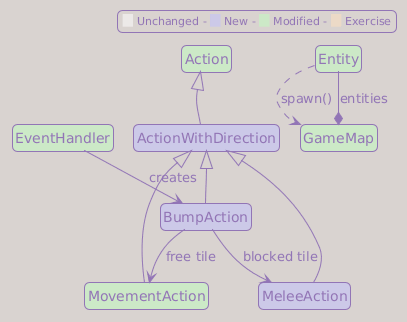

# Part 5a: Monsters

**Part 5** fills the dungeon with enemies. It comes in two parts: first the monsters appear, then they come to life.

**Part 5a** puts orcs and trolls in the dungeon rooms. They block your way, and you can bump into them, but they do not move yet.

**Part 5b** gives them a turn after each of yours: they hunt you down, walking around walls to reach you.

---

## What You Will Build

By the end of Part 5a, orcs and trolls appear in the dungeon rooms. You see them only inside your field of view, you cannot walk through them, and bumping into one prints an attack message in the terminal. For now they stand still.

## Learning goals

In this part we will:

- Move sprites, colors, and key bindings into a `game/data/` package
- Define monsters as templates (the Prototype pattern) and copy them into the dungeon
- Make one "bump" action decide between moving and attacking
- Use Python's `ABC` and `@abstractmethod` to enforce the `Action` contract
- Place enemies in dungeon rooms during generation

---

## Background

This section is for reading; there is nothing to type yet. If you want to start building right away, skip to [A data package for sprites and colors](#a-data-package-for-sprites-and-colors). You can come back here at any time, even after you finish the tutorial, when you know the game from the inside and some of these ideas will mean more.

### Describing monsters as data

An orc and a troll behave the same way in this game: they walk, they chase the player, and from Part 6 they fight. What makes them different is data: a glyph, a color, a name, and later a few numbers for hit points and attack.

We could still write one class per monster, `class Orc(Entity): ...`. But once we add components (Fighter, AI), the difference between an Orc and a Troll is just their stats: same code, different numbers. Templates let us define that difference as data, not code. Adding a new monster type is then a one-liner in `game/entity_factories.py`.

This idea has a name: the **Prototype** pattern. Each template is a fully configured object, not a blueprint read by a separate builder. To create a new monster, we copy an existing instance and change its position; we do not call a function that assembles one from scratch. The template *is* the object to copy, so adding a monster type means declaring one more instance.

→ [Game Programming Patterns: Prototype](https://gameprogrammingpatterns.com/prototype.html)

→ [Refactoring Guru: Prototype](https://refactoring.guru/design-patterns/prototype) ([Python example](https://refactoring.guru/design-patterns/prototype/python/example))

Templates have a known cost. They are module-level objects, created when the module is imported. In bigger projects, that timing often causes import-order problems and surprises when saving objects to a file (serialization). We accept that cost here. In Part 13 we meet one of those surprises and design around it.

---

## A data package for sprites and colors

So far our glyphs (`"@"`, `"#"`, `" "`) and colors (`(255, 255, 255)`, `(35, 35, 90)`, etc.) have been written directly in the code. With the player plus two enemies (and items, scrolls, equipment coming in later parts), the same literal values would soon appear in many places. If we ever want to recolor the orc, change the player glyph, render floors as `"."` instead of blank spaces, or build a colorblind theme, we want **one place** to change.

We now create a small `game/data/` package with two modules: `sprites` for single-character glyphs and `colors` for RGB tuples.

!!! question "Why a data package?"
    Keeping all visual constants in one place is a common good practice. It has three concrete benefits:

    1. **Discoverability**: a developer reading `game/data/sprites.py` can see every glyph the game uses at a glance.
    2. **Theming**: changing the orc's color or the floor appearance is a one-line edit instead of a code search.
    3. **Self-documentation**: `colors.PLAYER` is easier to understand than `(255, 255, 255)` at a call site.

    We use `UPPERCASE` names because they are module-level constants (PEP 8). We give each entity its **own named constant** even when colors repeat: `colors.WHITE` would tell us *which* color, but `colors.PLAYER` tells us *who* uses it.

    One naming note: we call the package `data`, not `constants`. Colors and sprites are constants, but the package will gain members that are not: key maps arrive later in this same part, and configuration follows in later parts. `data` covers them all.

!!! info "What is a PEP?"
    A **PEP** (*Python Enhancement Proposal*) is a numbered design document where the Python community records its decisions: new language features, conventions, processes. PEP 8 is the style guide, and many features this tutorial uses (type hints, f-strings, `match`) were first proposed in a PEP.

    Most ecosystems have an equivalent: Java has JEPs, JavaScript changes go through TC39 proposals, and the internet itself is specified in RFCs. When you see a PEP cited, it is a pointer to the original discussion and rationale, free to read at peps.python.org.

Create `game/data/__init__.py` as an empty file; it marks the folder as a Python package.

Create `game/data/sprites.py`:

```python
from __future__ import annotations

# Entity sprites
PLAYER  = "@"
ORC     = "o"
TROLL   = "T"

# Map sprites
UNKNOWN = "?"
UNSEEN  = " "
FLOOR   = " "
WALL    = "#"
WATER   = "~" # Part-2. Exercise 3: Add a new tile type
```

Create `game/data/colors.py`:

```python
from __future__ import annotations

from typing import NamedTuple


class Color(NamedTuple):
    r: int
    g: int
    b: int

    def scale(self, factor: float) -> Color:
        f = max(0.0, min(1.0, factor))
        aux_r = round(self.r * f)
        aux_g = round(self.g * f)
        aux_b = round(self.b * f)

        return Color(aux_r, aux_g, aux_b)

    @property
    def grey(self) -> Color:
        grey = round(0.299  * self.r + 0.587  * self.g + 0.114  * self.b)
        return Color(grey, grey, grey)


# Generic colors
DEFAULT_FG          = Color(255, 255, 255)

# Entity colors
PLAYER              = Color(255, 255, 255)
ORC                 = Color( 63, 127,  63)
TROLL               = Color(  0, 127,   0)

# Map colors: unseen
UNSEEN_FG           = Color(255, 255, 255)
UNSEEN_BG           = Color(  0,   0,   0)

# Map colors: floor
FLOOR_FG            = Color(255, 255, 255)
FLOOR_OUT_OF_FOV    = Color( 35,  35,  90)
FLOOR_IN_FOV        = Color(190, 170,  80)

# Map colors: wall
WALL_FG_OUT_OF_FOV  = Color( 80,  80, 120)
WALL_BG_OUT_OF_FOV  = Color(  0,   0,  70)
WALL_FG_IN_FOV      = Color(220, 210, 170)
WALL_BG_IN_FOV      = Color(110,  95,  60)

# Part-2. Exercise 3: Add a new tile type
# Map colors: water
WATER_FG_OUT_OF_FOV = Color( 64, 255, 255)
WATER_BG_OUT_OF_FOV = Color(  0,   0, 180)
WATER_FG_IN_FOV     = Color(180, 255, 255)
WATER_BG_IN_FOV     = Color( 20,  90, 220)
```

`Color` is a `NamedTuple` with three integer fields (`r`, `g`, `b`). Because `NamedTuple` subclasses `tuple`, `tcod` accepts any `Color` value wherever it expects a plain `(r, g, b)` tuple. We also give `Color` two helpers of its own: the method `color.scale(factor)` returns a dimmed copy (Part 9 uses it for the fireball highlight), and the property `color.grey` returns a greyscale copy. Any module can use `Color(r, g, b)` as a constructor and import the type with `from game.data.colors import Color`.

We will extend both files as the game grows: more sprites in Parts 8 (items), 9 (scrolls), 11 (stairs), 13 (equipment); more colors in Parts 6 (corpse), 7 (UI and combat messages), 8-13 (each new feature). A third module joins the package later in this same part: `keys.py`, for key bindings.

Now update `game/map/tile_types.py` to use those constants instead of inline visual values:

```python
from __future__ import annotations

import numpy as np

from game.data import colors, sprites
from game.data.colors import Color

# Describes how to draw one tile: character + foreground + background colors
graphic_dtype = np.dtype(
    [
        ("ch", np.int32),   # Unicode codepoint of the character
        ("fg", "3B"),       # foreground RGB (3 unsigned bytes)
        ("bg", "3B"),       # background RGB
    ]
)

# Describes one tile: its gameplay properties + its appearance
tile_dtype = np.dtype(
    [
        ("walkable",    np.bool_),      # True if entities can walk here
        ("transparent", np.bool_),      # True if this tile doesn't block FOV
        ("out_of_fov",  graphic_dtype), # appearance when explored but outside FOV
        ("in_fov",      graphic_dtype), # appearance when inside the player's FOV
    ]
)

# Used for tiles the player has never seen. Pure black
UNSEEN = np.array(
    (
        ord(sprites.UNSEEN),
        colors.UNSEEN_FG,
        colors.UNSEEN_BG,
    ),
    dtype=graphic_dtype,
)


def new_tile(
    *,
    walkable: bool,
    transparent: bool,
    out_of_fov: tuple[int, Color, Color],
    in_fov: tuple[int, Color, Color],
) -> np.ndarray:
    """Create a single tile definition."""
    return np.array((walkable, transparent, out_of_fov, in_fov), dtype=tile_dtype)


# Tile definitions
floor = new_tile(
    walkable    = True,
    transparent = True,
    out_of_fov  = (ord(sprites.FLOOR), colors.FLOOR_FG, colors.FLOOR_OUT_OF_FOV),
    in_fov      = (ord(sprites.FLOOR), colors.FLOOR_FG, colors.FLOOR_IN_FOV),
)

wall = new_tile(
    walkable    = False,
    transparent = False,
    out_of_fov  = (ord(sprites.WALL), colors.WALL_FG_OUT_OF_FOV, colors.WALL_BG_OUT_OF_FOV),
    in_fov      = (ord(sprites.WALL), colors.WALL_FG_IN_FOV, colors.WALL_BG_IN_FOV),
)

# Part-2. Exercise 3: Add a new tile type
water = new_tile(
    walkable    = False,
    transparent = True,
    out_of_fov  = (ord(sprites.WATER), colors.WATER_FG_OUT_OF_FOV, colors.WATER_BG_OUT_OF_FOV),
    in_fov      = (ord(sprites.WATER), colors.WATER_FG_IN_FOV, colors.WATER_BG_IN_FOV),
)
```

This keeps all visual choices in `game/data/`: entity sprites, terrain sprites, entity colors, and terrain colors. If you completed the Part 2 water exercise, these listings already move its values into `sprites.WATER` and the `WATER_*` colors. If you did not, omit the `water` tile, the `WATER` sprite, and the `WATER_*` colors.

Next, replace the inline color of the one entity that already exists, the player.

In `main.py`, import the new data module and replace the player's inline color:

```diff
 import tcod

+from game.data import colors
 from game.engine import Engine
 from game.entity import Entity
 from game.map.map_generator import generate_dungeon
@@
     player = Entity(
         x     = 0,
         y     = 0,
         char  = "@",
-        color = (255, 255, 255),
+        color = colors.PLAYER,
         name  = "Player",          # Part-2. Exercise 1: Add names to entities
     )
```

If you completed the Part 4 marker exercises (2 and 3), remove the two marker entities now: delete the whole `if len(rooms) == 1:` block from `generate_dungeon` in `game/map/map_generator.py`. The markers were useful to test FOV, but this part places real enemies in rooms, and the markers would only get in the way. The rest of those exercises stays: the `stays_visible` check in `GameMap.render()` and the normal `Entity` import, which `generate_dungeon` still uses as a type hint.

!!! tip "Run it now"
    If you run the game at this point, you can check that nothing has changed: same dungeon, same colors as at the end of Part 4 (only the markers are gone, if you had them). That is exactly what success looks like here. This section was a *refactor*: it changed how the code is organized, not what it does.

    Running the game after each self-contained change like this is a good habit: it confirms that everything up to this point works, while the last change is still fresh in your mind.

---

## Updating Entity

So far we create entities inline, like `Entity(0, 0, "@", (255, 255, 255))`. We want to turn entity types into reusable templates that we can copy into the dungeon, and for that the `Entity` class needs two additions first: a new field, `blocks_movement`, and a `spawn()` method that copies a template onto a map at a chosen position.

The `name` field is not new: it was Exercise 1 in Part 2. If you skipped that exercise, the listing below adds the field for you. From this part on it belongs to the main code, because entity templates and the combat messages of the coming parts depend on it. The next section uses `name`, `blocks_movement`, and `spawn()` to define our monster prototypes.

If you completed the `stays_visible` exercise in Part 4, keep that field; it remains useful for entities that should stay visible after being discovered.

Update `game/entity.py`:

```python
from __future__ import annotations

import copy
from typing import TYPE_CHECKING

from game.data import colors, sprites
from game.data.colors import Color

if TYPE_CHECKING:
    from game.map.game_map import GameMap


class Entity:
    """A generic object: player, enemy, item, etc."""

    def __init__(
        self,
        x: int                = 0,
        y: int                = 0,
        char: str             = sprites.UNKNOWN,
        color: Color          = colors.DEFAULT_FG,
        name: str             = "<unnamed>",    # Part-2. Exercise 1: Add names to entities
        stays_visible: bool   = False,          # Part-4. Exercise 3: Remember a discovered marker
        blocks_movement: bool = False,
    ) -> None:
        self.x               = x
        self.y               = y
        self.char            = char
        self.color           = color
        self.name            = name             # Part-2. Exercise 1: Add names to entities
        self.stays_visible   = stays_visible    # Part-4. Exercise 3: Remember a discovered marker
        self.blocks_movement = blocks_movement

    def spawn(self, game_map: GameMap, x: int, y: int) -> Entity:
        """Create a deep copy of this entity and place it on the map."""
        clone = copy.deepcopy(self)
        clone.x = x
        clone.y = y
        game_map.entities.add(clone)

        return clone

    def set_position(self, x: int, y: int) -> None:
        self.x = x
        self.y = y

    def move(self, dx: int, dy: int) -> None:
        self.x += dx
        self.y += dy
```

Position defaults to `(0, 0)` so templates can be defined without coordinates.

!!! tip "`copy.deepcopy`: shallow vs deep copies"
    A *shallow* copy (`copy.copy`) duplicates the outer object but shares its inner attributes with the original. A *deep* copy (`copy.deepcopy`) walks the object recursively and duplicates everything, so the clone shares nothing with the template. We want deep copies here: each spawned enemy must be fully independent, so updating one orc never affects the template or any other orc.

---

## Entity templates

Now that `Entity` carries a `name`, a `blocks_movement` flag, and a `spawn()` method, we can define reusable *templates*: one `Entity` per type, created once and copied into the dungeon wherever we need it.

Create `game/entity_factories.py`:

```python
from __future__ import annotations

from game.data import colors, sprites
from game.entity import Entity

player = Entity(
    char            = sprites.PLAYER,
    color           = colors.PLAYER,
    name            = "Player",
    blocks_movement = True,
)

orc = Entity(
    char            = sprites.ORC,
    color           = colors.ORC,
    name            = "Orc",
    blocks_movement = True,
)

troll = Entity(
    char            = sprites.TROLL,
    color           = colors.TROLL,
    name            = "Troll",
    blocks_movement = True,
)
```

These are *prototypes*: for dungeon entities, we call `spawn()` on them to create positioned copies. The player is a small startup special case (covered in the `main.py` section below) because they need to exist before any map does.

!!! info "Why templates and not subclasses?"
    Each module-level `Entity` here is a fully configured object that `spawn()` copies with `copy.deepcopy`: the Prototype pattern. [Describing monsters as data](#describing-monsters-as-data) in the Background section explains why we prefer it to one subclass per monster, and what it costs.

!!! question "Why lowercase `orc` when `colors.ORC` is uppercase?"
    The UPPERCASE convention is for constant *values*: passive data you read, like a color tuple. A template is an *object* with identity and behavior: it has `spawn()`, and from Part 6 it will carry a fighter component with hit points. Python names module-level instances in lowercase; an uppercase `ORC` would promise an immutability that a live object cannot keep.

    The difference in case also carries information. The same word lives in three namespaces: `sprites.ORC` and `colors.ORC` are values from the `data` package, while `entity_factories.orc` is a prototype you clone. The casing tells you which layer of the game you are touching.

---

## Blocking entities and collision

Enemies block movement: the player cannot walk through an orc. Add `get_blocking_entity_at` to `GameMap`:

```diff
 class GameMap:
     ...

+    def get_blocking_entity_at(self, x: int, y: int) -> Entity | None:
+        for entity in self.entities:
+            if entity.blocks_movement and entity.x == x and entity.y == y:
+                return entity
+
+        return None
```

---

## The BumpAction pattern

When the player presses an arrow key toward an occupied tile, should they move or attack? We decide at the moment of the "bump": if an entity blocks the destination, we attack it; otherwise we move.

Update `game/actions.py` with new action types:

```python
from __future__ import annotations

from abc import ABC, abstractmethod
from typing import TYPE_CHECKING

if TYPE_CHECKING:
    from game.engine import Engine
    from game.entity import Entity


class Action(ABC):

    @abstractmethod
    def perform(self, engine: Engine, entity: Entity) -> None:
        ...


class EscapeAction(Action):

    def perform(self, engine: Engine, entity: Entity) -> None:
        raise SystemExit()


# Part-1. Exercise 3: Add a wait action
class WaitAction(Action):

    def perform(self, engine: Engine, entity: Entity) -> None:
        pass  # Do nothing; time still passes


class ActionWithDirection(Action, ABC):
    """Base for actions that have a dx/dy direction."""

    def __init__(self, dx: int, dy: int) -> None:
        self.dx = dx
        self.dy = dy


class MovementAction(ActionWithDirection):

    def perform(self, engine: Engine, entity: Entity) -> None:
        dest_x = entity.x + self.dx
        dest_y = entity.y + self.dy

        if not engine.game_map.in_bounds(dest_x, dest_y):
            return  # Destination is outside the map

        if not engine.game_map.tiles["walkable"][dest_x, dest_y]:
            return  # Destination is blocked by a tile

        if engine.game_map.get_blocking_entity_at(dest_x, dest_y):
            return  # Blocked by an entity; cannot move here

        entity.move(self.dx, self.dy)


class MeleeAction(ActionWithDirection):

    def perform(self, engine: Engine, entity: Entity) -> None:
        dest_x = entity.x + self.dx
        dest_y = entity.y + self.dy
        target = engine.game_map.get_blocking_entity_at(dest_x, dest_y)

        if not target:
            return

        print(f"{entity.name} attacks {target.name}!")


class BumpAction(ActionWithDirection):
    """Move if the tile is free; attack if an entity is blocking it."""

    def perform(self, engine: Engine, entity: Entity) -> None:
        dest_x = entity.x + self.dx
        dest_y = entity.y + self.dy

        if engine.game_map.get_blocking_entity_at(dest_x, dest_y):
            MeleeAction(self.dx, self.dy).perform(engine, entity)

        else:
            MovementAction(self.dx, self.dy).perform(engine, entity)
```

!!! info "Abstract classes and `ABC`"
    `Action` was always meant as a blueprint, never to be instantiated directly. Python's `abc` module lets you enforce that formally:

    - `ABC` (Abstract Base Class): inheriting from it lets the class declare abstract methods.
    - `@abstractmethod`: marks a method as a contract that every concrete subclass must override. Python refuses to instantiate any class that still has an abstract method without an implementation, and raises a `TypeError`.

    `ActionWithDirection` is also abstract: it stores `dx`/`dy` but leaves `perform` to its own subclasses. Python already treats it as abstract, because it does not implement `perform`. A linter like Pylint, however, cannot tell whether that was on purpose, and warns:

    ```text
    W0223: Method 'perform' is abstract in class 'Action' but is not overridden in child class 'ActionWithDirection'
    ```

    The fix is `class ActionWithDirection(Action, ABC)`. Python allows a class to list more than one parent (multiple inheritance). Here `Action` contributes the action interface and `ABC` contributes the abstract-class machinery. Listing `ABC` again tells the linter that `ActionWithDirection` is abstract on purpose and is not expected to implement `perform`.

!!! info "Design decision: BumpAction as dispatcher"
    The input handler does not know what is at the destination; it only knows the player pressed right. `BumpAction` decides what to do when the action is performed, by checking the map. This keeps the input handler simple and keeps input separate from game logic.

!!! info "About `WaitAction`"
    If you completed the wait-action exercise from Part 1 and/or Part 2, this is the canonical version: the same empty `pass` body, now formally part of the action set, so the engine handles "skip a turn" the same way as a move or an attack.

---

## Updating the input handler

Replace the individual key checks with two lookup tables and add support for wait, numpad, and vi keys. `MOVE_KEYS` is a dictionary that maps each movement key to a `(dx, dy)` offset; `WAIT_KEYS` is a `set`, because for a wait key we only need to check membership, not retrieve a value.

These two tables are data, not logic, so they belong in the `game/data/` package we just created: the same argument that centralized sprites and colors applies to key bindings. With every binding in one module, remapping any control is a one-line edit, and the input handler stays focused on turning events into actions. This also delivers the key maps promised in the naming note at the start of this part. We also give the `Escape` key a named constant: `KEY_QUIT_GAME` says *what the key does*, where `KeySym.ESCAPE` only says which key it is.

Create `game/data/keys.py`:

```python
from __future__ import annotations

import tcod.event

MOVE_KEYS = {
    # Arrow keys
    tcod.event.KeySym.UP:       ( 0, -1),
    tcod.event.KeySym.DOWN:     ( 0,  1),
    tcod.event.KeySym.LEFT:     (-1,  0),
    tcod.event.KeySym.RIGHT:    ( 1,  0),

    # Numpad
    tcod.event.KeySym.KP_1:     (-1,  1), # LEFT  - DOWN
    tcod.event.KeySym.KP_2:     ( 0,  1), #         DOWN
    tcod.event.KeySym.KP_3:     ( 1,  1), # RIGHT - DOWN
    tcod.event.KeySym.KP_4:     (-1,  0), # LEFT
    tcod.event.KeySym.KP_6:     ( 1,  0), # RIGHT
    tcod.event.KeySym.KP_7:     (-1, -1), # LEFT  - UP
    tcod.event.KeySym.KP_8:     ( 0, -1), #         UP
    tcod.event.KeySym.KP_9:     ( 1, -1), # RIGHT - UP

    # Vi keys
    tcod.event.KeySym.B:        (-1,  1), # LEFT  - DOWN
    tcod.event.KeySym.J:        ( 0,  1), #         DOWN
    tcod.event.KeySym.N:        ( 1,  1), # RIGHT - DOWN
    tcod.event.KeySym.H:        (-1,  0), # LEFT
    tcod.event.KeySym.L:        ( 1,  0), # RIGHT
    tcod.event.KeySym.Y:        (-1, -1), # LEFT  - UP
    tcod.event.KeySym.K:        ( 0, -1), #         UP
    tcod.event.KeySym.U:        ( 1, -1), # RIGHT - UP
}

WAIT_KEYS = {
    tcod.event.KeySym.PERIOD,
    tcod.event.KeySym.KP_5,
    tcod.event.KeySym.CLEAR,
}

KEY_QUIT_GAME = tcod.event.KeySym.ESCAPE
```

`game/input_handlers.py` needs the new import; `dispatch` and `event_quit` stay unchanged, and `event_keydown` is rewritten to use the lookup tables instead of `match`/`case`. Update the imports:

```diff
 import tcod.event

-from game.actions import Action, EscapeAction, MovementAction, WaitAction
+from game.actions import (
+    Action,
+    BumpAction,
+    EscapeAction,
+    WaitAction,
+)
+from game.data import keys
```

Then replace the whole body of `event_keydown` with:

```python
    def event_keydown(self, event: tcod.event.KeyDown) -> Action | None:
        key = event.sym

        if key in keys.MOVE_KEYS:
            dx, dy = keys.MOVE_KEYS[key]
            return BumpAction(dx, dy)

        if key in keys.WAIT_KEYS:
            return WaitAction()

        if key == keys.KEY_QUIT_GAME:
            return EscapeAction()

        return None
```

One honest note about the vi keys: they are temporary. Part 8 starts using letter keys for items and actions, several of those letters collide with the vi block, and that chapter removes it (with the full reasoning there). Arrow keys and the numpad work unchanged for the rest of the tutorial.

!!! tip "Run it now"
    If you run the game now, you can try the new movement keys: the numpad and the vi keys move you diagonally, and the wait keys are accepted too (waiting will start to matter once enemies take their turns, in Part 5b). Checking each change while it is still small is much easier than debugging all of them together at the end.

---

## Enemy placement in the map generator

Add a `place_entities` function to the existing `game/map/map_generator.py`. The `RectangularRoom` class stays unchanged, and so does the `tunnel_between` function's body; it already takes the `rng` instance Part 4 introduced. The function spawns monsters from the templates we defined above, so first add `entity_factories` to the imports at the top of the file:

```python
from game import entity_factories
```

Then add the function itself:

```python
def place_entities(
    rng: random.Random,
    room: RectangularRoom,
    dungeon: GameMap,
    max_monsters: int,
) -> None:
    number_of_monsters = rng.randint(0, max_monsters)

    for _ in range(number_of_monsters):
        x = rng.randint(room.x1 + 1, room.x2 - 1)
        y = rng.randint(room.y1 + 1, room.y2 - 1)

        if not any(entity.x == x and entity.y == y for entity in dungeon.entities):
            if rng.random() < 0.8:  # 80% chance of troll
                entity_factories.troll.spawn(dungeon, x, y)

            else:
                entity_factories.orc.spawn(dungeon, x, y)
```

`place_entities` takes the same `rng` instance `generate_dungeon` already owns, instead of calling the shared `random` module. This keeps monster placement reproducible from the same dungeon seed, without reseeding anything global.

Also notice the `if not any(...)` check: when the chosen tile is already occupied, that monster is simply not placed. So `max_monsters` is an upper limit, not a guaranteed count. If you count the monsters in a room, finding fewer than the roll asked for is normal.

Update `generate_dungeon` to call `place_entities` and accept the new parameter:

```diff
 def generate_dungeon(
     max_rooms: int,
     room_min_size: int,
     room_max_size: int,
     map_width: int,
     map_height: int,
+    max_monsters_per_room: int,
     player: Entity,
     seed: int,
 ) -> GameMap:
     """Generate a new dungeon map and place the player."""
     # Part-3. Exercise 1: Reproducible dungeons
     rng = random.Random(seed)

     dungeon = GameMap(map_width, map_height, entities=[player])

     rooms: list[RectangularRoom] = []

     max_room_attempts = max_rooms * 2
     for _ in range(max_room_attempts):
         ...
         if not rooms:
             # First room: place the player here
             player.set_position(*new_room.center)

         else:
             # All subsequent rooms: dig a tunnel to the previous room
             for x, y in tunnel_between(rng, rooms[-1].center, new_room.center):
                 dungeon.tiles[x, y] = tile_types.floor
+
+            place_entities(rng, new_room, dungeon, max_monsters_per_room)

         rooms.append(new_room)
         if len(rooms) >= max_rooms:
             break

     return dungeon
```

!!! note "If you did the Part 3 exercises"
    The tunnel line above is the main-path version (connect to the previous room with `tunnel_between(rng, rooms[-1].center, new_room.center)`). If you connected to the nearest room (Exercise 2) or used `roughly_center` as the tunnel endpoints (Exercise 3, converted to take `rng` in Part 4), keep your own version of those lines. The only additions Part 5 needs are the `max_monsters_per_room` parameter and the `place_entities(rng, new_room, dungeon, max_monsters_per_room)` call inside the `else` branch:

    ```diff
             else:
                 # Part-3. Exercise 2: Connect to the nearest room
                 nearest_room = rooms[0]
                 nearest_distance = new_room.squared_distance(nearest_room)

                 for room in rooms[1:]:
                     distance = new_room.squared_distance(room)
                     if distance < nearest_distance:
                         nearest_room = room
                         nearest_distance = distance

                 # All subsequent rooms: dig a tunnel to another room
                 for x, y in tunnel_between(
                     rng,
                     nearest_room.roughly_center(rng),
                     new_room.roughly_center(rng),
                 ):
                     dungeon.tiles[x, y] = tile_types.floor
    +
    +            place_entities(rng, new_room, dungeon, max_monsters_per_room)
    ```

!!! tip "Why not place enemies in the first room?"
    The player starts in the first room. Spawning enemies there would mean instant combat before the player can even look around. Skipping the `place_entities` call for `rooms[0]` gives the player a safe starting area.

---

## Updating main.py

The player is a special case: `spawn()` requires a `GameMap` to add the entity to, but at startup the map does not exist yet. So we do not use `spawn()`; we call `copy.deepcopy` on the template directly. `entity_factories.player` is a *template*, a single module-level object that is never placed on a map, so deep-copying it gives us an independent player for this run.

Update `main.py`:

```diff
 from __future__ import annotations

+import copy
 import os
 import random
 from pathlib import Path

 import tcod

-from game.data import colors
+from game import entity_factories
 from game.engine import Engine
-from game.entity import Entity
 from game.map.map_generator import generate_dungeon
@@
     seed = int(os.environ.get("GAME_SEED", random.getrandbits(64)))
+    # seed = 12345  # Write here the game seed to reproduce a map
     print(f"Game seed: {seed}")
@@
     max_rooms = 30
+    max_monsters_per_room = 2
@@
-    player = Entity(
-        x     = 0,
-        y     = 0,
-        char  = "@",
-        color = colors.PLAYER,
-        name  = "Player",          # Part-2. Exercise 1: Add names to entities
-    )
+    player = copy.deepcopy(entity_factories.player)

     game_map = generate_dungeon(
-        max_rooms     = max_rooms,
-        room_min_size = room_min_size,
-        room_max_size = room_max_size,
-        map_width     = map_width,
-        map_height    = map_height,
-        player        = player,
-        seed          = seed,
+        max_rooms             = max_rooms,
+        room_min_size         = room_min_size,
+        room_max_size         = room_max_size,
+        map_width             = map_width,
+        map_height            = map_height,
+        max_monsters_per_room = max_monsters_per_room,
+        player                = player,
+        seed                  = seed,    # Part-3. Exercise 1: Reproducible dungeons
     )
```

The commented `# seed = 12345` line is a shortcut for testing. In Part 4 we chose a fixed seed with the `GAME_SEED` environment variable. When you keep running the same dungeon while you debug, it can be easier to write the seed in the code: remove the `#` and put in the seed the game printed. That line overwrites any seed chosen before it, including `GAME_SEED`, so add the `#` back when you want random dungeons again.

The player no longer uses `colors.PLAYER` in `main.py` (the template has it now), so the `colors` import added earlier in this part goes away again. Everything else, `Engine(...)`, the SDL metadata calls, and the `tcod.context.new` block, stays exactly as it was.

!!! note "Part 4 exercise carry-overs"
    If you completed the variable torch radius or fading memory exercises in Part 4, `Engine(...)` already takes `fov_radius`, `fading_memory`, and `memory_duration` there; this diff does not touch that call, so keep those arguments exactly as you have them. If you did not do those exercises, `Engine(game_map=game_map, player=player)` does not change either.

---

## Testing Part 5a

Run the game with `uv run main.py` (or `python main.py`):

- [ ] Orcs (`o`, green) and Trolls (`T`, dark green) appear in rooms, but never in the room where you start
- [ ] Enemies appear only when they are inside your FOV
- [ ] You cannot walk through an enemy
- [ ] Bumping into an enemy prints `"Player attacks Orc!"` in the terminal
- [ ] Enemies stay where they are, even when you stand next to them
- [ ] Diagonal movement works (numpad or vi keys)

If the monsters are there and block your way, Part 5a is complete. They still look like statues; Part 5b wakes them up.

---

## Summary

The dungeon now has monsters, built from data. Key patterns introduced:

- **Data package**: sprites, colors, and key bindings live in `game/data/`, one place to change each
- **Templates + spawn()**: define entity types as data, clone them into the dungeon
- **BumpAction**: resolves move-or-attack at runtime, keeping input handling simple
- **ABC + `@abstractmethod`**: make the `Action` contract explicit and linter-enforced
- **place_entities()**: fills each room except the first with a random number of monsters

**Current architecture**:

- `entity_factories.py`: defines reusable player and enemy prototypes
- `Entity.spawn()`: clones prototypes into the current map
- `GameMap.get_blocking_entity_at()`: finds what stands in the way
- `game/map/map_generator.py`: places enemies while generating rooms
- `data/`: centralizes entity and terrain sprites/colors, plus the key bindings

**Local Class Diagram**:



**File structure**:

```text
main.py                     ← modified
game/
├── __init__.py
├── actions.py              ← modified
├── engine.py
├── entity.py               ← modified
├── entity_factories.py     ← new
├── input_handlers.py       ← modified
├── data/
│   ├── __init__.py         ← new
│   ├── colors.py           ← new
│   ├── keys.py             ← new
│   └── sprites.py          ← new
└── map/
    ├── __init__.py
    ├── game_map.py         ← modified
    ├── tile_types.py       ← modified
    └── map_generator.py    ← modified
```
