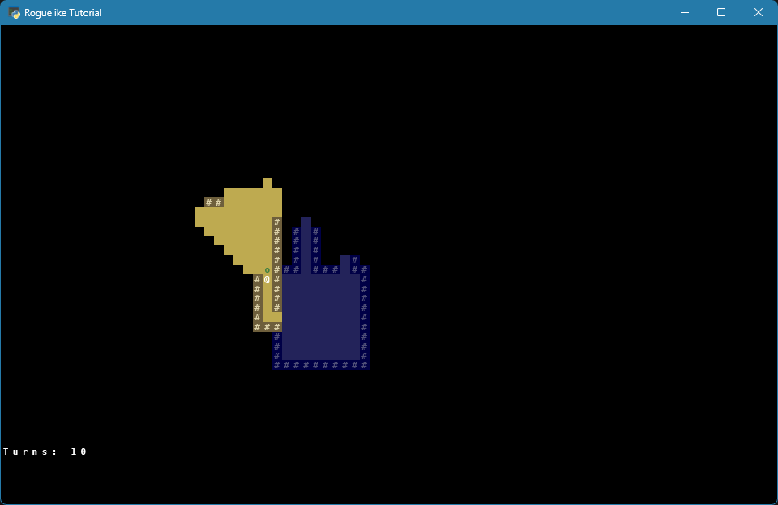
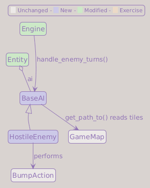
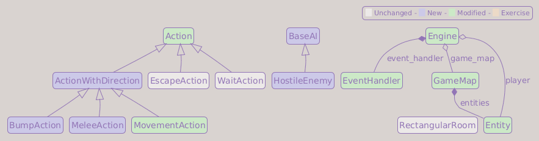

# Part 5b: Enemies That Hunt

In **Part 5a** the dungeon filled with orcs and trolls, but they stand still like statues. This part brings them to life: after each of your moves, every enemy that can see you takes its own turn and comes for you.

## What You Will Build

By the end of Part 5b, enemies take a turn after every action of yours. A visible enemy walks toward you, around walls and around other monsters, and attacks when it stands next to you (for now, the attack only prints a message). Waiting with `.` or numpad 5 passes a turn and lets them come closer.

## Learning goals

In this part we will:

- Give enemies an AI component that decides what they do on their turn
- Implement a turn system: player acts, then enemies act
- Use the A* pathfinder from `tcod` so enemies walk around walls and each other

---

## Background

This section is for reading; there is nothing to type yet. If you want to start building right away, skip to [AI components](#ai-components). You can come back here at any time, even after you finish the tutorial, when you know the game from the inside and some of these ideas will mean more.

### How turns work in a roguelike

Most roguelikes are turn-based: the world waits until the player acts. In this part, one game turn has three steps, always in this order:

1. The player acts: moves, attacks, or waits.
2. Every enemy with an AI takes one action.
3. The game recomputes the field of view (FOV) for the player's new position.

Each step hides a design choice.

**What costs a turn?** Every action the player sends costs a turn, even one that fails. If you walk into a wall, nothing moves, but the enemies still act. This is a simplification, and the simplest version to teach. Many roguelikes do not charge a turn for it: in NetHack, for example, walking into a wall takes no game time. The usual way to get that behavior is to have the action raise a small exception, such as `Impossible("...")`, and have the game skip the enemy turns when it catches one. Part 8 introduces this `Impossible` exception for failures the player should read about, such as a full inventory. It keeps wall bumps silent, so in this tutorial they still cost a turn.

**Enemies first, or FOV first?** In step 2, enemies use the FOV from the *start* of the turn, before the player moved. When the player steps into an enemy's range, that enemy does not react until the following turn. Swapping steps 2 and 3 makes enemies react at once, but creates a different problem: an enemy could step toward you before you ever saw it on screen. Both orders are valid roguelike conventions. We keep the FOV update last, so you always see an enemy at least once before it moves.

**Who sees whom?** Enemies do not compute their own sight. An enemy acts only when it stands inside the player's FOV. This is a common roguelike simplification: if the player can see the enemy, the enemy can see the player. It is not realistic (an enemy behind you cannot see you), but it is fair and predictable for the player.

### Finding paths with A*

The simplest chase AI steps straight toward the player. That works in an open room, but a wall between the enemy and the player stops it: the straight step is blocked, and the enemy never tries another direction.

A pathfinding algorithm solves this by treating the map as a graph. Each walkable tile is a node, and each step to a neighbor tile is an edge with a cost. The algorithm searches for the cheapest chain of steps from the start to the goal.

A* (said "A star", published in 1968) is the classic choice for games. It explores tiles in order of "cost so far plus an estimate of the distance left". The estimate makes it try the tiles that point toward the goal first, so it usually visits far fewer tiles than a blind search, and it still finds the shortest path.

Costs also make the search flexible. A tile with a higher cost is not forbidden, only less attractive, so we can make enemies prefer to go around each other without ever leaving them stuck. `tcod` includes A*, so our code only has to describe those costs.

---

## AI components

Enemies need to act on their turn. We model this with an `AI` component: a class with a `perform()` method that the engine calls each enemy turn.

Create `game/components/__init__.py` as an empty file; it makes `components` a Python package.

Create `game/components/ai.py`:

```python
from __future__ import annotations

from typing import TYPE_CHECKING

from game.actions import BumpAction

if TYPE_CHECKING:
    from game.engine import Engine
    from game.entity import Entity


class BaseAI:

    def perform(self, engine: Engine, entity: Entity) -> None:
        raise NotImplementedError()


class HostileEnemy(BaseAI):
    """Chases the player when visible; waits otherwise."""

    def perform(self, engine: Engine, entity: Entity) -> None:
        if not engine.game_map.visible[entity.x, entity.y]:
            return  # Enemy is not in player's FOV; it cannot see the player either

        target = engine.player
        dx = target.x - entity.x
        dy = target.y - entity.y

        # Step one tile toward the player along each axis
        # Clamp dx/dy to -1, 0, or 1 to get a unit direction
        BumpAction(
            dx = max(-1, min(1, dx)),
            dy = max(-1, min(1, dy)),
        ).perform(engine, entity)
```

!!! info "`BaseAI` uses an informal contract, not `ABC`"
    `Action` used `ABC` and `@abstractmethod` because it is a public contract: the engine creates many action types through it, so enforcing the contract at construction time is worth it. `BaseAI` instead starts with an informal contract: `perform` just raises `NotImplementedError`, which documents that subclasses must override it without the extra machinery. In Part 6, `BaseAI` joins the component pattern (it inherits from `BaseComponent`), but it keeps this informal `NotImplementedError` style rather than becoming an `ABC`.

!!! question "Why reuse `BumpAction`?"
    The enemy faces the same problem the player does: at the destination tile there might be a wall, an empty floor, or another entity. `BumpAction` already resolves all three cases (no-op, move, attack). Reusing it here means enemies cannot walk through walls or through each other, and the same placeholder `MeleeAction` (for now it only prints a message) runs when they hit the player.

!!! question "Why `visible[entity.x, entity.y]`?"
    We check the *player's* FOV array, not a separate "can the enemy see" computation: if the player can see the enemy, the enemy can see the player. "Who sees whom?" in [How turns work in a roguelike](#how-turns-work-in-a-roguelike) explains this simplification.

!!! warning "No pathfinding yet"
    The current AI takes one step straight toward the player, without looking ahead. It cannot navigate around walls: facing a corner, it tries to move into it, `BumpAction` rejects the move, and the enemy stays put. We replace it with proper A* pathfinding at the end of this part, once the turn system lets you see the problem in the game.

---

## Extending Entity with an AI slot

Entities that have AI (enemies) need an `ai` attribute. First extend the existing `TYPE_CHECKING` imports at the top of `game/entity.py`:

```diff
 if TYPE_CHECKING:
+    from game.components.ai import BaseAI
     from game.map.game_map import GameMap
```

Then add the attribute to `Entity`:

```diff
 class Entity:

     def __init__(
         self,
         x: int                = 0,
         y: int                = 0,
         char: str             = sprites.UNKNOWN,
         color: Color          = colors.DEFAULT_FG,
         name: str             = "<unnamed>",    # Part-2. Exercise 1: Add names to entities
         stays_visible: bool   = False,          # Part-4. Exercise 3: Remember a discovered marker
         blocks_movement: bool = False,
+        ai: BaseAI | None     = None,
     ) -> None:
         ...
         self.blocks_movement = blocks_movement
+        self.ai              = ai
```

Update `game/entity_factories.py` to assign AI to enemies:

```python
from __future__ import annotations

from game.components.ai import HostileEnemy
from game.data import colors, sprites
from game.entity import Entity

player = Entity(
    char            = sprites.PLAYER,
    color           = colors.PLAYER,
    name            = "Player",
    blocks_movement = True,
)

orc = Entity(
    char            = sprites.ORC,
    color           = colors.ORC,
    name            = "Orc",
    blocks_movement = True,
    ai              = HostileEnemy(),
)

troll = Entity(
    char            = sprites.TROLL,
    color           = colors.TROLL,
    name            = "Troll",
    blocks_movement = True,
    ai              = HostileEnemy(),
)
```

---

## The turn system

After the player acts, each living enemy takes one turn. Add a `handle_enemy_turns` method to `Engine` and call it in `handle_events`, right after the player's action. The `Iterable` and `Any` imports are already in `game/engine.py` from Part 4:

```diff
 class Engine:
     ...

     def handle_events(self, events: Iterable[Any]) -> None:
         for event in events:
             action = self.event_handler.dispatch(event)
             if action is None:
                 continue
             action.perform(self, self.player)
+            self.handle_enemy_turns()
             self.update_fov()  # recompute after every action

+    def handle_enemy_turns(self) -> None:
+        for entity in set(self.game_map.entities) - {self.player}:
+            if entity.ai:
+                entity.ai.perform(self, entity)
```

If your `handle_events` also has the turn counter from Part 1 or the fading memory lines from Part 4, keep them. The only new line there is the `handle_enemy_turns()` call right after `action.perform(...)`.

Two things happen in `set(self.game_map.entities) - {self.player}`. First, `set(...)` takes a snapshot of the entities so we can iterate safely: from Part 6 on, enemies can die and be removed from the set during their turn, and Python raises a `RuntimeError` if a set changes size while you iterate over it. Second, `- {self.player}` removes the player from that snapshot, so the loop steps through enemies only.

!!! info "What costs a turn, and why this order"
    `MovementAction.perform()` returns without doing anything when the destination is a wall, but `handle_events` still runs `handle_enemy_turns()` afterwards: bumping into a wall costs a turn. And `handle_enemy_turns()` runs before `update_fov()`, so enemies react to where you were at the start of the turn.

    Both are deliberate choices. [How turns work in a roguelike](#how-turns-work-in-a-roguelike) in the Background section explains them and the alternatives.

!!! warning "Holding a key may take many turns"
    Most operating systems generate repeated `KeyDown` events while a key is held. With the new turn loop in place, that means holding `→` walks the player tile by tile *and* lets enemies act on every step. This is usually what players expect (faster traversal of empty corridors), but if you want one physical key press to mean exactly one turn, filter repeats at the start of `event_keydown`:

    ```python
    def event_keydown(self, event: tcod.event.KeyDown) -> Action | None:
        if event.repeat:
            return None
        ...
    ```

    We leave repeat enabled because it makes early playtests less tedious. You can change this later, when combat starts to matter.

!!! tip "Run it now"
    If you run the game now, the enemies wake up. Walk into the FOV of an orc and it comes toward you, one step per turn; wait with `.` and it keeps coming; stand next to it and it attacks (`"Orc attacks Player!"` in the terminal).

    Now put a wall between you and an enemy: it walks into the wall and stays there, exactly as the "No pathfinding yet" warning above predicted. Seeing the problem first makes the fix in the next section easier to follow.

---

## Proper pathfinding for enemies

Our enemies move in a straight line, so they get stuck on corners. A* (said "A star") is a classic algorithm that finds the shortest path between two points on a grid, going around walls; [Background](#finding-paths-with-a) explains how it works. `tcod` includes it, so we only have to describe the map to it.

First add two imports at the top of `game/components/ai.py`:

```diff
 from typing import TYPE_CHECKING

+import numpy as np
+import tcod
+
 from game.actions import BumpAction
```

Then add a `get_path_to` method to `BaseAI`, so every AI can ask for a path:

```python
class BaseAI:

    def perform(self, engine: Engine, entity: Entity) -> None:
        raise NotImplementedError()

    def get_path_to(
        self,
        engine: Engine,
        entity: Entity,
        dest_x: int,
        dest_y: int,
    ) -> list[tuple[int, int]]:
        """Compute an A* path from entity to (dest_x, dest_y)."""
        cost = np.array(engine.game_map.tiles["walkable"], dtype=np.int8)

        # Increase cost of tiles occupied by other entities so the pathfinder
        # routes around them rather than through them
        for other in engine.game_map.entities:
            if other is not entity and other.blocks_movement and cost[other.x, other.y]:
                cost[other.x, other.y] += 10

        graph = tcod.path.SimpleGraph(cost=cost, cardinal=2, diagonal=3)
        pathfinder = tcod.path.Pathfinder(graph)
        pathfinder.add_root((entity.x, entity.y))

        # [1:] drops the starting position (current tile)
        path: list[list[int]] = pathfinder.path_to((dest_x, dest_y))[1:].tolist()

        # pylint: disable=unnecessary-comprehension
        return [(x, y) for x, y in path]
```

The cost array tells the pathfinder how expensive each tile is to enter: `0` means blocked, and walkable tiles start at `1`. Converting the `walkable` booleans to `int8` gives exactly that: `False` becomes `0` and `True` becomes `1`. Adding `10` to the cost of a tile with a blocking entity is high enough that the pathfinder prefers to go around it, but it still goes through when there is no other way.

`tcod.path.SimpleGraph` creates a weighted graph from the cost array. Cardinal moves cost 2, diagonal moves cost 3 (this is close to the real distance ratio without using floating point). `pathfinder.path_to` returns the full path including the start; we drop the first element (`[1:]`) since that is the entity's current position. If the entity is already standing on the destination, that leaves an empty list and the caller simply does nothing.

!!! note "Why the `# pylint: disable` comment?"
    If you run `pylint`, it flags the final line as `unnecessary-comprehension`, assuming `[(x, y) for x, y in path]` is just a roundabout copy of `path` you could replace with `list(path)`.

    That is a false positive: `path` holds `list[int]` pairs, and the comprehension turns each pair into a `tuple[int, int]`, which is what the return type promises. `list(path)` would keep the inner lists instead and break that promise without any error.

    The comment turns off the check on this one line, so you do not search for a "fix" that would make the code worse.

Now replace `HostileEnemy` so it uses `get_path_to` whenever the player is not already next to it:

```python
class HostileEnemy(BaseAI):
    """Chases the player when visible; waits otherwise."""

    def perform(self, engine: Engine, entity: Entity) -> None:
        if not engine.game_map.visible[entity.x, entity.y]:
            return  # Enemy is not in player's FOV; it cannot see the player either

        target = engine.player
        dx = target.x - entity.x
        dy = target.y - entity.y
        distance = max(abs(dx), abs(dy))

        if distance <= 1:
            BumpAction(dx, dy).perform(engine, entity)
            return

        path = self.get_path_to(engine, entity, target.x, target.y)
        if path:
            dest_x, dest_y = path[0]
            BumpAction(
                dx = dest_x - entity.x,
                dy = dest_y - entity.y,
            ).perform(engine, entity)
```

`max(abs(dx), abs(dy))` is the number of moves between the enemy and the player when diagonal steps are allowed. When it is `1`, the player is on one of the eight neighbor tiles, and the enemy attacks with a plain bump. Otherwise it takes the first step of the path. That step still goes through `BumpAction`, so the rules for walls and blocking entities stay in one place.

!!! note "Enemies forget you the instant you leave their sight"
    The opening `if not engine.game_map.visible[entity.x, entity.y]: return` means a monster stops the moment it loses sight of you, even if it was chasing you a tile ago. This keeps the AI as simple as possible while you learn the pattern, but it is not very convincing: a monster that just saw you turn a corner should at least walk to where you were.

    Part 12 fixes this in its Exercise 4, *Monsters that remember*, by giving each enemy a `target_position` to walk toward. That one change also makes breaking line of sight a tactic: you can lead monsters out of a room you do not want to fight in.

!!! tip "Run it now"
    Run the game again and repeat the test with the wall: the enemy now walks around it. In a corridor, a second monster waits behind the first or looks for another way, instead of pushing into it.

---

## Testing Part 5b

Run the game with `uv run main.py` (or `python main.py`):

- [ ] Enemies stay still while they are outside your FOV
- [ ] A visible enemy moves one step toward you after each of your actions
- [ ] Pressing `.` or numpad 5 passes a turn; if a visible enemy is pursuing you, it takes one step
- [ ] Enemies walk around walls and corners to reach you
- [ ] When an adjacent enemy takes a turn, it prints `"Orc attacks Player!"` (the `MeleeAction` stub)
- [ ] Bumping into an enemy still prints `"Player attacks Orc!"`



---

## Summary

Enemies now take turns and hunt the player. Key patterns introduced:

- **AI component**: each enemy has a `perform(engine, entity)` method called each turn
- **Turn loop**: player acts → `handle_enemy_turns()` → `update_fov()`
- **A* pathfinding**: a cost array describes the map, and `tcod.path` finds the way around walls and other monsters

**Current architecture**:

- `components/ai.py`: gives enemies turn behavior; `BaseAI.get_path_to()` finds paths for any AI
- `Entity.ai`: an optional AI slot; enemy templates fill it, the player leaves it empty
- `Engine`: runs player action, enemy turns, then FOV update

**Local Class Diagram**:



**Full Class Diagram**:



**File structure**:

```text
main.py
game/
├── __init__.py
├── actions.py
├── engine.py               ← modified
├── entity.py               ← modified
├── entity_factories.py     ← modified
├── input_handlers.py
├── data/
│   ├── __init__.py
│   ├── colors.py
│   ├── keys.py
│   └── sprites.py
├── components/
│   ├── __init__.py         ← new
│   └── ai.py               ← new
└── map/
    ├── __init__.py
    ├── game_map.py
    ├── tile_types.py
    └── map_generator.py
```

---

## Exercises

The next parts assume you did these exercises. Try each one on your own first. If one is too hard for now, do not let it stop you: where a reference solution is given, read it and type it in, and when a later part builds on an exercise, it points out the code that comes from it.

1. **Minimum monsters per room**:

    Add a `min_monsters` parameter to `place_entities` and use `rng.randint(min_monsters, max_monsters)`. Thread it all the way up: add `min_monsters_per_room` to `generate_dungeon`'s signature and to its `place_entities` call, then add a `min_monsters_per_room` variable in `main.py`, next to `max_monsters_per_room`, and pass it through. Keep it at `0`, then try `1` and observe how much more crowded and dangerous the dungeon feels.

2. **Weighted monster table**:

    The current 80/20 split (troll common, orc rare) is hardcoded. Replace it with a list of `(entity_template, weight)` tuples and use `rng.choices(population, weights)` to pick. Try flipping the ratio, e.g. `(orc, 75), (troll, 25)`, to see how differently the dungeon plays when the orc stops being a rare sight. Then settle back on weights that keep the troll the common spawn, e.g. `(orc, 25), (troll, 75)`, mirroring the original hardcoded split. This makes adding new monster types a one-line change.

3. **Passive blocking entities**:

    Add a `chest` entity that has `blocks_movement=True` but no AI. Verify that `BumpAction` prints an attack message when you walk into it (because it is blocking). In Part 8, items like chests will have a different interaction.
