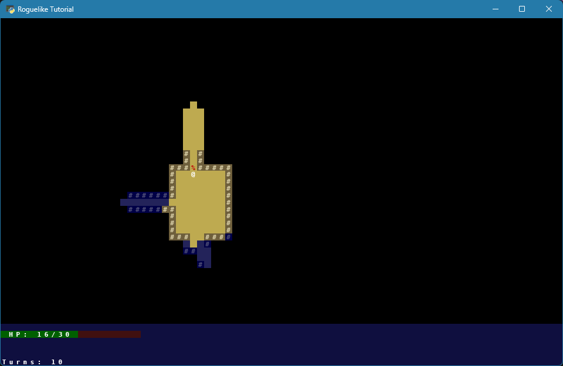
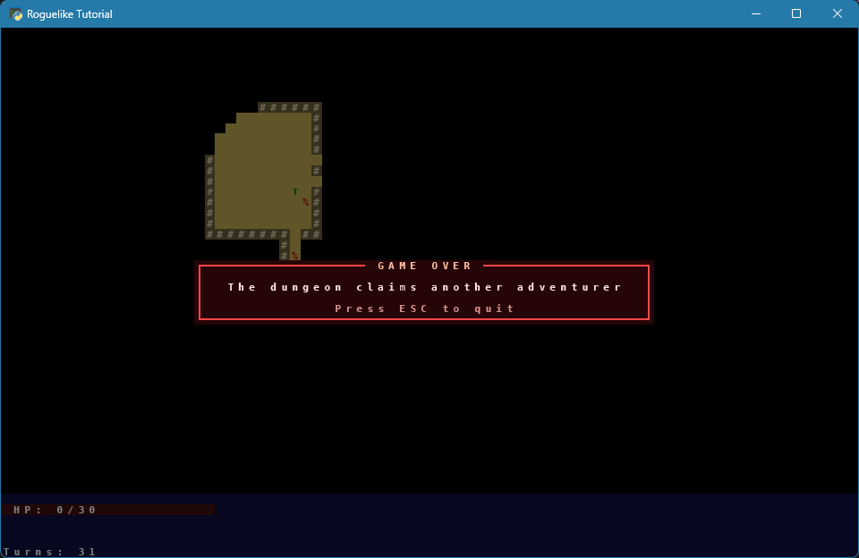
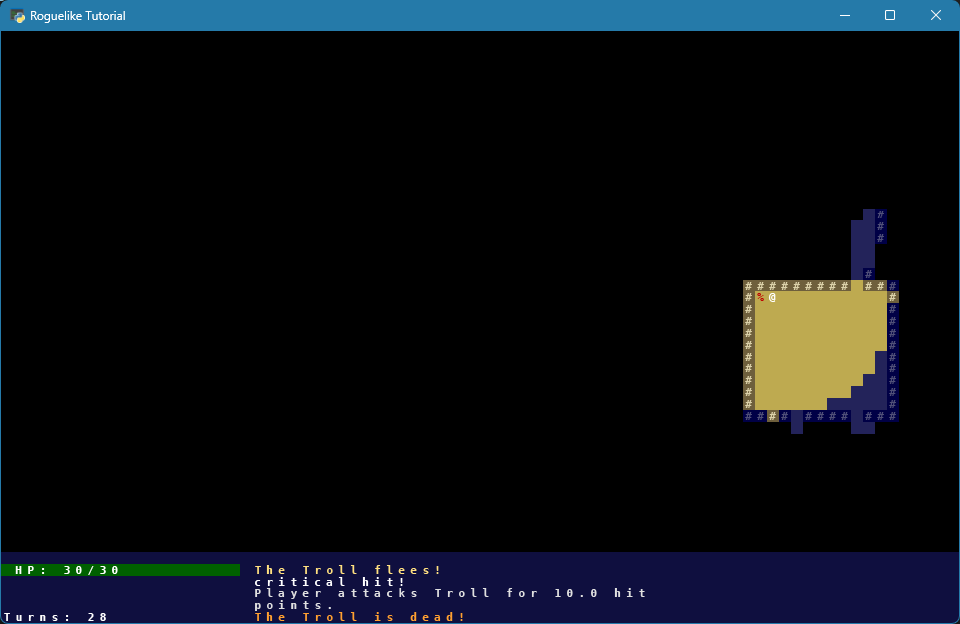
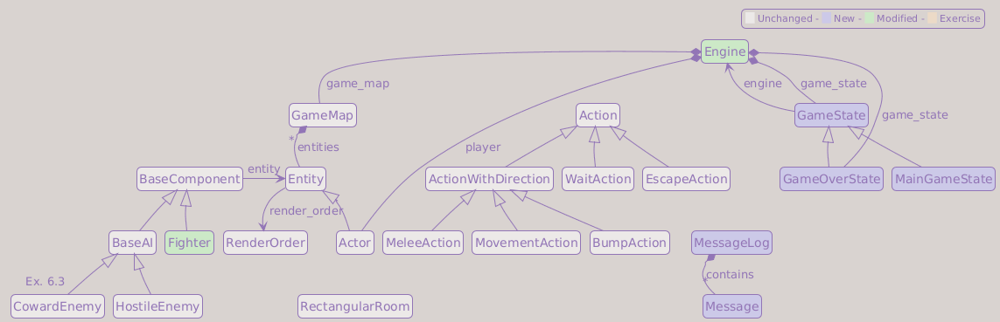

# Part 7: The User Interface

## What You Will Build

By the end of this part, your game will have a health bar, a message log, the names of the entities under the mouse cursor, and a real game-over screen. For the first time, the game will talk to the player through the window instead of the terminal.

## Learning goals

In this part we will:

- Divide the screen into a map area and a UI panel
- Add a health bar that updates after every turn
- Add a message log that replaces the `print()` calls
- Show entity names under the mouse cursor
- Turn the input handlers into game states that also draw their own screen
- Show a framed game-over panel when the player dies

---

## Background

This section is for reading; there is nothing to type yet. If you want to start building right away, skip to [The screen layout](#the-screen-layout). You can come back here at any time, even after you finish the tutorial, when you know the game from the inside and some of these ideas will mean more.

### What does a player need to see?

A roguelike UI has one design constraint: every piece of information the player needs to make a decision must be visible *without* leaving the main screen. That means:

- **Health**: how close am I to death?
- **Recent events**: what just happened? (especially damage numbers)
- **Context**: what is this tile or entity I'm hovering over?

The panel we build in this part answers these three questions: a health bar, a message log, and the names of the entities under the mouse cursor.

### One message log for the whole game

Many parts of the game want to write to the log: a `Fighter` when it attacks or dies, an AI when a monster flees, and later the consumables. So the question is where the log lives, and how all those parts reach it.

The v2 tutorial stores a `MessageLog` instance on `Engine`. That works, but every component that wants to log must receive `engine` as a parameter just to reach `engine.message_log`. The 2019 tutorial has no `Engine`: components return lists of result dictionaries, and the main loop reads the messages from them and adds them to its own log.

We use a third option: a static class. `MessageLog` keeps its messages in class-level state, no instance is ever created, and any module can call `MessageLog.add_message(...)` after a one-line import, with no extra dependency on `Engine`.

!!! info "Pattern: Singleton-like global state"
    This gives the main benefit of a Singleton (one object that everyone can reach) without the `__new__` code that a classic Singleton uses to block a second instance.

    The trade-off is also the same: it is easy to use from anywhere, and for that reason it can hide dependencies. Reading a module's parameters no longer tells you that it writes to the log.

    The *Game Programming Patterns* chapter on Singleton is worth reading.

    → [Game Programming Patterns: Singleton](https://gameprogrammingpatterns.com/singleton.html)

    → [Refactoring Guru: Singleton](https://refactoring.guru/design-patterns/singleton) ([Python example](https://refactoring.guru/design-patterns/singleton/python/example))

### Game states

Until now, the input handler only turned key presses into actions, and `Engine` drew the screen the same way in every situation. That stops working as soon as the game has more than one screen: the game-over panel in this part, then inventory menus, targeting, and a main menu. If `Engine` drew all of them, its `render()` would grow one branch for every mode.

Instead, each situation becomes a *game state*: an object that handles the input **and** draws the screen for that situation. `Engine` only keeps a reference to the active state and passes events and drawing calls to it. Adding a new screen then means adding a new state class, without touching `Engine`.

!!! info "Pattern: State"
    `GameState` and its subclasses implement the *State* pattern: each subclass stands for one game state (normal play, game over) and holds both the input handling and the drawing for that state. `Engine` is the *context*, the object that owns the current state: it stores the active state and passes `handle_events` and `on_render` calls to it.

    In this part, `Engine` still makes the switch to the game-over state. In later parts, modal states also switch states themselves (`self.engine.game_state = ...`), so the switching code stays close to the state that causes it. Inventory and targeting states build on this same structure.

    → [Game Programming Patterns: State](https://gameprogrammingpatterns.com/state.html)

    → [Refactoring Guru: State](https://refactoring.guru/design-patterns/state) ([Python example](https://refactoring.guru/design-patterns/state/python/example))

---

## The screen layout

For now, we use 44 rows for the map (rows 0 to 43) and 6 rows for a UI panel at the bottom (rows 44 to 49). The panel's top row shows the names of the entities under the mouse cursor. The health bar sits on the left of the next row, and the message log fills the five rows on its right. Later, you can decide where to place the panel and how big each part of your UI should be.

```text
┌────────────────────────────────────────────────────────────────────────────────┐
│                                                                                │
│                        MAP AREA (80 × 44, rows 0 to 43)                        │
│                                                                                │
├────────────────────────────────────────────────────────────────────────────────┤
│                     Orc                                                        │
│▓HP: 27/30▓▓▓▓▓▓▓▓░░ Hello and welcome, adventurer, to yet                      │
│                     another dungeon!                                           │
│                     Player attacks Orc for 4.2 hit points.                     │
│                     Orc attacks Player for 2.7 hit points.                     │
│                     Player attacks Orc for 4.2 hit points.                     │
└────────────────────────────────────────────────────────────────────────────────┘
```

The `HP: 27/30` text is printed on top of the bar: the `▓` cells are the filled part, the `░` cells the empty part.

---

## Extending `game/data/colors.py` with UI colors

`game/data/colors.py` already holds entity colors (`PLAYER`, `ORC`, `TROLL`, `CORPSE` from Parts 5 and 6). The UI we are about to build needs more constants: combat message colors, the welcome banner, and the health bar's filled and empty states.

Add these lines to the file. `DEFAULT_FG` and the existing entity and map colors stay exactly where they are; the block below only adds new constants, split into their own sections:

```python
# Generic colors
...
WHITE               = Color(255, 255, 255)
BLACK               = Color(  0,   0,   0)

... (at the end)

# Combat message colors
PLAYER_ATTACK       = Color(224, 224, 224)
ENEMY_ATTACK        = Color(255, 192, 192)
PLAYER_DEATH        = Color(255,  48,  48)
ENEMY_DEATH         = Color(255, 160,  48)

# UI colors
HUD_BG              = Color( 15,  15,  63)
WELCOME_TEXT        = Color( 32, 160, 255)
BAR_TEXT            = WHITE
HP_BAR_FILLED       = Color(  0,  96,   0)
HP_BAR_EMPTY        = Color( 64,  16,  16)

# Game over screen colors
GAME_OVER_FRAME     = Color(255,  72,  72)
GAME_OVER_PANEL_BG  = Color( 38,   5,   8)
GAME_OVER_TITLE     = Color(255, 192, 160)
GAME_OVER_TEXT      = Color(255, 232, 224)
GAME_OVER_DIM       = Color(216, 144, 144)
```

We put the new constants in separate sections (`Generic colors`, `Combat message colors`, `UI colors`, ...) so the file stays easy to scan as it grows. Notice that we name the death colors `PLAYER_DEATH` and `ENEMY_DEATH`, not `PLAYER_DIE`: the color belongs to an event, so we use the noun.

!!! note "If you kept earlier exercises"
    Extra exercise messages can get their own colors here as well. For example, the reference implementation uses `ENEMY_FLEE` and `BLOCKED` for Part 5/6 exercise feedback. They are useful, but not required for the base tutorial path.

!!! question "Why this lives in `data/`, not in `engine.py`"
    `game/data/colors.py` is imported by `hud`, `message_log`, `fighter`, and later by every UI component. If the colors lived in `game/engine.py`, those modules would need to import `engine` just to get a color. But `engine` already imports them, so we would get circular imports.

---

## message_log.py

The message log stores recent events and draws them in the panel. Two features make it easy to read: **color** (attacks look different from deaths) and **stacking** (if the same message repeats, it shows `(x3)` instead of three identical lines).

Create `game/message_log.py`:

```python
from __future__ import annotations

import textwrap
from typing import ClassVar

import tcod

from game.data import colors
from game.data.colors import Color


class Message:
    def __init__(self, text: str, fg: Color) -> None:
        self.plain_text = text
        self.fg = fg
        self.count = 1

    @property
    def full_text(self) -> str:
        if self.count > 1:
            return f"{self.plain_text} (x{self.count})"

        return self.plain_text


class MessageLog:
    messages: ClassVar[list[Message]] = []

    @classmethod
    def add_message(
        cls,
        text: str,
        fg: Color   = colors.WHITE,
        *,
        stack: bool = True,
    ) -> None:
        if stack and cls.messages and cls.messages[-1].plain_text == text:
            cls.messages[-1].count += 1
        else:
            cls.messages.append(Message(text, fg))

    @classmethod
    def clear(cls) -> None:
        cls.messages.clear()

    @staticmethod
    def render(
        console: tcod.console.Console,
        x: int,
        y: int,
        width: int,
        height: int,
    ) -> None:
        wrapped_lines: list[tuple[str, Color]] = []
        for message in MessageLog.messages:
            for line in textwrap.wrap(message.full_text, width):
                wrapped_lines.append((line, message.fg))

        total = len(wrapped_lines)
        start = max(0, total - height)
        end   = start + height

        for y_offset, (line, color) in enumerate(wrapped_lines[start:end]):
            console.print(
                x    = x,
                y    = y + y_offset,
                text = line,
                fg   = color,
            )
```

`MessageLog` has no `__init__`. `messages` is a class variable that every part of the game shares, and the methods work on it without an instance. The `ClassVar` annotation says that this sharing is intentional.

`render` first turns all messages into one list of `(line, color)` pairs, wrapping long messages to the panel width. Then it takes the last `height` lines (the most recent ones) and prints them from top to bottom. `clear()` empties the list; Part 10 calls it when a new game starts.

!!! info "@classmethod vs @staticmethod"
    A **`@classmethod`** receives the class itself as its first argument (`cls`). That is what `add_message` needs: it reads and writes `cls.messages`, the shared list.

    A **`@staticmethod`** receives nothing automatically (no `self`, no `cls`). `render` can be static because it only reads `MessageLog.messages` by name. It does not change class state, and no subclass needs to override it.

!!! info "ClassVar and shared class state"
    `ClassVar` comes from the `typing` module. It marks an attribute as belonging to the class itself, not to each instance. It changes nothing at runtime: it is a note for type checkers and linters.

    It matters most with mutable values. A list written in a class body is created once, when Python defines the class, and every instance shares it:

    ```python
    class Bag:
        items: list[str] = []

    first  = Bag()
    second = Bag()
    first.items.append("sword")
    print(second.items)  # ['sword']
    ```

    This is a common bug when each instance should have its own list; the fix is to create the list in `__init__` with `self.items = []`. Linters warn about any mutable value in a class body for this reason. `MessageLog` never creates instances, so sharing is exactly what we want. `ClassVar` says so, and the warning goes away.

!!! question "Why a static class instead of an instance?"
    Because many modules write to the log, and a static class lets them do it without receiving `engine` as a parameter. [One message log for the whole game](#one-message-log-for-the-whole-game), in the Background section, compares this with the 2019 and v2 tutorials and explains the trade-off.

---

## hud.py

The HUD (heads-up display: the information drawn on top of the game view) needs three small drawing functions. The engine calls them every frame.

Create `game/hud.py`:

```python
from __future__ import annotations

from typing import TYPE_CHECKING

from game.data import colors

if TYPE_CHECKING:
    from tcod.console import Console
    from game.map.game_map import GameMap


def render_panel(console: Console, y: int = 44, height: int = 6) -> None:
    console.draw_rect(
        x      = 0,
        y      = y,
        width  = console.width,
        height = height,
        ch     = ord(' '),
        bg     = colors.HUD_BG,
    )


def render_bar(
    console: Console,
    current_value: float,
    maximum_value: int,
    total_width: int,
    y: int = 45,
) -> None:
    bar_width = int(float(current_value) / maximum_value * total_width)

    console.draw_rect(
        x      = 0,
        y      = y,
        width  = total_width,
        height = 1,
        ch     = ord(' '),
        bg     = colors.HP_BAR_EMPTY,
    )

    if bar_width > 0:
        console.draw_rect(
            x      = 0,
            y      = y,
            width  = bar_width,
            height = 1,
            ch     = ord(' '),
            bg     = colors.HP_BAR_FILLED,
        )

    console.print(
        x    = 1,
        y    = y,
        text = f"HP: {int(current_value)}/{maximum_value}",
        fg   = colors.BAR_TEXT,
    )


def render_names_at_mouse_location(
    console: Console,
    x: int,
    y: int,
    mouse_location: tuple[int, int],
    game_map: GameMap,
) -> None:
    mouse_x, mouse_y = mouse_location

    if game_map.in_bounds(mouse_x, mouse_y) and game_map.visible[mouse_x, mouse_y]:
        names = ", ".join(
            entity.name
            for entity in game_map.entities
            if entity.x == mouse_x and entity.y == mouse_y
        )
        console.print(x=x, y=y, text=names)
```

- `render_panel` fills the six-row HUD area with `HUD_BG`, before anything else is drawn on top of it.
- `render_bar` first draws the whole bar in the empty color, then draws the filled part over it, and finally prints the text `"HP: N/M"` on top.
- `render_names_at_mouse_location` collects the names of all entities on the cursor's tile and joins them with commas. It only does this when the tile is in view, so the mouse cannot reveal monsters you cannot see.

All three functions take only what they need: no `Engine` reference, no hidden dependencies.

---

## From input handlers to game states

The classes in `game/input_handlers.py` are about to do more than translate input:
each one will also draw the screen for one situation, such as normal play or
game over. If each state does both jobs, `Engine` does not need a separate drawing
branch for every future menu and mode.

Rename the file to `game/game_states.py`, so its name matches that wider role. We
will also change the classes so they take an engine, handle events, and draw themselves.
Later parts use this structure for inventory screens, spell targeting, and states that
switch to other states.

Each state:

- Takes an `engine` in its constructor
- Has a `handle_events(event)` method
- Has an `on_render(console)` method that draws anything the state needs

!!! info "Pattern: State"
    This is the *State* design pattern. [Game states](#game-states), in the Background section, explains the idea and links to further reading.

Replace `game/input_handlers.py` with `game/game_states.py`. Here we see a small benefit of the Part 5 decision to keep the key tables in `game/data/keys.py`: there are no key maps to move, so the new file contains only the states and their drawing helpers. Start with the imports and the panel-drawing helper that every state will share:

```python
from __future__ import annotations

from typing import TYPE_CHECKING

import tcod

from game.actions import Action, BumpAction, EscapeAction, WaitAction
from game.data import colors, keys
from game.data.colors import Color

if TYPE_CHECKING:
    from game.engine import Engine


def _draw_panel(
    console: tcod.console.Console,
    x: int,
    y: int,
    width: int,
    height: int,
    frame_color: Color,
    bg_color: Color,
    shadow: bool = True,
) -> None:
    if shadow:
        # Draw the panel shadow one tile down and to the right
        console.draw_rect(
            x      = x + 1,
            y      = y + 1,
            width  = width,
            height = height,
            ch     = ord(" "),
            bg     = colors.BLACK,
        )

    # Fill the panel interior with the selected background color
    console.draw_rect(
        x        = x,
        y        = y,
        width    = width,
        height   = height,
        ch       = ord(" "),
        fg       = frame_color,
        bg       = bg_color,
        bg_blend = tcod.constants.BKGND_SET,
    )

    # Draw the panel frame over the filled background
    console.draw_frame(
        x      = x,
        y      = y,
        width  = width,
        height = height,
        clear  = False,
        fg     = frame_color,
        bg     = bg_color,
    )
```

`_draw_panel()` draws a framed box. Later parts use it for every menu and popup, so it is worth understanding once. It draws in three passes:

1. An optional **drop shadow**: a plain black `draw_rect`, moved one cell right and one cell down from the panel's corner. It makes the panel look like it floats above the map.
2. A **fill** pass: `draw_rect` covers the panel area with spaces. `bg_blend=tcod.constants.BKGND_SET` replaces the background color of each cell instead of mixing it with what was drawn before. `BKGND_SET` is already the default for `draw_rect`, so this argument changes nothing; we write it anyway because the whole point of this pass is to cover what is underneath, and the explicit value says so. `ch=ord(" ")` replaces the characters too, so the dungeon tiles underneath are fully hidden.
3. A **frame** pass: `draw_frame` with `clear=False` draws only the border characters, preserving the interior just filled by `draw_rect`.

Next, the base `GameState` every other state inherits from:

```python
class GameState:

    def __init__(self, engine: Engine) -> None:
        self.engine = engine

    def handle_events(self, event: tcod.event.Event) -> Action | None:
        match event:
            case tcod.event.Quit():
                return EscapeAction()

            case tcod.event.MouseMotion():
                self.engine.mouse_location = event.integer_position

            case tcod.event.KeyDown():
                return self.event_keydown(event)

        return None

    def event_keydown(self, _event: tcod.event.KeyDown) -> Action | None:
        return None

    def on_render(self, console: tcod.console.Console) -> None:
        self.engine.render(console)
```

`handle_events()` chooses what to do by event type:

- `Quit` (closing the window) always ends the game, no matter which state is active.
- `MouseMotion` stores the cursor position in `engine.mouse_location`, so `render_names_at_mouse_location` always has current data.
- `KeyDown` is passed to `event_keydown()`, so each subclass decides what its own keys do.

`on_render()` just calls `engine.render()`, unless a subclass overrides it. `GameOverState` does that below.

Mouse events arrive in pixel coordinates. The engine will pass each event through `context.convert_event`, which returns a copy with the position in tile coordinates. `integer_position` rounds that position down to whole tiles. You may see `event.tile` in older code: it is deprecated since tcod 21.

Then `MainGameState`, the state the engine starts in and the one play returns to once any other state closes:

```python
class MainGameState(GameState):

    def event_keydown(self, event: tcod.event.KeyDown) -> Action | None:
        key = event.sym

        if key in keys.MOVE_KEYS:
            dx, dy = keys.MOVE_KEYS[key]
            return BumpAction(dx, dy)

        if key in keys.WAIT_KEYS:
            return WaitAction()

        if key == keys.KEY_QUIT_GAME:
            return EscapeAction()

        return None
```

`event_keydown()` does exactly what `EventHandler.event_keydown` did before this rename: movement keys become a `BumpAction`, the wait keys become a `WaitAction`, and the quit key becomes an `EscapeAction`. Any other key reaches `return None`, so `GameState.handle_events()` reports no action and no turn passes.

*Normal play, with the new HUD panel*:



Finally, `GameOverState`, the screen shown once the player dies:

```python
class GameOverState(GameState):
    TITLE    = "GAME OVER"
    FG_COLOR = colors.GAME_OVER_FRAME
    BG_COLOR = colors.GAME_OVER_PANEL_BG

    def on_render(self, console: tcod.console.Console) -> None:
        super().on_render(console)

        # Dim the map background to highlight the game-over screen
        console.fg[:] = console.fg // 2
        console.bg[:] = console.bg // 2

        title   = f" {self.TITLE} "
        message = "The dungeon claims another adventurer"
        hint    = "Press ESC to quit"
        width   = max(len(title) + 4, len(message) + 6, len(hint) + 6)
        height  = 6
        x = (console.width  - width)  // 2
        y = (console.height - height) // 2

        # Draw the game-over box
        _draw_panel(console, x, y, width, height, self.FG_COLOR, self.BG_COLOR)

        # Draw the centered game-over title over the frame
        console.print(
            x    = x + (width - len(title)) // 2,
            y    = y,
            text = title,
            fg   = colors.GAME_OVER_TITLE,
            bg   = self.BG_COLOR,
        )

        # Draw the main game-over line
        console.print(
            x         = console.width // 2,
            y         = y + 2,
            text      = message,
            fg        = colors.GAME_OVER_TEXT,
            alignment = tcod.constants.CENTER,
        )

        # Draw the quit hint at the bottom of the panel
        console.print(
            x         = console.width // 2,
            y         = y + height - 2,
            text      = hint,
            fg        = colors.GAME_OVER_DIM,
            alignment = tcod.constants.CENTER,
        )

    def event_keydown(self, event: tcod.event.KeyDown) -> Action | None:
        if event.sym == keys.KEY_QUIT_GAME:
            return EscapeAction()

        return None
```

*The finished game over screen*:



`GameOverState` declares three class variables (`TITLE`, `FG_COLOR`, and `BG_COLOR`), so a subclass can change any of them without touching the others. Part 8 uses the same idea for the inventory overlays.

`on_render()` starts by dimming everything already on the console. `console.fg[:] = console.fg // 2` halves every foreground color channel in place, and the matching `bg` line halves the backgrounds. The map and HUD stay visible but faded, so the player looks at the panel. Every modal screen from here on (inventory, popups, level-up) uses this dimming trick again.

The panel width adapts to its longest line (title, message, or hint, each with extra space for the borders and a margin). A separate `console.print` centers the title on the top border row, replacing the frame characters there. The message is centered inside the panel. The hint sits on the row just above the bottom border, in a dimmer color, so it reads as secondary information.

`engine.py` still imports `from game.input_handlers import EventHandler, GameOverEventHandler`, the module you just replaced, so do not run the game yet: it would fail with `ModuleNotFoundError: No module named 'game.input_handlers'`. That is expected; the next section changes `engine.py` to use `game_states.py` instead.

---

## Update engine.py

Five changes: new imports, updated `__init__`, updated `handle_events`, updated `render()`, and updated `run()`. All come from switching to the new `GameState` API (the `game_states.py` refactor above) and adding the UI.

Add the imports at the top of `game/engine.py`:

```diff
+from game import hud
 from game.entities.entity import Actor
-from game.input_handlers import EventHandler, GameOverEventHandler
+from game.game_states import GameOverState, GameState, MainGameState
 from game.map.game_map import GameMap
+from game.message_log import MessageLog
```

Update `__init__` to use the new state class and track mouse position:

```diff
     self.game_map = game_map
     self.player = player
-    self.event_handler = EventHandler()
+
+    self.mouse_location: tuple[int, int] = (0, 0)
+    self.game_state: GameState = MainGameState(self)
```

Update `handle_events` to call the new `handle_events()` method (replacing the old `dispatch()`), guard enemy turns so they only run while the player is alive, and pass `self` to `GameOverState`:

```diff
    def handle_events(self, events: Iterable[Any]) -> None:
        for event in events:
-            action = self.event_handler.dispatch(event)
+            action = self.game_state.handle_events(event)
            if action is None:
                continue

            action.perform(self, self.player)
-            self.handle_enemy_turns()
-            self.update_fov()  # recompute after every action
-
-            if not self.player.is_alive:
-                self.event_handler = GameOverEventHandler()
+
+            if self.player.is_alive:
+                self.handle_enemy_turns()
+
+            self.update_fov()  # recompute after every action
+
+            if not self.player.is_alive:
+                self.game_state = GameOverState(self)
```

Replace the existing `render()` method. It no longer receives `context` or controls the frame cycle; `run()` owns those steps now.

```python
    def render(self, console: Console) -> None:
        self.game_map.render(console)

        hud.render_panel(console=console)

        MessageLog.render(
            console = console,
            x       = 21,
            y       = 45,
            width   = 40,
            height  = 5,
        )

        hud.render_bar(
            console       = console,
            current_value = self.player.fighter.hp,
            maximum_value = self.player.fighter.max_hp,
            total_width   = 20,
        )

        hud.render_names_at_mouse_location(
            console        = console,
            x              = 21,
            y              = 44,
            mouse_location = self.mouse_location,
            game_map       = self.game_map,
        )
```

These coordinates map directly onto the panel layout from the start of the chapter. The HP bar fills columns `0-19` of row `45` (`total_width=20`), so the message log and the hover names start one column past it, at `x=21`. Row `44` (the panel's top row) holds the names under the cursor; rows `45-49` hold the five wrapped message lines (`y=45`, `height=5`).

!!! note "If you kept the Part 1 turn counter"
    Part 1, Exercise 3 added a `turn_count` counter, and since Part 2 `Engine.render()` prints it with `console.print(x=0, y=44, text=f"Turns: {self.turn_count}")`. Row `44` now belongs to the panel: it shows hover names, so the old print would land on top of them.

    The new `render()` above replaces the old one, so add the counter back, this time on the panel's bottom row, which stays free for the rest of this chapter:

    ```diff
             hud.render_names_at_mouse_location(
                 console        = console,
                 x              = 21,
                 y              = 44,
                 mouse_location = self.mouse_location,
                 game_map       = self.game_map,
             )
    +
    +        # Part-1. Exercise 3: Add a wait action
    +        console.print(x=0, y=49, text=f"Turns: {self.turn_count}")
    ```

    Row `49` is the panel's last row (`y=44`, `height=6`, so rows `44` through `49`). Later parts add more HUD pieces (the gold counter in Part 8, the floor display and the XP bar in Part 11), but they all sit on rows `44` to `46`, so the counter keeps its place.

Update `run()` to delegate rendering to the active game state and to capture the result of `context.convert_event`:

```diff
    def run(self, context: Context, console: Console) -> None:
         while True:
-            self.render(console=console, context=context)
-            self.handle_events(tcod.event.wait())
+            console.clear()
+            self.game_state.on_render(console=console)
+            context.present(console)
+            for event in tcod.event.wait():
+                event = context.convert_event(event)
+                self.handle_events([event])
```

`context.convert_event(event)` returns a new event object with the mouse position in tile coordinates. We must keep the return value: the original event is not changed in place.

!!! info "render() vs game_map.render()"
    `GameMap.render()` draws tiles and entity sprites. `Engine.render()` builds the full frame: the map first, then the UI panel on top. Because the two are separate, the map never needs to know about the UI layout.

!!! tip "Run it now"
    If you run the game now, you can check that the panel itself works: the health bar follows your HP, and moving the mouse over a visible entity shows its name on the panel's top row.

    The message log area stays empty, because nothing has posted a message to it yet. Combat and death still print to the terminal, exactly as they did at the end of Part 6. It is a good habit to check the panel on its own like this, before you connect the message log: any layout or coordinate mistake is easy to spot, and it does not get mixed with log output.

---

## Update main.py

Two small changes: two new imports and posting the welcome message.

Add the imports:

```diff
+from game.data import colors
 from game.engine import Engine
 from game.entities import factories
 from game.map.map_generator import generate_dungeon
+from game.message_log import MessageLog
```

Post the welcome message after creating the engine:

```diff
 engine = Engine(game_map=game_map, player=player)
+
+MessageLog.add_message(
+    "Hello and welcome, adventurer, to yet another dungeon!",
+    colors.WELCOME_TEXT,
+)
```

---

## Replace print() with message_log in fighter.py

All the `print()` calls from Parts 5 and 6 now go through `MessageLog.add_message()`. Because `MessageLog` is a static class, `melee_attack()` and `die()` can call it directly, with no extra parameters. `die()` is still called from the `hp` setter, as in Part 6.

Add the import at the top of `game/entities/components/fighter.py`:

```diff
+from game.message_log import MessageLog
```

First, add `heal()` and `take_damage()` to `Fighter` in `game/entities/components/fighter.py`. Defining them now means `melee_attack()` can call `take_damage()` right after:

```python
    def heal(self, amount: float) -> float:
        if self.hp == self.max_hp:
            return 0.0

        new_hp_value = self._hp + amount
        new_hp_value = min(new_hp_value, float(self.max_hp))

        recovered = new_hp_value - self._hp
        self.hp = new_hp_value

        return recovered

    def take_damage(self, amount: float) -> None:
        self.hp -= amount
```

`take_damage()` only runs `self.hp -= amount`, but it gives the call sites a readable name. `melee_attack()` will use it next, and later damage sources use the same method. The assignment still goes through the `hp` setter, so death works exactly as before.

`heal()` never raises HP above `max_hp`, and it returns the amount actually recovered. No code calls it yet in this part: the healing potions in Part 8 will be the first to use it, but it belongs here, next to the other HP methods.

Update `Fighter.melee_attack()` in `game/entities/components/fighter.py`:

```diff
 def melee_attack(self, target: Actor) -> None:
     damage = (self.attack * self.attack) / (self.attack + target.fighter.defense)
     attack_msg = f"{self.entity.name.capitalize()} attacks {target.name}"
+    attack_color = colors.PLAYER_ATTACK if self.entity.ai is None else colors.ENEMY_ATTACK

-    print(f"{attack_msg} for {damage:.1f} hit points.")
-    target.fighter.hp -= damage
+    MessageLog.add_message(f"{attack_msg} for {damage:.1f} hit points.", attack_color)
+    target.fighter.take_damage(damage)
```

`self.entity.ai is None` identifies the player: the player never has an AI component, and living enemies always do. Player attacks use a light grey (`PLAYER_ATTACK`) and enemy attacks a red tint (`ENEMY_ATTACK`), so the player can scan the log quickly. Damage now goes through `target.fighter.take_damage(damage)`, the method you just added, instead of assigning to `target.fighter.hp` directly.

Update `Fighter.die()` in `game/entities/components/fighter.py` to write to the message log:

```diff
-def die(self) -> None:
-    # Differentiate the message: the player gets a second-person line, enemies the third-person one
-    if self.entity.ai:
-        death_message = f"The {self.entity.name} is dead!"
-    else:
-        death_message = "You died!"
-    print(death_message)
+def die(self) -> None:
+    if self.entity.ai is None:
+        death_message = "You died!"
+        death_message_color = colors.PLAYER_DEATH
+
+    else:
+        death_message = f"The {self.entity.name} is dead!"
+        death_message_color = colors.ENEMY_DEATH
+
+    MessageLog.add_message(death_message, death_message_color)
```

!!! note "If you kept Part 5/6 exercise code"
    Change those messages to `MessageLog.add_message(...)` too. For example, the non-combat blocker message in `actions.py`, the flee message in `ai.py`, and the critical-hit message in `fighter.py` should keep the same behavior but send their text to the message log.

!!! tip "Run it now"
    With the message log connected, running the game now shows the full picture:

    - the welcome message appears as soon as the game starts;
    - attacking and being attacked add colored lines to the log instead of printing to the terminal;
    - dying writes `"You died!"` to the log.

    Compare this with the earlier checkpoint, where the same panel had an empty log area: it is a nice way to see how much changed in this part.

    

---

## Testing your work

Run the game with `uv run main.py` (or `python main.py`):

- [ ] The bottom panel has a dark background, visually distinct from the map area above it
- [ ] A health bar appears on the left of the panel, showing `HP: 30/30`
- [ ] The welcome message appears in the message log panel
- [ ] Attacking an enemy adds a colored line to the message log
- [ ] When enemies attack you, the message appears in a different color
- [ ] Hovering the mouse over a visible entity shows its name on the panel's top row
- [ ] On death, `"You died!"` appears in the log and the bar shows 0 HP
- [ ] On death, the screen dims and a framed game-over panel with a drop shadow appears centered
- [ ] Repeated identical messages stack: wait (`.` or numpad `5`) next to an orc and you see `"Orc attacks Player for 2.7 hit points. (x3)"`

---

## Summary

The game now has a working UI panel. Key additions:

- **`game/data/colors.py`**: new colors for messages, the HUD, and the game-over screen
- **`MessageLog`**: static class that stores and renders recent events with stacking and color
- **`hud`**: stateless HUD helpers for the bar and mouse names
- **`_draw_panel()`**: shared shadow + fill + frame helper reused by every later menu and popup
- **`on_render()`**: each game state controls its own frame rendering
- **`mouse_location`**: engine tracks the cursor for hover tooltips

**Current architecture**:

- `Engine.render()`: composes the full frame: map, message log, HP bar, and hover text
- `GameMap.render()`: still draws only terrain and entities
- `MessageLog`: static class; any module can call `MessageLog.add_message()`
- `hud.py`: stateless HUD drawing helpers; each function takes only what it needs
- `GameState.on_render()`: lets each state control what gets drawn for its state

**Class Diagram**:



**File structure**:

```text
main.py                         ← modified
game/
├── __init__.py
├── actions.py
├── engine.py                   ← modified
├── hud.py                      ← new
├── game_states.py              ← renamed from input_handlers.py
├── message_log.py              ← new
├── data/
│   ├── __init__.py
│   ├── colors.py               ← modified
│   ├── keys.py
│   └── sprites.py
├── entities/
│   ├── __init__.py
│   ├── entity.py
│   ├── factories.py
│   ├── render_order.py
│   └── components/
│       ├── __init__.py
│       ├── ai.py
│       ├── base_component.py
│       └── fighter.py          ← modified
└── map/
    ├── __init__.py
    ├── game_map.py
    ├── tile_types.py
    └── map_generator.py
```

---

## Exercises

1. **Colored HP bar**:

    Make both the filled and the empty part of the bar change color with the HP percentage: healthy above 70%, injured above 30%, critical at 30% or less. Use these three pairs of colors in `colors.py`:

    ```python
    HP_BAR_HEALTHY_FILLED  = Color( 32, 160,  64)
    HP_BAR_HEALTHY_EMPTY   = Color( 16,  48,  24)
    HP_BAR_INJURED_FILLED  = Color(216, 168,  32)
    HP_BAR_INJURED_EMPTY   = Color( 58,  42,   8)
    HP_BAR_CRITICAL_FILLED = Color(200,  48,  48)
    HP_BAR_CRITICAL_EMPTY  = Color( 58,  16,  16)
    ```

    ??? note "Reference implementation"
        Add the six constants above at the end of `game/data/colors.py`, under a `# Part-7. Exercise 1: Colored HP bar` comment.

        In `render_bar` (`game/hud.py`), compute the HP ratio once, choose the pair of colors, and use them in the two `draw_rect` calls:

        ```diff
         ) -> None:
        -    bar_width = int(float(current_value) / maximum_value * total_width)
        +    # Part-7. Exercise 1: Colored HP bar
        +    hp_ratio = float(current_value) / maximum_value
        +    bar_width = int(hp_ratio * total_width)
        +    if hp_ratio > 0.70:
        +        bar_color_fg = colors.HP_BAR_HEALTHY_FILLED
        +        bar_color_bg = colors.HP_BAR_HEALTHY_EMPTY
        +    elif hp_ratio > 0.30:
        +        bar_color_fg = colors.HP_BAR_INJURED_FILLED
        +        bar_color_bg = colors.HP_BAR_INJURED_EMPTY
        +    else:
        +        bar_color_fg = colors.HP_BAR_CRITICAL_FILLED
        +        bar_color_bg = colors.HP_BAR_CRITICAL_EMPTY

             console.draw_rect(
                 ...
        -        bg     = colors.HP_BAR_EMPTY,
        +        bg     = bar_color_bg,
             )

             if bar_width > 0:
                 console.draw_rect(
                     ...
        -            bg     = colors.HP_BAR_FILLED,
        +            bg     = bar_color_fg,
                 )
        ```

2. **Scroll the message panel**:

    The message log shows only the five most recent wrapped lines. Let the player read older messages with `Page Up` and `Page Down`. Define the keys in `game/data/keys.py` like every other binding, as `LOG_SCROLL_UP` and `LOG_SCROLL_DOWN`, and keep the scroll offset in `MessageLog` as another `ClassVar`. A new message should jump back to the most recent lines, and scrolling must never cost a turn.

    ??? note "Reference implementation"
        Add the keys at the end of `game/data/keys.py`:

        ```python
        LOG_SCROLL_UP   = tcod.event.KeySym.PAGEUP
        LOG_SCROLL_DOWN = tcod.event.KeySym.PAGEDOWN
        ```

        In `game/message_log.py`, add the offset, reset it when a message arrives or the log is cleared, and add two methods to change it. `render` becomes a `@classmethod`, because it now writes class state: it clamps the offset between `0` and the number of hidden lines.

        ```diff
         class MessageLog:
             messages: ClassVar[list[Message]] = []
        +    # Part-7. Exercise 2: Scroll the message panel
        +    scroll: ClassVar[int] = 0

             @classmethod
             def add_message(
                 ...
                 else:
                     cls.messages.append(Message(text, fg))

        +        # Part-7. Exercise 2: Scroll the message panel
        +        cls.scroll = 0
        +
             @classmethod
             def clear(cls) -> None:
                 cls.messages.clear()
        +        # Part-7. Exercise 2: Scroll the message panel
        +        cls.scroll = 0
        +
        +    # Part-7. Exercise 2: Scroll the message panel
        +    @classmethod
        +    def scroll_up(cls, amount: int = 1) -> None:
        +        cls.scroll += amount
        +
        +    @classmethod
        +    def scroll_down(cls, amount: int = 1) -> None:
        +        cls.scroll = max(0, cls.scroll - amount)

        -    @staticmethod
        +    @classmethod
             def render(
        +        cls,
                 console: tcod.console.Console,
                 ...
                 total = len(wrapped_lines)
        -        start = max(0, total - height)
        +        max_scroll = max(0, total - height)
        +        cls.scroll = max(0, min(cls.scroll, max_scroll))
        +        start = max(0, total - height - cls.scroll)
                 end   = start + height
        ```

        Handle the keys in `GameState.handle_events` (`game/game_states.py`), before `event_keydown`, so they work in every state and return no action (no action, no turn). Import `MessageLog` at the top of the file:

        ```diff
                     case tcod.event.KeyDown():
        +                # Part-7. Exercise 2: Scroll the message panel
        +                if event.sym == keys.LOG_SCROLL_UP:
        +                    MessageLog.scroll_up()
        +                    return None
        +
        +                if event.sym == keys.LOG_SCROLL_DOWN:
        +                    MessageLog.scroll_down()
        +                    return None
        +
                         return self.event_keydown(event)
        ```

3. **Entity details**:

    When the mouse is over a living actor, show its combat stats next to its name, with one decimal place: `"Player (HP: 30.0/30.0, ATK: 5.0, DEF: 2.0)"`. Everything else keeps showing only its name. Careful: a corpse is still an `Actor` (`die()` only changes it), so it should show `remains of Orc`, not `remains of Orc (HP: 0.0/18.0, ...)`.

    ??? note "Reference implementation"
        In `game/hud.py`, import `Actor` (`from game.entities.entity import Actor`) and replace the generator expression in `render_names_at_mouse_location` with an explicit loop:

        ```diff
             if game_map.in_bounds(mouse_x, mouse_y) and game_map.visible[mouse_x, mouse_y]:
        -        names = ", ".join(
        -            entity.name
        -            for entity in game_map.entities
        -            if entity.x == mouse_x and entity.y == mouse_y
        -        )
        +        # Part-7. Exercise 3: Entity details
        +        names_at: list[str] = []
        +        for entity in game_map.entities:
        +            if entity.x != mouse_x or entity.y != mouse_y:
        +                continue
        +
        +            if isinstance(entity, Actor) and entity.is_alive:
        +                names_at.append(
        +                    f"{entity.name} "
        +                    f"(HP: {entity.fighter.hp:.1f}/{float(entity.fighter.max_hp):.1f}, "
        +                    f"ATK: {entity.fighter.attack:.1f}, "
        +                    f"DEF: {entity.fighter.defense:.1f})"
        +                )
        +            else:
        +                names_at.append(entity.name)
        +
        +        names = ", ".join(names_at)
                 console.print(x=x, y=y, text=names)
        ```
