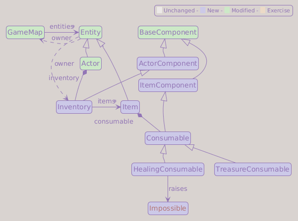

# Part 8a: The Item System

**Part 8** is the longest and densest chapter in this tutorial. It adds more new pieces at once than any earlier chapter: a new entity subclass (`Item`), two specialized component bases (`ActorComponent` and `ItemComponent`), and two consumable components (`HealingConsumable` and `TreasureConsumable`). It also adds an ownership model that lets an item move between the map and an inventory, and a way for an action that cannot succeed to say why.

**Part 8a** builds the data model: items appear in the dungeon and can be inspected, but cannot yet be picked up, used, dropped, or auto-collected.

**Part 8b** adds the player-facing side: actions, keyboard bindings, and the inventory overlay.

---

## What You Will Build

By the end of Part 8a, health potions and chests appear in the dungeon as instances of the new `Item` entity, spawned from a weighted table. Hovering the mouse over either already shows its name: that is the generic lookup Part 7 built, working here with no changes. Walking over a chest does nothing yet, like any other non-blocking entity; the auto-collect mechanic will be added in Part 8b. There are no other keyboard interactions with items yet either.

## Learning goals

In this part we will:

- Add an `owner` back-reference to `Entity`
- Add `Item` as an entity subclass with a required `Consumable`
- Add `Impossible`, an exception that carries the reason an action failed
- Implement `Inventory`, `HealingConsumable`, and `TreasureConsumable` as components
- Narrow base component types so annotations match the actual runtime type
- Spawn health potions and chests using a weighted item table

---

## Background

This section is for reading; there is nothing to type yet. If you want to start building right away, skip to [New constants](#new-constants). You can come back here at any time, even after you finish the tutorial, when you know the game from the inside and some of these ideas will mean more.

### Where does an item live?

Before writing any code, consider the central design question: a health potion needs to exist in two places.

When it is on the dungeon floor, the map owns it. When the player picks it up, the inventory owns it. It is the same Python object in both cases; only its *owner* changes. How does the game track which owner currently holds it, and which collection to search for it?

The answer is two related pieces of state: the entity lives inside a collection (the map's or the inventory's), and it also carries an `owner` field on `Entity` that points back to whichever one currently holds it:

```text
On the dungeon floor:
  Item
  ├── tracked in GameMap.entities
  └── owner = GameMap

In the player's inventory:
  Item
  ├── tracked in Inventory.items
  └── owner = Inventory
```

In both cases the item is the same Python object. `owner` is a back-reference to the current container, but it is not the only place that stores this information. The collection stores it too. So whenever an item changes hands, we must update both the collection and `owner` together. Otherwise the two would disagree about where the item is.

### Saying why an action failed

Until now, an action that could not happen just returned early, and the player got no feedback. Part 8 changes that: **when the game rejects an action and the player needs to know, it should say why**. "Your inventory is full." is more useful than a key press that does nothing.

A function can report a failure in three ways:

- Return `None`. This is silent: the caller has to check for it and decide what to tell the player.
- Return a `bool`. This is only a little better: the caller knows the action failed, but not why.
- Raise an exception that carries the reason, such as `Impossible("Your inventory is full.")`.

We use the third option. Python uses exceptions for unexpected bugs, but also for *expected* failures: a missing dictionary key, an invalid value conversion. An impossible action is the same kind of expected failure, so raising `Impossible` does not mean there is a bug. The exception carries the reason out of any depth of function calls, without passing a return value back through every function in between. A single handler, added in Part 8b, catches it and writes the reason to the message log.

---

## New constants

Part 8a adds the sprites and colors needed for health potions and chests. It also adds the message colors used when the player recovers health or finds gold. The action-rejection color and the inventory overlay palette will be introduced in Part 8b, where they are first used.

At the end of `game/data/sprites.py`, add the chest sprite and an items section for `HEALTH_POTION`:

```diff
 WATER   = "~" # Part-2. Exercise 3: Add a new tile type
+
+CHEST   = "$"
+
+# Items
+HEALTH_POTION = "!"
```

In `game/data/colors.py`, add the chest color to the entity colors, and a new item section right after them:

```diff
 # Entity colors
 ...
 CORPSE           = Color(191,   0,   0)
+CHEST            = Color(180, 128,  40)

+# Item colors
+HEALTH_POTION    = Color(127,   0, 255)
```

Add `HEALTH_RECOVERED` near the combat message colors:

```diff
 # Combat message colors
 ...
+HEALTH_RECOVERED = Color(  0, 255,   0)
```

Add `GOLD` to the UI colors, since the same color will later be used by the gold counter:

```diff
 # UI colors
 ...
+GOLD = Color(255, 215,   0)
```

`HEALTH_RECOVERED` is a bright green used for HP-recovery messages. `GOLD` is used when `TreasureConsumable.activate()` reports that the player has found treasure, and later by the gold counter in the HUD.

!!! note "If you completed the Part 5 chest exercise"
    `sprites.CHEST` and `colors.CHEST` may already be defined. Keep the existing definitions instead of adding duplicates.

---

## Narrowing component types

`BaseComponent` in `game/entities/components/base_component.py` declares `entity: Entity`, and every component inherits that annotation. It is too broad. A `Fighter` component's entity is always an `Actor`; it is never a plain `Entity` or an `Item`. This chapter also moves `ai` from `Entity` to `Actor`. After that, `entity: Entity` is not only too broad but wrong for code like `self.entity.ai` in `Fighter`, because `Entity` no longer has an `ai` attribute.

!!! question "Why not just annotate `entity: Actor` directly in `Fighter`?"
    `Fighter` could declare `entity: Actor` itself, with no class in between. But `Fighter` is not the only actor component: `BaseAI` and `Inventory` need the exact same annotation. `ActorComponent` declares it once, and every actor component inherits it by subclassing `ActorComponent` instead of `BaseComponent`. `ItemComponent` does the same for `entity: Item`.

`ActorComponent` declares `entity: Actor`; `ItemComponent` declares `entity: Item`. `Fighter` and `BaseAI` will subclass `ActorComponent`; components that belong to an item will subclass `ItemComponent`.

Update `game/entities/components/base_component.py`:

```diff
 from __future__ import annotations

 from typing import TYPE_CHECKING

 if TYPE_CHECKING:
-    from game.entities.entity import Entity
+    from game.entities.entity import Actor, Item


 class BaseComponent:
-    entity: Entity  # set by the owning Entity after creation
+    pass


+class ActorComponent(BaseComponent):
+    entity: Actor
+
+
+class ItemComponent(BaseComponent):
+    entity: Item
```

!!! info "Why keep `BaseComponent` at all?"
    `BaseComponent` carries no `entity` annotation because that type depends on whether the component belongs to an `Actor` or an `Item`, which `BaseComponent` cannot know. `ActorComponent` and `ItemComponent` carry the correct declarations; `BaseComponent` remains only as their shared ancestor.

`ItemComponent` declares `entity: Item`, but `Item` does not exist yet in `entity.py`. Add a one-line stub now, at the end of the file, so the annotation refers to a real class from the start:

```python
class Item(Entity):
    pass
```

Now update each existing component to use the correct base class. In `game/entities/components/fighter.py`:

```diff
-from game.entities.components.base_component import BaseComponent
+from game.entities.components.base_component import ActorComponent

 ...

-class Fighter(BaseComponent):
+class Fighter(ActorComponent):
```

In `game/entities/components/ai.py`:

```diff
-from game.entities.components.base_component import BaseComponent
+from game.entities.components.base_component import ActorComponent

 ...

-class BaseAI(BaseComponent):
+class BaseAI(ActorComponent):
```

**Note**: The `entity.py` section below replaces this stub with the full `Item` implementation.

The two new components introduced in this chapter (`Inventory` and `Consumable`) will use the correct bases from the start.

!!! tip "Run it now"
    If you run the game now, you can check that `Fighter` and `BaseAI` still work exactly as before: combat, death messages, and enemy turns are unaffected by the base-class change. It is a good habit to confirm a refactor like this one before building new, unconnected pieces on top of it.

---

## Create `game/entities/components/inventory.py`

`Inventory` and `Consumable` (next section) both reference `Entity`/`Actor` additions that the `entity.py` section below adds: `owner`, `place()`, and `Actor.inventory`. Seeing the components first shows what those additions need to support, before you write them.

```python
from __future__ import annotations

from typing import TYPE_CHECKING

from game.entities.components.base_component import ActorComponent

if TYPE_CHECKING:
    from game.entities.entity import Item
    from game.map.game_map import GameMap


class Inventory(ActorComponent):

    def __init__(self, capacity: int) -> None:
        self.capacity: int     = capacity
        self.items: list[Item] = []
        self.gold: int         = 0

    def add_item(self, item: Item, game_map: GameMap | None) -> bool:
        if len(self.items) >= self.capacity:
            return False

        if game_map is not None:
            game_map.entities.discard(item)

        item.owner = self
        self.items.append(item)

        return True

    def drop_item(self, item: Item, game_map: GameMap) -> bool:
        if item not in self.items:
            return False

        self.items.remove(item)
        item.place(self.entity.x, self.entity.y, game_map)

        return True
```

`self.gold: int = 0` stores the treasure the player has collected. Gold is something the player carries, so it lives here next to the item list instead of as a separate attribute on `Actor`.

`add_item()` checks capacity, makes the inventory the item's owner, and appends the item to `items`. When the item comes from the dungeon floor, the caller passes the current `game_map`, and `add_item()` removes the item from the map's entity set with `game_map.entities.discard()`. When the item was never placed on a map, for example a starting item, the caller can pass `None`.

`game_map` accepts `None`, but it has no default value. This makes each call say what it means: `inventory.add_item(item, engine.game_map)` means "take this item from the map", while `inventory.add_item(item, None)` means "add an item that is not on any map". Because the argument is always written out, it is hard to forget it and leave a floor item both on the map and in the inventory.

When the inventory is full, `add_item()` returns `False` instead of raising an exception. `Inventory` only manages data. Whether a full inventory should show a message to the player is the caller's decision. The next section adds `Impossible`, the exception that the caller will raise in Part 8b.

`drop_item()` first checks that the item is really in `items`, the same check `Consumable.consume()` makes later in this chapter. Then it removes the item and calls `item.place()` to put it back on the dungeon floor at the actor's position. Like `add_item()`, it returns `False` if the item was not there. The caller passes `game_map` explicitly: in Part 8b, `DropItem.perform` already has `engine` and can pass `engine.game_map`, so `Inventory` does not need to find the map by itself.

---

## Create `game/exceptions.py`

Actions that cannot succeed will raise `Impossible`, with the reason as the exception message (see [Saying why an action failed](#saying-why-an-action-failed) in Background):

```python
from __future__ import annotations


class Impossible(Exception):
    """Exception raised when an action is impossible. The reason is the exception message."""
```

Nothing catches it yet. Part 8b adds the one handler that catches it and writes the reason to the message log.

---

## Create `game/entities/components/consumable.py`

Create the file with `Consumable` as the base class, plus its two concrete subclasses, `HealingConsumable` and `TreasureConsumable`:

```python
from __future__ import annotations

from typing import TYPE_CHECKING

from game.data import colors
from game.entities.components.base_component import ItemComponent
from game.entities.components.inventory import Inventory
from game.exceptions import Impossible
from game.message_log import MessageLog

if TYPE_CHECKING:
    from game.actions import Action
    from game.engine import Engine
    from game.entities.entity import Actor


class Consumable(ItemComponent):
    auto_activate: bool = False

    def activate(self, _action: Action, _engine: Engine, _consumer: Actor) -> None:
        """Apply this consumable's effect. Must be overridden."""
        raise NotImplementedError()

    def consume(self) -> None:
        """Remove the item from the holder's inventory."""
        entity = self.entity
        inventory = entity.owner
        if isinstance(inventory, Inventory) and entity in inventory.items:
            inventory.items.remove(entity)
            entity.owner = None


class HealingConsumable(Consumable):

    def __init__(self, amount: float) -> None:
        self.amount = amount

    def activate(self, _action: Action, _engine: Engine, consumer: Actor) -> None:
        amount_recovered = consumer.fighter.heal(self.amount)

        if amount_recovered > 0:
            MessageLog.add_message(
                f"You consume the {self.entity.name}, and recover {amount_recovered:.1f} HP!",
                colors.HEALTH_RECOVERED,
            )
            self.consume()

        else:
            raise Impossible("Your health is already full.")


class TreasureConsumable(Consumable):
    auto_activate = True

    def __init__(self, value: int) -> None:
        self.value = value

    def activate(self, _action: Action, engine: Engine, consumer: Actor) -> None:
        consumer.inventory.gold += self.value
        MessageLog.add_message(
            f"You found {self.value} gold!",
            colors.GOLD,
        )
        engine.game_map.entities.discard(self.entity)
        self.entity.owner = None
```

The file defines three classes: `Consumable` as the base for all item effects, `HealingConsumable` for HP recovery, and `TreasureConsumable` for treasure that will be collected automatically on contact, once Part 8b adds the collection logic.

`activate()` is declared with `_action: Action` rather than the more specific `ItemAction`, because `ItemAction` does not exist until Part 8b, so Part 8a temporarily accepts the broader `Action` type.

`auto_activate: bool = False` is a class-level flag. `TreasureConsumable` overrides it to `True`. The flag exists but nothing reads it yet: chests spawn on the floor and stay there until Part 8b adds the collection logic.

`Inventory` is a regular import here, outside `TYPE_CHECKING`, unlike `Action`, `Engine`, and `Actor` above. `consume()` needs it at runtime for the `isinstance` check. The import is safe because `inventory.py` imports `Item` only inside its own `TYPE_CHECKING` block (the pattern from Part 2), so there is no import cycle.

The `isinstance` check does two jobs. It stops `consume()` when the item is not in an inventory. It also narrows the declared type from `GameMap | Inventory | None` to `Inventory`, so the type checker accepts `inventory.items` on the next line. After removing the item, `entity.owner = None` clears the old reference, so the consumed item no longer points at the inventory it came from.

`HealingConsumable.activate()` calls `fighter.heal()`, which you wrote in Part 7. If the player is already at full health, `heal()` returns `0.0` and `activate()` raises `Impossible`.

`TreasureConsumable.activate()` adds `value` to `consumer.inventory.gold`, logs the find, and removes the chest from the map in the same call. There is no `self.consume()` here because `consume()` removes an item from an inventory; the chest was never in one.

---

## Updating `game/entities/entity.py`

`entity.py` changes in several steps. Each step introduces one concept before the next one depends on it.

### Step 1: Remove `ai` from `Entity` and expand TYPE_CHECKING imports

`ai` is an `Actor` concern, not an `Entity` concern. Plain entities (passive blockers, map decorations) never have AI. It is on the base class only because `Entity` had it before `Actor` existed.

At the same time, add the imports that the new classes and annotations in this chapter require:

```diff
 if TYPE_CHECKING:
     from game.entities.components.ai import BaseAI
+    from game.entities.components.consumable import Consumable
     from game.entities.components.fighter import Fighter
+    from game.entities.components.inventory import Inventory
     from game.map.game_map import GameMap


 class Entity:

     def __init__(
         self,
         x: int = 0,
         ...
         render_order: RenderOrder = RenderOrder.UNKNOWN,
-        ai: BaseAI | None = None,
     ) -> None:
         self.x               = x
         ...
         self.render_order    = render_order
-        self.ai              = ai
```

### Step 2: Add the `owner` field

Add `owner` as the first parameter of `__init__`, and auto-register the entity when an owner is provided:

```diff
 class Entity:
+    owner: GameMap | Inventory | None
+
     def __init__(
         self,
+        owner: GameMap | None = None,
         x: int = 0,
         y: int = 0,
         ...
         render_order: RenderOrder = RenderOrder.UNKNOWN,
     ) -> None:
+        self.owner           = owner
         self.x               = x
         ...
         self.render_order    = render_order
+        if owner is not None:
+            owner.entities.add(self)
```

Every entity tracks its owner. The class-level annotation covers all values the field holds over its lifetime, while the `__init__` parameter is intentionally narrower.

!!! tip "Class-level annotation vs `__init__` parameter"
    Declare the field's full type at class level and use a narrower `__init__` parameter for the valid *initial* states only. The type checker uses the class-level annotation as the type of the field, so it does not complain when the code later assigns an `Inventory`. This pattern is useful whenever an attribute can legitimately change type over its lifetime but only starts in a subset of those states.

The constructor parameter is `GameMap | None`: entities start on the map or unowned. Item *templates* (defined in `game/entities/factories.py`) are created with no owner. When `spawn()` places a clone on the floor, the clone gets `owner = dungeon`. When the player picks it up in Part 8b, `Inventory.add_item()` changes `item.owner` to the inventory. The class-level annotation covers all three runtime states.

!!! info "The three ownership states"
    - **Template**: `entity.owner = None`

        `None` means the entity currently has no owner. At construction time, this is how factory templates are represented.

    - **On the map**: `entity.owner = GameMap`

        `GameMap` means the entity is on that map: it was spawned, placed, or dropped there.

    - **In inventory**: `entity.owner = Inventory`

        `Inventory` is only set later, on pickup, so accepting it at construction time would be misleading.

### Step 3: Update `spawn()`

`spawn()` has existed since Part 5. It creates a deep copy and adds it to the map's entity set. Now it also sets `owner` on the clone:

```diff
     def spawn(self, game_map: GameMap, x: int, y: int) -> Entity:
         clone = copy.deepcopy(self)
         clone.x     = x
         clone.y     = y
+        clone.owner = game_map
         game_map.entities.add(clone)
         return clone
```

### Step 4: Add `place()`

`place()` moves an entity to a new position and optionally transfers it to a new owner. `Inventory.drop_item()` calls it to return an item to the dungeon floor:

```diff
+    def place(self, x: int, y: int, game_map: GameMap | None = None) -> None:
+        from game.map.game_map import GameMap
+
+        self.x = x
+        self.y = y
+        if game_map is not None:
+            if isinstance(self.owner, GameMap):
+                self.owner.entities.discard(self)
+
+            self.owner = game_map
+            game_map.entities.add(self)
+
     def set_position(self, x: int, y: int) -> None:
```

The local import makes `GameMap` available at runtime without introducing a module-level circular import. `isinstance(self.owner, GameMap)` checks whether the entity is registered directly with the map and must be removed from it. It is `False` in the other two cases, so the discard is skipped: a fresh template entity placed for the first time has `owner = None`, and an item dropped from the inventory has `owner = Inventory`.

### Step 5: Add `inventory` to `Actor` and fix the `ai` annotation

`Actor` now requires an `Inventory` component. This step also cleans up the `ai` wiring: since `Entity` no longer accepts `ai`, `Actor` must own the attribute directly.

Update `Actor.__init__`:

```diff
     def __init__(
         self,
         *,
         x: int            = 0,
         y: int            = 0,
         char: str         = sprites.UNKNOWN,
         color: Color      = colors.DEFAULT_FG,
         name: str         = "<unnamed>",
         ai: BaseAI | None = None,
         fighter: Fighter,
+        inventory: Inventory,
     ) -> None:
         super().__init__(
             x               = x,
             y               = y,
             char            = char,
             color           = color,
             name            = name,
             blocks_movement = True,
             render_order    = RenderOrder.ACTOR,
-            ai              = ai,
         )
         self.fighter = fighter
         self.fighter.entity = self

-        if self.ai:
-            self.ai.entity = self
+        self.inventory = inventory
+        self.inventory.entity = self
+
+        self.ai = ai
+        if self.ai is not None:
+            self.ai.entity = self
```

`ai=ai` is no longer passed to `super().__init__()` because `Entity` no longer accepts it.

### Step 6: Add the `Item` class

`Item` is parallel to `Actor`: a specialized entity with its own required component. Replace the stub with the full class:

```diff
-class Item(Entity):
-    pass
+class Item(Entity):
+
+    def __init__(
+        self,
+        *,
+        x: int       = 0,
+        y: int       = 0,
+        char: str    = sprites.UNKNOWN,
+        color: Color = colors.DEFAULT_FG,
+        name: str    = "<unnamed>",
+        consumable: Consumable,
+    ) -> None:
+        super().__init__(
+            x               = x,
+            y               = y,
+            char            = char,
+            color           = color,
+            name            = name,
+            blocks_movement = False,
+            render_order    = RenderOrder.ITEM,
+        )
+        self.consumable = consumable
+        self.consumable.entity = self
```

Items do not usually block movement (you can stand on top of a potion) and render at `RenderOrder.ITEM`, below actors and above the floor.

---

## Update `game/entities/factories.py`

Every `Actor` now requires an `Inventory`. Add the component to the existing templates, and also import both consumable classes and `Item`:

```diff
 from game.data import colors, sprites
 from game.entities.components.ai import HostileEnemy
+from game.entities.components.consumable import (
+    HealingConsumable,
+    TreasureConsumable,
+)
 from game.entities.components.fighter import Fighter
+from game.entities.components.inventory import Inventory
-from game.entities.entity import Actor
+from game.entities.entity import Actor, Item
```

```diff
 player = Actor(
     char      = sprites.PLAYER,
     color     = colors.PLAYER,
     name      = "Player",
     ai        = None,   # player is controlled by the keyboard
     fighter   = Fighter(hp=30.0, defense=2.0, attack=5.0),
+    inventory = Inventory(capacity=10),
 )

 orc = Actor(
     char      = sprites.ORC,
     color     = colors.ORC,
     name      = "Orc",
     ai        = HostileEnemy(),
     fighter   = Fighter(hp=18.0, defense=1.0, attack=4.0),
+    inventory = Inventory(capacity=0),
 )

 troll = Actor(
     char      = sprites.TROLL,
     color     = colors.TROLL,
     name      = "Troll",
     ai        = HostileEnemy(),
     # Part-6. Exercise 3: Flee behavior
     fighter   = Fighter(hp=12.0, defense=0.0, attack=3.0, flee_threshold=0.3),
+    inventory = Inventory(capacity=0),
 )
```

The player starts with `capacity=10`. Ten slots are few enough that a full inventory becomes a real limit the player has to manage. Enemies get an inventory too, so every `Actor` has the same shape. With `capacity=0` they cannot carry anything, even if some code tried to add an item. In practice, an orc that walks over a potion leaves it there for a simpler reason: its AI never looks for items.

If you skipped Part 6 Exercise 3, keep your existing `troll` fighter line. Only the new `inventory` argument matters here.

Then add both item templates and the spawn table at the bottom of the file:

```python
# Items
health_potion = Item(
    char       = sprites.HEALTH_POTION,
    color      = colors.HEALTH_POTION,
    name       = "Health Potion",
    consumable = HealingConsumable(amount=4.0),
)

chest = Item(
    char       = sprites.CHEST,
    color      = colors.CHEST,
    name       = "Chest",
    consumable = TreasureConsumable(value=10),
)

item_chances = [
    (health_potion, 40),
    (chest,         60),
]
```

`item_chances` mirrors the `monster_chances` pattern from Part 5: a list of `(template, weight)` pairs that `map_generator.py` uses to select which item to spawn. Weights are relative: a chest (60) is created more often than a potion (40). Part 8b's Exercise 2 adds `backpack_scroll` to this list.

!!! note "If you completed the Part 5 chest exercise"
    Replace the passive `Entity` definition with this `Item` definition, and remove any old spawn logic or spawn table entry you added for it. The `item_chances` table above replaces them.

    Your import line also has `Entity`, and you may have a `RenderOrder` import used only by the old chest. Remove both, so the imports match the diff above.

---

## Add `items` to `GameMap`

Items on the map need a way to be found. `isinstance(entity, Item)` needs `Item` at runtime, so add it to the existing module-level import in `game/map/game_map.py`, then add a filtered property:

```diff
-from game.entities.entity import Actor
+from game.entities.entity import Actor, Item

 ...

     @property
     def actors(self) -> Iterator[Actor]:
         ...

+    @property
+    def items(self) -> Iterator[Item]:
+        yield from (
+            entity for entity in self.entities
+            if isinstance(entity, Item)
+        )
```

This does not create a circular import: `entity.py`'s only references to `GameMap` are the `TYPE_CHECKING` import and the deferred import inside `place()` from Step 4, neither of which runs at module load time.

!!! tip "Run it now"
    If you run the game now, you can check that this refactor changed nothing visible: the game should start and play exactly as before, with no items on the floor yet. It is a good habit to confirm a structural change like this one before building the next piece on top of it.

---

## Update `game/map/map_generator.py`

In Part 5, `place_entities` accepted a single monster limit. Part 8 adds **item** spawning, so the function receives both monster and item limits.

!!! tip "If you completed Exercise 1 from Part 5"
    That exercise added `min_monsters` to `place_entities`. The diffs below assume it is already there. If you skipped it, add `min_monsters: int` alongside `max_monsters` and replace `max_monsters` with `rng.randint(min_monsters, max_monsters)` while you are here.

!!! tip "If you skipped Exercise 2 from Part 5"
    If your code still has a hardcoded orc/troll `if/else`, replace it with the weighted version below: `factories.monster_chances` split into `monster_templates` and `monster_weights`, then selected with `rng.choices`. It is the version future spawn tables build on.

    ```python
    # Part-5. Exercise 2: Weighted monster table
    monster_templates, monster_weights = zip(*factories.monster_chances)

    for _ in range(number_of_monsters):
        x = rng.randint(room.x1 + 1, room.x2 - 1)
        y = rng.randint(room.y1 + 1, room.y2 - 1)

        if not any(entity.x == x and entity.y == y for entity in dungeon.entities):
            monsters = rng.choices(
                monster_templates,
                weights = monster_weights,
                k       = 1,
            )
            monsters[0].spawn(dungeon, x, y)
    ```

    `rng` is the local `random.Random(seed)` instance introduced in Part 4. Using it here, instead of the module-level `random`, keeps monster selection reproducible for a given seed, exactly like room generation.

Expand the function signature:

```diff
 def place_entities(
     rng: random.Random,
     room: RectangularRoom,
     dungeon: GameMap,
     min_monsters: int,
     max_monsters: int,
+    min_items: int,
+    max_items: int,
 ) -> None:
     number_of_monsters = rng.randint(min_monsters, max_monsters)
+    number_of_items    = rng.randint(min_items, max_items)

     # Part-5. Exercise 2: Weighted monster table
     monster_templates, monster_weights = zip(*factories.monster_chances)
+    item_templates, item_weights       = zip(*factories.item_chances)
```

Then add the item spawning loop at the end of the function body:

```diff
+
+    for _ in range(number_of_items):
+        x = rng.randint(room.x1 + 1, room.x2 - 1)
+        y = rng.randint(room.y1 + 1, room.y2 - 1)
+        if not any(entity.x == x and entity.y == y for entity in dungeon.entities):
+            items = rng.choices(
+                item_templates,
+                weights = item_weights,
+                k       = 1,
+            )
+            items[0].spawn(dungeon, x, y)
```

!!! tip "`zip(*x)` unzips a list of pairs"
    `*factories.item_chances` unpacks the list of `(template, weight)` pairs into separate arguments. `zip` then regroups them by position: all the templates together, all the weights together. The result, `item_templates` and `item_weights`, is two parallel sequences ready for `random.Random.choices()`.

`random.Random.choices()` returns a list even when `k=1`, so `[0]` takes its only element.

Also expand the signature of `generate_dungeon` itself to accept the item parameters:

```diff
 def generate_dungeon(
     max_rooms: int,
     room_min_size: int,
     room_max_size: int,
     map_width: int,
     map_height: int,
     min_monsters_per_room: int,
     max_monsters_per_room: int,
+    min_items_per_room: int,
+    max_items_per_room: int,
     player: Entity,
     seed: int,
 ) -> GameMap:
```

While in `generate_dungeon`, update the first-room branch to use `place()` instead of `set_position()`:

```diff
         if not rooms:
-            player.set_position(*new_room.center)
+            player.place(*new_room.center, dungeon)
```

`place()` sets `player.owner = dungeon`. Without this, the player would be present in `dungeon.entities` but still have `owner = None`, which would make the ownership state inconsistent from the first map onward.

Update the call site in `generate_dungeon`:

```diff
             place_entities(
                 rng,
                 new_room,
                 dungeon,
                 min_monsters_per_room,
                 max_monsters_per_room,
+                min_items_per_room,
+                max_items_per_room,
             )
```

---

## Update `main.py`

Add the item density parameters alongside the monster parameters:

```diff
     min_monsters_per_room = 0
     max_monsters_per_room = 2
+    min_items_per_room    = 0
+    max_items_per_room    = 2
```

Pass them to `generate_dungeon`:

```diff
     game_map = generate_dungeon(
         ...
         min_monsters_per_room = min_monsters_per_room,
         max_monsters_per_room = max_monsters_per_room,
+        min_items_per_room    = min_items_per_room,
+        max_items_per_room    = max_items_per_room,
         player                = player,
         seed                  = seed,
     )
```

---

## Testing Part 8a

Run the game and verify the following:

- Health potions (`!`) and chests (`$`) appear on the dungeon floor.
- Moving the mouse over a potion shows "Health Potion" on the panel's top row; moving it over a chest shows "Chest".
- Walking over a chest does nothing yet. Auto-collect will be added in Part 8b.
- No keyboard interactions with items exist yet. The `G`, `I`, and `D` keys will be added in Part 8b.

As with monsters in Part 5, occupied positions are skipped rather than retried, so `max_items_per_room` is an upper bound, not a guarantee. If your first few rooms only show one item type, that is normal randomness, not a bug. To check both types reliably while testing, you can temporarily raise the floor with `min_items_per_room = max_items_per_room = 2`, then restore the tutorial values once you have confirmed both appear.

If both item types appear and hover names work, Part 8a is complete.

---

## Summary

- `Entity.owner` is a back-reference to whichever collection currently holds an entity, `GameMap.entities` or `Inventory.items`, not the sole record of its location.
- `Item` is a new entity subclass with a required `Consumable`. `ActorComponent` and `ItemComponent` narrow `entity` to the correct runtime type on every component.
- `Inventory`, `HealingConsumable`, and `TreasureConsumable` exist and hold real data, but nothing calls them yet: no key picks up an item, and no contact check collects a chest.
- Health potions and chests spawn on the floor from a weighted table, and their names already show on hover, reusing the lookup Part 7 built.

**Local Class Diagram**:



**File structure**:

```text
main.py                         ← modified
game/
├── __init__.py
├── actions.py
├── engine.py
├── exceptions.py               ← new
├── hud.py
├── game_states.py
├── message_log.py
├── data/
│   ├── __init__.py
│   ├── colors.py               ← modified
│   ├── keys.py
│   └── sprites.py              ← modified
├── entities/
│   ├── __init__.py
│   ├── entity.py               ← modified
│   ├── factories.py            ← modified
│   ├── render_order.py
│   └── components/
│       ├── __init__.py
│       ├── ai.py               ← modified
│       ├── base_component.py   ← modified
│       ├── consumable.py       ← new
│       ├── fighter.py          ← modified
│       └── inventory.py        ← new
└── map/
    ├── __init__.py
    ├── game_map.py             ← modified
    ├── tile_types.py
    └── map_generator.py        ← modified
```

Continue to [Part 8b: Inventory](part-8b.md) to pick up, use, drop, and auto-collect these items.

---
