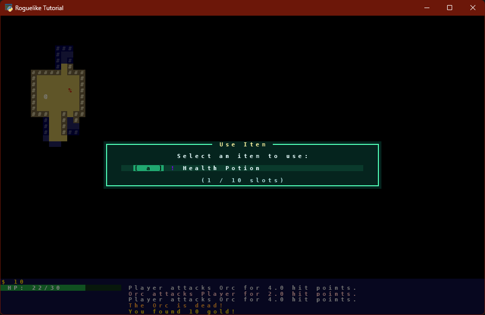
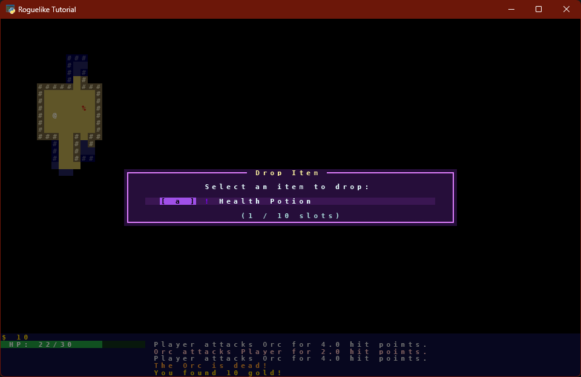
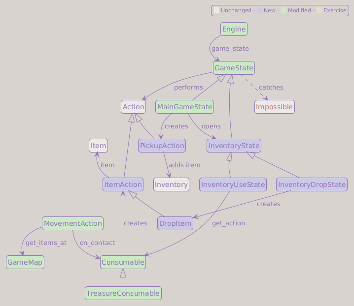
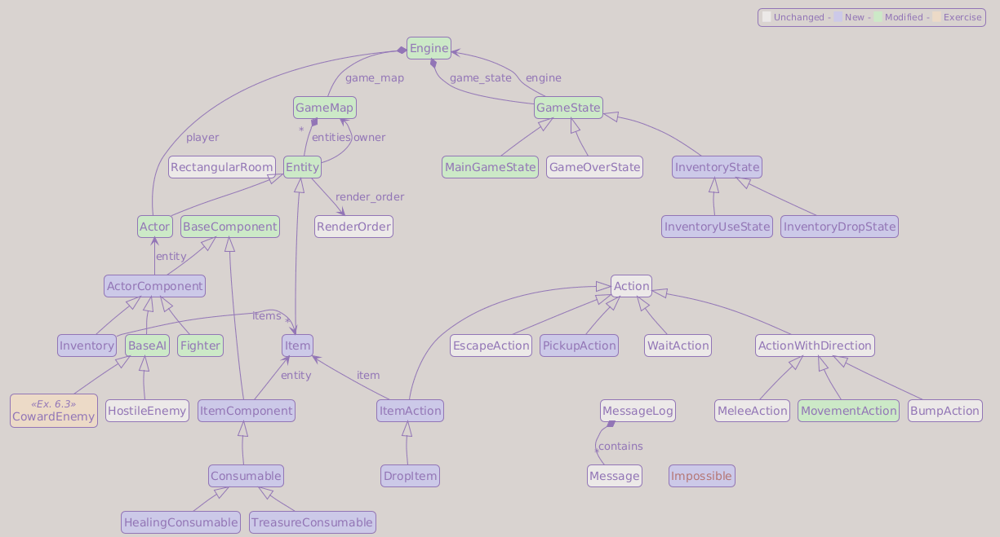

# Part 8b: Inventory

In **Part 8a** we built the item data model: items exist in the dungeon, and can be seen but not touched. This part adds the player-facing side: actions, keyboard bindings, and the inventory overlay.

## What You Will Build

By the end of **Part 8b**, the player can pick up health potions with `G`, browse the inventory with `I`, use items by letter, drop items with `D`, and collect treasure chests by walking over them. A gold counter appears above the HP bar.

## Learning goals

In this part we will:

- Implement `PickupAction`, `ItemAction`, and `DropItem`
- Refactor `GameState` so each state controls its own post-action flow
- Build the inventory overlay using the modal state pattern
- Add treasure chests as auto-collected items with a gold counter
- Remove the vi movement keys so their letters are free for actions and items

---

## Background

This section is for reading; there is nothing to type yet. If you want to start building right away, skip to [Update `game/actions.py`](#update-gameactionspy). You can come back here at any time, even after you finish the tutorial, when you know the game from the inside and some of these ideas will mean more.

### Who decides what happens after an action?

Until now, `Engine.handle_events()` ran the whole cycle: it asked the active state for an action, performed it, ran the enemy turns, and updated the field of view. With one state, that was enough.

The inventory overlay changes this. When the player selects an item in the overlay, the game must use the item and then close the overlay, going back to `MainGameState`. The engine cannot make that switch, because it does not know which state to go back to. The state does: the overlay knows it was opened from the map, so it knows it must close.

So in this part the cycle moves into `GameState.handle_events()`. Each state then decides what happens after an action, and the engine only passes events to the current state.

### Modal screens

A *modal* screen takes all the input until it closes: while the inventory is open, letter keys select items instead of moving the player. We already have one modal screen: `GameOverState` from Part 7 draws an overlay on top of the map and handles its own keys.

The inventory overlay is the same kind of state. It overrides `on_render()` to draw on top of the map, and `event_keydown()` to handle its own keys. It closes in one of two ways:

- The player selects a valid item. The action runs, and then `GameState.handle_events()` switches back to `MainGameState`.
- The player presses `Escape`. `event_keydown()` sets the state directly and returns no action, so no turn passes.

Any state can open any other state. The current state is simply `self.engine.game_state`, so there is no stack of states to maintain.

---

## Update `game/actions.py`

Add the three new action classes and two new imports at the top of the file:

```diff
-from game.entities.entity import Actor
+from game.entities.entity import Actor, Item
+from game.exceptions import Impossible
 from game.message_log import MessageLog
```

```python
class PickupAction(Action):

    def perform(self, engine: Engine, entity: Entity) -> None:
        assert isinstance(entity, Actor)
        inventory = entity.inventory

        for item in engine.game_map.items:
            if entity.x == item.x and entity.y == item.y:
                if not inventory.add_item(item, game_map=engine.game_map):
                    raise Impossible("Your inventory is full.")

                MessageLog.add_message(f"You picked up the {item.name}!")
                return

        raise Impossible("There is nothing here to pick up.")


class ItemAction(Action):

    def __init__(self, item: Item) -> None:
        super().__init__()
        self.item = item

    def perform(self, engine: Engine, entity: Entity) -> None:
        assert isinstance(entity, Actor)
        self.item.consumable.activate(self, engine, entity)


class DropItem(ItemAction):

    def perform(self, engine: Engine, entity: Entity) -> None:
        assert isinstance(entity, Actor)
        if not entity.inventory.drop_item(self.item, engine.game_map):
            raise Impossible("You don't have that.")

        MessageLog.add_message(f"You dropped the {self.item.name}.")
```

`PickupAction` iterates `engine.game_map.items` (the new property) looking for an item at the player's position. If found, it delegates to `inventory.add_item()`, which removes the item from the map's entity set, transfers ownership to the inventory, and appends it to `inventory.items`. Both trailing `raise Impossible` statements ensure the player always gets feedback.

`ItemAction` delegates to `consumable.activate()`. `DropItem` extends `ItemAction` because dropping also needs the item reference, but calls `inventory.drop_item()` instead, raising `Impossible` on the `False` case the same way `PickupAction` does for a full inventory.

The `assert isinstance(entity, Actor)` lines make a rule explicit. `Action.perform` accepts any `Entity`, but these three actions need an `Actor`, because only actors have an `inventory`. The assert checks this at runtime. It also tells the type checker that `entity` is an `Actor` from that line on, so the attribute accesses after it need no cast.

Also add `PickupAction` to the import list at the top of `game/game_states.py`:

```diff
-from game.actions import (
-    Action,
-    BumpAction,
-    EscapeAction,
-    WaitAction,
-)
+from game.actions import (
+    Action,
+    BumpAction,
+    EscapeAction,
+    PickupAction,
+    WaitAction,
+)
```

Now that `ItemAction` exists, import it at module level, add `get_action()` to `Consumable` in `game/entities/components/consumable.py`, and tighten the `_action` annotations to `ItemAction`:

```diff
+from game.actions import ItemAction
 from game.data import colors
 ...

 if TYPE_CHECKING:
     from game.actions import Action
```

```diff
 class Consumable(ItemComponent):
+
+    def get_action(self, _consumer: Actor, _engine: Engine) -> Action | None:
+        """Return the action this consumable produces when used."""
+        return ItemAction(item=self.entity)
+
-    def activate(self, _action: Action, _engine: Engine, _consumer: Actor) -> None:
+    def activate(self, _action: ItemAction, _engine: Engine, _consumer: Actor) -> None:
```

```diff
-    def activate(self, _action: Action, _engine: Engine, consumer: Actor) -> None:
+    def activate(self, _action: ItemAction, _engine: Engine, consumer: Actor) -> None:
```

```diff
-    def activate(self, _action: Action, engine: Engine, consumer: Actor) -> None:
+    def activate(self, _action: ItemAction, engine: Engine, consumer: Actor) -> None:
```

`get_action()` returns the action produced by using this item. The base implementation returns a plain `ItemAction`, but future consumable types can override it to request additional input before acting, for example a targeting scroll that needs a destination tile.

Moving `ItemAction`'s import to module level is safe for the same reason as the `TYPE_CHECKING` imports in Part 8a: `entity.py` only refers to `Consumable` under `TYPE_CHECKING`, so nothing on the `actions.py` → `entity.py` path imports `consumable.py` back.

---

## Move action execution into `GameState`

The inventory overlay must close itself *after* its action runs, and only the state knows which state comes next (see [Who decides what happens after an action?](#who-decides-what-happens-after-an-action) in the Background). So the action cycle moves from the engine into `GameState.handle_events()`.

Update `game/engine.py`. The `handle_events` signature changes from `Iterable[Any]` to `Iterable[tcod.event.Event]`, so `Any` is no longer needed. `engine.py` also stops importing `GameOverState`: from now on, `GameState.handle_events` in `game_states.py` is the code that switches to it:

```diff
-from typing import Any

 import tcod.event
 ...
-from game.game_states import GameOverState, GameState, MainGameState
+from game.game_states import GameState, MainGameState
```

Then simplify `handle_events()` to a one-line dispatch:

```diff
-def handle_events(self, events: Iterable[Any]) -> None:
+def handle_events(self, events: Iterable[tcod.event.Event]) -> None:
     for event in events:
-        action = self.game_state.handle_events(event)
-        if action is None:
-            continue
-
-        action.perform(self, self.player)
-
-        if self.player.is_alive:
-            self.handle_enemy_turns()
-
-        self.update_fov()  # recompute after every action
-
-        if not self.player.is_alive:
-            self.game_state = GameOverState(self)
+        self.game_state.handle_events(event)
```

Also add `INVALID` to `game/data/colors.py`, since the rewritten `handle_events` uses it for rejection messages:

```diff
 GOLD                = Color(255, 215,   0)
+INVALID             = Color(255, 255,   0)
```

`INVALID` is yellow: it is used for every rejection the player should read, from a full inventory to an already-healed condition.

Now rewrite `GameState.handle_events()` in `game/game_states.py` to own the full execution cycle. `from game.data import colors` was already imported in Part 7; only `Impossible` is new:

```diff
+from game.exceptions import Impossible
 from game.message_log import MessageLog
```

The rewritten method checks `isinstance(self.engine.game_state, (InventoryUseState, InventoryDropState))`, but neither class exists yet. Add these placeholder classes at the bottom of the file, so the names exist from the start. The base class logs a message and returns to `MainGameState` on any key. That way, pressing `I` or `D` before the real overlay exists gives feedback instead of leaving the game stuck. The "Inventory states" section below replaces all three classes:

```python
class InventoryState(GameState):
    """Base class for inventory screens (use and drop share the same UI)."""

    def __init__(self, engine: Engine) -> None:
        super().__init__(engine)
        MessageLog.add_message("Inventory not implemented yet.", colors.INVALID)

    def event_keydown(self, _event: tcod.event.KeyDown) -> Action | None:
        self.engine.game_state = MainGameState(self.engine)
        return None


class InventoryUseState(InventoryState):
    pass


class InventoryDropState(InventoryState):
    pass
```

```python
def handle_events(self, event: tcod.event.Event) -> None:
    action: Action | None = None

    match event:
        case tcod.event.Quit():
            action = EscapeAction()

        case tcod.event.MouseMotion():
            self.engine.mouse_location = event.integer_position

        case tcod.event.KeyDown():
            action = self.event_keydown(event)  # pylint: disable=assignment-from-none

    if action is not None:
        try:
            action.perform(self.engine, self.engine.player)

        except Impossible as ex:
            MessageLog.add_message(str(ex), colors.INVALID)
            return

        if self.engine.player.is_alive:
            self.engine.handle_enemy_turns()

        if not self.engine.player.is_alive:
            self.engine.game_state = GameOverState(self.engine)

        elif isinstance(self.engine.game_state, (InventoryUseState, InventoryDropState)):
            self.engine.game_state = MainGameState(self.engine)

        self.engine.update_fov()
```

The return type of `handle_events` changes from `Action | None` to `None`, because the method now runs the action itself instead of returning it. Remember to change the signature line too.

Key differences from the old engine code:

- `except Impossible as ex:` catches any rejection, logs it with `colors.INVALID`, and returns early so enemies do not take their turn on a failed action.
- After a successful action, if the current state is an inventory state, it switches back to `MainGameState`. Opening the inventory does not advance time; using or dropping an item does.

!!! note "What Impossible is for"
    `Impossible` is only for rejections that are worth telling the player about: a full inventory, an already-healed condition, nothing to pick up.

    Low-level movement failures (walking into a wall, trying to walk off the map) do not raise `Impossible`. Those actions still cost a turn, because the player pressed a key and tried something. But a log message for every wall collision would be noise.

    The rule is: if the player needs to read why an action failed, raise `Impossible`; if the failure is obvious from what is on screen, return silently.

!!! info "Why an exception instead of a result-object?"
    Part 8a chose `raise Impossible(...)` over the other common option: a result-object, for example `ActionResult(success, message)`. A result-object needs no exceptions, and a caller can inspect the result and decide what to do next. The cost is that every function in between has to check the result and pass it on. That repeated pass-it-on code is what the comment below calls plumbing.

    Here is the same `activate()` → `perform()` chain you just built, shown with the result-object mechanism instead:

    ```python
    def activate(self) -> ActionResult:
        if not target:
            return ActionResult(success=False, message="No valid target.")
        ...
        return ActionResult(True)

    def perform(self) -> ActionResult:
        result = self.item.activate()
        if not result.success:
            return result  # <-- plumbing: result needs to be resent
        ...
        return ActionResult(True)

    ...

    result = action.perform()
    if result.success:
        foo()
    else:
        bar()
    ```

    Compare that with what you just wrote: `raise Impossible(...)` exits directly to the single `except Impossible` above, with no intermediate function touched.

    The [2019 tutorial](https://www.rogueliketutorials.com/tutorials/tcod/2019/part-8/) used the result-object shape, but as a plain dict: `results.append({"consumed": False, "message": Message("You are already at full health", ...)})`. Every caller up the chain had to inspect `consumed` and decide whether to keep going.

!!! note "If you kept the Part 1 turn counter"
    Moving `action.perform(...)` out of `Engine.handle_events` also moves the only place `self.turn_count += 1` used to live. Add it back on the successful-action path, right after the `except` block: a turn that raises `Impossible` should not count, because the player did not actually act.

    ```diff
        if action is not None:
            try:
                action.perform(self.engine, self.engine.player)

            except Impossible as ex:
                MessageLog.add_message(str(ex), colors.INVALID)
                return

    +        # Part-1. Exercise 3: Add a wait action
    +        self.engine.turn_count += 1
    +
            if self.engine.player.is_alive:
                self.engine.handle_enemy_turns()
    ```

!!! note "If you kept the Part 4 fading-memory exercise"
    Moving the update loop out of `Engine.handle_events` also moves the only place `self.update_memory()` used to run. Add it back right before `update_fov()`:

    ```diff
            elif isinstance(self.engine.game_state, (InventoryUseState, InventoryDropState)):
                self.engine.game_state = MainGameState(self.engine)

    +        # Part-4. Exercise 4: Fading memory
    +        if self.engine.fading_memory:
    +            self.engine.update_memory()
    +
            self.engine.update_fov()
    ```

!!! note "If you kept the Part 7 Page Up/Down scroll exercise"
    Your `keys.LOG_SCROLL_UP` / `keys.LOG_SCROLL_DOWN` check already lives in this method, at the start of the `case tcod.event.KeyDown():` branch. Keep it there when you rewrite the method, before `action = self.event_keydown(event)`.

    Its two `return None` lines become a plain `return`, because the method no longer returns an action. They still exit before any action runs, the same way the `except Impossible` branch returns early: scrolling never reaches `event_keydown` and never costs a turn.

---

## Trim movement keys

Since Part 1, the vi keys (`b`, `h`, `j`, `k`, `l`, `n`, `u`, `y`) also move the player (Part 1 explains where they come from). The arrow keys and the numpad cover the same directions, and we now need those letters: this chapter adds `G`, `I`, and `D` as action keys, and Exercise 3 gives the remaining letters to items, so the player can use them directly from the map.

Remove the vi keys block from `MOVE_KEYS` in `game/data/keys.py`:

```diff
     tcod.event.KeySym.KP_9:     ( 1, -1), # RIGHT - UP
-
-    # Vi keys
-    tcod.event.KeySym.B:        (-1,  1), # LEFT  - DOWN
-    tcod.event.KeySym.J:        ( 0,  1), #         DOWN
-    tcod.event.KeySym.N:        ( 1,  1), # RIGHT - DOWN
-    tcod.event.KeySym.H:        (-1,  0), # LEFT
-    tcod.event.KeySym.L:        ( 1,  0), # RIGHT
-    tcod.event.KeySym.Y:        (-1, -1), # LEFT  - UP
-    tcod.event.KeySym.K:        ( 0, -1), #         UP
-    tcod.event.KeySym.U:        ( 1, -1), # RIGHT - UP
 }
```

!!! info "Numpad vs. regular number keys"
    `tcod.event.KeySym.KP_1`–`KP_9` are different key codes from `tcod.event.KeySym.N1`–`N9`. Numpad keys still work for movement. Regular number keys (`1`–`9`, `0`) remain free for future use, such as equipment slots in Part 13.

!!! warning "No numpad, no default diagonals"
    Some laptop keyboards have no numpad. On those keyboards, removing the vi keys leaves no diagonal movement: the arrow keys only cover the four cardinal directions. This tutorial does not add a replacement binding for that case; add your own keys to `MOVE_KEYS` in `game/data/keys.py` if you need diagonals without a numpad.

---

## Update `MainGameState`

The three new actions get named bindings in `game/data/keys.py` first, like every key since Part 5. Add them at the end of the file:

```python
KEY_PICKUP      = tcod.event.KeySym.G
KEY_INVENTORY   = tcod.event.KeySym.I
KEY_DROP        = tcod.event.KeySym.D
```

Then add the three checks at the end of `event_keydown`:

```diff
         if key == keys.KEY_QUIT_GAME:
             return EscapeAction()

+        if key == keys.KEY_PICKUP:
+            return PickupAction()
+
+        if key == keys.KEY_INVENTORY:
+            self.engine.game_state = InventoryUseState(self.engine)
+
+        if key == keys.KEY_DROP:
+            self.engine.game_state = InventoryDropState(self.engine)
+
         return None
```

`G` returns a `PickupAction`; the action system handles the rest. `I` and `D` do not return actions; they switch the active state immediately. The overlay then handles the next key press.

!!! tip "Run it now"
    If you run the game at this point, you can check that movement, combat, and the message log still behave exactly as before: the engine refactor moved code around without changing what it does.

    Then try the three new keys. `G` over a health potion picks it up and logs a message. `I` and `D` switch to the inventory state and immediately show "Inventory not implemented yet." in yellow, instead of leaving the game unresponsive. That confirms the key bindings and the stub are both wired correctly, before the next section replaces the stub with a real overlay.

---

## Inventory states

Three new state classes go at the bottom of `game/game_states.py`.

Add the inventory overlay colors to `game/data/colors.py`:

```diff
 INVALID             = Color(255, 255,   0)
+
+# Inventory overlay colors
+INVENTORY_MENU_TITLE = Color(255, 245, 160)
+INVENTORY_MENU_TEXT  = Color(232, 255, 255)
+INVENTORY_MENU_DIM   = Color(168, 216, 216)
+INVENTORY_MENU_KEY   = BLACK
+
+INVENTORY_USE_FG     = Color( 80, 255, 184)
+INVENTORY_USE_BG     = Color(  5,  36,  30)
+INVENTORY_USE_ACCENT = Color( 32, 168, 112)
+INVENTORY_USE_ROW_BG = Color( 10,  58,  44)
+
+INVENTORY_DROP_FG     = Color(224, 128, 255)
+INVENTORY_DROP_BG     = Color( 38,  14,  58)
+INVENTORY_DROP_ACCENT = Color(160,  80, 232)
+INVENTORY_DROP_ROW_BG = Color( 58,  22,  82)
```

The inventory overlay uses two distinct color schemes: green tones for item use (activation) and purple tones for item dropping. At a glance, the player always knows which overlay is open. The `INVENTORY_MENU_*` constants are shared by both schemes: title, text, and dim shades that look the same in either overlay, plus the key badge foreground.

Item names come from data, so a very long name could overflow the panel. A small helper trims text to a maximum width and marks the cut with `...`. Add it to `game/game_states.py`, next to `_draw_panel` from Part 7:

```python
def _trim_text(text: str, max_width: int) -> str:
    ellipsis = "..."

    if len(text) <= max_width:
        return text

    if max_width <= len(ellipsis):
        return text[:max_width]

    return text[:max_width - len(ellipsis)] + ellipsis
```

One more binding before the states themselves: the overlay closes with `Escape`, and that gets its own name in `game/data/keys.py`, right after `KEY_QUIT_GAME`:

```diff
 KEY_QUIT_GAME   = tcod.event.KeySym.ESCAPE
+KEY_EXIT        = tcod.event.KeySym.ESCAPE
```

!!! question "Two names for the same key?"
    `KEY_QUIT_GAME` and `KEY_EXIT` both map to `ESCAPE`, on purpose. The name records *intent*: `KEY_QUIT_GAME` ends the program, `KEY_EXIT` closes an overlay and returns to the map.

    Today they happen to share a physical key. If you later decide overlays should close with `Q` or `Backspace` instead, that is a one-line remap in `keys.py`; with a single shared constant, the two meanings would be mixed, and you would have to find and check every place that uses it.

Now the three state classes, replacing the `InventoryUseState`/`InventoryDropState` stubs from earlier.

`InventoryState.on_render()` is the longest method in this chapter; it draws the overlay in five steps, in order:

- Dim the map behind it.
- Size the panel to fit the content.
- Draw the frame with its title and prompt.
- List the items (or an empty message).
- Print the slot counter along the bottom.

The prose after the listing walks through each step.

Add `Item` to the imports at the top of `game_states.py` so that `on_item_selected` can use it as a type annotation:

```diff
 if TYPE_CHECKING:
     from game.engine import Engine
+    from game.entities.entity import Item
```

```python
class InventoryState(GameState):
    """Base class for inventory screens (use and drop share the same UI)."""

    TITLE        = "<missing title>"
    PROMPT       = "<missing prompt>"
    EMPTY_TEXT   = "Your pack is empty."
    FG_COLOR     = colors.WHITE
    BG_COLOR     = colors.BLACK
    ACCENT_COLOR = colors.WHITE
    ROW_BG_COLOR = colors.BLACK

    def on_render(self, console: tcod.console.Console) -> None:
        super().on_render(console)  # draws the map behind the overlay

        # Dim the map background to highlight the inventory
        console.fg[:] = console.fg // 2
        console.bg[:] = console.bg // 2

        inventory = self.engine.player.inventory
        number_of_items_in_inventory = len(inventory.items)

        slot_count   = f"({len(inventory.items)} / {inventory.capacity} slots)"
        max_height   = console.height - 4
        height       = min(max(8, number_of_items_in_inventory + 7), max_height)
        visible_rows = min(number_of_items_in_inventory, max(0, height - 7))

        item_width = max((len(item.name) for item in inventory.items), default=0) + 18
        width = min(
            console.width - 4,
            max(
                46,
                len(self.TITLE) + 4,
                len(self.PROMPT) + 6,
                len(slot_count) + 6,
                item_width,
            ),
        )

        x = (console.width  - width)  // 2
        y = (console.height - height) // 2

        # Draw the inventory box
        _draw_panel(console, x, y, width, height, self.FG_COLOR, self.BG_COLOR)

        title = f" {self.TITLE} "
        # Draw the inventory title over the frame
        console.print(
            x    = x + (width - len(title)) // 2,
            y    = y,
            text = title,
            fg   = colors.INVENTORY_MENU_TITLE,
            bg   = self.BG_COLOR,
        )

        # Draw the main help text
        console.print(
            x         = console.width // 2,
            y         = y + 2,
            text      = self.PROMPT,
            fg        = colors.INVENTORY_MENU_TEXT,
            alignment = tcod.constants.CENTER,
        )

        row_x = x + 3
        row_width = width - 6
        if visible_rows > 0:
            name_width = max(1, row_width - 12)
            for i, item in enumerate(inventory.items[:visible_rows]):
                item_key = chr(ord("a") + i)
                row_y = y + 4 + i

                # Draw the background for one item row
                console.draw_rect(
                    x      = row_x,
                    y      = row_y,
                    width  = row_width,
                    height = 1,
                    ch     = ord(" "),
                    bg     = self.ROW_BG_COLOR,
                )

                # Draw the key that selects this item
                console.print(
                    row_x + 2,
                    row_y,
                    f"[ {item_key} ]",
                    fg = colors.INVENTORY_MENU_KEY,
                    bg = self.ACCENT_COLOR,
                )

                # Draw the item glyph using its own color
                console.print(
                    row_x + 8,
                    row_y,
                    item.char,
                    fg = item.color,
                    bg = self.ROW_BG_COLOR,
                )

                # Draw the item name, trimmed if it does not fit
                console.print(
                    row_x + 10,
                    row_y,
                    _trim_text(item.name, name_width),
                    fg = colors.INVENTORY_MENU_TEXT,
                    bg = self.ROW_BG_COLOR,
                )

        else:
            row_y = y + 4

            # Draw the empty row when there are no items
            console.draw_rect(
                x      = row_x,
                y      = row_y,
                width  = row_width,
                height = 1,
                ch     = ord(" "),
                bg     = self.ROW_BG_COLOR,
            )

            # Draw the empty-inventory message
            console.print(
                x         = console.width // 2,
                y         = row_y,
                text      = self.EMPTY_TEXT,
                fg        = colors.INVENTORY_MENU_DIM,
                bg        = self.ROW_BG_COLOR,
                alignment = tcod.constants.CENTER,
            )

        # Draw the used-slots counter after the item list
        console.print(
            x         = console.width // 2,
            y         = y + height - 2,
            text      = slot_count,
            fg        = colors.INVENTORY_MENU_DIM,
            bg        = self.BG_COLOR,
            alignment = tcod.constants.CENTER,
        )

    def event_keydown(self, event: tcod.event.KeyDown) -> Action | None:
        player = self.engine.player
        key = event.sym
        index = key - tcod.event.KeySym.A

        if 0 <= index <= 25:
            try:
                selected_item = player.inventory.items[index]
            except IndexError:
                MessageLog.add_message("Invalid entry.", colors.INVALID)
                return None

            return self.on_item_selected(selected_item)

        if key == keys.KEY_EXIT:
            self.engine.game_state = MainGameState(self.engine)
            return None

        return super().event_keydown(event)

    def on_item_selected(self, item: Item) -> Action | None:
        raise NotImplementedError()
```

`on_render()` renders the map first via `super()`, dims it with the same `// 2` trick introduced in Part 7 for the game-over screen, and then draws the box with `_draw_panel()` (shadow, fill, frame). Nothing new there: the overlay reuses the same code as the game-over panel.

The panel layout is fixed at the top and grows downward with the item list. Row `y` carries the frame and the centered title; `y+2` prints the `PROMPT` help text; item rows start at `y+4`. The used-slots counter (`(3 / 10 slots)`) sits on the row above the bottom border, like a status line, and doubles as capacity feedback now that the inventory can fill up.

Each item row is drawn in four pieces: a one-row `draw_rect` with `ROW_BG_COLOR` that makes the row read as a single unit, the selection key as a badge (`[ a ]`, dark text over `ACCENT_COLOR`), the item sprite in its own color at `row_x + 8`, and the name at `row_x + 10`, passed through `_trim_text()` so a long name cannot break the layout. The badge-over-accent style makes the keys the player can press stand out from the text around them.

`width` adapts to the longest content line (title, prompt, counter, or item name plus its prefixes) with a floor of 46 cells, and is clamped to `console.width - 4` so the panel always leaves a margin. `height` follows the item count, with `visible_rows` recomputed from the clamped height so the loop never draws past the bottom border. When the inventory is empty, a single dim row prints `EMPTY_TEXT` instead of the item list.

`TITLE`, `PROMPT`, and the four color class variables follow the same class-variable pattern introduced in Part 7 for `GameOverState`. The next two classes each override them: green tones for activation, purple tones for dropping, so the player always knows which overlay is open at a glance.

Finally, `event_keydown()` converts the pressed key to an index: `a → 0`, `b → 1`, and so on. The range `0 <= index <= 25` covers exactly the 26 letters `a`-`z`. If the index falls outside the item list, it logs "Invalid entry." and returns `None`. Otherwise it calls `on_item_selected()`, which the two subclasses implement differently. `Escape` closes the overlay immediately by switching back to `MainGameState` without returning an action (so enemies do not take a turn).

```python
class InventoryUseState(InventoryState):
    TITLE        = "Use Item"
    PROMPT       = "Select an item to use:"
    FG_COLOR     = colors.INVENTORY_USE_FG
    BG_COLOR     = colors.INVENTORY_USE_BG
    ACCENT_COLOR = colors.INVENTORY_USE_ACCENT
    ROW_BG_COLOR = colors.INVENTORY_USE_ROW_BG

    def on_item_selected(self, item: Item) -> Action | None:
        return item.consumable.get_action(self.engine.player, self.engine)
```

**The use inventory overlay looks like this**:



```python
class InventoryDropState(InventoryState):
    TITLE        = "Drop Item"
    PROMPT       = "Select an item to drop:"
    FG_COLOR     = colors.INVENTORY_DROP_FG
    BG_COLOR     = colors.INVENTORY_DROP_BG
    ACCENT_COLOR = colors.INVENTORY_DROP_ACCENT
    ROW_BG_COLOR = colors.INVENTORY_DROP_ROW_BG

    def on_item_selected(self, item: Item) -> Action | None:
        from game.actions import DropItem

        return DropItem(item=item)
```

**The drop overlay shares the same layout**:



!!! info "Pattern: Template Method"
    `InventoryState` defines the complete algorithm (render the overlay, map keys to items, call `on_item_selected`) but leaves the final step as an abstract hook that each concrete subclass fills in. `InventoryUseState` uses the item; `InventoryDropState` drops it. The skeleton of the algorithm lives in the base class; the variation lives in the subclasses.

    The same structure appears with `on_index_selected` in `SelectIndexState` (Part 9).

    → [Refactoring Guru: Template Method](https://refactoring.guru/design-patterns/template-method) ([Python example](https://refactoring.guru/design-patterns/template-method/python/example))

`InventoryUseState` asks the item's consumable for an action; `InventoryDropState` returns a `DropItem`. The action is then executed by `GameState.handle_events()` and, because the current state is an inventory state, it automatically switches back to `MainGameState` after the action completes.

You will notice that `InventoryUseState` and `InventoryDropState` are referenced in `GameState.handle_events()`, which is defined earlier in the same file. This is fine in Python: method bodies are only executed when called, at which point all classes in the module are already defined.

!!! tip "Run it now"
    If you run the game now, `I` opens the "Use Item" overlay for real: the map dims, the framed panel appears, and a health potion shows up as a row with its `[ a ]` key badge. Selecting it while injured heals you and closes the overlay; at full health it logs the familiar "already full" rejection instead, and the overlay stays open. `D` opens the purple "Drop Item" overlay the same way; dropping an item always succeeds and closes it. Walking onto a chest still does nothing (that is the next section), but the pickup-use-drop loop for potions is complete, and confirming it now is easier than debugging it together with the chest logic later.

---

## Treasure chests

Part 8a defined both consumable types and spawned chests on the floor. The chest template and `auto_activate = True` are already in place. This section adds the pieces that make chests actually work: a `GameMap` helper, a contact method on `Consumable`, a contact check in `MovementAction`, and the HUD element that shows the accumulated gold.

### Auto-collect in `MovementAction`

`PickupAction` is triggered by the `G` key. But treasure should be collected automatically when the player steps on it. This requires three additions.

First, add a `GameMap.get_items_at(x, y)` helper that returns all items at a given position, matching the `get_actor_at` naming from Part 6. Reuse the module-level `Item` import added in Part 8a:

```python
def get_items_at(self, x: int, y: int) -> list[Item]:
    return [
        entity for entity in self.entities
        if isinstance(entity, Item) and entity.x == x and entity.y == y
    ]
```

Second, add an `on_contact` method to `Consumable`. It activates the item if `auto_activate` is set, using the standard `ItemAction` path:

```diff
 class Consumable(ItemComponent):
     auto_activate: bool = False

+    def on_contact(self, engine: Engine, consumer: Actor) -> None:
+        if self.auto_activate:
+            ItemAction(item=self.entity).perform(engine, consumer)
```

`TreasureConsumable` overrides `on_contact` so that only the player collects a chest; a wandering monster that steps on it leaves it untouched. Add the override in `game/entities/components/consumable.py`:

```diff
 class TreasureConsumable(Consumable):
     auto_activate = True

     def __init__(self, value: int) -> None:
         self.value = value

+    def on_contact(self, engine: Engine, consumer: Actor) -> None:
+        if consumer is engine.player:
+            super().on_contact(engine, consumer)
+
     def activate(self, _action: ItemAction, engine: Engine, consumer: Actor) -> None:
```

Third, after `entity.move()` in `MovementAction.perform()`, trigger contact for every item on the new tile:

```diff
         entity.move(self.dx, self.dy)
+
+        if isinstance(entity, Actor):
+            for item in engine.game_map.get_items_at(entity.x, entity.y):
+                item.consumable.on_contact(engine=engine, consumer=entity)
```

The `isinstance(entity, Actor)` check satisfies the type checker: `on_contact` expects an `Actor`, and `entity` in `MovementAction` is annotated as the wider `Entity` type. In practice any entity that moves will be an actor.

`get_items_at()` returns a fresh list, so `activate()` can safely modify `game_map.entities` during iteration. The `MovementAction` wiring has no player check: it fires `on_contact` for every actor that steps on the tile. The decision to react lives in the consumable: `TreasureConsumable` only acts when the consumer is the player (so a wandering monster cannot take a chest), while a different consumable could choose to react to anyone.

### `render_gold` in `hud.py`

Add a one-line gold display above the HP bar:

```python
def render_gold(
    console: Console,
    gold: int,
    y: int = 44,
) -> None:
    console.print(
        x    = 0,
        y    = y,
        text = f"$ {gold}",
        fg   = colors.GOLD,
    )
```

Call it from `Engine.render()`:

```diff
     hud.render_bar(...)
+
+    hud.render_gold(
+        console = console,
+        gold    = self.player.inventory.gold,
+    )
```

---

## Testing Part 8b

Run the game and verify the following:

- Health potions (`!`) appear on the dungeon floor.
- Walking over a potion and pressing `G` adds it to the inventory and shows "You picked up the Health Potion!".
- Pressing `G` on an empty tile shows "There is nothing here to pick up." in yellow.
- Pressing `I` opens the "Use Item" overlay: the map dims, a framed panel with a drop shadow appears, and carried items are listed as rows with `[ a ]`-style key badges.
- The overlay shows the used-slots counter (for example `(2 / 10 slots)`) at the bottom of the panel.
- Opening either overlay with an empty inventory shows the empty-pack message instead of item rows.
- Pressing the letter for a potion when injured heals the player and shows a green message.
- Pressing the letter for a potion at full health shows "Your health is already full." in yellow.
- Pressing `D` opens the "Drop Item" overlay in purple tones; selecting an item drops it at the player's feet.
- Pressing an out-of-range letter in the inventory overlay shows "Invalid entry." in yellow.
- Filling the inventory to capacity and picking up one more item shows "Your inventory is full." in yellow.
- Pressing `Escape` in either overlay returns to the map without an enemy turn (no action was performed).
- Enemies still act on their turn after the player successfully uses or drops an item.
- Enemies do *not* act when the player tries to pick up from an empty tile (a failed action costs no turn).
- Chests (`$`) appear on the dungeon floor. Walking over one shows "You found 10 gold!" and the `$` symbol disappears.
- A monster that steps on a chest leaves it in place; only the player collects it.
- The gold counter above the HP bar increments each time a chest is collected.

---

## Summary

The items from Part 8a are now part of play. Key additions:

- **`PickupAction`, `ItemAction`, `DropItem`**: pickup, use, and drop are actions, so they cost a turn like any other action, and they reject impossible requests with `Impossible`
- **`GameState.handle_events()`**: runs the whole action cycle; one `except Impossible` shows every rejection in the log, and a failed action costs no turn
- **`InventoryState`**: modal overlay base class; `InventoryUseState` and `InventoryDropState` override `TITLE`, `PROMPT`, the four color class variables, and `on_item_selected()`
- **`Consumable.get_action()` / `Consumable.on_contact()`**: an item decides which action it produces when used, and whether it reacts when an actor steps on it
- **`GameMap.get_items_at()` and `hud.render_gold()`**: chests are collected on contact, and the gold counter shows the total
- **`game/data/keys.py`**: vi keys removed; `KEY_PICKUP`, `KEY_INVENTORY`, `KEY_DROP`, and `KEY_EXIT` added

**Current architecture**:

- `Engine.handle_events()`: passes each event to the current state; it no longer performs actions
- `GameState.handle_events()`: performs the action, catches `Impossible`, runs the enemy turns, switches to `GameOverState` on death or back to `MainGameState` after an inventory action, and updates the FOV
- `MainGameState`: `G` returns a `PickupAction`; `I` and `D` open the inventory overlays directly, without an action
- `InventoryState`: draws over the dimmed map, maps `a` to `z` to items, and closes with `Escape` without spending a turn
- `Consumable.on_contact()`: activates the item via `ItemAction` when an actor steps on its tile and `auto_activate` is set; `TreasureConsumable` overrides it so only the player collects a chest
- `Impossible`: raised anywhere in the action chain and caught in one place

**Local Class Diagram**:



**Full Class Diagram** (all of Part 8):



**File structure**:

```text
main.py
game/
├── __init__.py
├── actions.py                  ← modified
├── engine.py                   ← modified
├── exceptions.py
├── hud.py                      ← modified
├── game_states.py              ← modified
├── message_log.py
├── data/
│   ├── __init__.py
│   ├── colors.py               ← modified
│   ├── keys.py                 ← modified
│   └── sprites.py
├── entities/
│   ├── __init__.py
│   ├── entity.py
│   ├── factories.py
│   ├── render_order.py
│   └── components/
│       ├── __init__.py
│       ├── ai.py
│       ├── base_component.py
│       ├── consumable.py       ← modified
│       ├── fighter.py
│       └── inventory.py
└── map/
    ├── __init__.py
    ├── game_map.py             ← modified
    ├── tile_types.py
    └── map_generator.py
```

---

## Exercises

The next parts assume you did these exercises. Try each one on your own first. If one is too hard for now, do not let it stop you: where a reference solution is given, read it and type it in, and when a later part builds on an exercise, it points out the code that comes from it.

!!! tip "Exercises 1 and 2 together make the game noticeably more fun"
    Stacking keeps the inventory list clean, and the backpack gives the player a reason to seek scrolls. Exercises 3 and 4 polish the user interface.

1. **Item stacking**:

    When the inventory shows items, group identical ones into a single row with a count, `[ a ] Health Potion (x3)`, instead of three separate lines. Items with the same `name` form a stack. This is a display-layer change: the underlying `Inventory.items` list is untouched, so dropping still removes one instance at a time and the stack just shrinks by one.

    ??? note "Reference implementation"
        Add two static helpers to `InventoryState`. `stack_items(items) -> list[list[Item]]` groups items by name (`dict.setdefault`); each stack is a `list[Item]` whose first element is used for display and selection (after Exercise 3, also sort the stacks here: `stacks.sort(key=lambda s: s[0].key or 0)`). `stack_name(stack) -> str` returns `"Health Potion (x3)"` when `len(stack) > 1`, else just the name.

        Then `on_render()` calls `stack_items()` and iterates over stacks, computing the panel width from `stack_name()` so the frame fits the longest entry. `event_keydown()` must use the stacks too: build them with `stack_items()` and select `stacks[index][0]`. If it still indexes `inventory.items`, the letter on a grouped row points to the wrong item. Exercise 3 later replaces this letter-to-index selection with fixed keys. (`Inventory.drop_item()` already removes the first matching item, so dropping needs no extra logic.)

2. **Backpack growing scroll**:

    Add a scroll that permanently grows the player's backpack, up to a ceiling. Make `max_capacity: int` a **required** parameter of `Inventory.__init__` (no default): that forces every `Actor` in `factories.py` to declare its ceiling (monsters get `max_capacity=0`, so they never expand), and a forgotten actor fails loudly at startup instead of silently inheriting 26. Each scroll is a permanent, irreversible upgrade (the player starts at `capacity=10`, gains `+4` per scroll, up to 26), so finding one is meaningful.

    ??? note "Reference implementation"
        `BackpackConsumable(amount: int)` raises `capacity` by `amount`, capped at `max_capacity`. Use `min()` for the actual gain, and raise `Impossible` if already at the cap before touching anything:

        ```python
        actual = min(self.amount, consumer.inventory.max_capacity - consumer.inventory.capacity)
        consumer.inventory.capacity += actual
        ```

        Add the visual constants: `BACKPACK_SCROLL = "?"` in `sprites.py` and a parchment `BACKPACK_SCROLL = Color(255, 224, 160)` in `colors.py`. After growing the capacity, log the gain in that color and `self.consume()`:

        ```python
        MessageLog.add_message(
            f"Your backpack grows by {actual} slots.",
            colors.BACKPACK_SCROLL,
        )
        self.consume()
        ```

        Finally wire a `backpack_scroll` item in `factories.py` (`sprites.BACKPACK_SCROLL`, `colors.BACKPACK_SCROLL`, name `"Backpack Growing Scroll"`) and add it to `item_chances` alongside the health potion and chest.

3. **Persistent item keys**:

    Right now the inventory letter for each item shifts whenever a preceding item is used or dropped: after consuming the first potion, what was `b` becomes `a`. Give each item type a **fixed hotkey**, assigned by the programmer in `factories.py`, that never changes regardless of inventory order (and `None` for auto-collected items like the chest, which need no shortcut). Because the key lives on the template object, `spawn()` copies it for free: no per-instance bookkeeping on pickup, consume or drop. The wiring touches a handful of places: the `Item` itself, the factories, the inventory render, the inventory's key handling, the main-game key handling (so a hotkey works without opening the inventory), and the pickup message.

    ??? note "Reference implementation"
        `Item.__init__` (`entity.py`): add `key: tcod.event.KeySym | None` as a required parameter, alongside `consumable`. The `| None` supports auto-collected items (the chest) that need no shortcut. Import `tcod.event` under `TYPE_CHECKING` (the annotation is a string at runtime thanks to `from __future__ import annotations`).

        `factories.py`: assign a mnemonic key per keyboard-interactive item, `None` for auto-collected ones. After Exercise 4 these raw values become `keys.*` constants:

        ```python
        health_potion   = Item(..., key=tcod.event.KeySym.H)   # becomes keys.HEALTH_POTION after Ex 4
        backpack_scroll = Item(..., key=tcod.event.KeySym.B)   # becomes keys.BACKPACK_SCROLL after Ex 4
        chest           = Item(..., key=None)
        ```

        `InventoryState.on_render()`: show the letter in the badge with `chr(item.key) if item.key is not None else "-"` (`KeySym` is an `IntEnum` whose letter values equal their ASCII codes, so `chr(KeySym.H)` is `'h'`). Add the key-based sort (`stacks.sort(key=lambda s: s[0].key or 0)`) inside `stack_items`, not here, so the order stays stable everywhere the stacks are used.

        `InventoryState.event_keydown()`: replace the index computation with a loop checking `stack[0].key is not None and stack[0].key == key`. After it (and the escape check), add a fallback for stray letters: if `ord("a") <= int(key) <= ord("z")`, log `"Invalid entry."` in `colors.INVALID` and return `None`.

        `MainGameState.event_keydown()`: add a fallback at the end that scans the inventory for an item whose `key` matches `event.sym` and calls `item.consumable.get_action()`. Same effect as opening the inventory and selecting it; if it needs targeting (Part 9), the targeting UI opens just the same.

        `PickupAction`: after the `"You picked up the ..."` message, if `item.key is not None`, log a second line. Import `from game.data.keys import key_label` and write `MessageLog.add_message(f"Press {key_label(item.key)} to use it.")` (`key_label` makes a badge like `[ H ]`; you add it in Exercise 4).

        With vi keys removed, `a`–`z` minus `g`, `i`, `d` gives 23 conflict-free hotkey slots.

4. **Item hotkey constants and `key_label`**:

    Exercise 3 wired the item hotkeys as raw `tcod.event.KeySym` values in `game/entities/factories.py`; they are the only bindings left outside `game/data/keys.py`. Bring them home as named constants (`HEALTH_POTION`, `BACKPACK_SCROLL`), and add a small `key_label` helper that formats a key as a badge like `[ H ]` or `[ Esc ]` (the pickup hint from Exercise 3 renders through it, and the Part 10 main menu will use it too).

    !!! tip "How `key_label` picks a name"
        Three rules, in order: an entry in `_SPECIAL_KEY_NAMES` wins first (`ESCAPE` becomes `Esc`); otherwise, a printable ASCII code (32 to 126) becomes `chr(v).upper()`, so the period key reads `.` instead of the verbose `"PERIOD"`; everything else falls back to `sym.name` (`"F1"`, `"KP_8"`, `"UP"`).

    ??? note "Reference implementation"
        Additions to `game/data/keys.py`. The helper goes near the top of the file, after the `tcod.event` import; the hotkey constants go at the end. The `LOG_SCROLL_*` block appears as context: it comes from Part 7 Exercise 2, not from this one:

        ```python
        # Part-8. Exercise 4: Item hotkey constants and key_label
        _SPECIAL_KEY_NAMES = {
            tcod.event.KeySym.ESCAPE: "Esc",
        }

        def key_label(sym: tcod.event.KeySym) -> str:
            v    = int(sym)
            name = _SPECIAL_KEY_NAMES.get(sym) or (chr(v).upper() if 32 <= v <= 126 else sym.name)
            return f"[ {name} ]"
        ```

        ```python
        # Part-7. Exercise 2: Scroll the message panel
        LOG_SCROLL_UP   = tcod.event.KeySym.PAGEUP
        LOG_SCROLL_DOWN = tcod.event.KeySym.PAGEDOWN

        # Part-8. Exercise 4: Item hotkey constants and key_label
        HEALTH_POTION   = tcod.event.KeySym.H
        BACKPACK_SCROLL = tcod.event.KeySym.B
        ```

        In `game/entities/factories.py`, import `keys`, drop the now-unused `import tcod.event`, and point the item hotkeys at the constants:

        ```diff
        -from game.data import colors, sprites
        +from game.data import colors, keys, sprites
        -import tcod.event
        ```

        ```diff
        -    key        = tcod.event.KeySym.H,
        +    key        = keys.HEALTH_POTION,
        ...
        -    key        = tcod.event.KeySym.B,
        +    key        = keys.BACKPACK_SCROLL,
        ```
