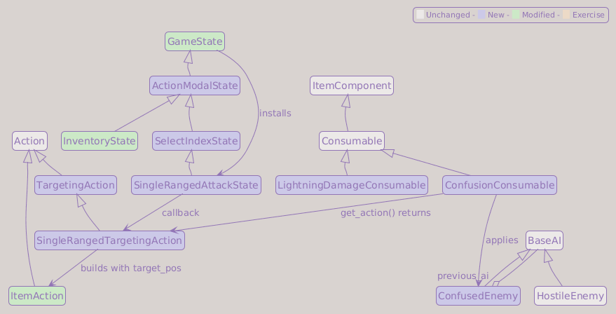

# Part 9a: Targeting

## What You Will Build

By the end of Part 9a, the player will be able to read two spell scrolls. A lightning bolt strikes the nearest enemy on its own. A confusion scroll opens a targeting cursor: the player picks an enemy with the keyboard or the mouse, and that enemy stumbles around for a few turns. Part 9b adds the fireball, which hits a whole area.

## Learning goals

In this part we will:

- Add a targeting cursor the player moves with keyboard or mouse
- Implement two spell scrolls: lightning bolt (auto-target) and confusion (cursor)
- Let an item ask for a target without making the game logic depend on the user interface
- Add a `ConfusedEnemy` AI that wanders randomly

---

## Background

This section is for reading; there is nothing to type yet. If you want to start building right away, skip to [Add entity.distance()](#add-entitydistance). You can come back here at any time, even after you finish the tutorial, when you know the game from the inside and some of these ideas will mean more.

### Targeting as a game state

So far, every keypress either moves the player or triggers an action. Spells that require targeting need a different mode: the player moves a cursor around the map and confirms a target, or presses Escape to cancel.

This is a job for the game states from Part 8. When the player uses a targeting scroll, we switch to a new game state. That state:

1. Intercepts all keyboard and mouse input
2. Draws the cursor (and, for an area spell, the area that will be hit) on every frame
3. On confirm, runs the action and returns to `MainGameState`
4. On Escape, cancels and returns to `MainGameState`

```text
MainGameState
  │  player presses i → use scroll
  ▼
InventoryUseState
  │  scroll.consumable.get_action() returns TargetingAction
  ▼
GameState.handle_events()
  │  isinstance dispatch: installs targeting state
  ▼
SingleRangedAttackState
  │  player confirms target
  ▼
MainGameState  (back to normal play)
```

---

## Add entity.distance()

The spell code needs a reusable way to measure the distance from an entity to a map coordinate. `entity.py` did not need `math` before this chapter, so add the import at the top of the file:

```diff
 import copy
+import math
 from typing import TYPE_CHECKING
```

Then add the method to `Entity`:

```python
def distance(self, x: int, y: int) -> float:
    return math.hypot(self.x - x, self.y - y)
```

!!! tip "`math.hypot` vs manual sqrt"
    `math.hypot(a, b)` computes `sqrt(a² + b²)` in one call. It is more readable than `math.sqrt(a*a + b*b)`, numerically stable, and about as fast.

    When you only need to *compare* a distance against a threshold, you can skip `sqrt` entirely: `dx*dx + dy*dy <= r*r` is equivalent to `hypot(dx, dy) <= r` but avoids any floating-point root. Part 9b uses that trick in `get_aoe_tiles_in_radius` (`aoe` stands for Area of Effect).

---

## ActionModalState: a marker for auto-closing states

Some states (inventory screens, targeting cursors, ...) should return the player
to normal gameplay automatically after a successful action. In Part 8,
`handle_events` identified these states by listing them explicitly:

```python
elif isinstance(self.engine.game_state, (InventoryUseState, InventoryDropState)):
    self.engine.game_state = MainGameState(self.engine)
```

Adding targeting states would mean extending that tuple every time. Instead,
we are going to introduce a shared base class that expresses the intent once:

```python
class ActionModalState(GameState):
    """State that returns to the main game after a successful action."""
```

Any state that inherits from `ActionModalState` closes automatically after a successful action.

Update `InventoryState` from Part 8 to inherit from it:

```diff
-class InventoryState(GameState):
+class InventoryState(ActionModalState):
```

And update the isinstance check in `GameState.handle_events`:

```diff
-elif isinstance(self.engine.game_state, (InventoryUseState, InventoryDropState)):
+elif isinstance(self.engine.game_state, ActionModalState):
     self.engine.game_state = MainGameState(self.engine)
```

Adding a new modal state in the future requires no changes to `handle_events`.

!!! tip "Run it now"
    If you run the game now, it should play exactly as at the end of Part 8: this was a refactor, so nothing visible changes. Once an enemy has hurt you, open the inventory with `i`, drink a potion, and check that the overlay still closes by itself. Do it again with `d` to drop an item. Running the game after a refactor like this one is a good habit: if something broke, you know it was this small change.

---

## SelectIndexState: cursor base class

This part builds `SingleRangedAttackState`, a cursor that selects a single tile. Part 9b adds `AreaRangedAttackState`, a cursor that highlights the area a spell will hit. Both share cursor movement, keyboard shortcuts, and mouse-click logic. `SelectIndexState` holds that common behavior, so each concrete state only needs to implement `on_index_selected`.

Before writing the class, add the cursor navigation constants to `game/data/keys.py`:

```diff
 KEY_QUIT_GAME   = tcod.event.KeySym.ESCAPE
 KEY_EXIT        = tcod.event.KeySym.ESCAPE
+KEY_SELECT      = {tcod.event.KeySym.RETURN, tcod.event.KeySym.KP_ENTER}
+
+CURSOR_FAST     = tcod.event.Modifier.LSHIFT | tcod.event.Modifier.RSHIFT  # x5
+CURSOR_FASTER   = tcod.event.Modifier.LCTRL  | tcod.event.Modifier.RCTRL   # x10
```

`KEY_EXIT` already exists from Part 8 and closes any modal overlay (menus, cursors, dialogs), so the cursor reuses it. We only add `KEY_SELECT`, `CURSOR_FAST`, and `CURSOR_FASTER`.

Now add to `game/game_states.py`:

```python
class SelectIndexState(ActionModalState):
    """Base for states that ask the player to select a map tile."""

    def __init__(self, engine: Engine) -> None:
        super().__init__(engine)
        player = self.engine.player
        engine.mouse_location = player.x, player.y

    def on_render(self, console: tcod.console.Console) -> None:
        super().on_render(console)

        x, y = self.engine.mouse_location
        if self.engine.game_map.in_bounds(x, y):
            console.bg[x, y] = colors.WHITE
            console.fg[x, y] = colors.BLACK

    def event_keydown(self, event: tcod.event.KeyDown) -> Action | None:
        key = event.sym
        if key in keys.MOVE_KEYS:
            modifier = 1
            if event.mod & keys.CURSOR_FAST:
                modifier *= 5
            if event.mod & keys.CURSOR_FASTER:
                modifier *= 10

            x, y = self.engine.mouse_location
            dx, dy = keys.MOVE_KEYS[key]
            x = max(0, min(x + dx * modifier, self.engine.game_map.width - 1))
            y = max(0, min(y + dy * modifier, self.engine.game_map.height - 1))
            self.engine.mouse_location = x, y

            return None

        if key in keys.KEY_SELECT:
            return self.on_index_selected(*self.engine.mouse_location)

        if key == keys.KEY_EXIT:
            self.engine.game_state = MainGameState(self.engine)
            return None

        return super().event_keydown(event)

    def event_mousebuttondown(self, event: tcod.event.MouseButtonDown) -> Action | None:
        x, y = event.integer_position
        if self.engine.game_map.in_bounds(x, y) and event.button == 1:
            return self.on_index_selected(x, y)

        return None

    def on_index_selected(self, x: int, y: int) -> Action | None:
        raise NotImplementedError()
```

The cursor starts at the player's position. Each key press moves it one tile; with Shift held it moves 5 tiles, with Ctrl 10, and with both 50, which helps on large maps. Enter or left-click confirms the selection.

Escape cancels targeting and returns to normal gameplay.

---

## SingleRangedAttackState

The targeting states receive a function as a parameter, so they need a type for "a function". Add this import at the top of `game/game_states.py`:

```diff
 from __future__ import annotations

+from collections.abc import Callable
 from typing import TYPE_CHECKING
```

```python
class SingleRangedAttackState(SelectIndexState):
    """Asks the player to select a single target tile."""

    def __init__(
        self,
        engine: Engine,
        callback: Callable[[tuple[int, int]], Action],
    ) -> None:
        super().__init__(engine)
        self.callback = callback

    def on_index_selected(self, x: int, y: int) -> Action | None:
        return self.callback((x, y))
```

The `callback` is a function that accepts `(x, y)` and returns an `Action`. Its annotation says exactly that: `Callable[[tuple[int, int]], Action]` reads as "a callable that takes one `tuple[int, int]` argument and returns an `Action`". The list holds the parameter types; the last item is the return type. The consumable provides the callback when it creates the state.

---

## Adding scroll constants

Two new sprites and two new colors. Both scrolls share the same `~` glyph, but each gets its own named constant so they can be retextured independently.

Extend `game/data/sprites.py`:

```diff
 HEALTH_POTION = "!"
+
+CONFUSION_SCROLL = "~"
+LIGHTNING_SCROLL = "~"
```

Extend `game/data/colors.py`:

```diff
 HEALTH_POTION    = Color(127,   0, 255)
+
+CONFUSION_SCROLL = Color(207,  63, 255)
+LIGHTNING_SCROLL = Color(255, 255,   0)
```

---

## TargetingAction: separating model from UI

The most direct approach to targeting is to override `get_action()`, install the cursor state as a side effect, and return nothing:

```python
# naive approach: side effect, no return value
def get_action(self, _consumer, engine):
    from game.game_states import SingleRangedAttackState
    engine.game_state = SingleRangedAttackState(...)
    # returns None implicitly; the method appears to do nothing
```

It runs, but it has two problems:

- `get_action()` is declared `-> Action | None` but uses `None` as a signal for "I already handled it." A caller reading the signature has no idea a state was just installed.
- `consumable.py` is part of the game model: it decides what an item does. `game_states.py` is the user interface: it reads keys and draws the screen. Today the user interface depends on the model, never the other way round. The naive version adds a dependency in the opposite direction, so the two layers would depend on each other, and the consumable could only be used where a screen and a cursor exist.

The fix is a thin data class in `game/actions.py`. `get_action()` returns it; `GameState.handle_events()` reads its fields and creates the state. The model layer never imports from the user interface.

The targeting actions build an `ItemAction` that also carries the chosen tile, so first give `ItemAction` a `target_pos` parameter in `game/actions.py`:

```diff
 class ItemAction(Action):

-    def __init__(self, item: Item) -> None:
+    def __init__(self, item: Item, target_pos: tuple[int, int] | None = None) -> None:
         super().__init__()
         self.item = item
+        self.target_pos = target_pos
```

`perform` is unchanged from Part 8: it still asserts `isinstance(entity, Actor)` before calling `activate`. Items that need no target, such as the health potion, simply leave `target_pos` as `None`.

Then add the targeting actions after `DropItem`:

```python
class TargetingAction(Action):
    """Data container: GameState dispatches to the appropriate targeting state."""
    prompt: str

    def perform(self, engine: Engine, entity: Entity) -> None:
        pass  # satisfies ABC; GameState does the real work


class SingleRangedTargetingAction(TargetingAction):

    def __init__(self, item: Item, prompt: str = "Select a target.") -> None:
        self.item     = item
        self.prompt   = prompt
        self.callback = lambda pos: ItemAction(item=item, target_pos=pos)
```

`perform()` is a no-op that satisfies the abstract base class. The real work happens in `handle_events()` after `perform()` returns: it checks `isinstance(action, TargetingAction)`, reads `prompt` and `callback`, and installs the correct state. `actions.py` never imports `game_states`.

Its parameters are unused, but they keep the names `engine` and `entity`, as in `EscapeAction.perform`. `Action.perform` declares those names, so a caller could pass them by keyword; renaming them to `_engine` in an override breaks that, and pyright reports it. The underscore trick only works when the base method itself uses underscored names, as `Consumable.get_action` does.

`callback` is a lambda built at construction time. When the player confirms a target, the targeting state calls `callback((x, y))` and the result becomes the next action. The same pattern works for chained targeting: a callback that returns another `TargetingAction` opens a second cursor, because `handle_events()` treats it like any other targeting action it receives.

`prompt: str` is a class-level annotation without a value. It tells the type checker that every `TargetingAction` subclass provides a `.prompt` attribute, without forcing a default. Python does not enforce this at runtime; the subclass `__init__` is what actually sets the value.

!!! info "Pattern: Strategy-shaped callback"
    `TargetingAction` carries a `callback` that the targeting state calls once the player picks a target. From the state's point of view, this is the *Strategy* idea: the state manages cursor input, but the variable behavior (what action to produce from `(x, y)`) is injected as a callable.

    The consumable chooses which targeting action to return; the targeting action supplies the callback, and the item's `activate()` method still owns the actual effect.

    → [Refactoring Guru: Strategy](https://refactoring.guru/design-patterns/strategy) ([Python example](https://refactoring.guru/design-patterns/strategy/python/example))

---

## ConfusedEnemy AI

`ConfusedEnemy` picks a random direction, so `game/entities/components/ai.py` needs `random`. It already imports `MessageLog`, which the new class also uses:

```diff
 from __future__ import annotations

+import random
 from typing import TYPE_CHECKING
```

Then add the class:

```python
class ConfusedEnemy(BaseAI):

    def __init__(
        self,
        entity: Actor,
        previous_ai: BaseAI | None,
        turns_remaining: int,
    ) -> None:
        super().__init__()
        self.entity = entity
        self.previous_ai = previous_ai
        self.turns_remaining = turns_remaining

    def perform(self, engine: Engine, entity: Actor) -> None:
        if self.turns_remaining <= 0:
            MessageLog.add_message(
                f"The {entity.name} is no longer confused."
            )
            entity.ai = self.previous_ai

        else:
            direction_x, direction_y = random.choice(
                [
                    (-1, -1), (0, -1), (1, -1),
                    (-1,  0),          (1,  0),
                    (-1,  1), (0,  1), (1,  1),
                ]
            )
            self.turns_remaining -= 1
            BumpAction(direction_x, direction_y).perform(engine, entity)
```

A confused enemy picks a random direction each turn. If that direction happens to point at the player, `BumpAction` turns the step into an attack; this is intended, since a confused orc is still dangerous at close range. When the confusion expires, it restores its previous AI.

!!! info "Why does `ConfusedEnemy` receive `entity` in `__init__`?"
    Every other component gets its `entity` set externally after creation (`component.entity = self` in `Actor.__init__`). `ConfusedEnemy` is different because it is created during play, not when the game starts. The target actor is already known at construction time, so passing `entity` directly and assigning `self.entity = entity` in `__init__` is the right approach here.

---

## Two new consumables

Both go in `game/entities/components/consumable.py`, next to `HealingConsumable`.

### LightningDamageConsumable (auto-target nearest)

```python
class LightningDamageConsumable(Consumable):

    def __init__(self, damage: float, maximum_range: int) -> None:
        self.damage = damage
        self.maximum_range = maximum_range

    def activate(self, _action: ItemAction, engine: Engine, consumer: Actor) -> None:
        target = None
        closest_distance = float(self.maximum_range)

        for actor in engine.game_map.actors:
            if actor is not consumer and engine.game_map.visible[actor.x, actor.y]:
                distance = consumer.distance(actor.x, actor.y)
                if distance <= closest_distance:
                    target = actor
                    closest_distance = distance

        if target:
            MessageLog.add_message(
                f"A lightning bolt strikes the {target.name} for {self.damage:.1f} damage!",
                colors.PLAYER_ATTACK,
            )
            target.fighter.take_damage(self.damage)
            self.consume()

        else:
            raise Impossible("No enemy is close enough to strike.")
```

`LightningDamageConsumable` finds the nearest visible actor within `maximum_range` and damages it directly, with no player input. If nothing is in range, it raises `Impossible` and the scroll is not consumed.

### ConfusionConsumable (cursor targeting)

Update the imports at the top of `consumable.py`. The targeting action comes from `actions.py`, and the confusion effect needs `ConfusedEnemy`:

```diff
-from game.actions import ItemAction
+from game.actions import (
+    ItemAction,
+    SingleRangedTargetingAction,
+)
 from game.data import colors
+from game.entities.components.ai import ConfusedEnemy
 from game.entities.components.base_component import ItemComponent
```

Add the targeting colors to `game/data/colors.py` (used by the confusion message below and, shortly, by the targeting prompt in `handle_events`):

```python
NEEDS_TARGET          = Color(63, 255, 255)
STATUS_EFFECT_APPLIED = Color(63, 255, 63)
```

Then add the consumable to `consumable.py`:

```python
class ConfusionConsumable(Consumable):

    def __init__(self, number_of_turns: int) -> None:
        self.number_of_turns = number_of_turns

    def get_action(self, _consumer: Actor, _engine: Engine) -> Action:
        return SingleRangedTargetingAction(
            item   = self.entity,
            prompt = "Select an enemy.",
        )

    def activate(self, action: ItemAction, engine: Engine, consumer: Actor) -> None:
        if action.target_pos is None:
            raise Impossible("You need to select a target")

        target = engine.game_map.get_actor_at(*action.target_pos)

        if not target:
            raise Impossible("You must select an enemy to target.")

        if not engine.game_map.visible[target.x, target.y]:
            raise Impossible("You cannot target an area you cannot see.")

        if target is consumer:
            raise Impossible("You cannot confuse yourself!")

        MessageLog.add_message(
            f"The eyes of the {target.name} look vacant, as it starts to stumble around!",
            colors.STATUS_EFFECT_APPLIED,
        )
        target.ai = ConfusedEnemy(
            entity          = target,
            previous_ai     = target.ai,
            turns_remaining = self.number_of_turns,
        )
        self.consume()
```

`get_action()` now returns a value. Unlike the naive version, it never touches `engine`, so the parameter keeps its underscore. `GameState.handle_events()` reads the returned `SingleRangedTargetingAction`, installs the state, and shows the prompt; the consumable does none of that work.

## game/entities/factories.py: add scrolls

!!! note "If you skipped Part 8 Exercises 2, 3 or 4"
    This section reuses Part 8 exercises. **Exercise 2** added `BackpackConsumable` and the `backpack_scroll` template: if you skipped it, omit the `BackpackConsumable` import and the `backpack_scroll` line in `item_chances`. **Exercise 3** added the `key` parameter to `Item`: if you skipped it, omit the `key=` lines on each scroll and the `keys.py` hotkey additions below. **Exercise 4** gave those hotkeys named constants: if you did Exercise 3 but not 4, write raw values (`key=tcod.event.KeySym.C`) instead of the `keys.*` constants.

Add the scroll hotkeys to `keys.py`:

```diff
 HEALTH_POTION    = tcod.event.KeySym.H
 BACKPACK_SCROLL  = tcod.event.KeySym.B  # Part-8. Exercise 2: Backpack growing scroll
+CONFUSION_SCROLL = tcod.event.KeySym.C
+LIGHTNING_SCROLL = tcod.event.KeySym.L
```

```python
from game.data import colors, keys, sprites
from game.entities.components.consumable import (
    BackpackConsumable,  # Part-8. Exercise 2: Backpack growing scroll
    ConfusionConsumable,
    HealingConsumable,
    LightningDamageConsumable,
    TreasureConsumable,
)

confusion_scroll = Item(
    char       = sprites.CONFUSION_SCROLL,
    color      = colors.CONFUSION_SCROLL,
    name       = "Confusion Scroll",
    consumable = ConfusionConsumable(number_of_turns=10),
    # Part-8. Exercise 3: Persistent item keys
    key        = keys.CONFUSION_SCROLL,     # Part-8. Exercise 4: Item hotkey constants and key_label
)

lightning_scroll = Item(
    char       = sprites.LIGHTNING_SCROLL,
    color      = colors.LIGHTNING_SCROLL,
    name       = "Lightning Scroll",
    consumable = LightningDamageConsumable(damage=20.0, maximum_range=5),
    # Part-8. Exercise 3: Persistent item keys
    key        = keys.LIGHTNING_SCROLL,      # Part-8. Exercise 4: Item hotkey constants and key_label
)
```

Each scroll pairs a sprite and color constant with its consumable. The parameters set the default difficulty values: confusion lasts 10 turns, lightning deals 20 damage up to range 5.

`item_chances` already exists from Part 8 with `health_potion`, `chest`, and `backpack_scroll`. Extend it with the two new scroll types:

```diff
 item_chances = [
     (health_potion,    40),
     (chest,            60),
     (backpack_scroll,  20),
+    (confusion_scroll, 15),
+    (lightning_scroll, 15),
 ]
```

Because `place_entities` already reads `factories.item_chances` via `zip`, the map generator picks up the new items without any changes.

!!! tip "Run it now"
    If you run the game now, you can check the first half of the work. Scrolls (`~`) appear on the floor in two colors. Pick up a lightning scroll, walk within a few tiles of an enemy, and use it: the nearest visible enemy is struck. Try it with no enemy in sight, too: you get a message and keep the scroll.

    The confusion scroll does nothing yet: the turn passes and the scroll stays in your inventory. Its targeting action reaches `handle_events()`, which does not know about it yet. The next section connects it to the cursor state.

---

## Update GameState.handle_events

Two changes are needed to `handle_events()` in this part.

### MouseButtonDown dispatch

The targeting states respond to mouse clicks. Add the `MouseButtonDown` case to the `match` block and a default stub method to `GameState`:

```diff
         case tcod.event.MouseMotion():
             self.engine.mouse_location = event.integer_position

+        case tcod.event.MouseButtonDown():
+            action = self.event_mousebuttondown(event)  # pylint: disable=assignment-from-none

         case tcod.event.KeyDown():
             action = self.event_keydown(event)  # pylint: disable=assignment-from-none
```

The new line needs the same pylint comment as the `event_keydown` line below it: the base `event_mousebuttondown` always returns `None`, and pylint cannot see that subclasses override it.

```python
def event_mousebuttondown(self, _event: tcod.event.MouseButtonDown) -> Action | None:
    return None
```

### TargetingAction dispatch

The second change happens after `action.perform()` succeeds. If the result is a `TargetingAction`, install the correct state and return early, without advancing enemy turns or updating FOV:

```diff
         if action is not None:
             try:
                 action.perform(self.engine, self.engine.player)

             except Impossible as ex:
                 MessageLog.add_message(str(ex), colors.INVALID)
                 return
+
+            if isinstance(action, TargetingAction):
+                MessageLog.add_message(action.prompt, colors.NEEDS_TARGET)
+
+                if isinstance(action, SingleRangedTargetingAction):
+                    self.engine.game_state = SingleRangedAttackState(
+                        self.engine,
+                        callback = action.callback,
+                    )
+
+                return

             if self.engine.player.is_alive:
                 self.engine.handle_enemy_turns()
```

Import the new classes at the top of `game_states.py`:

```diff
 from game.actions import (
     Action,
     BumpAction,
     DropItem,
     EscapeAction,
     PickupAction,
+    SingleRangedTargetingAction,
+    TargetingAction,
     WaitAction,
 )
```

The `return` is placed after the `try/except`, not before. If a `TargetingAction.perform()` override ever raises `Impossible` (for example "you cannot target while stunned"), the existing `except` already catches it. Placing the targeting check before the try would bypass that protection.

!!! tip "Why `perform()` is a no-op"
    The alternative is to do the import and state creation inside `perform()`. It runs correctly, but `game_states.py` already imports `actions.py`, so `actions.py` importing `game_states.py` back closes a cycle. pylint reports it (`cyclic-import`, `game.actions -> game.game_states`) even when the import is inside the function.

    With the current design, `actions.py` has zero imports from `game_states.py`; the dependency is strictly one-way.

---

## Testing Part 9a

Run the game with `uv run main.py` (or `python main.py`):

- [ ] `~` scrolls appear on the floor in two colors (purple and yellow)
- [ ] Using a lightning scroll from the inventory (`i`, then its letter) strikes the nearest visible enemy
- [ ] With no enemy in range, the lightning scroll shows a message and stays in the inventory
- [ ] Using a confusion scroll opens a targeting cursor (white highlight on the player's tile)
- [ ] The cursor moves one tile per key press, 5 tiles with Shift, and 10 with Ctrl; it also follows the mouse
- [ ] Moving the cursor to an enemy and pressing Enter (or clicking it) confuses it; it wanders randomly for ~10 turns
- [ ] Pressing Escape during targeting cancels, returns to normal play, and keeps the scroll
- [ ] Using a scroll removes it from the inventory

If all of this works, Part 9a is complete. The cursor can only point at one tile so far. Part 9b teaches it to show a whole area, and adds a spell that needs one: the fireball.

---

## Summary

The targeting system is now in place. Key additions:

- **`ActionModalState`**: marks the states that close by themselves after a successful action
- **`SelectIndexState`**: cursor movement + confirm/cancel
- **`SingleRangedAttackState`**: the targeting state for spells with a single target
- **`TargetingAction`** / **`SingleRangedTargetingAction`**: data classes returned by `get_action()`; carry `prompt` and `callback`
- **`ConfusedEnemy`**: temporary AI swap with countdown
- Two scroll types covering auto-target and single-target

**Current architecture**:

- Targeting states are temporary input states layered on top of normal gameplay
- Targeting consumables return a `TargetingAction`; `handle_events()` installs the state and shows the prompt, with no involvement from the consumable
- `ItemAction` carries both the selected item and optional target position
- AI can be swapped at runtime, as with `ConfusedEnemy`
- Dependency direction is strictly one-way: `game_states` → `actions` ← `consumable`

**Local Class Diagram**:



**File structure**:

```text
main.py
game/
├── __init__.py
├── actions.py                  ← modified
├── engine.py
├── exceptions.py
├── hud.py
├── game_states.py              ← modified
├── message_log.py
├── data/
│   ├── __init__.py
│   ├── colors.py               ← modified
│   ├── keys.py                 ← modified
│   └── sprites.py              ← modified
├── entities/
│   ├── __init__.py
│   ├── entity.py               ← modified
│   ├── factories.py            ← modified
│   ├── render_order.py
│   └── components/
│       ├── __init__.py
│       ├── ai.py               ← modified
│       ├── base_component.py
│       ├── consumable.py       ← modified
│       ├── fighter.py
│       └── inventory.py
└── map/
    ├── __init__.py
    ├── game_map.py
    ├── tile_types.py
    └── map_generator.py
```
