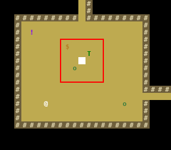
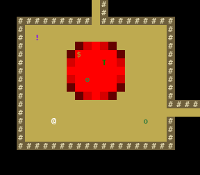
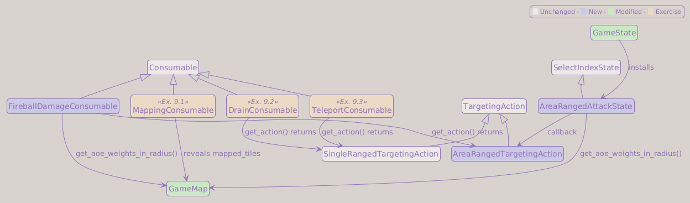
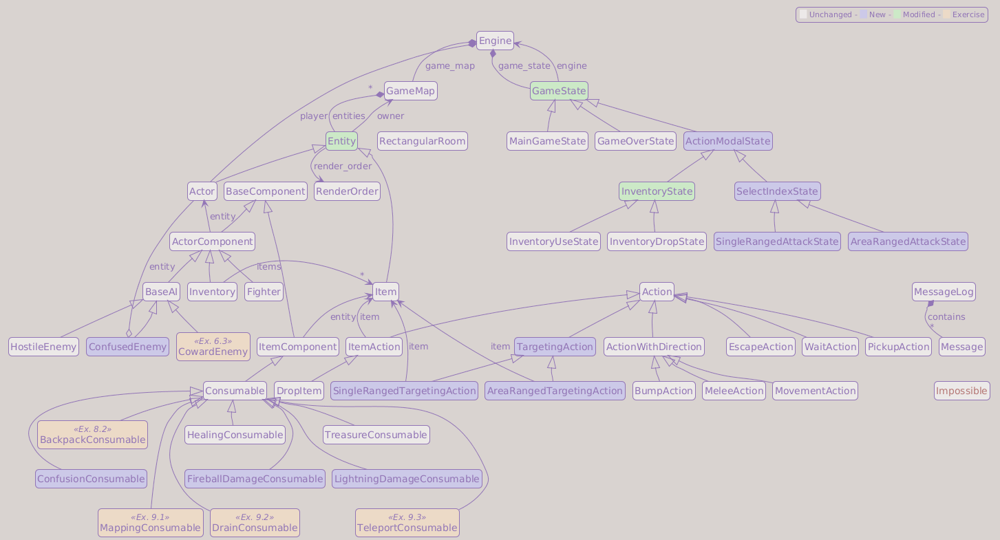

# Part 9b: Area of Effect

In **Part 9a** the player got a targeting cursor and two scrolls: lightning strikes the nearest enemy, and confusion makes a chosen enemy stumble around. This part adds the fireball, a spell that hits every actor in an area, and teaches the cursor to show that area before the player commits.

## What You Will Build

By the end of Part 9b, the player can throw a fireball. A red circle follows the cursor and shows the tiles the blast will reach. Walls shield the tiles behind them, and actors near the edge of the blast take less damage than those at its center.

## Learning goals

In this part we will:

- Add a second targeting state that previews an Area of Effect (AoE)
- Draw a circle on a grid, and stop it at walls with a line-of-sight check
- Soften the edge of the circle, and take the damage from the same numbers as the preview
- Build the fireball in three steps, and play each one

---

## Background

This section is for reading; there is nothing to type yet. If you want to start building right away, skip to [Step 1: Square outline](#step-1-square-outline). You can come back here at any time, even after you finish the tutorial, when you know the game from the inside and some of these ideas will mean more.

### A preview the player can trust

An area spell asks the player to make a decision: where to aim so that the blast catches the enemies and misses the player. The highlighted area is the only information they have for that decision. If the highlight shows one shape and the damage uses another, the player soon learns that the preview lies, and stops trusting it.

So the rule for this part is simple: **the preview and the damage must come from the same data**. We will not get there in one go:

1. Step 1 draws a quick square while the damage uses the real distance. You will see them disagree.
2. Step 2 computes one mask of the tiles the blast reaches, and uses it for both.
3. Step 3 replaces the mask with weights between 0 and 1. The preview fades at the edge, and the damage fades with it.

### Circles on a grid

On a grid, a circle is a set of tiles: each tile is either in or out. The obvious test, `dx² + dy² <= r²`, keeps every tile whose center lies within the radius. It is correct, but the result looks lumpy: with `r = 3`, each side of the circle ends in a single tile that sticks out.

Grid circles look best when their edge falls on the *boundary between* tiles, not through the middle of a tile. In practice that means a radius of 3.5 instead of 3.

So the test we want is `dx² + dy² <= (r + 0.5)²`, which expands to `r² + r + 0.25`. For whole-number `dx`, `dy`, and `r`, the left side is always a whole number, so the `0.25` can never change the result: `r² + r` gives exactly the same tiles with no floats at all.

Amit Patel's [Circle drawing on a grid](https://www.redblobgames.com/grids/circle-drawing/) (Red Blob Games) shows the difference interactively.

A wall must also stop the blast. To decide whether a tile is shielded, we trace a straight line from the center of the blast to the tile and check each tile on the way. This is the same question the field of view answers for the player's eyes: can you see from here to there?

---

## Step 1: Square outline

The first version of the fireball works, but it is crude: a square preview, and a damage rule that ignores walls. It is enough to throw a fireball, and to see why the next two steps are needed.

### AreaRangedTargetingAction

In Part 9a, `SingleRangedTargetingAction` carried a prompt and a callback. An area spell must also tell the targeting state how big the area is and what color to paint it. The new action stores a color, so import `Color` at the top of `game/actions.py`:

```diff
 from game.data import colors
+from game.data.colors import Color
 from game.entities.entity import Actor, Item
```

Then add the class after `SingleRangedTargetingAction`:

```python
class AreaRangedTargetingAction(TargetingAction):

    def __init__(
        self,
        item: Item,
        radius: int,
        color: Color,
        prompt: str = "Select a target location.",
    ) -> None:
        self.item     = item
        self.radius   = radius
        self.color    = color
        self.prompt   = prompt
        self.callback = lambda pos: ItemAction(item=item, target_pos=pos)
```

Like its sibling, it only holds data. `GameState.handle_events()` reads `radius`, `color`, and `callback` when it installs the targeting state.

### AreaRangedAttackState

`AreaRangedAttackState` extends `SelectIndexState` and asks the player to pick an explosion center. It highlights the affected area on every frame, so the player can see which tiles will be hit before confirming.

The state does not hardcode a color. Different spells may want different highlight colors, so `color` is passed as a parameter alongside `radius`. The calling consumable decides which color to use. Add `FIREBALL_AOE` to `game/data/colors.py`:

```python
FIREBALL_AOE = Color(255, 0, 0)
```

Keep it as its own constant rather than reusing the scroll's item color, so you can change the blast color later without changing the scroll.

Add the class to `game/game_states.py`:

```python
class AreaRangedAttackState(SelectIndexState):
    """Shows an Area of Effect (AoE) radius and asks the player to confirm."""

    def __init__(
        self,
        engine: Engine,
        radius: int,
        color: Color,
        callback: Callable[[tuple[int, int]], Action],
    ) -> None:
        super().__init__(engine)
        self.radius   = radius
        self.color    = color
        self.callback = callback

    def on_index_selected(self, x: int, y: int) -> Action | None:
        return self.callback((x, y))
```

The `on_render` method draws the preview, and we will rewrite it in each step. The simplest version draws a rectangular frame around the cursor. Add it to the class:

```python
def on_render(self, console: tcod.console.Console) -> None:
    super().on_render(console)

    x, y = self.engine.mouse_location
    diameter = self.radius * 2 + 1
    console.draw_frame(
        x      = x - self.radius,
        y      = y - self.radius,
        width  = diameter,
        height = diameter,
        fg     = self.color,
        bg     = None,
        clear  = False,
    )
```

`draw_frame` draws a rectangle outline. `clear=False` leaves the tiles inside untouched.

### FireballDamageConsumable

In `game/entities/components/consumable.py`, import the new targeting action:

```diff
 from game.actions import (
+    AreaRangedTargetingAction,
     ItemAction,
     SingleRangedTargetingAction,
 )
```

Then add the consumable next to `ConfusionConsumable`:

```python
class FireballDamageConsumable(Consumable):

    def __init__(self, damage: float, radius: int) -> None:
        self.damage = damage
        self.radius = radius

    def get_action(self, _consumer: Actor, _engine: Engine) -> Action:
        return AreaRangedTargetingAction(
            item   = self.entity,
            radius = self.radius,
            color  = colors.FIREBALL_AOE,
            prompt = "Select a target location.",
        )

    def activate(self, action: ItemAction, engine: Engine, _consumer: Actor) -> None:
        if action.target_pos is None:
            raise Impossible("You need to select a target")

        target_pos = action.target_pos

        if not engine.game_map.visible[target_pos]:
            raise Impossible("You cannot target an area you cannot see.")

        x, y = target_pos
        targets_hit = False
        for actor in engine.game_map.actors:
            if actor.distance(x, y) <= self.radius:
                MessageLog.add_message(
                    f"The {actor.name} is engulfed in a fiery explosion,"
                    f" taking {self.damage:.1f} damage!",
                    colors.PLAYER_ATTACK,
                )
                actor.fighter.take_damage(self.damage)
                targets_hit = True

        if not targets_hit:
            raise Impossible("There are no targets in the radius.")

        self.consume()
```

`get_action()` returns an `AreaRangedTargetingAction`, so `handle_events()` will install an `AreaRangedAttackState`. On confirm, `activate()` hits every actor whose distance to the target is at most `radius`, and that includes the player. It raises `Impossible` if the target tile is not visible or if no actor was hit; in both cases the scroll stays in the inventory.

### The fireball scroll

The scroll is registered like the two scrolls of Part 9a. If you skipped Part 8 Exercise 3, leave out the `keys.py` line and the `key=` line; if you did Exercise 3 but not 4, write `key=tcod.event.KeySym.F` instead of the constant.

`game/data/sprites.py`:

```diff
 CONFUSION_SCROLL = "~"
+FIREBALL_SCROLL  = "~"
 LIGHTNING_SCROLL = "~"
```

`game/data/colors.py`:

```diff
 CONFUSION_SCROLL = Color(207,  63, 255)
+FIREBALL_SCROLL  = Color(255,   0,   0)
 LIGHTNING_SCROLL = Color(255, 255,   0)
```

`game/data/keys.py`:

```diff
 CONFUSION_SCROLL = tcod.event.KeySym.C
+FIREBALL_SCROLL  = tcod.event.KeySym.F
 LIGHTNING_SCROLL = tcod.event.KeySym.L
```

In `game/entities/factories.py`, import the consumable:

```diff
     ConfusionConsumable,
+    FireballDamageConsumable,
     HealingConsumable,
```

Add the template after `confusion_scroll`:

```python
fireball_scroll = Item(
    char       = sprites.FIREBALL_SCROLL,
    color      = colors.FIREBALL_SCROLL,
    name       = "Fireball Scroll",
    consumable = FireballDamageConsumable(damage=12.0, radius=3),
    # Part-8. Exercise 3: Persistent item keys
    key        = keys.FIREBALL_SCROLL,       # Part-8. Exercise 4: Item hotkey constants and key_label
)
```

The fireball deals 12 damage over radius 3. Finally, let it spawn:

```diff
     (confusion_scroll, 15),
+    (fireball_scroll,  15),
     (lightning_scroll, 15),
 ]
```

### Dispatch the AoE state

The targeting branch that Part 9a added to `GameState.handle_events()` gets a second case:

```diff
                 if isinstance(action, SingleRangedTargetingAction):
                     self.engine.game_state = SingleRangedAttackState(
                         self.engine,
                         callback = action.callback,
                     )
+
+                elif isinstance(action, AreaRangedTargetingAction):
+                    self.engine.game_state = AreaRangedAttackState(
+                        self.engine,
+                        radius   = action.radius,
+                        color    = action.color,
+                        callback = action.callback,
+                    )

                 return
```

Import the new action at the top of `game_states.py`:

```diff
 from game.actions import (
     Action,
+    AreaRangedTargetingAction,
     BumpAction,
```

!!! tip "Run it now"
    If you run the game now, you can throw a fireball. Pick up a red `~`, use it, and move the cursor: a red square follows it. Confirm near a group of enemies and they burn. Keep your distance, because the blast hits you too.

    Look closely and you can see the problem this part is about. Aim so that an enemy stands in a corner of the square: it takes no damage, because `activate()` uses the real distance, and the corners of the square are farther away than the radius. Then aim next to a wall: the enemies on the other side burn too, because nothing checks for walls yet. The preview and the damage disagree, and Step 2 fixes both. Seeing the bug before you fix it is a good habit: afterwards you know exactly what the fix changed.



---

## Step 2: True circle

To make the preview and the damage agree, we need one answer to the question "which tiles does the blast reach?", and both must use it. Computing that answer takes a few helper methods in `GameMap`.

First add small tile-query helpers. They keep the AoE code readable and give us one place to define what counts as blocking:

```python
def is_transparent(self, x: int, y: int) -> bool:
    if not self.in_bounds(x, y):
        return False

    return bool(self.tiles["transparent"][x, y])

def is_opaque(self, x: int, y: int) -> bool:
    return not self.is_transparent(x, y)

def is_walkable(self, x: int, y: int) -> bool:
    if not self.in_bounds(x, y):
        return False

    return bool(self.tiles["walkable"][x, y])

def is_blocking(self, x: int, y: int) -> bool:
    return not self.is_walkable(x, y)
```

Now add two straight-line checks. They share the same shape, but answer different gameplay questions:

- **`has_line_of_sight`** asks whether vision can pass along the line, so it uses `is_opaque`.
- **`has_line_of_movement`** asks whether a straight-line path can be traversed, so it uses `is_blocking`.

The fireball AoE uses `has_line_of_sight`, so the blast follows the same rule as vision: opaque tiles stop it, transparent tiles do not.

`has_line_of_movement` has the same shape but answers a different question: can something travel along this straight line, or does a non-walkable tile block it? Part 9 never calls it. We write it now, next to its twin, because it is what a straight-line movement effect needs, such as a charge or dash spell that must stop at the first wall.

Both use `tcod.los`, and the AoE helpers below use `math`, so update the imports at the top of `game/map/game_map.py`:

```diff
 from __future__ import annotations

+import math
 from collections.abc import Iterable, Iterator
 from typing import TYPE_CHECKING

 import numpy as np
+import tcod
 from tcod.console import Console
```

```python
def has_line_of_sight(self, origin_x: int, origin_y: int, target_x: int, target_y: int) -> bool:
    if not self.in_bounds(origin_x, origin_y) or not self.in_bounds(target_x, target_y):
        return False

    if self.is_opaque(origin_x, origin_y):
        return False

    if self.is_opaque(target_x, target_y):
        return False

    path = tcod.los.bresenham((origin_x, origin_y), (target_x, target_y))
    for x, y in path[1:-1]:
        if self.is_opaque(x, y):
            return False

    return True

def has_line_of_movement(self, origin_x: int, origin_y: int, target_x: int, target_y: int) -> bool:
    if not self.in_bounds(origin_x, origin_y) or not self.in_bounds(target_x, target_y):
        return False

    if self.is_blocking(origin_x, origin_y):
        return False

    if self.is_blocking(target_x, target_y):
        return False

    path = tcod.los.bresenham((origin_x, origin_y), (target_x, target_y))
    for x, y in path[1:-1]:
        if self.is_blocking(x, y):
            return False

    return True
```

!!! info "`tcod.los.bresenham`"
    `tcod.los.bresenham((x0, y0), (x1, y1))` returns a numpy array of `(x, y)` integer pairs tracing the straight line from `(x0, y0)` to `(x1, y1)`, endpoints included. It uses the [Bresenham line algorithm](https://en.wikipedia.org/wiki/Bresenham%27s_line_algorithm): integer arithmetic only, no floating-point rounding. We slice `path[1:-1]` to skip origin and target since both line helpers already verified those tiles above; only the intermediate cells determine whether the line is clear.

**`get_aoe_tiles_in_radius`** returns a boolean numpy mask of every tile within radius that has line of sight to the center:

```python
def get_aoe_tiles_in_radius(self, center_x: int, center_y: int, radius: float) -> np.ndarray:
    area = np.zeros((self.width, self.height), dtype=bool, order="F")

    if not self.in_bounds(center_x, center_y):
        return area

    if radius < 0:
        return area

    if self.is_blocking(center_x, center_y):
        return area

    min_x = max(0,           math.floor(center_x - radius))
    max_x = min(self.width,  math.ceil( center_x + radius) + 1)
    min_y = max(0,           math.floor(center_y - radius))
    max_y = min(self.height, math.ceil( center_y + radius) + 1)

    radius_sqr = radius * radius + radius
    for y in range(min_y, max_y):
        dy = y - center_y
        dy_sqr = dy * dy
        for x in range(min_x, max_x):
            dx = x - center_x
            if dx * dx + dy_sqr > radius_sqr:
                continue

            if self.has_line_of_sight(center_x, center_y, x, y):
                area[x, y] = True

    return area
```

The circle test compares squared distances, which is mathematically equivalent to comparing distances but avoids `math.sqrt` entirely. The line-of-sight check then cuts out tiles that an opaque wall would shield.

The threshold is `r² + r`, not `r²`. The plain `dx² + dy² <= r²` test is correct, but on a grid it looks lumpy: with `r = 3`, each side of the circle ends in a single tile that sticks out. The extra `+ r` fixes that. The Background section [Circles on a grid](#circles-on-a-grid) explains why.

Only this yes/no helper uses `r² + r`. The weighted version in Step 3 already fades its edge smoothly, so it keeps the plain radius.

Now use the mask in both places. Rewrite `on_render` to highlight the matching tiles:

```python
def on_render(self, console: tcod.console.Console) -> None:
    super().on_render(console)

    x, y = self.engine.mouse_location
    game_map = self.engine.game_map
    aoe = game_map.get_aoe_tiles_in_radius(x, y, self.radius)
    console.bg[0 : game_map.width, 0 : game_map.height][aoe] = self.color
```

`console.bg` is a numpy array of shape `(width, height, 3)`. Indexing it with a boolean mask sets the background color of every `True` tile in one operation.

The mask has the map's shape, `(80, 44)`, but the console is `(80, 50)`: the extra rows hold the HUD. numpy refuses a mask whose shape does not match the array, so we first slice the console down to the map area, the same slice `GameMap.render` uses for `console.rgb`.

!!! note "Shorthand aliases"
    `console.bg` and `console.fg` are shorthand for `console.rgb["bg"]` and `console.rgb["fg"]`. You may see either form in tcod documentation or other tutorials.

    They are not deprecated, but the explicit form is clearer. The name `console.bg` does not say which buffer it reads: `console.rgb` stores colors as RGB, while `console.rgba` adds an alpha channel. `console.rgb["bg"]` makes that clear at the call site. This tutorial keeps the short form because it is easier to read in small listings; in your own code, prefer the explicit one.


Then make the fireball hit exactly the highlighted tiles. In `FireballDamageConsumable.activate()`:

```diff
         x, y = target_pos
+        target_area = engine.game_map.get_aoe_tiles_in_radius(x, y, self.radius)
         targets_hit = False
         for actor in engine.game_map.actors:
-            if actor.distance(x, y) <= self.radius:
+            if target_area[actor.x, actor.y]:
                 MessageLog.add_message(
```

`activate()` now asks the same question as `on_render`, with the same arguments, so every highlighted actor is hit and no other actor is.

!!! tip "Run it now"
    If you run the game now, the preview is a circle that ends at walls. Aim next to a wall: the tiles behind it stay dark, and the enemies standing there are safe. Every actor inside the red area takes the full 12 damage.


---

## Step 3: Antialiased circle

The circle above has a hard edge: each tile is either fully highlighted or not. Tiles right at the boundary look jagged. We can soften this by giving edge tiles a fractional weight.

`get_aoe_weights_in_radius` is the antialiased upgrade of `get_aoe_tiles_in_radius`: the same circle-and-line-of-sight logic, but it returns graded weights instead of a hard yes/no mask. We keep both on purpose. The boolean version stays as the cheaper primitive for any code that only needs to know *whether* a tile is in the blast (no float weights to carry); the weighted version is what the fireball uses, because it drives the smooth preview and the damage falloff from the same numbers.

Add `get_aoe_weights_in_radius` to `GameMap`. It returns a `float32` array where interior tiles carry `1.0` and edge tiles carry a value between `0.0` and `1.0`:

```python
def get_aoe_weights_in_radius(self, center_x: int, center_y: int, radius: float) -> np.ndarray:
    weights = np.zeros((self.width, self.height), dtype=np.float32, order="F")

    if not self.in_bounds(center_x, center_y):
        return weights

    if radius < 0:
        return weights

    if self.is_blocking(center_x, center_y):
        return weights

    min_x = max(0,           math.floor(center_x - radius - 1.0))
    max_x = min(self.width,  math.ceil( center_x + radius + 1.0) + 1)
    min_y = max(0,           math.floor(center_y - radius - 1.0))
    max_y = min(self.height, math.ceil( center_y + radius + 1.0) + 1)

    for y in range(min_y, max_y):
        dy = y - center_y
        for x in range(min_x, max_x):
            dx = x - center_x
            dist = math.hypot(dx, dy)

            if dist > radius + 1.0:
                continue

            if not self.has_line_of_sight(center_x, center_y, x, y):
                continue

            if dist <= radius:
                alpha = 1.0
            else:
                alpha = max(0.0, 1.0 - (dist - radius))

            weights[x, y] = alpha

    return weights
```

Unlike Step 2's `get_aoe_tiles_in_radius`, which only needed a yes/no threshold and so compared squared distances to avoid `math.sqrt`, here we need the *actual* fractional distance to compute the edge fade, so `math.hypot(dx, dy)` is the right tool (the same one we used in `Entity.distance`). Tiles within `radius` get `alpha = 1.0`. Tiles in the one-unit border zone get a linear fade down to `0.0`. Tiles beyond `radius + 1` are skipped.

Update `on_render` to scale the highlight color by each tile's weight. Add this import to `game/game_states.py`:

```diff
 from __future__ import annotations

+import math
 from collections.abc import Callable
 from typing import TYPE_CHECKING
```

Then the final `on_render`:

```python
def on_render(self, console: tcod.console.Console) -> None:
    super().on_render(console)

    x, y = self.engine.mouse_location

    weights = self.engine.game_map.get_aoe_weights_in_radius(x, y, self.radius)
    width  = self.engine.game_map.width
    height = self.engine.game_map.height
    min_x = max(0,      math.floor(x - self.radius - 1.0))
    max_x = min(width,  math.ceil( x + self.radius + 1.0) + 1)
    min_y = max(0,      math.floor(y - self.radius - 1.0))
    max_y = min(height, math.ceil( y + self.radius + 1.0) + 1)

    for grid_y in range(min_y, max_y):
        for grid_x in range(min_x, max_x):
            alpha = weights[grid_x, grid_y]
            if alpha > 0:
                console.bg[grid_x, grid_y] = self.color.scale(alpha)
```

The bounds `min_x/max_x/min_y/max_y` are precomputed to avoid iterating the entire map on every render frame. `Color.scale(factor)` multiplies each RGB channel by `factor` and rounds to the nearest integer; it is the method we added to `Color` back in Part 5. At `factor = 1.0` the color is unchanged; at `factor = 0.5` it is half as bright.



The damage follows the same weights. In `FireballDamageConsumable.activate()`:

```diff
         x, y = target_pos
-        target_area = engine.game_map.get_aoe_tiles_in_radius(x, y, self.radius)
+        target_area = engine.game_map.get_aoe_weights_in_radius(x, y, self.radius)
         targets_hit = False
         for actor in engine.game_map.actors:
-            if target_area[actor.x, actor.y]:
+            weight = float(target_area[actor.x, actor.y])
+            if weight > 0.0:
+                damage = self.damage * weight
                 MessageLog.add_message(
                     f"The {actor.name} is engulfed in a fiery explosion,"
-                    f" taking {self.damage:.1f} damage!",
+                    f" taking {damage:.1f} damage!",
                     colors.PLAYER_ATTACK,
                 )
-                actor.fighter.take_damage(self.damage)
+                actor.fighter.take_damage(damage)
                 targets_hit = True
```

Actors within the radius receive the full `damage`; actors in the outer ring receive a fraction proportional to their weight (between 0.0 and 1.0).

!!! note "Damage falloff at the edges"
    Using `get_aoe_weights_in_radius` instead of `get_aoe_tiles_in_radius` ties the damage model directly to the visual one: the gradient the player sees on screen is the same gradient that determines how hard each actor is hit. Actors fully inside the radius take `damage × 1.0`; actors in the antialiased outer ring take proportionally less. This makes the highlighted area a real indicator, not decoration.

---

## Testing Part 9b

Run the game with `uv run main.py` (or `python main.py`):

- [ ] Red `~` fireball scrolls appear on the floor, next to the purple and yellow scrolls of Part 9a
- [ ] Using a fireball scroll opens AoE targeting: a red circle with a soft edge follows the cursor
- [ ] Tiles behind a wall are not highlighted, and enemies standing there are not hit
- [ ] Enemies well inside the circle take 12 damage; enemies on the faded edge take less
- [ ] The fireball damages all actors in the area, including the player
- [ ] Confirming where no actor would be hit shows a message and keeps the scroll
- [ ] Pressing Escape during targeting cancels and keeps the scroll
- [ ] Lightning and confusion still work as in Part 9a

!!! danger "Fireball can hit you"
    The fireball does not exempt the player from its AoE, this is intentional. Don't stand in the blast radius.

---

## Summary

The targeting system now handles areas too. Key additions:

- **`AreaRangedTargetingAction`**: carries `radius` and `color` in addition to `prompt` and `callback`
- **`AreaRangedAttackState`**: previews the area under the cursor
- **`GameMap` tile queries**: `is_transparent`, `is_opaque`, `is_walkable`, `is_blocking`
- **Line checks**: `has_line_of_sight` and `has_line_of_movement`, built on `tcod.los.bresenham`
- **AoE helpers**: `get_aoe_tiles_in_radius` (a yes/no mask) and `get_aoe_weights_in_radius` (weights for a soft edge)
- **`FireballDamageConsumable`**: damage scaled by the same weights the preview draws

**Current architecture**:

- Targeting states are temporary input states layered on top of normal gameplay
- Targeting consumables return a `TargetingAction`; `handle_events()` installs the state and shows the prompt, with no involvement from the consumable
- `ItemAction` carries both the selected item and optional target position
- AI can be swapped at runtime, as with `ConfusedEnemy`
- Dependency direction is strictly one-way: `game_states` → `actions` ← `consumable`
- The AoE preview and the fireball damage read the same weights, so the highlighted area is exactly what gets hit

**Local Class Diagram**:



**Full Class Diagram**:



**File structure**:

```text
main.py
game/
├── __init__.py
├── actions.py                  ← modified
├── engine.py
├── exceptions.py
├── hud.py
├── game_states.py              ← modified
├── message_log.py
├── data/
│   ├── __init__.py
│   ├── colors.py               ← modified
│   ├── keys.py                 ← modified
│   └── sprites.py              ← modified
├── entities/
│   ├── __init__.py
│   ├── entity.py
│   ├── factories.py            ← modified
│   ├── render_order.py
│   └── components/
│       ├── __init__.py
│       ├── ai.py
│       ├── base_component.py
│       ├── consumable.py       ← modified
│       ├── fighter.py
│       └── inventory.py
└── map/
    ├── __init__.py
    ├── game_map.py             ← modified
    ├── tile_types.py
    └── map_generator.py
```

---

## Exercises

The next parts assume you did these exercises. Try each one on your own first. If one is too hard for now, do not let it stop you: where a reference solution is given, read it and type it in, and when a later part builds on an exercise, it points out the code that comes from it.

Each exercise adds a new scroll. Register it the same way Parts 9a and 9b registered the spell scrolls: a sprite, a color, a template in `factories.py`, and an entry in `item_chances`. If you did Part 8 Exercises 3 and 4, give it a hotkey too. Name the templates `mapping_scroll`, `drain_scroll`, and `teleport_scroll`: Part 12 refers to them by those names when it rebuilds the item table.

??? note "Reference: registering the three scrolls"
    `game/data/sprites.py`:

    ```diff
     LIGHTNING_SCROLL = "~"
    +MAPPING_SCROLL   = "~"  # Part-9. Exercise 1: Scroll of mapping
    +DRAIN_SCROLL     = "~"  # Part-9. Exercise 2: Drain scroll
    +TELEPORT_SCROLL  = "~"  # Part-9. Exercise 3: Teleport scroll
    ```

    `game/data/colors.py`:

    ```diff
     LIGHTNING_SCROLL    = Color(255, 255,   0)
    +MAPPING_SCROLL      = Color(127, 191, 255)  # Part-9. Exercise 1: Scroll of mapping
    +DRAIN_SCROLL        = Color(127, 255,  63)  # Part-9. Exercise 2: Drain scroll
    +TELEPORT_SCROLL     = Color(255,  63, 191)  # Part-9. Exercise 3: Teleport scroll
    ```

    `game/data/keys.py` (only with Part 8 Exercises 3 and 4). `D` already drops items, so the drain scroll uses `R`:

    ```diff
     LIGHTNING_SCROLL = tcod.event.KeySym.L
    +MAPPING_SCROLL   = tcod.event.KeySym.M  # Part-9. Exercise 1: Scroll of mapping
    +DRAIN_SCROLL     = tcod.event.KeySym.R  # Part-9. Exercise 2: Drain scroll
    +TELEPORT_SCROLL  = tcod.event.KeySym.T  # Part-9. Exercise 3: Teleport scroll
    ```

    `game/entities/factories.py`, the imports:

    ```diff
         ConfusionConsumable,
    +    DrainConsumable,  # Part-9. Exercise 2: Drain scroll
         FireballDamageConsumable,
         HealingConsumable,
         LightningDamageConsumable,
    +    MappingConsumable,  # Part-9. Exercise 1: Scroll of mapping
    +    TeleportConsumable,  # Part-9. Exercise 3: Teleport scroll
         TreasureConsumable,
    ```

    The templates, after `lightning_scroll`:

    ```python
    # Part-9. Exercise 1: Scroll of mapping
    mapping_scroll = Item(
        char       = sprites.MAPPING_SCROLL,
        color      = colors.MAPPING_SCROLL,
        name       = "Mapping Scroll",
        consumable = MappingConsumable(),
        # Part-8. Exercise 3: Persistent item keys
        key        = keys.MAPPING_SCROLL,       # Part-8. Exercise 4: Item hotkey constants and key_label
    )

    # Part-9. Exercise 2: Drain scroll
    drain_scroll = Item(
        char       = sprites.DRAIN_SCROLL,
        color      = colors.DRAIN_SCROLL,
        name       = "Drain Scroll",
        consumable = DrainConsumable(damage=10.0, maximum_range=5),
        # Part-8. Exercise 3: Persistent item keys
        key        = keys.DRAIN_SCROLL,         # Part-8. Exercise 4: Item hotkey constants and key_label
    )

    # Part-9. Exercise 3: Teleport scroll
    teleport_scroll = Item(
        char       = sprites.TELEPORT_SCROLL,
        color      = colors.TELEPORT_SCROLL,
        name       = "Teleport Scroll",
        consumable = TeleportConsumable(),
        # Part-8. Exercise 3: Persistent item keys
        key        = keys.TELEPORT_SCROLL,      # Part-8. Exercise 4: Item hotkey constants and key_label
    )
    ```

    And the spawn table:

    ```diff
         (lightning_scroll, 15),
    +    (mapping_scroll,   15),  # Part-9. Exercise 1: Scroll of mapping
    +    (drain_scroll,     15),  # Part-9. Exercise 2: Drain scroll
    +    (teleport_scroll,  15),  # Part-9. Exercise 3: Teleport scroll
     ]
    ```

1. **Scroll of mapping**:

    Add a `MappingConsumable` that reveals the whole floor's layout. The design catch is *what* to reveal: the map starts as solid wall, so `explored[:] = True` would also draw all the rock between rooms that no corridor ever reaches. Instead, track which tiles were actually **dug** during generation, in a boolean array filled as rooms and tunnels are dug, and reveal only those.

    The second catch is making the map last. If you did Part 4's fading memory (Exercise 4), `update_fov()` rebuilds `explored` from `memory` on every turn, so anything the scroll adds to `explored` disappears on the next turn, or a few turns later if you also refresh `memory`. A magic map should stay: keep a second array with the tiles the scroll revealed, and include it when `update_fov()` rebuilds `explored`. If you skipped that exercise, `explored` never fades and revealing it once is enough.

    ??? note "Reference implementation"
        Two new arrays in `GameMap.__init__` (`game/map/game_map.py`): the tiles dug during generation, and the tiles a scroll has revealed:

        ```diff
         self.explored = np.full((width, height), fill_value = False, order="F")

        +# Part-9. Exercise 1: Scroll of mapping
        +self.mapped_tiles = np.full((width, height), fill_value=False, order="F")
        +self.revealed     = np.full((width, height), fill_value=False, order="F")
        ```

        An `outer` property on `RectangularRoom` (`game/map/map_generator.py`), the room's bounding box including its surrounding walls:

        ```python
        # Part-9. Exercise 1: Scroll of mapping
        @property
        def outer(self) -> tuple[slice, slice]:
            """The room's bounding box including surrounding walls as numpy slices."""
            return slice(self.x1, self.x2 + 1), slice(self.y1, self.y2 + 1)
        ```

        Fill `mapped_tiles` as `generate_dungeon` digs. When a room is dug:

        ```diff
         dungeon.tiles[new_room.inner] = tile_types.floor
        +dungeon.mapped_tiles[new_room.outer] = True  # Part-9. Exercise 1: Scroll of mapping
        ```

        ...and in the tunnel loop, the tile plus its eight neighbors, so the tunnel walls show too:

        ```diff
         dungeon.tiles[x, y] = tile_types.floor
        +dungeon.mapped_tiles[x-1:x+2, y-1:y+2] = True  # Part-9. Exercise 1: Scroll of mapping
        ```

        The consumable in `game/entities/components/consumable.py`. No targeting is needed, so the base `get_action()` works as-is:

        ```python
        # Part-9. Exercise 1: Scroll of mapping
        class MappingConsumable(Consumable):

            def activate(self, _action: ItemAction, engine: Engine, _consumer: Actor) -> None:
                engine.game_map.revealed |= engine.game_map.mapped_tiles
                engine.game_map.explored |= engine.game_map.mapped_tiles

                MessageLog.add_message(
                    "The scroll reveals the layout of this floor!",
                    colors.STATUS_EFFECT_APPLIED,
                )
                self.consume()
        ```

        With fading memory, `update_fov()` (`game/engine.py`) keeps the revealed tiles explored:

        ```diff
         else:
             # Part-4. Exercise 4: Fading memory
             self.game_map.memory[self.game_map.visible] = self.memory_duration
        -    self.game_map.explored[:] = self.game_map.memory > 0
        +    # Part-9. Exercise 1: Scroll of mapping
        +    self.game_map.explored[:] = (self.game_map.memory > 0) | self.game_map.revealed
        ```

        Only the layout is revealed for good. Monsters and items still appear only when you see them, and ordinary memory still fades as before.

2. **Drain scroll**:

    Add a `DrainConsumable(damage: float, maximum_range: int)` that returns a `SingleRangedTargetingAction` from `get_action()` with prompt `"Select a target to drain."`. The scroll drains HP from the target and transfers the same amount to the player. Compute the actual amount once, capped at what the target has left so a dying enemy cannot over-heal you, and reuse it on both sides: read the target's HP before the hit and set `amount_drained = min(self.damage, target.fighter.hp)`. Apply it with `target.fighter.take_damage(amount_drained)` and `consumer.fighter.heal(amount_drained)` (heal is itself capped at max HP). Show two messages: one for the damage dealt and one for the HP recovered.

    In `activate()`, combine target validation into a single guard (this also prevents targeting corpses with `ai is None`):

    ```python
    if not target or target is consumer or target.ai is None:
        raise Impossible("You must select an enemy to target.")
    ```

    Enforce range explicitly after the visibility check: `consumer.distance(target.x, target.y) > self.maximum_range`. This mirrors how `LightningDamageConsumable` uses its own `maximum_range`.

    ??? note "Reference implementation"
        In `game/entities/components/consumable.py`:

        ```python
        # Part-9. Exercise 2: Drain scroll
        class DrainConsumable(Consumable):

            def __init__(self, damage: float, maximum_range: int) -> None:
                self.damage = damage
                self.maximum_range = maximum_range

            def get_action(self, _consumer: Actor, _engine: Engine) -> Action:
                return SingleRangedTargetingAction(
                    item   = self.entity,
                    prompt = "Select a target to drain.",
                )

            def activate(self, action: ItemAction, engine: Engine, consumer: Actor) -> None:
                if action.target_pos is None:
                    raise Impossible("You need to select a target")

                target = engine.game_map.get_actor_at(*action.target_pos)

                if not target or target is consumer or target.ai is None:
                    raise Impossible("You must select an enemy to target.")

                if not engine.game_map.visible[target.x, target.y]:
                    raise Impossible("You cannot target an area you cannot see.")

                if consumer.distance(target.x, target.y) > self.maximum_range:
                    raise Impossible("That target is too far away.")

                amount_drained = min(self.damage, target.fighter.hp)

                MessageLog.add_message(
                    f"You drain {amount_drained:.1f} HP from the {target.name}!",
                    colors.PLAYER_ATTACK,
                )
                target.fighter.take_damage(amount_drained)

                amount_recovered = consumer.fighter.heal(amount_drained)
                MessageLog.add_message(
                    f"You recover {amount_recovered:.1f} HP!",
                    colors.HEALTH_RECOVERED,
                )
                self.consume()
        ```

        The damage message comes before `take_damage()`, so if the hit kills the target, its death message appears after the drain message, in the order things happened.

3. **Teleport scroll**:

    Add a `TeleportConsumable` that returns a `SingleRangedTargetingAction` from `get_action()` with prompt `"Select a destination."`. The destination must be in bounds, explored, and walkable. Also check that no blocking entity (another actor) occupies the tile:

    ```python
    blocking_entity = game_map.get_blocking_entity_at(x, y)
    if blocking_entity is not None and blocking_entity is not consumer:
        raise Impossible("You cannot teleport onto another actor.")
    ```

    Once the destination passes every check, move the player there with `consumer.place(x, y, game_map)` and log the teleport.

    ??? note "Reference implementation"
        In `game/entities/components/consumable.py`:

        ```python
        # Part-9. Exercise 3: Teleport scroll
        class TeleportConsumable(Consumable):

            def get_action(self, _consumer: Actor, _engine: Engine) -> Action:
                return SingleRangedTargetingAction(
                    item   = self.entity,
                    prompt = "Select a destination.",
                )

            def activate(self, action: ItemAction, engine: Engine, consumer: Actor) -> None:
                if action.target_pos is None:
                    raise Impossible("You need to select a target")

                x, y = action.target_pos
                game_map = engine.game_map

                if not game_map.in_bounds(x, y):
                    raise Impossible("You cannot teleport out of the map.")

                if not game_map.explored[x, y]:
                    raise Impossible("You cannot teleport to a place you have not explored.")

                if not game_map.is_walkable(x, y):
                    raise Impossible("You cannot teleport into a wall.")

                blocking_entity = game_map.get_blocking_entity_at(x, y)
                if blocking_entity is not None and blocking_entity is not consumer:
                    raise Impossible("You cannot teleport onto another actor.")

                consumer.place(x, y, game_map)
                for item in engine.game_map.get_items_at(consumer.x, consumer.y):
                    item.consumable.on_contact(engine=engine, consumer=consumer)
                MessageLog.add_message("You teleport!", colors.STATUS_EFFECT_APPLIED)
                self.consume()
        ```

        The loop after `place()` is the auto-collect step explained in the tip below.

!!! tip "Auto-collect and teleport"
    `TeleportConsumable` calls `consumer.place()` directly, which bypasses the `on_contact` check in `MovementAction`. A player who teleports onto a chest will not pick it up automatically unless you add the same call after `consumer.place()`:

    ```diff
         consumer.place(x, y, game_map)
    +    for item in engine.game_map.get_items_at(consumer.x, consumer.y):
    +        item.consumable.on_contact(engine=engine, consumer=consumer)
         MessageLog.add_message("You teleport!", ...)
    ```

    The message is logged *after* the contact loop so that "You found X gold!" appears before "You teleport!" in the log.
